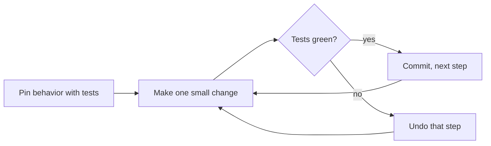

:::objectives
- Define refactoring precisely and explain why tests must come first.
- Name common code smells and the standard refactoring that fixes each.
- Apply extract function and named constants, and check that the output is unchanged.
- Explain each SOLID principle with a concrete Python example, and know when not to apply it.
:::

Your teacher likes the quiz report your program prints and asks for one small change: "Can I also get it as a CSV file for the gradebook?" Here's the function.

```python run title="quiz_report.py"
def print_report(results):
    print("QUIZ REPORT")
    best_name = ""
    best_avg = -1
    for name, scores in results:
        total = 0
        for s in scores:
            total += s
        avg = round(total / len(scores) * 10, 1)
        if avg >= 90:
            grade = "A"
        elif avg >= 80:
            grade = "B"
        elif avg >= 70:
            grade = "C"
        else:
            grade = "F"
        print(f"{name:<6}{avg:>6}%  {grade}")
        if avg > best_avg:
            best_avg = avg
            best_name = name
    class_total = 0
    count = 0
    for name, scores in results:
        for s in scores:
            class_total += s
            count += 1
    print(f"Class average: {round(class_total / count * 10, 1)}%")
    print(f"Top student: {best_name}")


print_report([("Ana", [9, 10, 8]), ("Ben", [7, 6, 8]), ("Cy", [10, 9, 9])])
```

It works. But every calculation is tangled up with a `print`, so a CSV version means copying the whole function and changing the output parts. Then there are two copies of the grading rules, and the next time the A cutoff changes, one of them will be missed. The code isn't wrong; it's hard to *change*. That's what this lesson is about.

## Refactoring means same behavior, better shape

**Refactoring** is changing the structure of code without changing what it does. Same inputs, same outputs, same errors; only the inside moves. Fixing a bug isn't refactoring, and neither is adding a feature. Keeping those separate is the main discipline: refactor first to make the change easy, then make the change.

How do you know the behavior didn't change? You don't, unless something checks. So refactoring starts with tests that pin down what the code does *now*, even the odd parts. These are called **characterization tests**. Then you work in small steps (one rename, one extracted function) and rerun the tests after each one. If a test goes red, the last small step is the culprit, and you undo it.



## Smells: signs that a change will hurt

A **code smell** is a surface pattern that usually means a deeper design problem. It isn't a bug, and a smell is sometimes fine. But each one has a well-known refactoring, with a name you can look up:

| Smell | What it looks like | Usual refactoring |
| --- | --- | --- |
| Long function | One function does several jobs; you scroll to read it | Extract Function |
| Duplicated code | The same rule written twice (the average, above) | Extract Function, then call it from both places |
| Magic numbers | `90`, `* 10`, `0.8` with no name | Replace Magic Number with Named Constant |
| Data clumps | The same 3 or 4 values passed around together | Introduce Parameter Object (often a dataclass) |
| Primitive obsession | Dicts and strings standing in for real concepts | Extract Class |
| Type switch | `if q["type"] == "mc": ... elif ...` in several functions | Replace Conditional with Polymorphism |
| Feature envy | A method that mostly uses another object's data | Move Method to that object |

`print_report` has the first three. Here it is after extracting functions and naming the numbers. The last line checks that the old and new versions print exactly the same text, which is a characterization test in its simplest form.

```python run title="quiz_report_refactored.py"
import contextlib
import io

POINTS_PER_QUESTION = 10
GRADE_CUTOFFS = [(90, "A"), (80, "B"), (70, "C")]


def percent(scores: list[int]) -> float:
    return round(sum(scores) / len(scores) * POINTS_PER_QUESTION, 1)


def letter(pct: float) -> str:
    for cutoff, grade in GRADE_CUTOFFS:
        if pct >= cutoff:
            return grade
    return "F"


def summarize(results: list[tuple[str, list[int]]]) -> tuple[list[tuple[str, float, str]], float, str]:
    rows = [(name, percent(scores), letter(percent(scores))) for name, scores in results]
    every_score = [s for _, scores in results for s in scores]
    top = max(rows, key=lambda row: row[1])[0]
    return rows, percent(every_score), top


def print_report(results: list[tuple[str, list[int]]]) -> None:
    rows, class_avg, top = summarize(results)
    print("QUIZ REPORT")
    for name, pct, grade in rows:
        print(f"{name:<6}{pct:>6}%  {grade}")
    print(f"Class average: {class_avg}%")
    print(f"Top student: {top}")


def write_csv(results: list[tuple[str, list[int]]]) -> str:
    rows, _, _ = summarize(results)
    return "\n".join(["name,percent,grade"] + [f"{n},{p},{g}" for n, p, g in rows])


results = [("Ana", [9, 10, 8]), ("Ben", [7, 6, 8]), ("Cy", [10, 9, 9])]
print_report(results)
print(write_csv(results))

buffer = io.StringIO()
with contextlib.redirect_stdout(buffer):
    print_report(results)
expected = "QUIZ REPORT\nAna     90.0%  A\nBen     70.0%  C\nCy      93.3%  A\nClass average: 84.4%\nTop student: Cy\n"
print("unchanged:", buffer.getvalue() == expected)
```

The averaging rule exists once, in `percent`. The grading rule exists once, in `letter`. And the CSV the teacher asked for took a three-line function, because `summarize` does the math without printing anything.

## SOLID, one small example at a time

SOLID is five design principles collected by Robert C. Martin. Each one is a response to a specific kind of pain, so learn them through the pain, not as rules.

**S: Single responsibility.** A class or function should have one reason to change. You just applied it: `summarize` changes when the *math* changes, `print_report` and `write_csv` change when a *format* changes. Before, all three reasons landed on one function.

**O: Open/closed.** Code should be open to new behavior without editing what already works. A quiz with several question types is the classic case. Instead of `if q["type"] == ...` in every function that marks answers, each type is a class with a `check` method. Step through and watch `q.check(r)` land in two different classes:

:::trace One line of score(), two different check() methods
```python
class MultipleChoice:
    def __init__(self, answer):
        self.answer = answer
    def check(self, response):
        return response.strip().upper() == self.answer

class Numeric:
    def __init__(self, answer, tolerance):
        self.answer = answer
        self.tolerance = tolerance
    def check(self, response):
        return abs(float(response) - self.answer) <= self.tolerance

def score(questions, responses):
    return sum(q.check(r) for q, r in zip(questions, responses))

print(score([MultipleChoice("B"), Numeric(3.14, 0.01)], ["b", "3.141"]))
```
:::

Adding a `TrueFalse` type next week means writing one new class. `score` never changes.

**L: Liskov substitution.** Wherever the code expects a parent class, any subclass must work, keeping the parent's promises. Here a survey question ("How did you like the quiz?") was made a subclass of `Question` because it *looks* like one:

```python run raises title="liskov.py"
class Question:
    def __init__(self, answer: str) -> None:
        self.answer = answer

    def check(self, response: str) -> bool:
        return response.strip().lower() == self.answer.lower()


class SurveyQuestion(Question):
    def check(self, response: str) -> bool:
        raise NotImplementedError("survey questions have no right answer")


def score(questions: list[Question], responses: list[str]) -> int:
    return sum(q.check(r) for q, r in zip(questions, responses))


print(score([Question("Paris"), Question("4")], ["paris", "4"]))
print(score([Question("Paris"), SurveyQuestion("")], ["paris", "Loved it"]))
```

`score` was correct; the subclass broke `Question`'s promise that `check` returns a bool. The fix isn't a `try` in `score`. It's admitting a survey question isn't a `Question`: give it its own class, kept in a separate list.

**I: Interface segregation.** Don't force a class to depend on methods it doesn't use. If a `QuizItem` ABC demanded `check`, `time_limit`, and `hint`, a simple reflection prompt would need three methods that raise `NotImplementedError`, which is the Liskov problem again. Several small ABCs (`Gradable`, `Timed`) let each class sign up only for what it really does; in Python a class can inherit from more than one.

**D: Dependency inversion.** High-level code should depend on an interface, not on a specific low-level class. If `Quiz.__init__` creates its own `FileLeaderboard()`, every test writes to a real file. Pass the leaderboard in instead:

```mermaid caption="Quiz depends on the Leaderboard interface; the concrete class is chosen by whoever builds the Quiz"
classDiagram
    class Leaderboard {
        <<interface>>
        +record(name, points)
    }
    Quiz --> Leaderboard : uses
    Leaderboard <|.. FileLeaderboard
    Leaderboard <|.. MemoryLeaderboard
```

```python run title="inversion.py"
class MemoryLeaderboard:
    def __init__(self) -> None:
        self.entries: list[tuple[str, int]] = []

    def record(self, name: str, points: int) -> None:
        self.entries.append((name, points))


class Quiz:
    def __init__(self, questions: list, leaderboard) -> None:
        self.questions = questions
        self.leaderboard = leaderboard  # passed in, not created here

    def finish(self, name: str, responses: list[str]) -> int:
        points = sum(q.check(r) for q, r in zip(self.questions, responses))
        self.leaderboard.record(name, points)
        return points


class Exact:
    def __init__(self, answer: str) -> None:
        self.answer = answer

    def check(self, response: str) -> bool:
        return response == self.answer


board = MemoryLeaderboard()
quiz = Quiz([Exact("4"), Exact("Paris")], board)
quiz.finish("Ana", ["4", "Paris"])
quiz.finish("Ben", ["5", "Paris"])
print(board.entries)
```

The real program passes a `FileLeaderboard`; tests pass a `MemoryLeaderboard` and check `entries`. `Quiz` doesn't change either way. This is the same move as the fake notifier from the last module, now with a name.

:::warning
**Changing behavior mid-refactor.** You notice a bug while extracting a function and fix it in the same step. Now a test fails and you can't tell whether the refactor broke something or the fix changed expected output. Finish the refactor with tests green, *then* fix the bug as its own change with its own new test.
:::

:::warning
**SOLID as a checklist.** An ABC with exactly one implementation, created "in case we need another someday", adds a file and a layer of indirection for nothing. Apply a principle when you feel the pain it addresses: a second implementation, a test you can't write, a change that touches five places.
:::

:::video pTB30aXS77U
ArjanCodes refactors one small order-and-payment program through all five SOLID principles in Python. Watch for how each principle arrives as the answer to a specific problem in the code, and compare his interface segregation step with the `QuizItem` example above.
:::

:::quiz
Q: Which of these is a refactoring?
- [x] Extracting the grading rule into `letter()` so the report prints exactly the same text
  The structure changed and the observable behavior didn't. That's the definition.
- [ ] Changing the A cutoff from 90 to 85 because the teacher asked
  That changes the output; it's a new requirement, not a refactoring.
- [ ] Fixing a crash when a student has no scores
  A bug fix changes behavior on purpose. Do it as its own step.

Q: Three functions each contain `if customer_type == "staff": ...`. Which smell is this, and what's the usual fix?
- [ ] Long function; split each into smaller ones
  Splitting them would still leave the type check repeated in every function.
- [x] A type switch; replace the conditional with polymorphism
  One class per customer type, each with its own method, puts each type's rules in one place.
- [ ] Magic numbers; add constants
  The repeated problem is the branching on type, not a bare number.

Q: `ReadOnlyStorage` subclasses `Storage` and makes `save()` raise `NotImplementedError`. Which principle does it break?
- [ ] Single responsibility
  It might have one job; the problem is how it treats callers.
- [x] Liskov substitution
  Code written for `Storage` calls `save()` and expects it to work, so the subclass can't stand in for its parent.
- [ ] Dependency inversion
  That's about which classes high-level code depends on, not about a subclass breaking promises.

Q: Why pass the leaderboard into `Quiz` instead of creating it inside `__init__`?
- [x] Tests can pass a memory version, and the program can switch storage without editing `Quiz`
  `Quiz` depends only on "something with `record`", so the caller chooses the concrete class.
- [ ] It makes `Quiz` run faster
  Speed isn't the point; flexibility and testability are.
- [ ] Python requires objects to be passed into constructors
  Creating objects inside `__init__` is allowed; it just welds the classes together.
:::

:::takeaways
- Refactoring changes structure, never behavior; pin behavior with characterization tests first, then move in small steps.
- Smells (long functions, duplication, magic numbers, type switches) predict where changes will hurt, and each has a named fix.
- Separating calculation from output is often the highest-value first refactor: it makes code testable and reusable.
- S: one reason to change. O: add behavior by adding classes. L: subclasses keep their parent's promises. I: small interfaces. D: depend on interfaces and pass dependencies in.
- Don't mix bug fixes with refactoring, and don't add abstractions before something needs them.
:::

## Further reading

- [Catalog of Refactorings](https://refactoring.com/catalog/), Martin Fowler's list of named refactorings, each with a short before-and-after.
- [Code Smells](https://refactoring.guru/refactoring/smells) at Refactoring.Guru, grouped by kind, with illustrated explanations of each fix.
