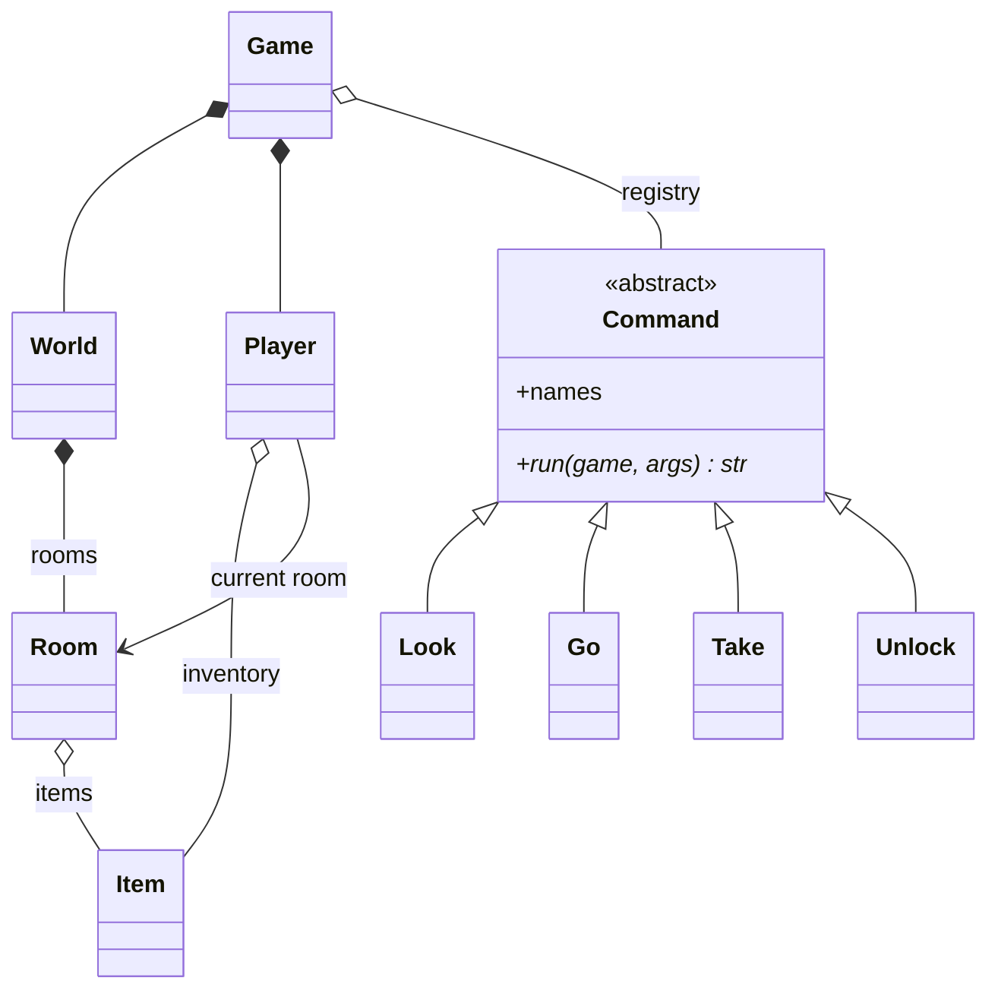
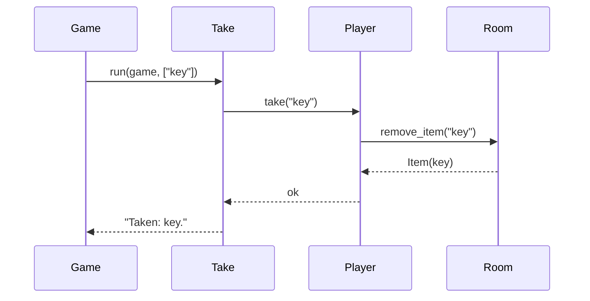
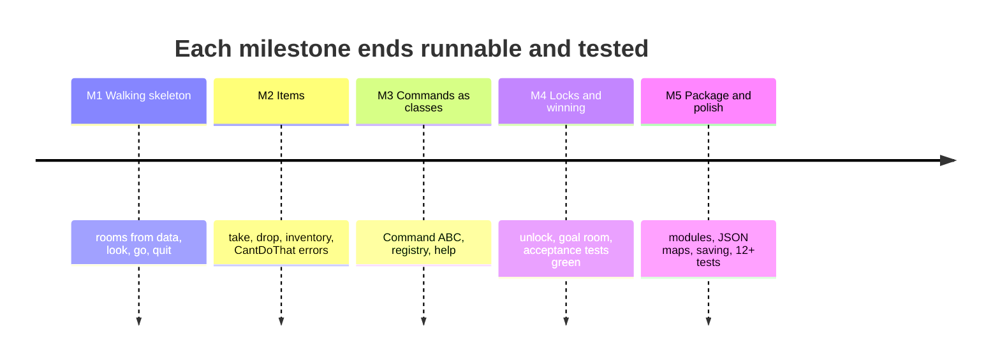

:::objectives
- Choose a capstone project at the right size and list the requirements it must meet.
- Turn a plain-language scenario into classes, responsibilities, and collaborators.
- Draw a class diagram and a sequence diagram, and justify each composition or inheritance link.
- Write an acceptance test before any real code, and plan milestones that each end with something working.
:::

Most capstone projects that fail don't fail at the code. They fail on day one, when someone starts typing `class Game:` with no idea what the other classes will be, and three days later every class knows about every other class. One afternoon of planning prevents that. By the end of this lesson you'll have a design document, a class diagram, and one failing test that says exactly what "finished" means.

## What your application must include

Your capstone is a command-line Python application of your own design. It must show the skills from Modules 2 to 7, at least at this level:

| Requirement | Minimum | Learned in |
| --- | --- | --- |
| Classes with clear jobs | 5 or more, each describable in one sentence | Module 2 |
| Composition | At least 2 "has-a" relationships | Module 3 |
| Inheritance or an interface | An `abc.ABC` (or duck-typed interface) with 2+ implementations used polymorphically | Modules 3, 6 |
| Protected state | Validation in constructors or properties; no outside code reaching into `_private` attributes | Module 4 |
| Custom exceptions | A base class and 2+ subclasses, caught at one boundary | Module 5 |
| Package layout | 3+ modules in a package, started with `python -m yourpackage` | Module 5 |
| Type hints | On every public method's parameters and return value | Modules 4, 5 |
| Tests | 12+ unit tests, including error paths and at least one fake or fixture | Module 6 |
| A refactor | One documented before-and-after improvement, tests green throughout | Module 7 |
| Design document | Diagram, responsibilities, and justified relationships (template below) | This lesson |

## Five project ideas

Pick one, or propose your own of similar size. The difficulty is about how many moving parts the design has, not how much code you type.

| Project | Difficulty | Core classes | Where polymorphism lives |
| --- | --- | --- | --- |
| **Library loans** | Starter | `Book`, `Copy`, `Member`, `Loan`, `Library` | `Notifier` (email, console, fake) for due-date reminders; reuse `DateRange` |
| **Text adventure engine** | Medium | `Room`, `Item`, `Player`, `World`, `Game`, `Command` | One class per command (`Look`, `Go`, `Take`, ...) behind a `Command` ABC |
| **Habit tracker** | Medium | `Habit`, `CheckIn`, `Streak`, `Tracker` | `Storage` ABC with JSON and in-memory backends; `Schedule` (daily, weekdays, weekly) |
| **Turn-based arena** | Medium-hard | `Fighter`, `Move`, `StatusEffect`, `Team`, `Battle` | `Move` and `StatusEffect` subclasses (heal, poison, shield) that each change a fighter differently |
| **Elevator simulation** | Hard | `Elevator`, `Floor`, `Request`, `Building`, `Scheduler` | Swappable `Scheduler` strategies (nearest-first, sweep), compared by average wait time |

The next lesson builds a starter for the **text adventure engine**, so the examples here use it. Every technique applies to the other projects.

## Find the classes: nouns, verbs, and responsibilities

Write a short paragraph describing your program from the user's side, the way you'd explain it to a friend. Then underline the nouns and the verbs.

> The **player** starts in the **hall** of an old **house**. Each **room** has a **description**, some **exits**, and sometimes **items**. The player can **look** around, **go** in a direction, **take** and **drop** items, and check their **inventory**. Some **doors** are **locked** and need a **key** to **unlock**. Reaching the **vault** **wins** the **game**.

Nouns are candidate classes or attributes; verbs are candidate methods. Not every noun becomes a class. "Description" is just a string attribute of `Room`, and "door" turns out to be a locked exit, not an object of its own. The test is whether the noun has **behavior or rules** of its own.

Then write a **CRC card** (Class, Responsibilities, Collaborators) for each class that survives. If you can't state a class's responsibility in one sentence, it's doing too much.

| Class | Responsibility (one sentence) | Collaborators |
| --- | --- | --- |
| `Room` | Knows its description, its exits, which exits are locked, and the items lying in it. | `Item` |
| `Item` | Holds an item's name and description. | none |
| `Player` | Tracks where the player is and what they carry, and moves between rooms. | `Room`, `Item` |
| `World` | Builds all the rooms from map data and finds them by name. | `Room`, `Item` |
| `Command` (ABC) | Turns one typed command into a change to the game and a reply. | `Game` |
| `Game` | Reads a line, picks the command, catches game errors, and knows when the player has won. | `World`, `Player`, `Command` |

## Draw it before you build it

A class diagram shows the structure; a sequence diagram shows one interaction over time. You need both, but only for the core of the program.





Drawing the sequence first often reveals a missing method: here, `Room.remove_item` has to exist, and it's the place to raise `CantDoThat` when the item isn't there.

## Composition or inheritance? Write down why

For every line on your diagram, write one sentence of justification. Inheritance needs the strongest case: the child must keep every promise the parent makes (Liskov, Module 7).

| Relationship | Kind | Why |
| --- | --- | --- |
| `Game` has a `World` and a `Player` | Composition | A game is made of these parts; neither is a kind of game. |
| `Room` holds `Item`s | Aggregation | Items exist on their own and move between rooms and the inventory. |
| `Go` is a `Command` | Inheritance from an ABC | Every command keeps the same promise, `run(game, args) -> str`, and `Game` treats them all alike. |
| `Player` is **not** a subclass of `Room` | (rejected) | It would get exits and descriptions it can't use; the player is *in* a room. |

## Write the acceptance test first

An **acceptance test** checks the whole program from the user's point of view. Writing it now turns a vague goal ("make a game") into a precise one, using the interface from your diagram. Stub the class so the test can run, and watch it fail:

```python run title="test_acceptance.py"
import sys
import unittest

TINY_WORLD = {
    "start": "hall",
    "goal": "vault",
    "items": {"key": "A small brass key."},
    "rooms": {
        "hall": {"description": "A dusty hall.", "exits": {"north": "corridor"}, "items": ["key"]},
        "corridor": {
            "description": "A narrow corridor.",
            "exits": {"south": "hall", "east": "vault"},
            "locked": {"east": "key"},
        },
        "vault": {"description": "Gold, everywhere.", "exits": {"west": "corridor"}},
    },
}


class Game:
    """Planned interface. Every method is a stub until the engine is built."""

    def __init__(self, world_data: dict) -> None:
        self.world_data = world_data

    def handle(self, line: str) -> str:
        raise NotImplementedError("Game.handle")

    @property
    def won(self) -> bool:
        raise NotImplementedError("Game.won")


class TestWholeGame(unittest.TestCase):
    def test_locked_door_blocks_the_way(self):
        game = Game(TINY_WORLD)
        game.handle("go north")
        self.assertIn("locked", game.handle("go east"))

    def test_player_wins_by_unlocking_the_vault(self):
        game = Game(TINY_WORLD)
        for line in ["take key", "go north", "unlock east", "go east"]:
            game.handle(line)
        self.assertTrue(game.won)


suite = unittest.defaultTestLoader.loadTestsFromTestCase(TestWholeGame)
unittest.TextTestRunner(stream=sys.stdout, verbosity=2).run(suite)
```

Two errors, and that's the plan working. These tests will stay red through the early milestones and turn green in Milestone 4. Notice the decisions they already forced: the world is plain data (so a map can live in a JSON file), `handle` returns the reply as a string instead of printing it (so tests can read it), and winning is a property of `Game`.

## Your design document

Keep this as `DESIGN.md` in your project folder and update it as the design changes. Reviewers read it before your code.

```text
# <Project name>: design

## What it does
Two or three sentences from the user's side.

## How to run it
python -m <package>

## Classes
One line per class: its single responsibility.

## Diagram
A class diagram (Mermaid, or a photo of a hand drawing).

## Relationships and why
For each line in the diagram: composition, aggregation, or inheritance,
plus one sentence of justification.

## Errors
The exception hierarchy, which module raises each one, and where they are caught.

## Modules
Which classes live in which module, and the direction imports flow.

## Tests
What is covered, which fakes or fixtures exist, and how to run them.

## A refactor I made
The smell, the before, the after, and how the tests protected it.

## What I would change next
Honest limits and the next two improvements.
```

## Plan milestones that each end with something working

Each milestone ends with a program you can run and tests that pass. If you run out of time, you hand in the last finished milestone, not a half-built pile.



A **walking skeleton** (M1) is the thinnest version that runs end to end: two rooms, `look`, `go`, and a loop. It feels too small to bother with. Build it anyway: it proves your classes fit together before you've invested in any of them.

:::tip
Scope down early. If the arena or elevator idea feels big, cut features, not structure: two kinds of `Move` instead of six, one scheduling strategy plus a fake. The rubric rewards clear design and tests, not feature count.
:::

:::video 6XrL5jXmTwM
Lucid's walkthrough of UML class diagrams. Watch for the difference between aggregation (hollow diamond) and composition (filled diamond), since your relationships table has to choose between them.
:::

## Before you start building

- [ ] I picked a project and wrote the user-side paragraph.
- [ ] Every class has a one-sentence responsibility and listed collaborators.
- [ ] I have a class diagram and one sequence diagram.
- [ ] Every relationship has a written justification.
- [ ] My acceptance test runs and fails for the right reason.
- [ ] `DESIGN.md` exists with every heading from the template.
- [ ] My milestones each end with something that runs.
