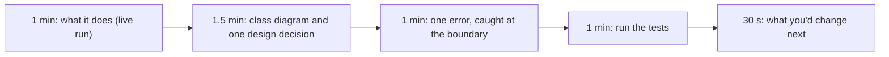

:::objectives
- Build a test plan that covers happy paths, edge cases, and error paths for every class.
- Test an interactive program end to end by injecting its input and output.
- Run the suite with pytest, and know why `python -m pytest` finds your package when `pytest` alone may not.
- Polish, document, and present the project, and assess it against the rubric.
:::

When someone reviews your capstone, they'll probably do three things in this order: run the tests, run the program, and open `DESIGN.md`. If the first command fails, they'll read everything after it with suspicion. This lesson makes all three go well, using the text adventure engine from the last lesson as the example.

## A test plan, class by class

Before writing more tests, decide what each class must prove. For every class, aim for at least one test in each of the first three columns. Error paths are where capstones lose the most marks, because they're the tests people skip.

| Class | Happy path | Edge case | Error path | Fake or fixture |
| --- | --- | --- | --- | --- |
| `World` | Exits connect both ways | A room with no exits | A missing room or start raises `WorldError` | A tiny map dict |
| `Room` | `describe()` lists items and exits | No items: the "You see" line is left out | Removing an absent item raises `CantDoThat` | none |
| `Player` | Move, take, drop | Taking the last item in a room | Locked exit refuses *and* the player stays put | Fresh world per test |
| Commands | Each name and alias works | Wrong number of words shows usage | Unlock without the key refuses | `Game` built from `HOUSE` |
| `Game` / `main` | The winning route wins | Empty lines and nonsense never crash | `quit` ends cleanly | Scripted input and output |

Here's the whole engine from the last lesson in one cell, so the tests below can use it. The comments mark where each file starts.

```python run title="adventure (the whole engine in one cell)"
import json
from abc import ABC, abstractmethod
from collections.abc import Callable
from dataclasses import dataclass
from pathlib import Path


# ---- adventure/errors.py ----
class GameError(Exception):
    """Something the player tried that the game refuses. Shown as a reply."""


class UnknownCommand(GameError):
    def __init__(self, word: str) -> None:
        super().__init__(f"I don't know how to {word!r}. Type 'help'.")
        self.word = word


class CantDoThat(GameError):
    """A sensible command that doesn't work right now."""


class WorldError(Exception):
    """The map data is broken: a bug in the map, not a player mistake."""


# ---- adventure/world.py ----
@dataclass(frozen=True)
class Item:
    name: str
    description: str


class Room:
    def __init__(self, name: str, description: str) -> None:
        self.name = name
        self.description = description
        self.exits: dict[str, "Room"] = {}
        self._locks: dict[str, str] = {}  # direction -> name of the key that opens it
        self._items: dict[str, Item] = {}

    def add_item(self, item: Item) -> None:
        self._items[item.name] = item

    def remove_item(self, name: str) -> Item:
        try:
            return self._items.pop(name)
        except KeyError:
            raise CantDoThat(f"There is no {name} here.") from None

    def lock(self, direction: str, key: str) -> None:
        self._locks[direction] = key

    def key_for(self, direction: str) -> str | None:
        return self._locks.get(direction)

    def unlock(self, direction: str) -> None:
        self._locks.pop(direction, None)

    def describe(self) -> str:
        lines = [f"{self.name.title()}: {self.description}"]
        if self._items:
            lines.append("You see: " + ", ".join(sorted(self._items)))
        lines.append("Exits: " + ", ".join(sorted(self.exits)))
        return "\n".join(lines)


class World:
    def __init__(self, rooms: dict[str, Room], start: Room, goal: str | None) -> None:
        self.rooms = rooms
        self.start = start
        self.goal = goal

    @classmethod
    def from_dict(cls, data: dict) -> "World":
        try:
            items = {name: Item(name, text) for name, text in data.get("items", {}).items()}
            rooms = {name: Room(name, spec["description"]) for name, spec in data["rooms"].items()}
            for name, spec in data["rooms"].items():
                for direction, target in spec.get("exits", {}).items():
                    rooms[name].exits[direction] = rooms[target]
                for direction, key in spec.get("locked", {}).items():
                    rooms[name].lock(direction, key)
                for item_name in spec.get("items", []):
                    rooms[name].add_item(items[item_name])
            return cls(rooms, rooms[data["start"]], data.get("goal"))
        except KeyError as err:
            raise WorldError(f"the map mentions {err}, which isn't defined") from err


# ---- adventure/player.py ----
class Player:
    def __init__(self, room: Room) -> None:
        self.room = room
        self._inventory: dict[str, Item] = {}

    def move(self, direction: str) -> None:
        if direction not in self.room.exits:
            raise CantDoThat(f"You can't go {direction} from here.")
        if self.room.key_for(direction):
            raise CantDoThat(f"The way {direction} is locked.")
        self.room = self.room.exits[direction]

    def take(self, name: str) -> Item:
        item = self.room.remove_item(name)
        self._inventory[name] = item
        return item

    def drop(self, name: str) -> None:
        if name not in self._inventory:
            raise CantDoThat(f"You aren't carrying a {name}.")
        self.room.add_item(self._inventory.pop(name))

    def has(self, name: str) -> bool:
        return name in self._inventory

    def inventory(self) -> list[str]:
        return sorted(self._inventory)


# ---- adventure/commands.py ----
class Command(ABC):
    names: tuple[str, ...] = ()
    usage: str = ""
    arity: int = 0  # how many words must follow the command name

    @abstractmethod
    def run(self, game: "Game", args: list[str]) -> str: ...


class Look(Command):
    names, usage = ("look", "l"), "look"

    def run(self, game, args):
        return game.player.room.describe()


class Go(Command):
    names, usage, arity = ("go",), "go DIRECTION", 1

    def run(self, game, args):
        game.player.move(args[0])
        return game.player.room.describe()


class Take(Command):
    names, usage, arity = ("take", "get"), "take ITEM", 1

    def run(self, game, args):
        return f"Taken: {game.player.take(args[0]).name}."


class Drop(Command):
    names, usage, arity = ("drop",), "drop ITEM", 1

    def run(self, game, args):
        game.player.drop(args[0])
        return f"Dropped: {args[0]}."


class Inventory(Command):
    names, usage = ("inventory", "i"), "inventory"

    def run(self, game, args):
        items = game.player.inventory()
        return "You carry: " + (", ".join(items) if items else "nothing")


class Help(Command):
    names, usage = ("help",), "help"

    def run(self, game, args):
        return "Commands: " + "; ".join(command.usage for command in game.commands)


class Unlock(Command):
    names, usage, arity = ("unlock",), "unlock DIRECTION", 1

    def run(self, game, args):
        direction = args[0]
        room = game.player.room
        key = room.key_for(direction)
        if key is None:
            raise CantDoThat(f"Nothing is locked to the {direction}.")
        if not game.player.has(key):
            raise CantDoThat(f"You need the {key}.")
        room.unlock(direction)
        return f"You unlock the way {direction} with the {key}."


COMMANDS: list[Command] = [Look(), Go(), Take(), Drop(), Inventory(), Help(), Unlock()]


# ---- adventure/game.py ----
class Game:
    def __init__(self, world: World, commands: list[Command]) -> None:
        self.world = world
        self.player = Player(world.start)
        self.commands = commands
        self._by_name = {name: command for command in commands for name in command.names}

    @classmethod
    def from_data(cls, data: dict) -> "Game":
        return cls(World.from_dict(data), COMMANDS)

    @property
    def won(self) -> bool:
        return self.player.room.name == self.world.goal

    def handle(self, line: str) -> str:
        words = line.lower().split()
        if not words:
            return "Say something. Type 'help' for commands."
        try:
            command = self._by_name.get(words[0])
            if command is None:
                raise UnknownCommand(words[0])
            if len(words) - 1 != command.arity:
                raise CantDoThat(f"Usage: {command.usage}")
            return command.run(self, words[1:])
        except GameError as err:
            return str(err)


# ---- adventure/maps.py ----
def load_map(path: Path) -> dict:
    try:
        return json.loads(path.read_text())
    except FileNotFoundError as err:
        raise WorldError(f"no map file at {path}") from err
    except json.JSONDecodeError as err:
        raise WorldError(f"{path.name} is not valid JSON (line {err.lineno})") from err


HOUSE = {
    "start": "hall",
    "goal": "vault",
    "items": {"key": "A small brass key.", "lamp": "An oil lamp.", "note": "It says: 'east'."},
    "rooms": {
        "hall": {"description": "A dusty hall.", "exits": {"north": "corridor", "west": "kitchen"}, "items": ["note"]},
        "kitchen": {"description": "Cold pots and a smell of soup.", "exits": {"east": "hall"}, "items": ["key", "lamp"]},
        "corridor": {
            "description": "A narrow corridor. A heavy door blocks the east.",
            "exits": {"south": "hall", "east": "vault"},
            "locked": {"east": "key"},
        },
        "vault": {"description": "Gold, everywhere you look.", "exits": {"west": "corridor"}},
    },
}


# ---- adventure/__main__.py ----
def main(data: dict, read: Callable[[str], str] = input, write: Callable[[str], None] = print) -> None:
    game = Game.from_data(data)
    write(game.player.room.describe())
    while not game.won:
        line = read("> ")
        if line.strip().lower() in ("quit", "q"):
            write("Bye!")
            return
        write(game.handle(line))
    write("You reached the vault. You win!")
```

## Test the whole program with scripted input

`main()` takes `read` and `write` parameters, which default to `input` and `print`. That one design decision from the last lesson means a test can play the entire game: a small `ScriptedIO` object hands out typed lines and records every reply. No real keyboard, no captured terminal output.

```python run title="tests/test_engine.py"
import sys
import unittest

WINNING_ROUTE = ["go west", "take key", "go east", "go north", "unlock east", "go east"]


class ScriptedIO:
    """Feeds main() typed lines and records everything it writes."""

    def __init__(self, lines: list[str]) -> None:
        self.lines = list(lines)
        self.output: list[str] = []

    def read(self, prompt: str) -> str:
        return self.lines.pop(0)

    def write(self, text: str) -> None:
        self.output.append(text)


class TestWorld(unittest.TestCase):
    def test_exits_connect_both_ways(self):
        world = World.from_dict(HOUSE)
        self.assertIs(world.start.exits["west"].exits["east"], world.start)

    def test_exit_to_a_missing_room_is_a_world_error(self):
        with self.assertRaises(WorldError):
            World.from_dict({"start": "hall", "rooms": {"hall": {"description": "x", "exits": {"up": "attic"}}}})

    def test_missing_start_is_a_world_error(self):
        with self.assertRaises(WorldError):
            World.from_dict({"rooms": {}})


class TestRoom(unittest.TestCase):
    def test_empty_room_has_no_you_see_line(self):
        self.assertNotIn("You see", Room("cell", "Bare walls.").describe())

    def test_removing_an_absent_item_refuses(self):
        with self.assertRaises(CantDoThat):
            Room("cell", "Bare walls.").remove_item("key")


class TestCommands(unittest.TestCase):
    def setUp(self):
        self.game = Game.from_data(HOUSE)

    def test_every_name_and_alias_is_registered(self):
        for command in COMMANDS:
            for name in command.names:
                with self.subTest(name=name):
                    line = f"{name} x" if command.arity else name
                    self.assertNotIn("I don't know", self.game.handle(line))

    def test_wrong_number_of_words_shows_usage(self):
        self.assertEqual(self.game.handle("take"), "Usage: take ITEM")

    def test_drop_puts_the_item_back_in_the_room(self):
        self.game.handle("take note")
        self.game.handle("drop note")
        self.assertIn("You see: note", self.game.handle("look"))

    def test_unlock_without_the_key_refuses(self):
        self.game.handle("go north")
        self.assertEqual(self.game.handle("unlock east"), "You need the key.")


class TestMain(unittest.TestCase):
    def test_winning_route_ends_with_the_win_message(self):
        io = ScriptedIO(WINNING_ROUTE)
        main(HOUSE, read=io.read, write=io.write)
        self.assertEqual(io.output[-1], "You reached the vault. You win!")

    def test_quit_says_bye(self):
        io = ScriptedIO(["look", "quit"])
        main(HOUSE, read=io.read, write=io.write)
        self.assertEqual(io.output[-1], "Bye!")

    def test_nonsense_never_crashes(self):
        io = ScriptedIO(["", "xyzzy", "go", "take take take", "quit"])
        main(HOUSE, read=io.read, write=io.write)
        self.assertEqual(len(io.output), 6)  # opening description, 4 replies, "Bye!"


suite = unittest.TestSuite()
for case in [TestWorld, TestRoom, TestCommands, TestMain]:
    suite.addTests(unittest.defaultTestLoader.loadTestsFromTestCase(case))
unittest.TextTestRunner(stream=sys.stdout, verbosity=2).run(suite)
```

Twelve tests, and every row of the plan is covered. Two techniques are worth copying into any project. `self.subTest(name=name)` runs one check per command inside a single test, and if one alias broke, the report would name it. And `test_nonsense_never_crashes` is a cheap safety net for the boundary: throw junk at it and confirm the game is still talking.

## The same ideas in pytest

In VS Code, pytest's fixtures and `parametrize` make the command checks a table. Save this as `tests/test_game.py` and add `from adventure.game import Game` and `from adventure.maps import HOUSE` under `import pytest`; this page already has those names, so the block leaves them out.

```python title="tests/test_game.py"
import pytest

WINNING_ROUTE = ["go west", "take key", "go east", "go north", "unlock east", "go east"]


@pytest.fixture
def game():
    return Game.from_data(HOUSE)


@pytest.mark.parametrize(
    "line, expected",
    [
        ("look", "Hall: A dusty hall."),
        ("l", "Hall: A dusty hall."),
        ("dance", "I don't know how to 'dance'"),
        ("go", "Usage: go DIRECTION"),
        ("go up", "You can't go up from here."),
        ("take sword", "There is no sword here."),
        ("unlock east", "Nothing is locked to the east."),
    ],
)
def test_reply_to_one_command(game, line, expected):
    assert expected in game.handle(line)


def test_winning_route_wins(game):
    for line in WINNING_ROUTE:
        game.handle(line)
    assert game.won


def test_route_without_unlocking_does_not_win(game):
    for line in WINNING_ROUTE:
        if line != "unlock east":
            game.handle(line)
    assert not game.won
```

Run it from the project folder, the one that contains `adventure/` and `tests/`:

```bash
python -m pytest -v
```

```text
collecting ... collected 9 items

tests/test_game.py::test_reply_to_one_command[look-Hall: A dusty hall.] PASSED [ 11%]
tests/test_game.py::test_reply_to_one_command[l-Hall: A dusty hall.] PASSED [ 22%]
tests/test_game.py::test_reply_to_one_command[dance-I don't know how to 'dance'] PASSED [ 33%]
tests/test_game.py::test_reply_to_one_command[go-Usage: go DIRECTION] PASSED [ 44%]
tests/test_game.py::test_reply_to_one_command[go up-You can't go up from here.] PASSED [ 55%]
tests/test_game.py::test_reply_to_one_command[take sword-There is no sword here.] PASSED [ 66%]
tests/test_game.py::test_reply_to_one_command[unlock east-Nothing is locked to the east.] PASSED [ 77%]
tests/test_game.py::test_winning_route_wins PASSED                       [ 88%]
tests/test_game.py::test_route_without_unlocking_does_not_win PASSED     [100%]

============================== 9 passed in 0.04s ===============================
```

:::warning
**`ImportError while importing test module` / `No module named 'adventure'`.** Typing plain `pytest` doesn't put your project folder on Python's import path, so `from adventure.game import Game` fails during collection. `python -m pytest` does add the current folder, which is why this course always uses it. Also check you're in the folder that *contains* `adventure`, not inside it.
:::

To see which lines your tests never run, the free `pytest-cov` plugin adds a coverage report. Install it with `python -m pip install pytest-cov`, then run `python -m pytest --cov=adventure`. Treat a low number as a list of places to look, not a score to chase: one good error-path test beats five that repeat the happy path.

## Polish before you present

Go through this list with the code open. Each item takes minutes and is visible to anyone reading your project.

- **Names.** Every class is a noun and every method a verb phrase. No `data2`, `temp`, or `do_stuff`.
- **Docstrings** on every class and on any method whose name doesn't say everything.
- **Type hints** on every public method. For a free extra check, install mypy (`python -m pip install mypy`) and run `python -m mypy adventure`.
- **Printing only at the edge.** Search for `print(`; it should appear only in `__main__.py` (or wherever your boundary is).
- **No catch-alls.** Search for `except Exception` and bare `except:`. Each one needs a very good reason in a comment, or it goes.
- **Dead code.** Delete commented-out blocks and unused functions; the history is in your saved versions.
- **A README** saying what the program is, how to run it, and how to run the tests, in that order.
- **DESIGN.md** updated to match the code as it is now, including the refactor section.

## Present it in five minutes

A capstone demo isn't a tour of every file. It's a short argument: here's what it does, here's why it's designed this way, here's the proof it works.



Pick **one** design decision to explain properly, such as "commands are classes, so adding `unlock` didn't touch `Game`", and show the code for it. Then type something wrong on purpose and show the friendly reply, and say which exception produced it. Finish by running the tests live. Rehearse once with a timer; nearly everyone's first run takes twice as long as they planned.

:::video E6NO0rgFub4
A focused guide to writing a useful README. Watch for the order of the sections it recommends, and compare it with the README item on the polish list above.
:::

## The rubric

| Criterion | Excellent (4) | Solid (3) | Developing (2) | Beginning (1) |
| --- | --- | --- | --- | --- |
| Responsibilities | Every class has one clear job, stated in DESIGN.md | Most classes are focused; one does two jobs | Several classes mix jobs (logic plus printing) | One or two large classes do everything |
| Relationships | Composition and inheritance each justified in writing; every subclass keeps its parent's promises | Relationships sensible, justifications brief | Inheritance used for code reuse where composition fits | Relationships unclear or missing |
| Interfaces and polymorphism | An ABC or duck-typed interface with 2+ implementations removes a type switch | Interface exists, used in one place | Polymorphism attempted but `if`/`isinstance` chains remain | No shared interface |
| Errors | Custom hierarchy, specific raises, one boundary that catches, no catch-alls | Custom errors, mostly specific | Built-in exceptions only, or some catch-alls | Errors printed, ignored, or crash with no handling |
| Modules | Package with 3+ modules, one-way imports, runs with `python -m` | Package works, minor import tangles | Several files but no package structure | Single file |
| Tests | 12+ tests covering error paths, with fakes or fixtures; all pass | 12+ tests, mostly happy paths; all pass | Fewer than 12, or some failing | No working tests |
| Code quality | Clear names, type hints, docstrings, no dead code; mypy clean or close | Mostly clear and typed | Inconsistent naming or hints | Hard to read |
| Design doc and demo | DESIGN.md matches the code; demo explains one decision with evidence, on time | DESIGN.md mostly current; demo clear | Design doc thin or outdated; demo is a file tour | Missing |

## Reflect

Answer these in the last section of `DESIGN.md`. Short, specific answers are better than long ones.

1. Which class changed the most between your first diagram and the final code, and why?
2. Where did a test catch a mistake you wouldn't otherwise have noticed?
3. Which relationship would you change from inheritance to composition (or the reverse) if you started again?
4. What was your refactor, and how did you know you hadn't changed the behavior?
5. If a classmate had to add one feature next week, which file would they open first, and would they need to edit anything that already works?

## Where to go next

- **Design patterns.** The command registry you built is the Command pattern, and the swappable discount rules were the Strategy pattern. [Refactoring.Guru's catalog](https://refactoring.guru/design-patterns/catalog) explains the common patterns with diagrams and Python examples.
- **Static typing.** [The mypy documentation](https://mypy.readthedocs.io/en/stable/getting_started.html) starts from the type hints you already write and shows what a checker catches before the code runs.
- **Packaging.** The [Python Packaging User Guide tutorial](https://packaging.python.org/en/latest/tutorials/packaging-projects/) shows how to add a `pyproject.toml` so others can install your package with pip.
- **Read real code.** Pick a small, well-tested open-source Python library, open its `tests/` folder first, and see how its authors structure what you practiced here.
