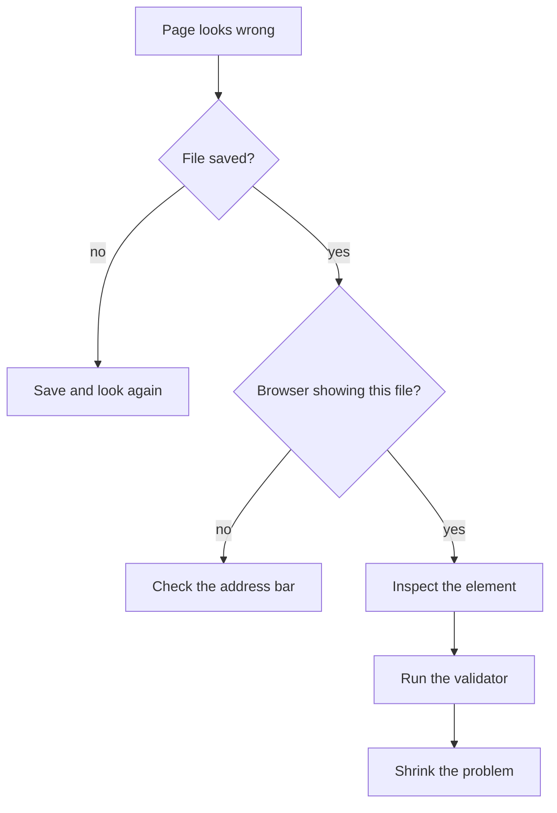

:::objectives
- Lay out a project folder the way real websites are organized.
- Name files so they work on every web server, not just your laptop.
- Use Auto Save, Format Document, and comments to keep your code readable.
- Follow a debugging routine, including the W3C validator, when a page misbehaves.
- Know how the rest of this course is laid out.
:::

A student builds a profile page. On their laptop the photo shows up perfectly. They upload the site, send the link to a friend, and the friend sees a broken-image icon. Nothing in the code changed. The bug is the file name: the picture is saved as `Me.JPG`, and the page asks for `me.jpg`. Windows and macOS shrug that off. The Linux computers that host most websites don't.

Habits like naming and organizing feel boring, and they prevent a surprising share of the bugs you'll meet in this course.

## One folder per project, with a predictable layout

Keep every project in its own folder inside your course folder. Inside a project, use the layout most websites use:

```text
web-course/
├── first-page/
│   └── index.html
└── profile/
    ├── index.html          ← the home page
    ├── favorites.html      ← another page
    ├── images/
    │   └── red-panda.jpg
    └── css/
        └── styles.css      ← you'll start using this in Module 4
```

When you open a project in VS Code, open the project folder itself (`profile`), not the whole `web-course` folder. Live Server serves the folder you opened, so the home page ends up at a clean address like `http://127.0.0.1:5500/index.html`.

:::video 3AXZ9Iahvc4
What to watch for: Kevin Powell sets up a root folder before writing a single tag, then opens that folder in VS Code. Copy that order in every project.
:::

## Name files the way web servers like them

Four rules cover nearly every naming bug:

1.  **Lowercase only.** `About.html` and `about.html` are different files on most web servers. If everything is lowercase, you never have to remember which is which.
2.  **No spaces.** Use hyphens: `my-trip.jpg`, not `my trip.jpg`. Spaces turn into `%20` in addresses and are easy to mistype.
3.  **Keep the real extension.** A photo is `.jpg` or `.png`, a page is `.html`. Don't rename a `.png` to `.jpg` and hope.
4.  **Short and descriptive.** `red-panda.jpg` tells you what's inside; `IMG_20260914_112233.jpg` doesn't.

:::warning
**Windows hides file extensions by default**, so a file you think is `index.html` can really be `index.html.txt`, and the browser shows it as plain text. Turn extensions on: in File Explorer, open **View › Show** and tick **File name extensions** (on Windows 10 it's a checkbox on the **View** tab). On a Mac, open **Finder › Settings › Advanced** and tick **Show all filename extensions**. Creating files from VS Code's Explorer avoids the problem, because VS Code uses exactly the name you type.
:::

## Save habits and tidy code

**Turn on Auto Save.** In VS Code, click **File › Auto Save** so it has a check mark. Your file saves a moment after you stop typing, and Live Server reloads the browser each time. If constant reloading bothers you, open **Settings**, search for `auto save`, and pick **onFocusChange**, which saves when you click away from the editor.

**Format your code.** Indentation shows which elements sit inside which. If your code gets messy, run **Format Document**: **Shift+Alt+F** on Windows, **Shift+Option+F** on a Mac, **Ctrl+Shift+I** on Linux and Chromebooks. VS Code re-indents the whole file.

**Leave notes with comments.** Anything between `<!--` and `-->` is ignored by the browser. Press **Ctrl+/** (**Cmd+/**) to turn the current line into a comment or back.

```html preview height="120"
<h1>Comments are invisible</h1>
<!-- TODO: add a photo here once I pick one -->
<p>The note above doesn't show up on the page, but it's still in the file.</p>
```

**Keep a backup.** If your course folder lives in a synced folder like OneDrive, iCloud Drive, or Google Drive, you won't lose work when a laptop dies. Otherwise, zip the folder now and then and copy it somewhere safe.

## A debugging routine for when the page looks wrong

Predict before you look: what will this page show?

```html preview height="230"
<h1>Shopping list
<p>Eggs</p>
<p>Flour</p>
<p>Milk</p>
```

Every line came out as a giant bold heading. The `<h1>` was never closed, so the browser put everything after it *inside* the heading. Open the result in DevTools and you'll see the three paragraphs nested under `<h1>` in the tree. Adding `</h1>` after `Shopping list` fixes it.

You found that by looking at the tree. When you're stuck, work through these questions in order, because the early ones are the quickest to check:



1.  **Is the file saved?** Look for the white dot on the tab.
2.  **Is the browser showing the file you're editing?** Check the file name at the end of the address. It's easy to edit `about.html` while staring at `index.html`.
3.  **Inspect it.** Right-click the broken part, choose **Inspect**, and see where it sits in the tree. Wrong nesting means a missing or misplaced closing tag.
4.  **Check the Console.** In DevTools, the **Console** tab shows errors in red. A missing image appears there as a failed request with **404 (Not Found)**.
5.  **Run the validator.** Go to [validator.w3.org](https://validator.w3.org/), open the **Validate by Direct Input** tab, paste your whole file, and click **Check**. For the shopping list it reports, among other things, `Unclosed element “h1”.` with a line number. Fix the first error first; one mistake often causes several messages.
6.  **Shrink the problem.** Copy the file, delete half of it, and see whether the bug survives. Keep halving until only the guilty lines are left.

:::tip
When you ask someone for help, say three things: what you expected, what happened instead, and the smallest piece of code that shows the problem. A CodePen link with just those lines gets you an answer much faster than "my website is broken".
:::

## How the rest of this course works

-   **Module 1** (this one) is setup.
-   **Modules 2 to 7** each have three lessons. **Notes** teach the ideas with live examples. A **Build-along** uses them to make one real page, step by step. **Practice** gives you new problems with hints and hidden solutions.
-   **Module 8** is a capstone: your own multi-page website.

The examples in these lessons show code above a live **Result** frame. You can right-click inside any result and choose **Inspect** to explore it in DevTools. The frames can't see files on your computer, though, so whenever a lesson builds something, type it into your own project in VS Code. Typing it yourself, typos and all, is how the tags stick.

:::quiz
Q: Your page uses ``, and the file on disk is `images/Dog.jpg`. It works on your Mac. What happens on a typical web host?
- [ ] It works everywhere, because file names ignore capital letters
  That's true on most Windows and Mac setups, but most web servers run Linux, where `Dog.jpg` and `dog.jpg` are different files.
- [x] The image is broken, because the server can't find `dog.jpg`
  The server looks for exactly `dog.jpg`, finds only `Dog.jpg`, and returns 404. Lowercase file names avoid this.
- [ ] The browser fixes the capital letter for you
  Browsers repair some broken HTML, but they can't guess file names on a server.

Q: Every paragraph on your page suddenly appears huge and bold. Which tool shows you why most directly?
- [x] The Elements panel, which shows the paragraphs nested inside a heading
  The tree shows what the browser built, so you can see that the heading swallowed everything after it.
- [ ] Reinstalling VS Code
  The editor didn't cause this; something in the HTML did.
- [ ] Auto Save
  Saving more often doesn't change what the code says.
:::

## Further reading

-   [Dealing with files](https://developer.mozilla.org/en-US/docs/Learn_web_development/Getting_started/Environment_setup/Dealing_with_files): MDN's guide to folder layout and file naming, with more detail on case and spaces.
-   [W3C Markup Validation Service](https://validator.w3.org/): bookmark it now. It catches unclosed tags and typos you'd otherwise hunt for by eye.
