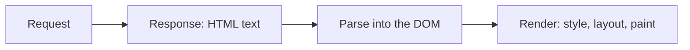
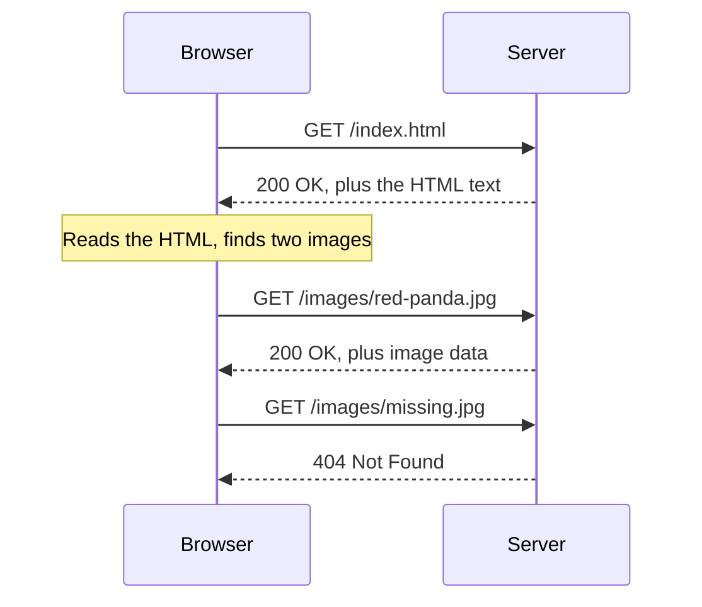
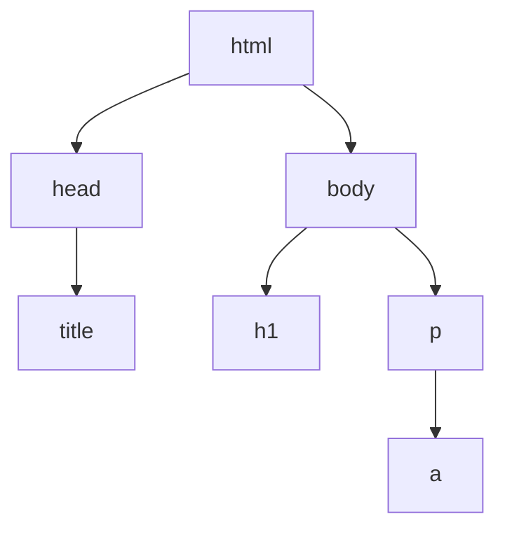
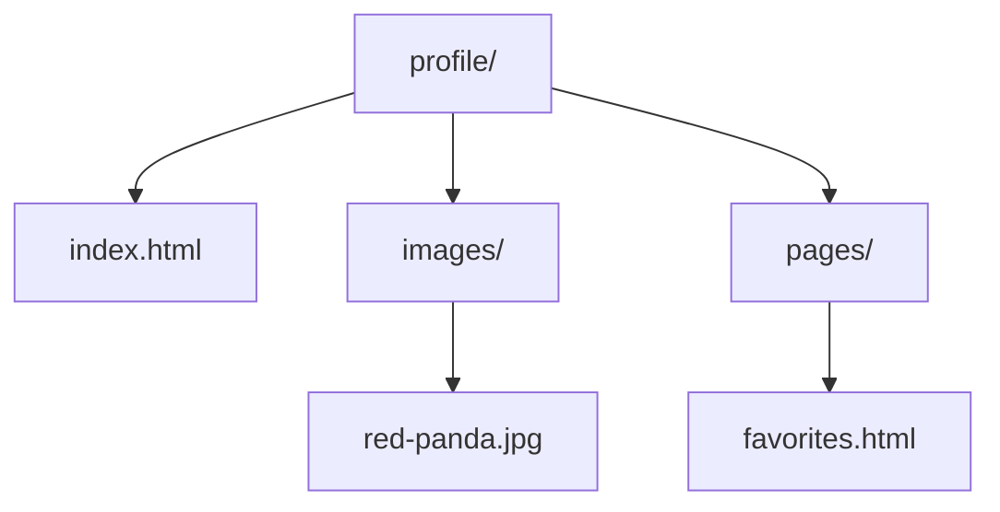

:::objectives
- Describe the four stages a page goes through: request, response, parsing into the DOM, and rendering.
- Read any element's parts: tags, attributes, content, and nesting.
- Write a complete document skeleton and explain what each line is for.
- Give a page an outline with headings, and add links and images with working paths and useful `alt` text.
:::

When you press Enter on a web address, your browser sends a short message that says, roughly, "please send me `/index.html`". What comes back is not a picture of a page. It's text, exactly like the file you typed in Module 1, and the browser builds the page from that text in a fraction of a second.

Knowing how it does that explains a lot of things that look strange at first: why a missing image doesn't stop the rest of the page, why the Elements panel doesn't always match your file, and why the line breaks in your code vanish on screen.



## The browser asks, the server answers

A **server** is any computer program that hands out files when asked. On the real web it's a machine in a data center. In this course, Live Server plays that role on your own computer.

The browser never gets a whole website at once. It asks for the HTML first, reads it, and then sends a separate request for every image, stylesheet, and script the HTML mentions.



Each answer starts with a **status code**. `200` means "here it is". `404` means "no file by that name". Because every file is its own request, a 404 for one image leaves the rest of the page untouched; you just get a broken-image icon in one spot.

:::try
Start Live Server on your `first-page` project, open DevTools, and click the **Network** tab. Refresh the page. You'll see a row for `index.html` with status `200` (plus a row Live Server adds for its auto-reload connection). Now add `` to the body, save, and watch a second row appear in red with status `404`.
:::

## Parsing: the text becomes a tree

The browser reads your HTML from top to bottom and turns each tag into an **element**, a little object in memory. Elements inside other elements become their children, so the result is a family tree called the **DOM** (Document Object Model).

```html
<html>
  <head><title>Red pandas</title></head>
  <body>
    <h1>Red pandas</h1>
    <p>They spend most of the day in <a href="https://en.wikipedia.org/wiki/Red_panda">trees</a>.</p>
  </body>
</html>
```



This tree is exactly what the Elements panel shows you. It's built *from* your file, but it isn't your file: when the HTML has mistakes, the parser repairs them using fixed rules, and the tree shows the repaired version. That's why Module 1's unclosed paragraphs looked fine, and why the unclosed heading swallowed everything after it.

## Rendering: style, layout, paint

With the tree built, the browser works out how it should look:

1.  **Style.** It decides the CSS for every element, starting from its own built-in defaults (that's why `<h1>` is big and bold before you write any CSS) and then applying yours.
2.  **Layout.** It calculates the size and position of every element's box, given the window's width.
3.  **Paint.** It fills in the pixels.

Resize the window and layout and paint run again, which is why text re-wraps as you drag. You'll control the style step in Module 4.

:::video Fe2bWQjJS68
What to watch for: a two-minute recap of the same pipeline. Listen for the moment the browser combines the DOM with the CSS before it does layout.
:::

## Anatomy of an element

```html
<a href="https://developer.mozilla.org" title="Opens MDN">MDN Web Docs</a>
```

-   `<a ...>` is the **opening tag**. `a` is the element's name (it stands for *anchor*, the original name for a link).
-   `href="..."` and `title="..."` are **attributes**: extra settings written as `name="value"` inside the opening tag.
-   `MDN Web Docs` is the **content**, the part you see.
-   `</a>` is the **closing tag**, with a slash.

A few elements, called **void elements**, can't have content, so they have no closing tag: ``, `<meta>`, `<link>`, and `<br>` are the ones you'll meet first.

Elements nest like boxes inside boxes, so close them in the reverse order you opened them:

```html
<p>This is <strong>really</strong> important.</p>   <!-- right -->
<p>This is <strong>really important.</p></strong>   <!-- wrong: closed in the wrong order -->
```

## The skeleton, line by line

```html title="index.html"
<!DOCTYPE html>
<html lang="en">
<head>
    <meta charset="UTF-8">
    <meta name="viewport" content="width=device-width, initial-scale=1.0">
    <title>Red pandas</title>
</head>
<body>
    <!-- everything visible goes here -->
</body>
</html>
```

-   `<!DOCTYPE html>` tells the browser to use modern standards. Without it, browsers switch to "quirks mode" and copy the bugs of browsers from the 1990s.
-   `<html lang="en">` wraps the whole page and names its language, so screen readers pronounce words correctly and translation tools know what they're translating from.
-   `<head>` holds information *about* the page. None of it appears in the page itself.
-   `<meta charset="UTF-8">` lets the page show any character: é, ñ, 中, curly quotes, emoji. Leave it out and an apostrophe can show up as `’`.
-   The `viewport` line tells phones to use their real screen width instead of pretending to be a desktop. Module 6 depends on it.
-   `<title>` is the text in the browser tab, in bookmarks, and in search results.
-   `<body>` holds everything visitors actually see.

## Headings and paragraphs give a page its outline

`<h1>` to `<h6>` are six levels of heading, like the chapters, sections, and subsections of a book. Use exactly one `<h1>` for what the whole page is about, `<h2>` for its main sections, and `<h3>` inside those. Choose the level by *position in the outline*, never for size. Size is CSS's job.

```html preview height="330"
<h1>Caring for a red panda</h1>
<p>Red pandas live in mountain forests and spend most of their time in trees.</p>
<h2>What they eat</h2>
<p>Mostly bamboo leaves, which they eat for hours every day.</p>
<h3>Treats</h3>
<p>Fruit and acorns, in small amounts.</p>
<h2>Where they sleep</h2>
<p>High up on branches, curled up with their tails over their faces.</p>
```

Many screen reader users move around a long page by jumping from heading to heading, and WebAIM's surveys of screen reader users keep finding that it's the most common way they look for information. A clean outline is how they skim.

Now predict: how many lines will this show?

```html preview height="150"
<p>Roses are red,
   violets are blue,
          extra      spaces    vanish   too.</p>
<p>Roses are red,<br>violets are blue,<br>br forces a line break.</p>
```

The first paragraph shows as one line (or wraps wherever the window ends). HTML **collapses whitespace**: any run of spaces, tabs, and line breaks counts as a single space. To end a line on purpose inside a paragraph, as in a poem or an address, use `<br>`. To separate ideas, start a new `<p>`.

## Links: what goes in `href`

`<a href="...">` makes a link. The value of `href` comes in a few flavors:

| Kind | Example | Goes to |
| --- | --- | --- |
| Absolute URL | `https://developer.mozilla.org` | Another website. Always include `https://`. |
| Relative path | `pages/favorites.html` | A file in your own project, found starting from the current file's folder. |
| Same-page link | `#where-they-sleep` | The element on this page with `id="where-they-sleep"`. |
| Email | `mailto:club@example.com` | Opens the visitor's email app. |

Relative paths trip up nearly everyone at first, so here's a project to practice on:



| From this file | To this file | Write |
| --- | --- | --- |
| `index.html` | `pages/favorites.html` | `pages/favorites.html` |
| `index.html` | `images/red-panda.jpg` | `images/red-panda.jpg` |
| `pages/favorites.html` | `index.html` | `../index.html` |
| `pages/favorites.html` | `images/red-panda.jpg` | `../images/red-panda.jpg` |

A relative path starts in the folder of the file you're writing in. A folder name followed by `/` steps *into* that folder, and `../` steps *up* one level. Always use forward slashes, even on Windows.

## Images: `src`, `alt`, `width`, and `height`

```html preview height="400"

<p>The next image's file doesn't exist:</p>

```

-   `src` is the path or URL of the image file. (This lesson's frame can't see your computer's folders, so the first example uses a full URL. In your projects, use a relative path like `images/red-panda.jpg`.)
-   `alt` is the text that replaces the image when it can't be seen: for screen reader users, when the file is missing (look at the second example), or on a slow connection. Write what you'd say if you were describing the picture to a friend over the phone, and skip "image of", since screen readers already announce that it's an image.
-   If an image is pure decoration, write `alt=""` (empty, not missing) so screen readers skip it.
-   `width` and `height` in pixels let the browser reserve space before the file arrives, so the text below doesn't jump when it loads.

*The red panda photo is by Mathias Appel (CC0), via Wikimedia Commons.*

:::warning
**Paths from your hard drive.** VS Code sometimes suggests paths like `C:\Users\Sam\Desktop\cat.jpg` or `file:///Users/sam/cat.jpg`. They work on your computer only, because nobody else has your Desktop. Keep the image inside your project folder and use a relative path with forward slashes: `images/cat.jpg`.
:::

:::warning
**A missing quote swallows text.** In `<a href="about.html>About me</a>`, the value never ends, so the browser treats `About me</a>` and everything up to the next `"` as part of the address. If a link or image suddenly takes half your page with it, look for an unclosed quote just before the damage.
:::

:::video 07EVpWb8dtg
What to watch for: Kevin Powell writes the skeleton by hand and explains what lives in `<head>` versus `<body>`. Compare his lines with the ones Emmet wrote for you.
:::

:::quiz
Q: A page's HTML uses two images and one stylesheet. How many requests does the browser make to load it?
- [ ] 1, because the whole page arrives in one download
  Only the HTML arrives first. The browser finds the other files while reading it and asks for each separately.
- [ ] 3, one for each image and the stylesheet
  You also need the request for the HTML file itself, which is how the browser learns about the other three.
- [x] 4: the HTML, then two images and the stylesheet
  One request for the page, then one for every file it mentions.

Q: Inside one `<p>`, your file has `Hello,` on one line and `world!` on the next. What does the browser show?
- [ ] "Hello," and "world!" on two separate lines
  A line break in the source doesn't show up on screen; you'd need `<br>` or a second paragraph.
- [x] "Hello, world!" on one line
  Whitespace collapses, so the line break becomes a single space.
- [ ] Nothing, because a paragraph can't contain a line break
  It can. The browser simply treats the break as a space.

Q: You're writing `pages/favorites.html`. Which `src` shows the photo stored at `images/red-panda.jpg` in the project's top folder?
- [ ] `images/red-panda.jpg`
  That looks for `pages/images/red-panda.jpg`, because relative paths start in the current file's folder.
- [x] `../images/red-panda.jpg`
  `../` climbs from `pages` up to the project folder, then `images/` steps into the right place.
- [ ] `C:\profile\images\red-panda.jpg`
  That only works on one computer, and it uses backslashes, which aren't web paths.

Q: A link's only content is a magnifying-glass icon, and clicking it opens the search page. What's the best `alt` for the icon?
- [ ] `alt="magnifying glass icon"`
  That describes the picture, but a screen reader user needs to know what the link *does*.
- [x] `alt="Search"`
  When an image is the only content of a link, its alt text should say where the link goes or what it does.
- [ ] `alt=""`
  Empty alt is for decoration. Here the link would be announced with no name at all.
:::

:::takeaways
- The browser requests the HTML, then makes a separate request for every file it mentions. `200` means found; `404` means missing.
- Parsing turns your text into the DOM, a tree the Elements panel shows. Rendering then styles, lays out, and paints it.
- Every page needs the skeleton: doctype, `<html lang>`, a `<head>` with charset, viewport, and title, and a `<body>`.
- Headings form the page's outline (one `<h1>`, then `<h2>` and `<h3>` in order). Whitespace in the code collapses to one space.
- Relative paths start from the current file's folder; `../` goes up one level. Every meaningful image needs `alt` text that says what it shows or does.
:::

## Further reading

-   [How the web works](https://developer.mozilla.org/en-US/docs/Learn_web_development/Getting_started/Web_standards/How_the_web_works): MDN's plain-language tour of clients, servers, and requests, a little deeper than this lesson.
-   [Basic HTML syntax](https://developer.mozilla.org/en-US/docs/Learn_web_development/Core/Structuring_content/Basic_HTML_syntax): elements, attributes, nesting, and void elements, with small exercises to try.
-   [Alternative text](https://webaim.org/techniques/alttext/): WebAIM's guide to writing alt text for every kind of image, with lots of before-and-after examples.
