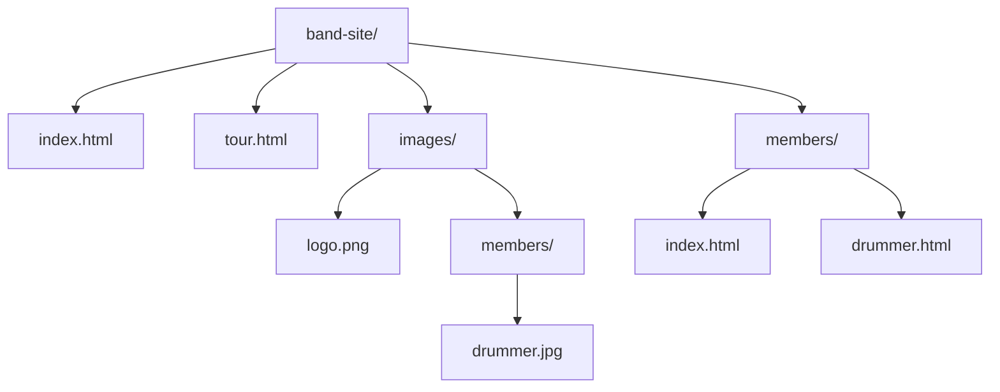

:::objectives
- Find and fix skeleton and nesting mistakes in someone else's page.
- Choose heading levels from an outline, not from font size.
- Write alt text that fits what an image is *for* on that page.
- Work out relative paths between files in nested folders.
- Build a complete page with jump links from a list of requirements.
:::

Do these in your own files with Live Server running, not just in your head. For each exercise, make a new file in a `practice-m2` folder (`ex1.html`, `ex2.html`, and so on), and paste your finished code into the [W3C validator](https://validator.w3.org/#validate_by_input) before opening the solution.

## Warm-up: predict the result

How many separate lines of text will this show, and which words will be bold?

```html
<p>Meet   the
   <strong>robotics</strong>
   club</p>
<p>Thursdays<br>Room 214</p>
```

Make your guess, then check it:

```html preview height="120"
<p>Meet   the
   <strong>robotics</strong>
   club</p>
<p>Thursdays<br>Room 214</p>
```

Three lines: "Meet the robotics club" (whitespace collapses, so the first paragraph is one line), then "Thursdays" and "Room 214", split by the `<br>`. Only "robotics" is bold.

### Exercise 1: Repair a broken skeleton

This page "works" in a browser, but it has six problems. Find them all, then write the corrected file.

```html
<html>
<head>
<title>Bike repair club</title>
</head>
<h1>Bike Repair Club</h1>
<body>
<p>We meet on Thursdays after school.</p>
<p>Bring a <strong>helmet.</p></strong>
</body>
```

Expected result: a valid page that the W3C validator accepts with no errors.

:::hint
Compare it line by line with the skeleton from the Notes lesson. Check: the first line, an attribute on `<html>`, two `<meta>` lines, where the heading is, how two tags close, and the very last line.
:::

:::solution
The six problems: no `<!DOCTYPE html>`; no `lang` on `<html>`; no `<meta charset>`; no viewport `<meta>`; the `<h1>` sits outside `<body>`; and `<strong>` closes after `</p>` even though it opened inside the paragraph. (The missing `</html>` is a seventh, smaller one: browsers add it, but write it anyway.)

```html
<!DOCTYPE html>
<html lang="en">
<head>
    <meta charset="UTF-8">
    <meta name="viewport" content="width=device-width, initial-scale=1.0">
    <title>Bike repair club</title>
</head>
<body>
    <h1>Bike Repair Club</h1>
    <p>We meet on Thursdays after school.</p>
    <p>Bring a <strong>helmet</strong>.</p>
</body>
</html>
```

Notice the period moved outside `</strong>`. Only "helmet" is the important word.
:::

### Exercise 2: Choose heading levels

A teacher sends you this text for a page, one heading per line, in order. Decide each heading's level (`<h1>` to `<h3>`) and write the page with one short paragraph under each heading.

```text
Starting a school garden
Choosing a spot
Sunlight
Water access
What to plant first
Fast growers
Plants that survive summer break
Who to ask for help
```

:::hint
Find the one heading the whole page is about. Then find the three big topics. Everything left over belongs inside one of those topics.
:::

:::solution
```html preview height="560"
<h1>Starting a school garden</h1>
<p>A small bed outside the science room is enough to start.</p>
<h2>Choosing a spot</h2>
<p>Walk the school grounds at different times of day before deciding.</p>
<h3>Sunlight</h3>
<p>Most vegetables need at least six hours of direct sun.</p>
<h3>Water access</h3>
<p>Pick a spot a hose can reach, or someone will be carrying buckets all spring.</p>
<h2>What to plant first</h2>
<p>Start with plants that forgive mistakes.</p>
<h3>Fast growers</h3>
<p>Radishes and lettuce can be ready in about a month.</p>
<h3>Plants that survive summer break</h3>
<p>Herbs like rosemary and thyme handle a few weeks without care.</p>
<h2>Who to ask for help</h2>
<p>The custodian knows where the water is, and the science teacher may have seeds.</p>
```

The page title is the only `<h1>`. "Choosing a spot", "What to plant first", and "Who to ask for help" are the main sections (`<h2>`). The rest are subsections (`<h3>`) of the section just above them.
:::

### Exercise 3: Write alt text for four images

A robotics club's home page has these images. Write the `alt` for each one.

1.  A photo of six members holding the robot they built, under the heading "Our team".
2.  The club logo, which is the only content of a link back to the home page.
3.  A decorative wavy line between two sections.
4.  A bar chart of club membership: 8 students in 2023, 14 in 2024, 21 in 2025.

:::hint
For each one, ask: "If this image disappeared, what would a visitor miss?" A link needs to say where it goes. A chart's job is its numbers.
:::

:::solution
```html

<a href="index.html"></a>


```

1.  Describe what the photo shows that matters on this page: who is in it and what they're doing.
2.  The image *is* the link, so its alt text names the destination, not the picture.
3.  Pure decoration gets an empty `alt=""`, so screen readers skip it.
4.  A chart's alt text gives the takeaway and the numbers. For bigger charts, put the data in the page's text or a table (Module 3) as well.
:::

### Exercise 4: Trace the file paths

Here's a band's website:



Write the `href` or `src` for each link:

1.  From `index.html` to `tour.html`
2.  From `index.html` to the drummer's photo
3.  From `members/drummer.html` to the logo
4.  From `members/drummer.html` to the drummer's photo
5.  From `members/drummer.html` to `members/index.html`
6.  From `members/index.html` to the home page

:::hint
Put your finger on the folder that holds the file you're writing in. Move up with `../` until you reach a folder that contains your target's path, then walk down. Number 5 is a trick: look at which folder both files are in.
:::

:::solution
| # | Path | Why |
| --- | --- | --- |
| 1 | `tour.html` | Both files are in `band-site/`. |
| 2 | `images/members/drummer.jpg` | Walk down two folders from `band-site/`. |
| 3 | `../images/logo.png` | Climb out of `members/`, then into `images/`. |
| 4 | `../images/members/drummer.jpg` | Climb out once, then down two folders. |
| 5 | `index.html` | Both files are in `members/`, so there's no climbing. This `index.html` is the members page, not the home page. |
| 6 | `../index.html` | Climb out of `members/` to reach the home page. |

Watch out for the two folders called `members`. Paths only care about where *you* are, which is why `images/members/` and `members/` never get confused if you start from the right place.
:::

### Exercise 5: Spot the bugs

This snippet should show a sentence with a link, a photo of popcorn, and a reminder in bold. Look at the result: half the content is missing.

```html preview height="140"
<h1>Movie night</h1>
<p>Vote for the movie on the <a href="vote.html>voting page</a>. Snacks are free.</p>

<p>See you <strong>Friday at 7!</p></strong>
```

Find four bugs. Which one causes the missing content?

:::hint
Read the `href` value carefully, character by character, looking for where it ends. Then look at the slash direction in `src`, at what `alt` says, and at the closing order on the last line.
:::

:::solution
1.  `href="vote.html>` has no closing quote. The value runs on until the next `"`, which is inside `src="`. Everything between, including "voting page" and "Snacks are free.", becomes part of a broken address. This is the bug that eats the content.
2.  `images\popcorn.jpg` uses a backslash. Web paths always use forward slashes: `images/popcorn.jpg`.
3.  `alt="popcorn.jpg"` repeats the file name, which helps nobody. Describe the picture instead.
4.  `</p></strong>` closes in the wrong order.

```html preview height="200"
<h1>Movie night</h1>
<p>Vote for the movie on the <a href="vote.html">voting page</a>. Snacks are free.</p>

<p>See you <strong>Friday at 7!</strong></p>
```

The image is still broken in this frame (there's no `images` folder here), but now its alt text says something useful.
:::

### Exercise 6: A one-page fan site with jump links

Build a single page about anything you're a fan of: a planet, a book series, a sport, a band. Requirements:

-   A complete skeleton with a sensible `<title>` and `lang`.
-   One `<h1>` with `id="top"`, and at least three `<h2>` sections, each with its own `id`.
-   A "Jump to" paragraph under the `<h1>` that links to each section.
-   One image with good alt text and `width`/`height`.
-   One link to another website, using `https://`.
-   A "Back to top" link at the very bottom.

:::hint
Write the headings and their `id`s first. Then the jump links are just `<a href="#that-id">`. Keep `id`s lowercase with hyphens and make each one unique.
:::

:::solution
Here's one version, about Saturn. The photo is a public-domain NASA image of Saturn taken by the Cassini spacecraft.

```html preview height="560"
<h1 id="top">Saturn, the planet with rings</h1>
<p>Jump to: <a href="#rings">The rings</a> | <a href="#titan">Titan</a> | <a href="#cassini">Cassini</a></p>


<h2 id="rings">The rings</h2>
<p>The rings are mostly chunks of water ice, from specks of dust to pieces as big as houses.</p>

<h2 id="titan">Titan</h2>
<p>Saturn's largest moon has a thick atmosphere and lakes of liquid methane.</p>

<h2 id="cassini">Cassini</h2>
<p>NASA's Cassini spacecraft orbited Saturn from 2004 to 2017. Read more on <a href="https://science.nasa.gov/mission/cassini/">NASA's Cassini page</a>.</p>

<p><a href="#top">Back to top</a></p>
```

In your own file, wrap this body in the full skeleton with `<title>Saturn fan page</title>`. Click each jump link in the result: the frame scrolls to the matching section.
:::

### Challenge: A three-level mini site

Build the band site from Exercise 4 for real, with any band (made up is fine). Every page needs a heading, a short paragraph, and a link to **every other page**, and `members/drummer.html` must show both the logo and the drummer's photo. Use any images you like, saved with the file names from the diagram.

When you think it's finished, open DevTools' **Network** tab and visit every page through its links, starting from `index.html`. You're done when no request on any page shows `404` and the validator reports no errors for any file.

:::video iSFXFG4CMUU
What to watch for: Kevin Powell builds a heading outline and shows why the level is about structure rather than size. Useful if Exercise 2 felt like guesswork.
:::
