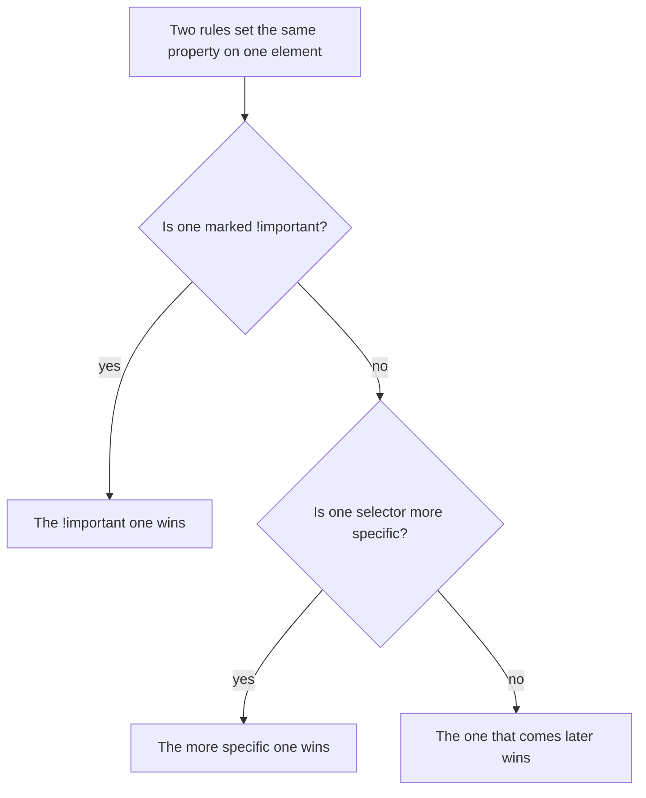
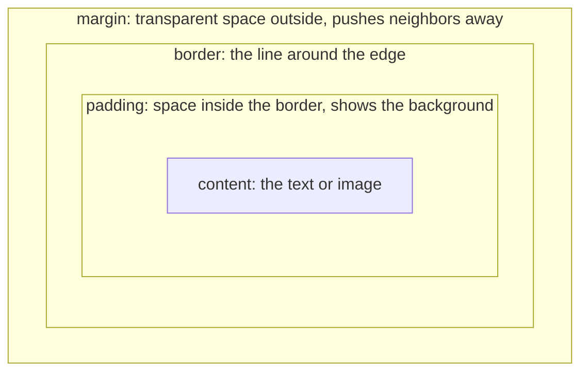

:::objectives
- Write a CSS rule and connect a stylesheet to a page.
- Target elements with type, class, ID, descendant, grouped, and pseudo-class selectors.
- Predict which rule wins a conflict using importance, specificity, and source order, and know which properties inherit.
- Name the four layers of the box model and calculate how wide a box really is, with and without `border-box`.
:::

Three rules below all set the color of the same paragraph, and the blue rule comes last. Cover the result with your hand and predict the color before you look.

```html preview height="90"
<p id="intro" class="note">Which color am I?</p>

<style>
  #intro { color: crimson; }
  .note  { color: seagreen; }
  p      { color: royalblue; }
</style>
```

It's crimson. "The last rule wins" is only the tie-breaker, and most beginners' CSS frustrations come from not knowing what happens before the tie-break. By the end of this lesson you'll be able to explain that result, and you'll know how to write CSS that doesn't surprise you.

## The anatomy of a CSS rule

```css
p {
  color: royalblue;
  font-size: 18px;
}
```

-   `p` is the **selector**: which elements this rule applies to.
-   Between the braces are **declarations**, each a **property** (`color`), a colon, a **value** (`royalblue`), and a semicolon.

CSS can live in three places:

1.  **An external stylesheet**, a `.css` file connected in the `<head>` with `<link rel="stylesheet" href="css/styles.css">`. Use this in your projects: one file can style every page of a site.
2.  **A `<style>` element** inside the HTML. The live examples in these lessons use it so the code and its result fit in one block.
3.  **A `style` attribute** on one element, like `<p style="color: red">`. Avoid it. It can't be reused, and as you'll see, it beats almost every other rule.

## Selectors point at elements

| Selector | Example | Selects |
| --- | --- | --- |
| Type | `p` | Every `<p>` |
| Class | `.price` | Every element with `class="price"` |
| ID | `#signup` | The one element with `id="signup"` |
| Descendant | `nav a` | Every `<a>` anywhere inside a `<nav>` |
| Child | `ul > li` | `<li>`s directly inside a `<ul>`, not deeper |
| Group | `h1, h2` | Every `<h1>` and every `<h2>` |
| Pseudo-class | `a:hover` | A link while the pointer is over it |
| Universal | `*` | Every element |

Hover over the menu links in this result:

```html preview height="200"
<nav>
  <a href="#">Home</a> <a href="#">Menu</a>
</nav>
<h2>Today's specials</h2>
<p>Tomato soup <span class="price">$4</span></p>
<p class="sold-out">Grilled cheese <span class="price">$6</span></p>

<style>
  h2 { font-family: Georgia, serif; }
  .price { font-weight: bold; color: darkgreen; }
  .sold-out { text-decoration: line-through; color: gray; }
  nav a { background: #fde68a; padding: 2px 8px; }
  nav a:hover { background: #f59e0b; }
</style>
```

A few things to notice. In the HTML, a class is written without the dot (`class="price"`); in CSS, the dot means "class". An element can have several classes separated by spaces, like `class="card featured"`, and each one can be targeted. And the sold-out price is still green even though its paragraph is gray. That's the cascade at work, and it's coming up next.

**Classes are your everyday tool.** IDs must be unique on a page and are best kept for jump links and pairing labels with inputs. You'll see below why styling with them causes trouble.

## The cascade: how the browser picks a winner

The cascade only matters when two declarations try to set the **same property** on the **same element**. Then the browser settles it by asking three questions, in this order:



1.  **Importance.** A declaration ending in `!important` beats normal ones. Treat it as an emergency tool you almost never use. (Even before this question, your CSS beats the browser's built-in defaults, which is why your rules can restyle an `<h1>` at all.)
2.  **Specificity.** The more precisely a selector targets an element, the stronger it is. Details in the next section.
3.  **Source order.** If everything else ties, the declaration that appears later in the CSS wins.

**Inheritance** is a separate idea that people often mix up with the cascade. Some properties, mostly about text (`color`, `font-family`, `font-size`, `line-height`, `text-align`), pass down from a parent to everything inside it. Box properties (`border`, `padding`, `margin`, `background`, `width`) don't.

```html preview height="150"
<div class="card">
  <p>This text inherits the card's color and font.</p>
  <p>But <a href="#">this link</a> stays blue, and the border didn't pass down to the paragraphs.</p>
</div>

<style>
  .card { color: #7c2d12; font-family: Georgia, serif; border: 3px solid #7c2d12; padding: 8px; }
</style>
```

An inherited value is the weakest thing in CSS: *any* rule that targets the element directly beats it. The browser's default stylesheet has a rule that colors `a` elements blue, so the link ignores the color it would inherit. Same story for the sold-out price above: `.price` targets the `<span>` directly, so it beats the gray coming down from the paragraph. To make links follow their parent's color, target them: `.card a { color: inherit; }`.

## Specificity is a three-column score

Score every selector by counting three kinds of thing:

1.  **IDs** (`#intro`)
2.  **Classes, pseudo-classes, and attribute selectors** (`.note`, `:hover`, `[type="email"]`)
3.  **Element types** (`p`, `nav`)

Write the counts as three numbers and compare them **left to right**, like comparing words alphabetically. The first column that differs decides; the rest don't matter.

| Selector | IDs | Classes | Types | Score |
| --- | --- | --- | --- | --- |
| `*` | 0 | 0 | 0 | 0-0-0 |
| `p` | 0 | 0 | 1 | 0-0-1 |
| `nav a` | 0 | 0 | 2 | 0-0-2 |
| `.note` | 0 | 1 | 0 | 0-1-0 |
| `p.note` | 0 | 1 | 1 | 0-1-1 |
| `nav a:hover` | 0 | 1 | 2 | 0-1-2 |
| `.card .price` | 0 | 2 | 0 | 0-2-0 |
| `#intro` | 1 | 0 | 0 | 1-0-0 |

Back to the opening puzzle: `#intro` scores 1-0-0, `.note` 0-1-0, and `p` 0-0-1. The ID wins in the first column, so the paragraph is crimson, and the order of the rules never came into it.

Columns never carry over. A selector with one class (0-1-0) beats one with eleven type selectors (0-0-11), the same way "b" comes after "azzzz" in the dictionary. Above all three columns sit inline `style` attributes, and above those, `!important`.

That's why experienced developers style almost entirely with single classes. When every selector scores about 0-1-0, conflicts are settled by source order, which you can see by reading the file. Use an ID, and the only way to override it is another ID or `!important`, and then the next fix needs something even stronger.

:::video LUDkXMXf3P8
What to watch for: Kevin Powell counts the score of several selectors and then shows a lower-scoring rule losing even though it comes later in the file.
:::

## Every element is a box

The browser draws every element as a rectangle with four layers, from the inside out:



```html preview height="230"
<div class="margin-area">
  <div class="box">
    <div class="content">content</div>
  </div>
</div>
<p>Yellow = margin. Light blue = padding. Navy = border. Dark blue = content.</p>

<style>
  /* .margin-area exists only to paint the margin yellow so you can see it */
  .margin-area { display: inline-block; background: #fde68a; }
  .box {
    margin: 24px;
    border: 8px solid #1e3a8a;
    padding: 24px;
    background: #bfdbfe;
  }
  .content { width: 140px; padding: 10px 0; background: #2563eb; color: white; text-align: center; font: 16px sans-serif; }
</style>
```

-   **Content** is where text and images go. `width` and `height` set its size.
-   **Padding** is space between the content and the border. The element's background fills it, so it's what gives a button breathing room around its label.
-   **Border** is the edge line.
-   **Margin** is transparent space *outside* the border. It pushes other elements away.

Padding, border, and margin each have four sides. `padding: 10px` sets all four; `padding: 10px 20px` sets top and bottom to 10 and left and right to 20; four values go clockwise from the top (`padding: 10px 20px 30px 40px` is top, right, bottom, left). For one side, use `margin-top`, `padding-left`, and so on.

In DevTools, select any element and open the **Computed** tab (Chrome) or the **Layout** tab (Firefox). A box-model diagram shows the real numbers for all four layers, and hovering over each layer highlights it on the page.

## How wide is a box, really?

Predict: both boxes below have `width: 200px`, `padding: 20px`, and a `5px` border. Will they line up with the 200px gray ruler?

```html preview height="200"
<div class="ruler">200px</div>
<div class="box content-box">content-box</div>
<div class="box border-box">border-box</div>

<style>
  .ruler { width: 200px; background: #e5e7eb; text-align: center; font: 12px monospace; }
  .box {
    width: 200px;
    padding: 20px;
    border: 5px solid #334155;
    margin-top: 10px;
    background: #fef3c7;
    font: 14px monospace;
  }
  .content-box { box-sizing: content-box; }
  .border-box  { box-sizing: border-box; }
</style>
```

By default (`box-sizing: content-box`), `width` sets only the content. Padding and border are added on top, so the first box is 5 + 20 + 200 + 20 + 5 = **250px** wide and sticks out past the ruler.

With `box-sizing: border-box`, `width` means the whole box including padding and border, so the second box is exactly 200px and its content shrinks to 150px. That's far easier to reason about, which is why most projects start their CSS with this rule:

```css
*, *::before, *::after {
  box-sizing: border-box;
}
```

Margin is never part of the width in either mode. It's extra space around the box.

:::warning
**Vertical margins collapse.** When one block sits on top of another, their touching margins don't add up: the bigger one wins. A paragraph with `margin-bottom: 30px` above one with `margin-top: 20px` leaves a 30px gap, not 50px. Side-by-side (horizontal) margins and padding never collapse. If spacing looks smaller than you expected, this is usually why.
:::

:::warning
**Inline elements ignore width and height.** `<a>`, `<span>`, and `<strong>` sit inside a line of text, so `width`, `height`, and top and bottom margins don't move anything around them. If you need a link to behave like a box (a button, say), give it `display: inline-block` or `display: block`.
:::

:::tip
To see every box on a page at once, temporarily add `* { outline: 2px solid red; }`. Unlike a border, an outline takes up no space, so it shows you the layout without changing it.
:::

:::video gjfYr_RpyDU
What to watch for: the moment a box with padding grows wider than the width you set, and how one `box-sizing` line fixes it everywhere.
:::

:::quiz
Q: The HTML is `<p class="tip">Save often</p>`. The CSS has `.tip { color: green; }` first and `p { color: purple; }` after it. What color is the text?
- [x] Green
  `.tip` scores 0-1-0 and `p` scores 0-0-1. Specificity is checked before order, so the class wins even though it comes first.
- [ ] Purple, because it comes last
  Source order only breaks ties, and these two selectors aren't tied.
- [ ] The browser's default black
  Both rules target the element directly, so one of them applies.

Q: Two rules both use the selector `.button`. The first sets `background: blue`; the second, later in the file, sets `background: orange`. What color is the button?
- [ ] Blue, because it was defined first
  Earlier never beats later when specificity is equal.
- [x] Orange
  Same selector, same specificity, so source order decides and the later rule wins.
- [ ] A mix of the two
  CSS picks exactly one value per property.

Q: A box has `width: 300px`, `padding: 10px`, and `border: 2px solid`, with the default `box-sizing`. How wide is it on screen, from border edge to border edge?
- [ ] 300px
  That's the content width only. With the default `content-box`, padding and border are added on top.
- [ ] 312px
  That adds one side of padding and border. Both sides count: left and right.
- [x] 324px
  2 + 10 + 300 + 10 + 2 = 324. With `border-box` it would be exactly 300.

Q: A heading with `margin-bottom: 40px` sits directly above a paragraph with `margin-top: 25px`. How big is the gap between them?
- [ ] 65px
  Vertical margins between stacked blocks don't add up.
- [x] 40px
  The margins collapse, and the larger of the two wins.
- [ ] 25px
  When margins collapse, the larger one is kept, not the smaller.
:::

:::takeaways
- A rule is a selector plus declarations. In projects, put CSS in a `.css` file linked from the `<head>`.
- Conflicts are settled by importance, then specificity, then source order. Inherited values lose to anything that targets the element directly.
- Specificity is IDs-classes-types, compared left to right. Styling with single classes keeps conflicts predictable; avoid IDs and `!important` for styling.
- Every box is content, padding, border, and margin. With the default `content-box`, padding and border add to `width`; `border-box` includes them.
- Vertical margins between stacked blocks collapse to the larger one.
:::

## Further reading

-   [Handling conflicts](https://developer.mozilla.org/en-US/docs/Learn_web_development/Core/Styling_basics/Handling_conflicts): MDN's full explanation of the cascade, specificity, and inheritance, with editable examples.
-   [The box model](https://developer.mozilla.org/en-US/docs/Learn_web_development/Core/Styling_basics/Box_model): MDN on margins, padding, borders, inline versus block boxes, and margin collapsing.
-   [Specificity Calculator](https://specificity.keegan.st/): type any selector and see its score, a handy way to check your own counting.
