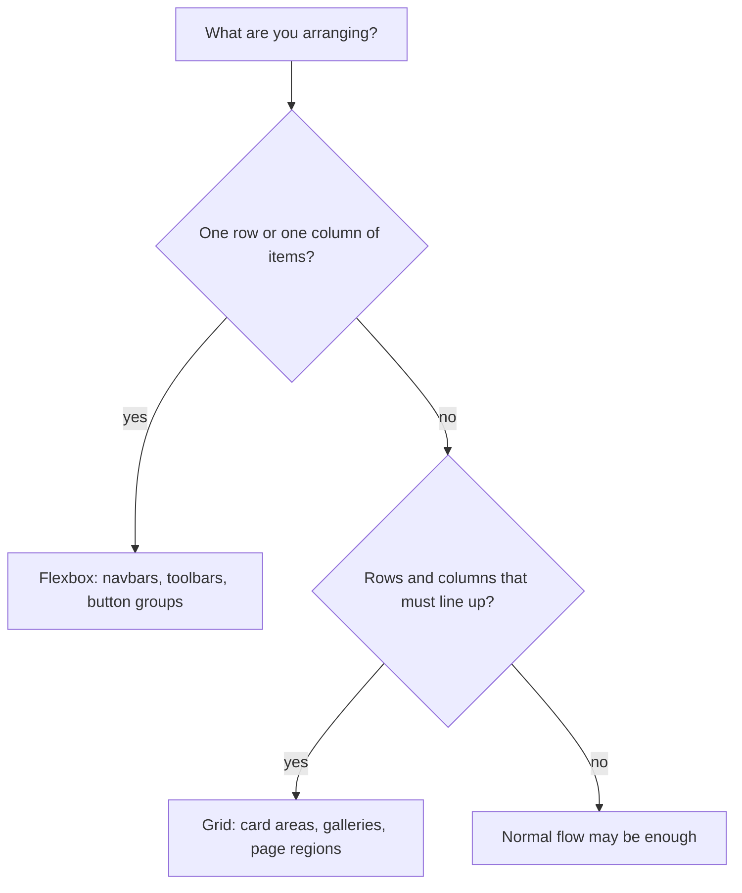

:::objectives
- Turn a parent element into a flex container and control its items with `justify-content`, `align-items`, `gap`, and `flex-wrap`.
- Explain the main axis and the cross axis, and predict what happens when `flex-direction` changes.
- Build grids with `grid-template-columns`, the `fr` unit, `repeat()`, and `minmax()`.
- Name page regions with `grid-template-areas` and decide when to reach for Flexbox or Grid.
:::

Put three cards on a page and they stack like pancakes, each one stretched across the whole width. You wanted them side by side. For years, getting there meant floats, clearfix hacks, and a lot of guessing. Today it takes one line of CSS.

Look at the two groups below. The HTML is identical. The only difference is `display: flex` on the second parent.

```html preview height="300"
<p>Normal flow: every block gets its own line.</p>
<div class="cards">
  <div class="card">One</div>
  <div class="card">Two</div>
  <div class="card">Three</div>
</div>

<p>Same HTML, plus <code>display: flex</code> on the parent:</p>
<div class="cards flex">
  <div class="card">One</div>
  <div class="card">Two</div>
  <div class="card">Three</div>
</div>

<style>
  body { font: 16px/1.4 system-ui, sans-serif; margin: 12px; }
  .card { background: #dbeafe; border: 2px solid #3b82f6; border-radius: 6px; padding: 8px 12px; margin: 4px; }
  .flex { display: flex; }
</style>
```

## The parent decides the layout

Block elements like `<div>`, `<p>`, and `<section>` follow **normal flow**: each one starts on a new line and is as wide as its parent. That's why the first group stacks.

When you write `display: flex` on an element, it becomes a **flex container**, and its direct children become **flex items**. The rule goes on the parent, and it only reaches one level down. Grandchildren keep behaving normally unless you make their parent a flex container too.

Notice that the flex cards also shrank to fit their text. Flexbox sizes items by their content first, then hands out leftover space if you ask it to.

## Main axis and cross axis

Every flex container has two directions. The **main axis** is the direction items line up in. The **cross axis** runs across it. With the default `flex-direction: row`, the main axis goes left to right and the cross axis goes top to bottom.

Two properties move items along those axes:

-   `justify-content` places items along the **main** axis: `flex-start`, `center`, `flex-end`, `space-between`, `space-around`, `space-evenly`.
-   `align-items` places items along the **cross** axis: `stretch` (the default), `flex-start`, `center`, `flex-end`.

Before you scroll, predict: in the last row, where will the short "A" box sit vertically?

```html preview height="420"
<p class="label">justify-content: flex-start (default)</p>
<div class="bar"><span>A</span><span>B</span><span>C</span></div>

<p class="label">justify-content: center</p>
<div class="bar" style="justify-content: center"><span>A</span><span>B</span><span>C</span></div>

<p class="label">justify-content: space-between</p>
<div class="bar" style="justify-content: space-between"><span>A</span><span>B</span><span>C</span></div>

<p class="label">align-items: stretch (default) vs. align-items: center</p>
<div class="tall"><span>A</span><span class="big">B<br>is<br>tall</span><span>C</span></div>
<div class="tall" style="align-items: center"><span>A</span><span class="big">B<br>is<br>tall</span><span>C</span></div>

<style>
  body { font: 15px/1.3 system-ui, sans-serif; margin: 10px; }
  .label { margin: 10px 0 4px; font-family: monospace; }
  .bar, .tall { display: flex; gap: 6px; background: #f1f5f9; border: 1px dashed #94a3b8; padding: 6px; }
  .tall { margin-bottom: 6px; }
  span { background: #fde68a; border: 2px solid #d97706; border-radius: 4px; padding: 6px 12px; }
</style>
```

In the default `stretch` row, A and C grow to match the tallest item, B. With `align-items: center`, each item keeps its own height and sits in the middle of the cross axis.

:::try
Copy the preview into your own file and add `flex-direction: column` to `.bar`. Now the main axis points down the page, so `justify-content` moves things vertically and `align-items` moves them sideways. Give the bar a `height: 150px` so you can see it.
:::

## Gap, wrapping, and who gets the leftover space

Three more properties handle most real layouts:

-   `gap: 12px` puts space *between* items, never on the outside edges. No more margin math.
-   `flex-wrap: wrap` lets items drop to a new line when they run out of room. Without it, flex items squeeze onto one line, even if that means shrinking below a sensible size.
-   `flex: 1` on an item tells it to grow and take whatever space is left over.

Here is a shop toolbar and a list of filter tags using all three.

```html preview height="200"
<header class="toolbar">
  <strong>Pixel Pantry</strong>
  <input type="search" placeholder="Search snacks" aria-label="Search snacks">
  <button>Cart (2)</button>
</header>

<ul class="tags">
  <li>Sweet</li><li>Salty</li><li>Spicy</li><li>Gluten-free</li><li>Vegan</li>
  <li>Under $3</li><li>Family size</li><li>New this week</li><li>Local</li>
</ul>

<style>
  body { font: 15px/1.3 system-ui, sans-serif; margin: 10px; }
  .toolbar { display: flex; align-items: center; gap: 12px; padding: 10px 14px; background: #1e293b; color: white; border-radius: 8px; }
  .toolbar input { flex: 1; min-width: 0; padding: 8px; border-radius: 6px; border: 0; }
  .toolbar button { padding: 8px 12px; }
  .tags { display: flex; flex-wrap: wrap; gap: 8px; list-style: none; padding: 0; }
  .tags li { background: #e0e7ff; border-radius: 999px; padding: 4px 12px; }
</style>
```

The search box has `flex: 1`, so it stretches while the logo and button stay their natural size. The tags wrap onto as many lines as they need, with the same 8px gap between rows and columns.

## Grid: draw the columns first

Flexbox works outward from the content: items take the space they need. Grid works the other way. You describe the columns first, and the items drop into them like eggs into a carton.

```html preview height="250"
<div class="grid">
  <div>1</div><div>2</div><div>3</div>
  <div>4</div><div>5</div><div>6</div>
</div>

<style>
  body { font: 16px system-ui, sans-serif; margin: 12px; }
  .grid {
    display: grid;
    grid-template-columns: 1fr 2fr 1fr;
    gap: 12px;
  }
  .grid div { background: #dcfce7; border: 2px solid #16a34a; border-radius: 6px; padding: 24px; text-align: center; }
</style>
```

`grid-template-columns` lists one size per column. The `fr` unit means "a fraction of the free space": the browser subtracts the gaps, then splits what's left into 1 + 2 + 1 = 4 shares. The middle column gets two of them. You can mix units too: `grid-template-columns: 200px 1fr` gives a fixed sidebar and a main column that takes the rest.

`repeat(4, 1fr)` is shorthand for `1fr 1fr 1fr 1fr`. Notice you never wrote any rows: Grid adds them automatically as items run out of columns.

## Columns that count themselves

The nicest trick in Grid is a single line that picks the number of columns for you:

```css
grid-template-columns: repeat(auto-fit, minmax(140px, 1fr));
```

Read it from the inside out. `minmax(140px, 1fr)` says each column must be at least 140px and may grow to share the free space. `auto-fit` says "fit as many of those columns as the width allows." Drag the corner of the dashed box below (with a mouse or trackpad) and watch the column count change.

```html preview height="330"
<p>Drag the bottom-right corner of the dashed box.</p>
<div class="frame">
  <div class="grid">
    <div>A</div><div>B</div><div>C</div><div>D</div>
    <div>E</div><div>F</div><div>G</div><div>H</div>
  </div>
</div>

<style>
  body { font: 15px system-ui, sans-serif; margin: 10px; }
  .frame { resize: horizontal; overflow: auto; width: 90%; min-width: 160px; max-width: 100%; border: 2px dashed #94a3b8; padding: 8px; box-sizing: border-box; }
  .grid { display: grid; grid-template-columns: repeat(auto-fit, minmax(140px, 1fr)); gap: 8px; }
  .grid div { background: #fce7f3; border: 2px solid #db2777; border-radius: 6px; padding: 18px; text-align: center; }
</style>
```

No media queries, no breakpoints. The grid simply responds to the space it's given.

## Name the regions with grid-template-areas

For page layouts, you can draw a little map in your CSS. Each quoted string is one row, and each word names the cell in that column. Then each element claims its region with `grid-area`.

```html preview height="320"
<div class="page">
  <header>Header</header>
  <nav>Sidebar</nav>
  <main>Main content</main>
  <footer>Footer</footer>
</div>

<style>
  body { font: 15px system-ui, sans-serif; margin: 10px; }
  .page {
    display: grid;
    grid-template-columns: 150px 1fr;
    grid-template-rows: auto 1fr auto;
    grid-template-areas:
      "header  header"
      "sidebar main"
      "footer  footer";
    gap: 8px;
    min-height: 280px;
  }
  header { grid-area: header; }
  nav    { grid-area: sidebar; }
  main   { grid-area: main; }
  footer { grid-area: footer; }
  .page > * { background: #ede9fe; border: 2px solid #7c3aed; border-radius: 6px; padding: 10px; }
</style>
```

Writing `header` twice in the first row makes the header span both columns. To move the sidebar to the right, you'd only change the strings to `"main sidebar"` and swap the column sizes. The HTML stays put.

## Flexbox or Grid?

Both can do many of the same jobs. Here's a rule of thumb that holds up:



Real pages mix them. A dashboard might use Grid for the whole page (header, sidebar, card area) and Flexbox inside the header to spread out the logo, search box, and profile button. A grid item can be a flex container, and a flex item can be a grid container.

:::video fYq5PXgSsbE
What to watch for: the flexbox terms (container, items, main axis, cross axis) and each container property shown live. It's a second angle on the properties you just used.
:::

:::video rg7Fvvl3taU start=3:08
What to watch for: how Kevin turns on the Grid inspector in DevTools to see the column lines, and why you usually don't need to declare rows at all. Watch until about 13:00; the section at 28:21 covers `grid-template-areas`.
:::

:::warning
**`display: flex` on the wrong element.** Writing `.card { display: flex; }` lays out the stuff *inside* each card, not the cards themselves. To put cards side by side, the rule goes on their parent: `.cards { display: flex; }`.
:::

:::warning
**Percent columns plus a gap overflow.** `grid-template-columns: 33.33% 33.33% 33.33%` with `gap: 20px` is wider than 100%, so the grid sticks out of its container. Use `repeat(3, 1fr)`: `fr` is measured after the gaps are taken out, so it always fits.
:::

:::warning
**An area that isn't a rectangle.** Every named area in `grid-template-areas` must form a rectangle, and every row string needs the same number of cells. Break either rule and the browser throws the whole declaration away. In DevTools you'll see the line crossed out with a yellow warning icon, and your items fall back to one column.
:::

:::quiz
Q: You write `.card { display: flex; }`, but the three `.card` elements inside `.cards` still stack on top of each other. Why?
- [ ] Flexbox also needs `flex-direction: row`
  `row` is already the default direction, so adding it changes nothing.
- [x] `display: flex` must go on the parent, `.cards`
  The container controls the layout of its direct children. On `.card` it only arranges what's inside each card.
- [ ] The cards need a `gap`
  `gap` only adds space between items that are already laid out by flex or grid.

Q: A container has `display: flex; flex-direction: column;`. Which line centers its items horizontally?
- [ ] `justify-content: center`
  With `column`, the main axis runs top to bottom, so this centers items vertically.
- [x] `align-items: center`
  The cross axis is now horizontal, and `align-items` works on the cross axis.
- [ ] `text-align: center`
  That centers text inside each item, not the items themselves.

Q: A grid is 600px wide with `grid-template-columns: 1fr 2fr` and no gap. How wide are the columns?
- [ ] 300px and 300px
  That would be `1fr 1fr`. The second column gets twice the share.
- [x] 200px and 400px
  The free space is split into 3 shares of 200px; the first column gets 1, the second gets 2.
- [ ] 1px and 2px
  `fr` is a share of the free space, not a pixel size.

Q: Eight cards sit in a 500px wide grid with `repeat(auto-fit, minmax(200px, 1fr))` and no gap. How many columns do you get?
- [ ] 3
  Three columns of at least 200px need 600px, which doesn't fit.
- [x] 2
  Two 200px columns fit in 500px, and the `1fr` maximum stretches each to 250px to fill the row.
- [ ] 8
  Each column must be at least 200px, so eight can't fit side by side.
:::

:::takeaways
- `display: flex` and `display: grid` go on the **parent**; only its direct children are laid out.
- In Flexbox, `justify-content` works along the main axis and `align-items` along the cross axis. `flex-direction: column` swaps which way is which.
- `gap` spaces items, `flex-wrap: wrap` lets them break onto new lines, and `flex: 1` makes an item take the leftover room.
- In Grid, `fr` splits the free space after gaps; `repeat(auto-fit, minmax(…, 1fr))` makes a grid that picks its own column count.
- `grid-template-areas` draws the page as a map of named rectangles. Use Flexbox for one line of things, Grid for rows and columns, and nest them freely.
:::

## Further reading

- [CSS-Tricks: A Complete Guide to Flexbox](https://css-tricks.com/snippets/css/a-guide-to-flexbox/): every property with a picture, split into "parent" and "children" columns. Worth bookmarking.
- [CSS-Tricks: A Complete Guide to CSS Grid](https://css-tricks.com/snippets/css/complete-guide-grid/): the same format for Grid, including `minmax()`, `auto-fit`, and areas.
- [MDN: Basic concepts of flexbox](https://developer.mozilla.org/en-US/docs/Web/CSS/CSS_flexible_box_layout/Basic_concepts_of_flexbox): the precise rules for axes, wrapping, and how `flex` sizes items.
