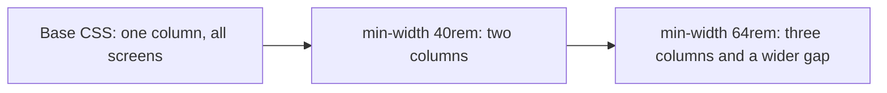

:::objectives
- Add the viewport meta tag and explain what goes wrong without it.
- Choose between `px`, `%`, `rem`, and `vw`, and size text with `clamp()`.
- Write mobile-first CSS with `min-width` media queries, and make images shrink to fit.
- Check text contrast, keep visible focus styles, support keyboard users, and respect `prefers-reduced-motion`.
:::

Maya's portfolio looks great on her laptop. Her friend opens the link on a phone and has to pinch to read anything, and the project gallery runs off the right edge. Another visitor, who uses the keyboard instead of a mouse, presses Tab and can't tell where they are on the page, because Maya wrote `outline: none` to get rid of "that ugly blue ring."

A missing tag, one fixed width, and one line of CSS caused all three. Each has a small fix.

## The viewport tag comes first

Phones still have to show old sites built for desktops. So unless a page says otherwise, many mobile browsers lay it out in a pretend window about 980px wide, then shrink the result to fit. Everything becomes tiny, and your phone-sized CSS never runs.

This line in the `<head>` tells the browser to use the device's real width:

```html
<meta name="viewport" content="width=device-width, initial-scale=1">
```

VS Code's `!` shortcut for a new HTML file adds it for you.

## Sizes that bend instead of break

Maya's gallery had `width: 900px`. On a 390px phone, that's 510px of sideways scrolling. Here are the units to reach for instead:

| Unit | Means | Good for |
| ---- | ----- | -------- |
| `px` | a fixed size | borders, small details |
| `%` | a share of the parent's size | widths inside a container |
| `rem` | a multiple of the root font size (16px by default) | font sizes, spacing |
| `vw` | 1% of the viewport's width | fluid sizes, used inside `clamp()` |

Use `rem` for text. Some visitors raise the default font size in their browser settings because they need bigger text. Sizes in `rem` grow with that setting; sizes in `px` ignore it.

Two patterns fix most width problems. `max-width` lets an element shrink but caps how wide it gets. And `clamp(min, preferred, max)` picks the preferred value but never goes below the minimum or above the maximum.

```html preview height="270"
<div class="wrap">
  <h1>Maya Chen</h1>
  <p>I design posters and build small websites for school clubs. This box is never wider than 40rem, and it keeps a 1rem gap from the edges on small screens.</p>
</div>
<p class="info">This frame is <span id="w"></span>px wide.</p>
<script>
  const show = () => { document.getElementById("w").textContent = innerWidth; };
  show(); addEventListener("resize", show);
</script>
<style>
  body { font-family: system-ui, sans-serif; margin: 0; }
  .wrap { max-width: 40rem; margin: 0 auto; padding: 0 1rem; }
  h1 { font-size: clamp(1.75rem, 1rem + 4vw, 3rem); margin: 0.5rem 0; }
  .info { text-align: center; color: #475569; font-size: 0.9rem; }
</style>
```

The heading's size is `1rem + 4vw`, so it grows as the screen widens, but `clamp()` holds it between 1.75rem and 3rem. On a phone it won't shrink to nothing, and on a giant monitor it won't turn into a billboard. The `margin: 0 auto` centers the box once it hits its max width.

## Mobile-first media queries

Sometimes the layout itself has to change: a sidebar sits beside the content on a laptop but below it on a phone. **Media queries** are CSS that only applies when a condition is true.

```css
@media (min-width: 40rem) {
  /* these rules only apply when the viewport is at least 40rem (640px) wide */
}
```

The smart way to use them is **mobile-first**. Write your normal CSS for the smallest screen, usually one simple column. Then add `min-width` queries that layer on columns as space appears. Small screens get the simplest CSS, and you rarely undo anything.



In the preview below, the frame is the viewport. Read the width it reports, then predict: one column or two?

```html preview height="250"
<div class="layout">
  <main>Projects</main>
  <aside>About me</aside>
</div>
<p class="info">This frame is <span id="w"></span>px wide.</p>
<script>
  const show = () => { document.getElementById("w").textContent = innerWidth; };
  show(); addEventListener("resize", show);
</script>
<style>
  body { font-family: system-ui, sans-serif; margin: 10px; }
  .layout { display: grid; gap: 10px; }
  .layout > * { background: #e0f2fe; border: 2px solid #0284c7; border-radius: 6px; padding: 30px 12px; }

  @media (min-width: 600px) {
    .layout { grid-template-columns: 2fr 1fr; }
  }
  .info { color: #475569; font-size: 0.9rem; }
</style>
```

On a laptop the frame is wider than 600px, so you see two columns. On a phone you see one. To watch it switch in your own project, open Chrome DevTools and press **Ctrl+Shift+M** (**Cmd+Shift+M** on a Mac) to toggle the device toolbar, then drag the width or pick a preset like *Mobile M (375px)*.

## Images that shrink to fit

A photo straight off a phone camera can be 4000px wide. By default an `` shows at its real size, so one big photo can break the whole layout. One rule fixes it everywhere:

```html preview height="250"
<div class="box">
  <p>Without the rule</p>
  
</div>
<div class="box fixed">
  <p>With <code>max-width: 100%</code></p>
  
</div>
<style>
  body { font: 14px system-ui, sans-serif; margin: 10px; }
  .box { width: 260px; border: 2px dashed #64748b; padding: 6px; margin-bottom: 10px; }
  .box p { margin: 0 0 4px; }
  .fixed img { max-width: 100%; height: auto; display: block; }
</style>
```

The first image pokes far out of its 260px box. The second shrinks to fit, and `height: auto` keeps its shape. Put `img { max-width: 100%; height: auto; }` near the top of every stylesheet, and keep the `width` and `height` attributes in your HTML so the browser can reserve space before the image loads.

## Remove the barriers you can't see

A page that fits every screen can still shut people out. Five checks catch most problems.

**Contrast.** Light grey on white looks elegant and is hard to read, especially on a phone in sunlight. The accessibility guidelines (WCAG) ask for a contrast ratio of at least **4.5:1** for normal text and **3:1** for large text (about 24px, or 18.5px bold).

```html preview height="150"
<p style="color:#aaaaaa">#aaaaaa on white: 2.3 to 1. Fails.</p>
<p style="color:#767676">#767676 on white: 4.5 to 1. Just passes.</p>
<p style="color:#595959">#595959 on white: 7 to 1. Comfortable.</p>
<style> body { font: 17px system-ui, sans-serif; margin: 10px; } </style>
```

Check any pair with the WebAIM contrast checker, or click a color swatch in DevTools' Styles pane, where Chrome shows the contrast ratio.

**Visible focus.** When someone presses Tab, the browser outlines the element that has focus. Removing that outline is like hiding the mouse pointer. If you don't like the default ring, replace it; never just delete it. `:focus-visible` matches when the browser decides a focus ring is useful (keyboard use), so mouse clicks don't trigger it.

**Real controls.** Tab only stops on focusable things: links with an `href`, buttons, and form fields. A `<div>` with a click handler can't be reached. Click the first line of the preview below, then press Tab a few times and watch where focus goes.

```html preview height="190"
<p>Click here, then press Tab, Tab, Tab.</p>
<a href="#" class="none">Link with outline: none</a>
<a href="#" class="ring">Link with a focus style</a>
<div class="fake" onclick="this.textContent = 'Clicked'">Fake button (a div)</div>
<button type="button" class="ring" onclick="this.textContent = 'Pressed'">Real button</button>
<style>
  body { font: 16px system-ui, sans-serif; margin: 10px; display: flex; flex-direction: column; align-items: flex-start; gap: 10px; }
  p { margin: 0; }
  .none:focus { outline: none; }
  .ring:focus-visible { outline: 3px solid #1d4ed8; outline-offset: 3px; }
  .fake { background: #e2e8f0; padding: 6px 12px; border-radius: 4px; cursor: pointer; }
  button { font: inherit; padding: 6px 12px; }
</style>
```

Focus lands on the first link with no visible sign, then the second link shows a clear ring, then it jumps straight past the fake button to the real one. Keyboard users never learn the fake one exists.

**Alt text.** Every `` needs an `alt` that says what the image tells the reader. Pure decoration gets `alt=""`, so screen readers skip it.

**Motion.** Some people get dizzy or sick from animation. Operating systems have a "reduce motion" setting, and CSS can read it:

```css
.bounce { animation: bounce 1s infinite alternate; }

@media (prefers-reduced-motion: reduce) {
  .bounce { animation: none; }
}
```

To test it without changing your computer's settings, open the DevTools Command Menu (**Ctrl+Shift+P** or **Cmd+Shift+P**), run **Show Rendering**, and set *Emulate CSS media feature prefers-reduced-motion* to `reduce`.

:::video VQraviuwbzU
What to watch for: "avoid fixed sizes" at 4:46 and "use media queries to add complexity" at 8:17. His point: a page is responsive until our CSS breaks it.
:::

:::video apdD69J4bEc
What to watch for: `:focus-visible` at 2:57, and why a click doesn't show the ring while a Tab press does.
:::

:::warning
**`outline: none` with nothing to replace it.** This one line makes a site unusable for keyboard users, and it hides in a lot of copied CSS. Search your stylesheet for `outline: none` and `outline: 0`, and wherever you find one, add a `:focus-visible` rule with an outline that has at least 3:1 contrast against the background.
:::

:::warning
**Max-width and min-width queries fighting.** With both `@media (max-width: 600px)` and `@media (min-width: 600px)` in one file, both apply at exactly 600px. Go mobile-first and use `min-width` everywhere.
:::

:::quiz
Q: A page looks tiny and zoomed-out on every phone, and none of its media queries seem to run. What's the most likely cause?
- [ ] The media queries use `rem` instead of `px`
  `rem` works fine in media queries. The queries never match because the browser thinks the screen is wide.
- [x] The `<head>` is missing the viewport meta tag
  Without it, many phones lay the page out about 980px wide and shrink it, so phone-sized queries never apply.
- [ ] The images don't have `max-width: 100%`
  That would cause overflowing images, not a zoomed-out page with dead media queries.

Q: Mobile-first CSS puts the phone layout in the base styles. Which media query adds a two-column layout for wider screens?
- [x] `@media (min-width: 40rem) { … }`
  The rules apply once the screen is at least 40rem wide, adding columns on top of the one-column base.
- [ ] `@media (max-width: 40rem) { … }`
  That applies to small screens, which is desktop-first thinking.
- [ ] `@media (width: 40rem) { … }`
  That only matches a screen exactly 40rem wide.

Q: What does `font-size: clamp(1.5rem, 5vw, 3rem)` give on a 400px-wide phone?
- [ ] 20px
  5vw is 20px here, but that's below the minimum.
- [x] 24px (1.5rem)
  5% of 400px is 20px, which is under the 1.5rem floor, so the floor wins.
- [ ] 48px (3rem)
  The maximum only applies once 5vw passes 48px, at 960px wide.

Q: A designer builds a "button" as `<div class="btn" onclick="buy()">Buy</div>`. What happens for someone using only a keyboard?
- [ ] It works, because Enter triggers `onclick` on anything
  Enter only activates elements that can take focus, and a plain `div` can't.
- [x] Tab skips it, so they can never reach or press it
  A `div` isn't focusable. Using `<button type="button">` gives you focus, Enter, and Space for free.
- [ ] It works if the div has a visible focus style
  A focus style only shows on elements that can receive focus.
:::

:::takeaways
- Every page needs `<meta name="viewport" content="width=device-width, initial-scale=1">`.
- Avoid fixed widths. Use `max-width`, `%`, and `rem`, and size headings with `clamp(min, preferred, max)`.
- Mobile-first: base CSS is the one-column phone layout; `@media (min-width: …)` adds columns as screens grow.
- `img { max-width: 100%; height: auto; }` stops images from breaking layouts.
- 4.5:1 contrast, a visible `:focus-visible` style, real `<a>` and `<button>` elements, useful `alt` text, and a `prefers-reduced-motion` rule remove the most common barriers.
:::

## Further reading

- [MDN: Responsive design](https://developer.mozilla.org/en-US/docs/Learn_web_development/Core/CSS_layout/Responsive_Design): the full tour, including the history of why the viewport tag exists.
- [web.dev: Learn Accessibility](https://web.dev/learn/accessibility): a free course from Google; the chapters on focus, color and contrast, and keyboard access fit right after this lesson.
- [WebAIM Contrast Checker](https://webaim.org/resources/contrastchecker/): paste two colors and get the ratio with a pass or fail for each WCAG level.
