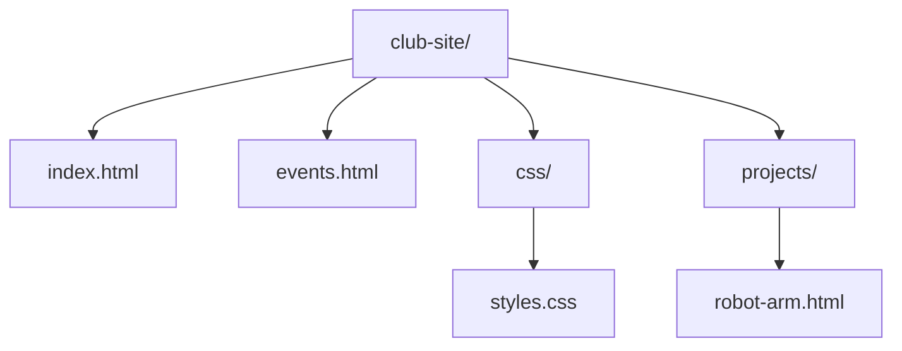

:::objectives
- Use size, weight, color, and spacing to show readers what matters most.
- Set readable body text with a type scale, line height, and line length.
- Store colors, sizes, and spacing in CSS custom properties and reuse them with `var()`.
- Write relative links between pages in different folders, and link one stylesheet from every page.
:::

Lena built her club's website one page at a time. The home page used `#2563eb` for links, the events page used `royalblue`, and the join page used whatever VS Code's color picker landed on. Headings were 28px on one page and `2em` on another. Each page looked fine alone. Together they looked like three different websites, and visitors clicking "Events" thought they'd left the site.

## Hierarchy: what should people see first?

Visitors don't read a page top to bottom. They scan, looking for the part they care about. **Visual hierarchy** is how you guide that scan: the most important thing looks the most important.

Both cards below have the same words. Squint at them until the text blurs. On which one can you still tell what's going on?

```html preview height="300"
<div class="pair">
  <div class="flat">
    <p>Riverside Robotics</p>
    <p>Spring build season starts March 3</p>
    <p>We meet Tuesdays and Thursdays in room 114. New members are welcome, and no experience is needed.</p>
    <p>Sign up by February 20</p>
  </div>
  <div class="clear">
    <p class="eyebrow">Riverside Robotics</p>
    <h2>Spring build season starts March 3</h2>
    <p>We meet Tuesdays and Thursdays in room 114. New members are welcome, and no experience is needed.</p>
    <a class="button" href="#">Sign up by February 20</a>
  </div>
</div>
<style>
  body { font: 16px/1.5 system-ui, sans-serif; margin: 12px; color: #1e293b; }
  .pair { display: grid; grid-template-columns: repeat(auto-fit, minmax(240px, 1fr)); gap: 16px; }
  .pair > div { border: 1px solid #e2e8f0; border-radius: 12px; padding: 16px; }
  .flat p { font-weight: 700; margin: 0 0 8px; }
  .eyebrow { margin: 0; font-size: 0.8rem; font-weight: 700; letter-spacing: 0.08em; text-transform: uppercase; color: #0f766e; }
  .clear h2 { font-size: 1.6rem; line-height: 1.15; margin: 0.25rem 0 0.5rem; }
  .clear p:not(.eyebrow) { color: #475569; margin: 0 0 1.25rem; }
  .button { display: inline-block; background: #0f766e; color: white; font-weight: 700; padding: 0.6rem 1.1rem; border-radius: 999px; text-decoration: none; }
</style>
```

The left card makes everything bold, so nothing stands out. The right one uses four tools you'll use on every page:

-   **Size**: the headline is the biggest thing.
-   **Weight and case**: the small uppercase label says "category" without competing with the headline.
-   **Color**: the paragraph is a softer grey, and the one action gets the strongest color on the card.
-   **Spacing**: the label sits close to the headline it belongs to, and there's more room above the button.

## Type that's easy to read

Good body text is mostly a few numbers set well:

```css
body {
  font-family: system-ui, sans-serif; /* the device's own interface font */
  font-size: 1rem;                    /* 16px unless the visitor changed it */
  line-height: 1.6;                   /* room between lines */
}
p { max-width: 65ch; }                /* about 65 characters per line */
h1, h2, h3 { line-height: 1.15; }     /* big text needs tighter lines */
```

The `ch` unit is the width of the "0" character, so `65ch` keeps lines around 65 characters. Much longer, and the eye loses its place finding the next line.

For heading sizes, don't pick numbers one at a time. Use a **type scale**: start at the body size and multiply by the same ratio for each step. With a ratio of 1.25:

| Step | Size | Use |
| ---- | ---- | --- |
| 0 | 1rem (16px) | body text |
| 1 | 1.25rem (20px) | `h3`, lead paragraph |
| 2 | 1.563rem (25px) | `h2` |
| 3 | 1.953rem (31px) | `h1` on inner pages |
| 4 | 2.441rem (39px) | the home page headline |

Because every size comes from one ratio, the headings look related.

```html preview height="300"
<p class="s4">Step 4: the home page headline</p>
<p class="s3">Step 3: an inner page title</p>
<p class="s2">Step 2: a section heading</p>
<p class="s1">Step 1: a lead paragraph or small heading</p>
<p class="s0">Step 0: body text at 1rem, with a line height of 1.6 so longer paragraphs stay easy to follow.</p>
<style>
  body { font-family: system-ui, sans-serif; margin: 12px; color: #1e293b; }
  p { margin: 0 0 0.5rem; line-height: 1.15; }
  .s4 { font-size: 2.441rem; font-weight: 800; }
  .s3 { font-size: 1.953rem; font-weight: 700; }
  .s2 { font-size: 1.563rem; font-weight: 700; }
  .s1 { font-size: 1.25rem; font-weight: 600; }
  .s0 { font-size: 1rem; line-height: 1.6; max-width: 65ch; }
</style>
```

## A spacing scale, and why closeness means "related"

Spacing works the same way. Pick a short list of sizes, such as 0.25, 0.5, 1, 1.5, 2, and 3rem, and use only those. Pages built from one list feel calm, even if visitors can't say why.

To choose *which* size, use **proximity**: things that belong together sit closer together. A heading should be nearer to its own paragraph than to the section above it.

## Color with a job

A site needs fewer colors than you'd think, and each one should have a job: a dark **text** color on a light **background**, a slightly different **surface** for cards, and one **brand** color for links and main buttons so visitors can spot what's clickable. An **accent** for small badges is optional. Check every text and background pair for 4.5:1 contrast; a color can be on-brand and still fail.

## Custom properties: decide once, use everywhere

Lena's bug was typing the same decision many times. **CSS custom properties** (often called CSS variables) let you type it once:

```css
:root {
  --color-brand: #1d4ed8;
  --space-m: 1rem;
}
a { color: var(--color-brand); }
.card { padding: var(--space-m); }
```

A custom property's name starts with two dashes. You set it like any property, and you read it with `var()`. Properties set on `:root` (the `<html>` element) are inherited by the whole page. Change `#1d4ed8` in one place, and every link, button, and border that uses it changes too.

They also follow the cascade. Set new values on a class, and everything inside that element uses them. Press the button:

```html preview height="250"
<button type="button" onclick="document.body.classList.toggle('night')">Toggle night mode</button>
<article class="card">
  <h2>Robot arm demo</h2>
  <p>Watch our six-axis arm stack cups at the spring showcase.</p>
  <a class="button" href="#">See the schedule</a>
</article>
<style>
  :root {
    --color-bg: #ffffff; --color-text: #1e293b; --color-surface: #f1f5f9; --color-brand: #1d4ed8;
    --space-s: 0.5rem; --space-m: 1rem; --radius: 12px;
  }
  .night { --color-bg: #0f172a; --color-text: #e2e8f0; --color-surface: #1e293b; --color-brand: #93c5fd; }
  body { margin: 0; padding: var(--space-m); background: var(--color-bg); color: var(--color-text); font: 16px/1.6 system-ui, sans-serif; }
  .card { max-width: 22rem; margin-top: var(--space-m); padding: var(--space-m); background: var(--color-surface); border-radius: var(--radius); }
  .card h2 { margin: 0 0 var(--space-s); color: var(--color-brand); }
  .button { display: inline-block; padding: var(--space-s) var(--space-m); background: var(--color-brand); color: var(--color-bg); border-radius: 999px; font-weight: 700; text-decoration: none; }
</style>
```

The `.night` rule redefines four colors on `<body>`, and every rule that reads them updates at once. None of the card's CSS changed.

## Many pages, one site

A multi-page site is just a folder of HTML files that link to each other. Here's a typical layout:



Links between them use **relative paths**: directions starting from the file you're in.

| From | To | `href` |
| ---- | -- | ------ |
| `index.html` | `events.html` | `events.html` |
| `index.html` | `css/styles.css` | `css/styles.css` |
| `index.html` | `projects/robot-arm.html` | `projects/robot-arm.html` |
| `projects/robot-arm.html` | `index.html` | `../index.html` |
| `projects/robot-arm.html` | `css/styles.css` | `../css/styles.css` |

A folder name followed by `/` means "go into this folder." `../` means "go up one folder." That's the whole system.

Three habits keep the pages consistent:

1.  **One stylesheet.** Every page links `css/styles.css` (with `../` in front for pages in subfolders), and no page has its own `<style>` block.
2.  **The same header.** Copy the exact same `<header>` and `<nav>` onto every page, so the menu never moves.
3.  **Mark where the visitor is.** Add `aria-current="page"` to the nav link for the current page. Screen readers announce "current page," and `[aria-current="page"]` lets you style it.

:::video PHO6TBq_auI
What to watch for: how each variable is declared and then read with `var()`. Compare his examples with the night mode button above.
:::

:::video bxr4p5Ik4js
What to watch for: the difference between a path that starts from the top and one that starts from where you are. That's the `/` warning below in a nutshell.
:::

:::warning
**Links that start with `/`.** `href="/css/styles.css"` means "from the very top of the website," not "from this folder." On a GitHub Pages project site, the top is `username.github.io`, not your project folder, so the styles vanish. Use relative paths like `css/styles.css`.
:::

:::warning
**Capital letters in file names.** Windows and macOS usually treat `About.html` and `about.html` as the same file, so a mismatched link works on your laptop. GitHub Pages treats them as different, and the link gives a 404 once you publish. Name every file and folder in lowercase, with dashes instead of spaces.
:::

:::warning
**A typo in a variable name fails silently.** `color: var(--colour-brand)` (British spelling) refers to a property that doesn't exist. No error appears; the color quietly falls back to the inherited value. If a style isn't applying, hover over the `var()` in DevTools' Styles pane: it shows the value, or flags the name as not defined.
:::

:::quiz
Q: A page at `events/spring.html` needs the stylesheet at `css/styles.css` (both inside the site's main folder). What goes in `href`?
- [ ] `css/styles.css`
  That would look for `events/css/styles.css`, a folder that doesn't exist.
- [x] `../css/styles.css`
  `../` climbs out of `events/` to the main folder, and `css/styles.css` goes from there.
- [ ] `/css/styles.css`
  That starts from the top of the whole website, which breaks when the site lives in a subfolder.

Q: `:root` sets `--color-brand: blue`, and `.promo` sets `--color-brand: orange`. A button inside `.promo` uses `background: var(--color-brand)`. What color is it?
- [ ] Blue, because `:root` covers the whole page
  `:root` sets the default, but a closer ancestor's value wins, just like inheritance.
- [x] Orange
  The button inherits `--color-brand` from its nearest ancestor that sets it, which is `.promo`.
- [ ] Neither; two definitions cause an error
  Redefining a custom property in a smaller scope is allowed and is how themes work.

Q: Every paragraph on a page is bold, 18px, and the same color as the headings. What's the most direct fix for the hierarchy?
- [ ] Make all the text bigger
  Bigger text that's all the same still has no hierarchy.
- [x] Make body text regular weight and softer in color, and let headings be the only large, bold text
  Hierarchy comes from contrast between levels, so headings need to be the only big, bold text.
- [ ] Add more colors so each paragraph is different
  More colors without a job create noise, not hierarchy.

Q: Why set `max-width: 65ch` on paragraphs?
- [ ] It makes the text larger on phones
  `ch` only sets a width, and phones are usually narrower than 65 characters anyway.
- [x] It keeps lines around 65 characters long, so the eye can easily find the start of the next line
  Very long lines make readers lose their place.
- [ ] It centers the paragraph
  Centering needs `margin: 0 auto`. `max-width` only caps the width.
:::

:::takeaways
- Hierarchy comes from four tools: size, weight, color, and spacing. Squint at a page to test it.
- Body text: 1rem, line height around 1.6, lines around 65ch. Headings come from one type scale.
- Use a short spacing scale, and put related things closer together than unrelated ones.
- Store design decisions in custom properties on `:root`, read them with `var()`, and override them on a class for variations.
- Pages connect with relative paths like `../index.html`. Every page links one stylesheet, repeats one header, and marks its nav link with `aria-current="page"`.
:::

## Further reading

- [MDN: Using CSS custom properties](https://developer.mozilla.org/en-US/docs/Web/CSS/Using_CSS_custom_properties): the details on inheritance, fallback values like `var(--x, blue)`, and what happens with invalid values.
- [web.dev: Learn CSS, Typography](https://web.dev/learn/css/typography): line height, line length, font stacks, and more, with live examples.
- [MDN: Dealing with files](https://developer.mozilla.org/en-US/docs/Learn_web_development/Getting_started/Environment_setup/Dealing_with_files): how to name and organize a website's files, including why spaces and capitals cause trouble.
