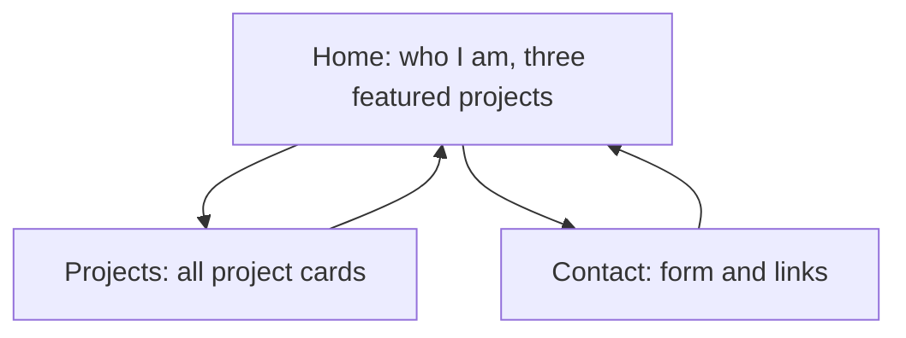

:::objectives
- Know exactly what the finished capstone site must include and what you'll hand in.
- Choose a project idea at the right difficulty for you.
- Plan the site with a one-sentence goal, a sitemap, a content list, phone and desktop wireframes, and a set of design tokens.
:::

Over the last six modules you built pieces: a product grid, a landing page, a club site. The capstone puts them together into one site that you design, build, and publish at a real web address you can send to anyone. Most of the hard thinking happens before the first tag, so this lesson is all planning.

## The brief

Build a website of **at least three linked pages** about a topic you choose, and publish it for free on GitHub Pages.

### Your site must have

1.  **Semantic structure** on every page: `<header>`, `<nav>`, `<main>`, and `<footer>`, with headings in order (one `<h1>`, then `<h2>`s, and so on).
2.  **One shared stylesheet** that starts with design tokens (custom properties for color, type sizes, and spacing). No page has its own `<style>` block.
3.  **Flexbox and Grid**: at least one layout made with each.
4.  **A responsive layout** that works from 320px to 1440px wide, written mobile-first, with no sideways scrolling at any width.
5.  **At least one form** with a `<label>` for every field.
6.  **Images** that scale, each with useful `alt` text (or `alt=""` for decoration). Use your own photos or openly licensed ones, such as Wikimedia Commons, with credit.
7.  **Keyboard access**: every link, button, and field reachable with Tab, a visible focus style, and a skip link.
8.  **Readable color**: every text and background pair at 4.5:1 or better.
9.  **Respect for motion settings**: any animation or transition is turned off for `prefers-reduced-motion: reduce`.
10. **Working relative links** on the live site, including the stylesheet and images.

### What you hand in

-   The live URL (like `https://yourname.github.io/my-site/`) and the GitHub repository link.
-   Your planning notes from this lesson: goal, sitemap, wireframes, and tokens.
-   A short test log (you'll make it in the last lesson).
-   A two- to three-minute presentation of the site.

## Pick an idea

Choose something you know about and care about. You'll write all the text yourself, and that's much easier on a topic you could talk about for ten minutes.

| Idea | Pages | What makes it interesting | Level |
| ---- | ----- | ------------------------- | ----- |
| Personal portfolio | Home, Projects, Contact | A project card grid and a contact form. Your pages from this course can be the projects. | Starter |
| Club, team, or band site | Home, Events, Join, Gallery | An events list, a photo gallery with a featured image, and a sign-up form. | Starter to middle |
| A local shop or café (invented, or a family business with permission) | Home, Menu, Visit, Order | A menu laid out with Grid, an hours table, and an order or booking form. | Middle |
| A guide to something you know well (a game, a sport, a city, a hobby) | 5 or more, with a subfolder | Consistent navigation across many pages, paths with `../`, and long-form reading typography. | Stretch |
| An event microsite (a science fair, a hackathon, a recital) | Home, Schedule, Speakers, Register | A schedule built with `grid-template-areas` and a dark theme from `prefers-color-scheme`. | Stretch |

:::tip
If you can't decide, pick the portfolio. It's the most useful one to have afterward, and it grows with you: every project you build after this course can become a new card on it.
:::

### Ideas that cause trouble

-   **Anything that needs accounts, saved data, or payments.** A login page, a shopping cart that remembers items, or a working checkout all need a server and a database. HTML and CSS can show what they'd look like, but can't make them work. Design the page and say so.
-   **Copying a famous site.** Rebuilding a big company's homepage teaches you less than you'd think, and their layouts hide a lot of complexity. Your own small site will be better.
-   **Placeholder text.** "Lorem ipsum" hides problems. Real headings and paragraphs of real length show you where the layout breaks.

## Plan before you code

Work through these five steps in a notes file or on paper. Keep it; it's part of what you hand in.

### 1. Write one sentence

*"This site is for \_\_\_\_\_\_, and it helps them \_\_\_\_\_\_."* For example: "This site is for students who might join the robotics club, and it helps them find out when we meet and sign up." Every page and every section should serve that sentence. When you're unsure whether to add something, check it against the sentence.

### 2. Draw the sitemap

List every page and how they link. Keep it flat: every page should be reachable from the main navigation in one click.



### 3. Write the content first

For each page, list the sections and write the actual text, at least in rough form. You'll find out quickly whether a page has enough to say. A page with one sentence on it probably belongs inside another page.

| Page | Sections | Content to gather |
| ---- | -------- | ----------------- |
| Home | Intro, featured projects, call to action | A two-sentence intro, a photo of you or your work |
| Projects | Card grid | For each project: a title, one sentence, a screenshot, a link |
| Contact | Form, other links | Which fields you need (name, email, message) |

### 4. Wireframe phone first, then desktop

A wireframe is a box sketch: no colors, no fonts, just where things go. Draw the phone version first, since it forces you to decide the order of importance. Then draw how the same boxes rearrange on a wide screen.

```text
PHONE (one column)      DESKTOP (wider than 48rem)
+------------------+    +----------------------------------------+
| Name             |    | Name             Home  Work  Contact   |
| Home Work Contact|    +----------------------------------------+
+------------------+    | Big headline           |               |
| Big headline     |    | Short intro            |     Photo     |
| Short intro      |    | [Button]               |               |
| [Button]         |    +----------------------------------------+
| Photo            |    | Card       | Card       | Card         |
+------------------+    +----------------------------------------+
| Card             |    | Footer                                 |
| Card             |    +----------------------------------------+
| Card             |
+------------------+
| Footer           |
+------------------+
```

Label each box with the layout tool you'll use: "flex, space-between" for the header, "grid, auto-fit" for the cards. Now the CSS is half planned.

:::video x3Yno9VUYBY
What to watch for: why designers sketch plain boxes before choosing colors and fonts, and how a wireframe turns into the finished design. Paper and pencil are fine for this project.
:::

### 5. Choose your tokens

Decide your design system before you build, and write it down:

-   **Colors**: text, muted text, background, surface, brand, and the text color that goes on the brand. Check every pair in the WebAIM contrast checker and write the ratio next to it.
-   **Type**: a body size of 1rem and a scale ratio (1.2 for calm, 1.25 for balanced, 1.333 for dramatic), giving four or five steps.
-   **Spacing**: five or six steps, such as 0.25, 0.5, 1, 1.5, 2, and 3rem.
-   **Fonts**: `system-ui` is a safe default. If you want a web font, choose one and stick with it for the whole site.

## A planning template

Copy this into a file called `planning.md` in your project folder and fill it in.

```text
CAPSTONE PLAN

Goal sentence:
  This site is for ______, and it helps them ______.

Pages (file name: purpose):
  index.html:
  ______.html:
  ______.html:

Sitemap: (sketch or list which pages link where)

Content per page: (sections and rough text)

Wireframes: (photo of paper sketches, phone and desktop, for each page)

Tokens:
  --color-text:        #______   on background: __:1
  --color-muted:       #______   on background: __:1
  --color-bg:          #______
  --color-surface:     #______
  --color-brand:       #______   on background: __:1
  --color-on-brand:    #______   on brand:      __:1
  type ratio: ____   steps: 1rem, ____, ____, ____, ____
  spacing: ____, ____, ____, ____, ____

Where I'll use Flexbox:
Where I'll use Grid:
The form on my site collects:
Images I need, and where they come from:
```

## A suggested schedule

| Session | Goal |
| ------- | ---- |
| 1 | Finish this plan: goal, sitemap, content, wireframes, tokens |
| 2 | Milestones 1 and 2: every page's HTML, then tokens and base styles |
| 3 | Milestones 3 and 4: layouts with Flexbox and Grid, then responsive rules |
| 4 | Milestones 5 and 6: accessibility pass, then publish on GitHub Pages |
| 5 | Test, polish, and rehearse your presentation |

The next lesson gives you a starter skeleton and walks through each milestone.

## Further reading

- [web.dev: Learn Design](https://web.dev/learn/design): a free course from Google on responsive design, from layout and typography to theming. A good place to look up any design question that comes up while planning.
- [WebAIM Contrast Checker](https://webaim.org/resources/contrastchecker/): check every color pair for your token list before you write a line of CSS.
