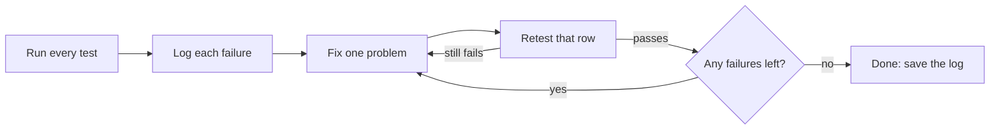

:::objectives
- Run a test plan on your live site and record the results in a test log.
- Write up one bug: what you saw, why it happened, and how you fixed it.
- Polish the details that visitors notice, and present the site in two to three minutes.
- Grade your own work against the rubric before anyone else does.
:::

Your site looks right on your laptop. That's a good start, and it's also the one setup you've been testing on all along. The real test is a stranger on a small phone with a cracked screen, a keyboard user who never touches a mouse, and someone who has turned their text size way up. This lesson checks the site for each of them.

## Step 1: Run the test plan

Do every test on the **live** GitHub Pages site, not on Live Server, since some bugs only appear online. Record each result in a test log like the one below, and keep it in `planning.md`.

| # | Test | How | Pass when |
| - | ---- | --- | --------- |
| 1 | Five widths | Device toolbar at 320, 375, 768, 1024, and 1440px, on every page | No sideways scrolling, nothing overlaps or gets cut off |
| 2 | A real phone | Open the live URL on your phone (or a friend's) | Text is readable without zooming, and buttons are easy to tap |
| 3 | Keyboard only | Tab and Shift+Tab through each page; Enter on links and buttons | The skip link shows first, every control is reachable in a sensible order, and focus is always visible |
| 4 | 200% zoom | Ctrl or Cmd with **+** until the zoom reads 200% | Nothing is cut off, and the page reflows instead of scrolling sideways |
| 5 | Contrast | Every text and background pair in the WebAIM checker | Every pair is 4.5:1 or better (3:1 for large text and focus rings) |
| 6 | Lighthouse | DevTools, **Lighthouse** panel, Accessibility checked, **Analyze page load** | You fixed every failed audit, or wrote down why one doesn't apply |
| 7 | Valid HTML | The [W3C Markup Validator](https://validator.w3.org/), **Validate by URI**, with each page's live URL | No errors |
| 8 | Every link | Click every link on every page of the live site | No 404s; every page loads with its styles and images |
| 9 | Reduced motion | DevTools Command Menu, **Show Rendering**, emulate `prefers-reduced-motion: reduce` | Nothing slides, spins, or smooth-scrolls |
| 10 | Form | Click each label; Tab to each field; try to submit with a required field empty | Clicking a label puts the cursor in its field, and the browser blocks the empty submission |

Here is what one row of a filled-in log might look like:

```text
Test 1, Five widths, 320px, Projects page:
  Result: FAIL. The project cards stick out past the right edge.
  Fix: changed minmax(280px, 1fr) to minmax(min(280px, 100%), 1fr).
  Retest: PASS at 320, 375, 768, 1024, 1440.
```

Don't stop at the first failure. Run every test, list everything, then fix the problems one at a time, retesting after each fix.



:::warning
**A perfect Lighthouse score doesn't mean the site is accessible.** Lighthouse can find missing `alt` attributes, missing labels, and low contrast. It can't tell whether your alt text actually describes the image, whether the focus order makes sense, or whether a heading says what the section is about. That's why tests 3 and 4 are done by a person.
:::

:::video zhdHP9beK1U
What to watch for: the keys to use (0:47) and the list of issues to check during a keyboard test (1:59). Use that list as your checklist for test 3.
:::

## Step 2: Write up one bug

Pick the most interesting problem your tests found and write a short note about it. Four parts:

1.  **What I saw**: "On my phone, the contact form's Send button disappeared off the right edge."
2.  **Why it happened**: "The input had `width: 400px`, and the phone was only 375px wide, so the row was wider than the screen."
3.  **How I fixed it**: "I replaced the fixed width with `flex: 1 1 14rem` and added `flex-wrap: wrap`, so the button drops under the input on narrow screens."
4.  **How I checked**: "Retested at 320 and 375px in the device toolbar and on my phone."

This note is part of the grade, and it's also the most useful thing you can say in an interview someday. Explaining a bug clearly shows you understand the code, not just that you typed it.

## Step 3: Polish what people notice

-   **Unique page titles.** Each `<title>` should name the page and the site, like `Projects | Maya Chen`. It's what shows in the browser tab and in search results.
-   **A short description.** Add `<meta name="description" content="...">` to each page's `<head>` with one sentence about that page. Search engines often show it under your link.
-   **Consistent edges.** Check that the header, the main content, and the footer line up on the left at every width. If one doesn't, it probably isn't inside a `.wrap`.
-   **Image credits.** Any photo you didn't take gets a credit in a caption or the footer, with the license name.
-   **No leftovers.** Delete commented-out code, test text, and unused CSS rules.
-   **A 404 page.** Add a `404.html` with your normal header and a link home. GitHub Pages shows it automatically whenever someone visits an address that doesn't exist on your site.

## Step 4: Present it in two to three minutes

Plan your talk around the site, not around the code. A good order:

1.  **The goal sentence** (15 seconds): who the site is for and what it helps them do.
2.  **A tour at phone width** (45 seconds): show the main pages in the device toolbar or on a real phone.
3.  **The same page at desktop width** (20 seconds): point out what rearranged and which CSS did it.
4.  **A keyboard run** (20 seconds): Tab from the top, show the skip link and the focus ring.
5.  **One piece of CSS you're proud of** (20 seconds): your tokens, a grid, or a tricky fix.
6.  **Your bug story** (20 seconds) and **what you'd add next** (10 seconds).

Rehearse once with a timer. If you're over three minutes, cut the tour, not the bug story.

## The rubric

Each row is scored from 1 to 4, for a total of 36 points.

| Criterion | 4: Excellent | 3: Good | 2: Developing | 1: Beginning |
| --------- | ------------ | ------- | ------------- | ------------ |
| **Structure** | Every page uses `header`, `nav`, `main`, `footer`; headings in order; validator shows no errors | Landmarks on every page, one or two heading or validator issues | Some pages missing landmarks, or headings chosen for size | Mostly `div`s; headings out of order |
| **Shared styles** | One stylesheet built from tokens; no page has its own styles; changing a token updates the site | One stylesheet with tokens, a few raw values repeated | Tokens exist but many values are hard-coded | Styles copied into each page |
| **Layout** | Flexbox and Grid each used where they fit best, with `gap` and no layout hacks | Both used, with one awkward spot | Only one of the two used | Layout relies on fixed widths or spacing tricks |
| **Responsive** | Mobile-first, works from 320 to 1440px with no sideways scroll, images scale | Works at all five test widths with a minor issue | Breaks at one width | Breaks on phones |
| **Accessibility** | Skip link, visible focus everywhere, all pairs 4.5:1, labels on every field, motion respected, keyboard test passes | One small gap in the list | Several gaps, but the keyboard can reach everything | Keyboard users get stuck, or focus is invisible |
| **Content and hierarchy** | Real, well-written content; clear hierarchy that passes the squint test; consistent spacing | Clear hierarchy, a few spacing inconsistencies | Hierarchy is unclear on some pages | Placeholder text or no visible hierarchy |
| **Published and linked** | Live URL works; every link, image, and stylesheet loads online; 404 page exists | Live, with one broken link or image | Live, but styles or several images missing | Not published |
| **Planning and testing** | Goal, sitemap, wireframes, tokens, full test log, and a clear bug write-up | All parts present, one thin | Plan or test log missing parts | Little or no planning or testing shown |
| **Presentation** | Two to three minutes, shows phone and desktop, a keyboard run, and the bug story | Covers most parts, a little long or short | Mostly reads code aloud | Not presented |

Score yourself honestly before you hand it in. Anything you rate 2 or below is your to-do list for the remaining time.

## Reflect

Write two or three sentences for each question in `planning.md`. These are for you, so be honest.

-   What part of the site took longer than you planned, and why?
-   Which bug taught you the most?
-   If you started over tomorrow, what would you plan differently?
-   What's one thing on a real website you now notice that you didn't before this course?

## Where to go next

You can now build sites that work for everyone on every screen. Here's where to take it:

-   **Add JavaScript.** It's the language that makes pages respond: menus that open, forms that check themselves, data that loads. Your HTML and CSS are the foundation it builds on.
-   **Keep practicing layouts.** [Frontend Mentor](https://www.frontendmentor.io/) gives you real designs to rebuild, with free challenges at every level. Kevin Powell's free course [Conquering Responsive Layouts](https://courses.kevinpowell.co/conquering-responsive-layouts) goes deeper on everything from Modules 5 and 6.
-   **Look things up in the best references.** [MDN's Learn web development](https://developer.mozilla.org/en-US/docs/Learn_web_development) and [web.dev's Learn CSS](https://web.dev/learn/css) are free, accurate, and kept up to date.
-   **Keep your site alive.** Add every new project to it. A portfolio that grows over a year says more than any single project.
