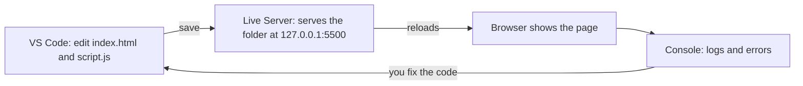

:::objectives
- Install VS Code on Windows, macOS, or a Chromebook.
- Add the Live Server extension and explain what it does for you.
- Open the browser Console and run a line of JavaScript in it.
- Make one course folder that holds every project you build.
:::

By the end of this page you will type `2 + 2` into your browser and it will answer `4`. That sounds tiny, but the window you type it into, the **Console**, is where your code will report every message and every error for the rest of the course. Most people who get stuck in their first JavaScript project are stuck because they never opened it.

You need three free things, and they work as a loop: you write code in an editor, a small local server hands the page to your browser, and the browser runs it and tells you what happened.



## What you need before you start

-   **A computer** running Windows 10 or 11, macOS 12 or newer, or a Chromebook where Linux can be turned on. Phones and tablets can't run VS Code.
-   **Permission to install software.** School laptops sometimes block installs. Check now, not the night before a project is due.
-   **Google Chrome** (or Microsoft Edge, which has the same developer tools). Firefox works too, but the menu names in this course are Chrome's.
-   About 20 minutes on a decent internet connection.

Everything here is free. Download VS Code only from **code.visualstudio.com**; other sites that offer "free VS Code" downloads sometimes bundle unwanted software.

## Step 1: Install VS Code

VS Code is a code editor from Microsoft. It colors your code so mistakes stand out, suggests names as you type, and runs extensions like Live Server.

:::tabs
@tab Windows
1.  Go to [code.visualstudio.com](https://code.visualstudio.com/) and click **Download for Windows**. You get the **User Installer**, which does not need an administrator password.
2.  Open the file from your Downloads folder (it is named something like `VSCodeUserSetup-x64-….exe`) and accept the license agreement.
3.  On **Select Additional Tasks**, leave **Add to PATH** checked. Also tick both **Add "Open with Code" action** boxes, so you can right-click any folder and open it in VS Code.
4.  If a page asks about the **GitHub Copilot CLI**, choose **Don't add the copilot command**. This course doesn't use it, and it needs a paid subscription.
5.  Click **Install**, then **Finish** with **Launch Visual Studio Code** ticked.
@tab macOS
1.  Go to [code.visualstudio.com](https://code.visualstudio.com/) and click **Download for macOS**. The Universal build runs on both Apple silicon and Intel Macs.
2.  Open the downloaded `.dmg` file.
3.  Drag **Visual Studio Code.app** into the **Applications** folder. Don't run it straight from the disk image or from Downloads, because updates can't install there.
4.  Open VS Code from Applications. If macOS warns that the app was downloaded from the internet and asks if you're sure, click **Open**.
5.  Optional: Control-click the icon in the Dock and choose **Options › Keep in Dock**.
@tab Chromebook
1.  Turn on Linux: select the time at the bottom right, then **Settings › About ChromeOS › Developers**, and next to **Linux development environment** select **Set up**. Accept the defaults. This can take 10 minutes or more, and a Terminal window opens when it's done.
2.  In that Terminal, type `dpkg --print-architecture` and press Enter. It prints `amd64` or `arm64`.
3.  Go to [code.visualstudio.com/download](https://code.visualstudio.com/download). Under Linux, choose **.deb x64** if you saw `amd64`, or **.deb Arm64** if you saw `arm64`.
4.  Open the **Files** app, go to **Downloads**, double-click the `.deb` file, and choose **Install**.
5.  Open the Launcher. VS Code is in the **Linux apps** folder.
:::

When VS Code opens you'll see a Welcome tab. You can close it. The column of icons on the far left is the **Activity Bar**; the top icon (two pages) is the **Explorer**, where your files will appear.

:::video f8_uF_IDV50
The official VS Code team's 15-minute tour. Watch for the Explorer, the Command Palette, and the Extensions view; those three are all you need here.
:::

## Step 2: Add the Live Server extension

You could open an HTML file by double-clicking it. The address bar would then start with `file://`, and the page would not update when you save. Some features you'll use later, like loading data with `fetch` in Module 6, refuse to work on `file://` pages at all. Live Server fixes both problems: it serves your folder at a real web address, `http://127.0.0.1:5500`, and reloads the browser every time you save a file.

1.  In VS Code, click the **Extensions** icon in the Activity Bar (four small squares), or press **Ctrl+Shift+X** (**Cmd+Shift+X** on a Mac).
2.  Search for `Live Server`.
3.  Pick the one by **Ritwick Dey**. It has tens of millions of installs. Click **Install**.

Nothing visible happens yet. The **Go Live** button appears in the status bar at the bottom right once you open a folder that contains an HTML file, which you'll do in the next lesson.

:::video _Tl-6HeV0Rc
Estefania walks through installing Live Server and using Go Live. Watch for the moment she saves the file and the browser updates on its own.
:::

## Step 3: Make a course folder

Make one folder for the whole course and one folder inside it for each project. Use lowercase names with dashes instead of spaces, because spaces turn into `%20` in web addresses.

1.  In your **Documents** folder (on a Chromebook, in **Linux files** inside the Files app), create a folder named `js-course`.
2.  In VS Code, choose **File › Open Folder…** and pick `js-course`.
3.  VS Code asks **Do you trust the authors of the files in this folder?** It's your own empty folder, so click **Yes, I trust the authors**.

The folder's name now appears at the top of the Explorer. From here on, always open the folder, not a single file. Live Server serves whatever folder VS Code has open.

## Step 4: Talk to the Console

Open Chrome on any page (a blank new tab works), then open the Console:

| Computer | Shortcut |
|---|---|
| Windows or Chromebook | **Ctrl+Shift+J** |
| Mac | **Cmd+Option+J** |
| Any, with the mouse | Right-click the page, choose **Inspect**, then click the **Console** tab |

Click next to the `>` prompt and type each line, pressing Enter after each:

```javascript
2 + 2
"hello".toUpperCase()
"7" + 3
```

```text
4
'HELLO'
'73'
```

The Console runs JavaScript as soon as you press Enter and shows the result underneath. The last line is a preview of Module 2: a number in quotes is text, and adding text to a number sticks them together instead of doing math.

:::note
Chrome may refuse the first time you **paste** code into the Console and ask you to type `allow pasting`. That warning exists because scammers trick people into pasting code that steals their accounts. Typing the examples yourself avoids it, and so does never pasting code you don't understand.
:::

## Check that everything works

You're ready for the next lesson when all three are true:

-   VS Code opens with `js-course` showing in the Explorer.
-   The Extensions view lists **Live Server** as installed.
-   The Console answers `2 + 2` with `4`.

## When something goes wrong

:::warning
**"Linux development environment" is missing or greyed out on a Chromebook.** A school-managed Chromebook usually has Linux turned off by the administrator, and only they can turn it on. Ask your teacher or school IT. Until then you can follow Modules 2–4 with the live previews on these pages and the Console, and edit files with [vscode.dev](https://vscode.dev/) (VS Code in the browser, which can open a folder from your Chromebook). Open your `index.html` from the Files app to view it in Chrome, and refresh by hand after each save.
:::

:::warning
**The installer on Windows says you need an administrator.** You downloaded the System Installer. Go back to the download page and pick **User Installer** for your computer (x64 for most laptops, Arm64 for Arm-based ones).
:::

:::warning
**You can't find the Extensions icon.** The Activity Bar can be hidden. Open the Command Palette with **Ctrl+Shift+P** (**Cmd+Shift+P** on a Mac), type `extensions`, and choose **Extensions: Install Extensions**.
:::

:::warning
**The Console shows red errors you didn't write.** Pages you visit (and some browser extensions) log their own errors. Open the Console on a new blank tab, or click the clear button (a circle with a line through it) at the top of the Console. You only care about errors that point at your own files.
:::

## Further reading

-   [VS Code setup overview](https://code.visualstudio.com/docs/setup/setup-overview): the official install pages for every operating system, if your setup differs from the steps above.
-   [Live Server on the VS Code Marketplace](https://marketplace.visualstudio.com/items?itemName=ritwickdey.LiveServer): every way to start and stop the server, plus its settings.
-   [Chrome DevTools: Console overview](https://developer.chrome.com/docs/devtools/console): what the Console can do beyond what this course uses.
