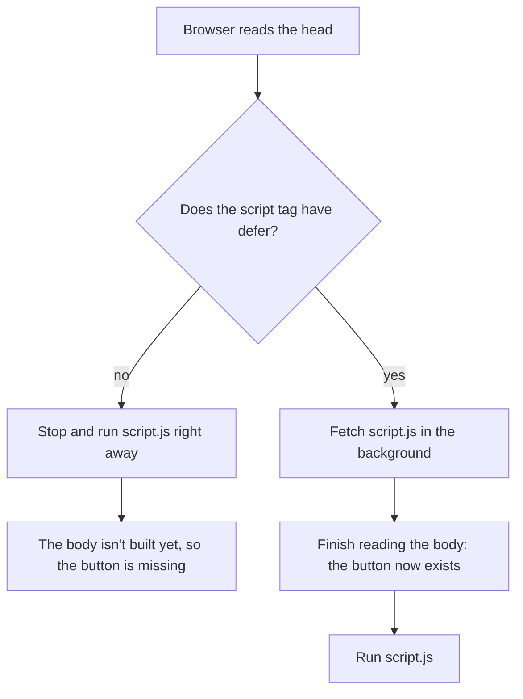

:::objectives
- Create `index.html` and `script.js` in a project folder and link them with `defer`.
- Prove a script is running with `console.log` and the Console.
- Recognize the two errors almost everyone hits first: a missing script file and an element that comes back `null`.
- Make a button that counts clicks and a second one that resets the count.
:::

Every page you've built with HTML and CSS stays exactly the same no matter how many times you click on it. Here's the first one that doesn't. Click the button a few times:

```html preview height="200" title="counter.html"
<h1>Click counter</h1>
<p>Clicks: <span id="count">0</span></p>
<button id="add" type="button">Add one</button>
<button id="reset" type="button">Reset</button>

<script>
  const countDisplay = document.querySelector("#count");
  const addButton = document.querySelector("#add");
  const resetButton = document.querySelector("#reset");
  let count = 0;

  addButton.addEventListener("click", () => {
    count = count + 1;
    countDisplay.textContent = count;
  });

  resetButton.addEventListener("click", () => {
    count = 0;
    countDisplay.textContent = count;
  });
</script>
<style>
  body { font-family: system-ui, sans-serif; padding: 8px 16px; }
  #count { font-weight: bold; font-size: 1.4em; }
  button { font-size: 1rem; padding: 8px 14px; margin-right: 6px; }
</style>
```

The previews on these pages keep everything in one file so you can see it at a glance. In your own projects you'll split the HTML and the JavaScript into separate files, which is what real sites do, so that's how you'll build this one.

## Step 1: Make the project folder and the HTML page

1.  Open your `js-course` folder in VS Code (**File › Open Folder…**).
2.  In the Explorer, hover over `JS-COURSE` and click the **New Folder** icon. Name it `01-counter`.
3.  Click `01-counter`, then the **New File** icon. Name it `index.html`.
4.  In the empty file type `!` and press Enter when the **Emmet Abbreviation** suggestion appears. VS Code fills in a full HTML skeleton.

Edit the skeleton so it matches this:

```html title="01-counter/index.html"
<!DOCTYPE html>
<html lang="en">
<head>
    <meta charset="UTF-8">
    <meta name="viewport" content="width=device-width, initial-scale=1.0">
    <title>Click counter</title>
    <script src="script.js" defer></script>
</head>
<body>
    <h1>Click counter</h1>
    <p>Clicks: <span id="count">0</span></p>
    <button id="add" type="button">Add one</button>
</body>
</html>
```

The new line is the `script` tag in the head. Its `src` says which file to load, and `defer` tells the browser when to run it.

## Step 2: Understand what `defer` does

A browser reads an HTML file from top to bottom, building each element as it goes. When it meets a plain `script` tag, it stops, fetches the script, runs it, and only then carries on reading. If that script lives in the head, it runs before the browser has reached the body, so the button doesn't exist yet.

`defer` changes the deal: fetch the file now, in the background, but wait to run it until the whole page has been read. By then every element is in place.



`defer` only works on scripts loaded with `src`. That's why the previews on these pages, which put the code directly inside the `script` tag, place it at the bottom of the page instead.

:::video BMuFBYw91UQ
Kyle from Web Dev Simplified compares where you can put a script tag and what `async` and `defer` change. Watch for why `defer` lets the HTML finish loading before the script runs.
:::

## Step 3: Prove the script runs

Create a second file in `01-counter` named `script.js` and give it one line:

```javascript title="01-counter/script.js"
console.log("script.js is connected");
```

Save both files (**Ctrl+S**, or **Cmd+S** on a Mac). Now start the server: right-click `index.html` in the Explorer and choose **Open with Live Server**. Your browser opens an address like `http://127.0.0.1:5500/01-counter/index.html`.

Open the Console (**Ctrl+Shift+J**, or **Cmd+Option+J** on a Mac). You should see:

```text
script.js is connected                                    script.js:1
```

The grey `script.js:1` on the right means "this came from line 1 of `script.js`." Click it and DevTools jumps to that line. When something breaks later, that link is how you'll find the line to blame.

`console.log` prints to the Console, not to the page. Visitors never see it; it's a note to yourself.

## Step 4: See the two classic errors on purpose

Breaking things deliberately, while you know what you changed, is the fastest way to learn what the error messages mean.

**Error 1: the browser can't find the file.** In `index.html`, change `src="script.js"` to `src="scripts.js"` and save. Live Server reloads the page, the log message disappears, and the Console shows something like:

```text
GET http://127.0.0.1:5500/01-counter/scripts.js net::ERR_ABORTED 404 (Not Found)
```

`404` means "no file at that address." The fix is to make `src` match the file name exactly, including capital letters. Change it back to `script.js` and save.

**Error 2: the element isn't there yet.** You'll see this one in Step 5, once the script touches the button.

## Step 5: Make the button count

Replace everything in `script.js` with this:

```javascript title="01-counter/script.js"
const countDisplay = document.querySelector("#count");
const addButton = document.querySelector("#add");
let count = 0;

addButton.addEventListener("click", () => {
  count = count + 1;
  countDisplay.textContent = count;
  console.log("count is now", count);
});
```

Save, switch to the browser, and click **Add one** a few times. The number on the page goes up, and the Console logs each new value.

Here is what each part does. You'll study all of it properly in Modules 3 and 4, so for now read it like a recipe:

-   `document.querySelector("#count")` finds the first element that matches a CSS selector, here the one with `id="count"`.
-   `let count = 0` makes a variable that is allowed to change. `const` makes one that isn't.
-   `addEventListener("click", () => { … })` says "every time this button is clicked, run the code inside the braces."
-   `countDisplay.textContent = count` replaces the text inside the span.

Now meet Error 2. In `index.html`, delete the word `defer` and save. The counter stops working and the Console shows:

```text
Uncaught TypeError: Cannot read properties of null (reading 'addEventListener')    script.js:5
```

Without `defer`, the script ran while the browser was still in the head. `querySelector("#add")` found nothing, which JavaScript represents as `null`, and `null` has no `addEventListener`. Put `defer` back and save.

:::warning
The same `null` error appears when a selector has a typo, like `querySelector("#Add")` or `querySelector("add")` without the `#`. When you see `Cannot read properties of null`, check two things: is the selector spelled exactly like the HTML, and does the script have `defer`?
:::

## Step 6: Add a reset button

Add a second button to `index.html`, right after the first one:

```html
<button id="reset" type="button">Reset</button>
```

Then add this to the bottom of `script.js`:

```javascript
const resetButton = document.querySelector("#reset");

resetButton.addEventListener("click", () => {
  count = 0;
  countDisplay.textContent = count;
});
```

Save and test: count to 5, press **Reset**, and the display returns to 0. Notice that **Reset** has to change two things, the variable and the text on the page. If you only set `count = 0`, the page keeps showing 5 until the next click. Keeping your data and your page in agreement is a theme that runs through this whole course.

:::try
Change `count + 1` to `count + 10` and save. Then add a third button, **Subtract one**, with its own listener.
:::

## Proof it works

-   The page opens from an `http://127.0.0.1:5500/…` address, not `file://`.
-   Clicking **Add one** raises the number, and **Reset** puts it back to 0.
-   The Console shows your `count is now` messages and no red errors.

:::quiz
Q: You remove `defer` from a script tag in the head, and the script runs `document.querySelector("#add")`. What does `querySelector` give back?
- [ ] The button, because it's in the HTML file
  It is in the file, but the browser hasn't reached it yet when the script runs.
- [x] `null`, because the body hasn't been built yet
  Without `defer` the script runs as soon as the browser reads its tag, before the button exists.
- [ ] An error that says the file is missing
  The file loaded fine; a missing file shows a 404 instead.

Q: The Console says `GET …/Script.js net::ERR_ABORTED 404 (Not Found)`, and your file is named `script.js`. What's the fix?
- [ ] Add `defer` to the tag
  `defer` changes when the script runs, but the browser can't even find this file.
- [x] Make the `src` match the file name exactly: `script.js`
  A 404 means nothing exists at that address. Capital letters count on web servers.
- [ ] Restart VS Code
  VS Code isn't the problem; the page is asking for a file name that doesn't exist.
:::

## Further reading

-   [MDN: the script element](https://developer.mozilla.org/en-US/docs/Web/HTML/Reference/Elements/script): the official reference for `src`, `defer`, and `async`.
-   [MDN: What is JavaScript?](https://developer.mozilla.org/en-US/docs/Learn_web_development/Core/Scripting/What_is_JavaScript): a friendly overview of how JavaScript fits with HTML and CSS, with more on loading scripts.
