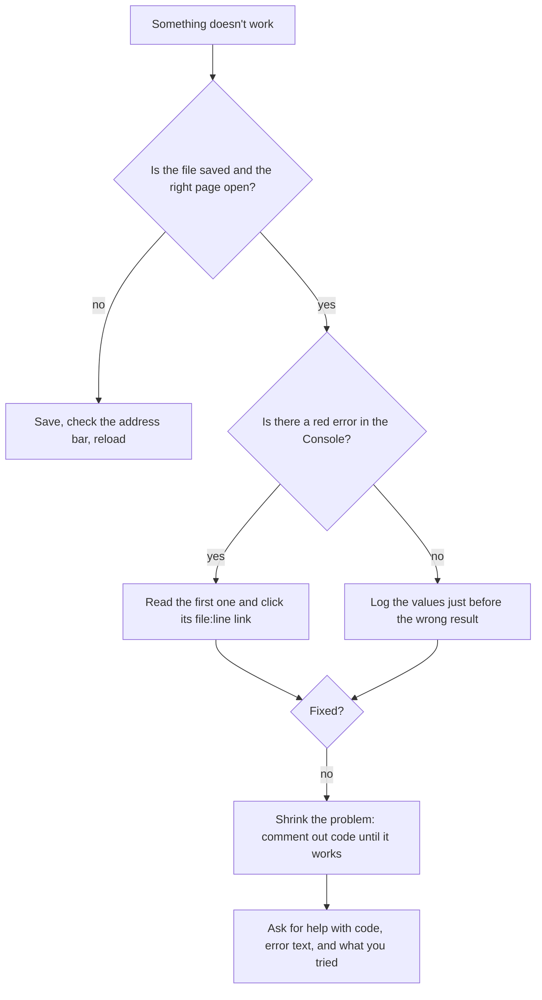

:::objectives
- Keep every project in its own folder with the same three files.
- Tell whether a file is saved, and turn on Auto Save.
- Read a Console error: its type, its message, and the file and line it points to.
- Use `console.log` to check what a variable really holds.
- Follow a short routine when you're stuck, and ask for help in a way that gets answers.
:::

The most common bug in this course won't be in your code. It will be a file you edited but never saved, so the browser keeps running the old version while you stare at the new one. The second most common is a perfectly clear error message sitting in a Console that nobody opened. Both take seconds to fix once you know to look.

## One folder per project

Give every project its own folder inside `js-course`, and give every project the same three files. When everything looks the same, you always know where to look.

```text
js-course/
├── 01-counter/
│   ├── index.html
│   ├── style.css
│   └── script.js
├── 02-tip-calculator/
│   ├── index.html
│   ├── style.css
│   └── script.js
└── 03-todo-list/
    └── …
```

Keep `js-course` open in VS Code and start each project by right-clicking its `index.html` and choosing **Open with Live Server**. The address bar then shows which project you're looking at, for example `127.0.0.1:5500/02-tip-calculator/index.html`. If the page looks wrong, glance at that address first: editing one project while viewing another happens to everyone.

## Make sure the browser sees your latest save

VS Code marks an unsaved file with a dot on its tab, and the Explorer shows a number badge for how many files are unsaved. Live Server only reloads when a file is saved, so a dot on a tab means the browser is showing old code.

You have two options:

-   Press **Ctrl+S** (**Cmd+S** on a Mac) every time you stop typing.
-   Turn on **File › Auto Save**. VS Code then saves about a second after you stop typing, and Live Server reloads on its own.

Auto Save is the better choice for this course. If the page ever seems stuck on an old version anyway, do a hard reload in the browser with **Ctrl+Shift+R** (**Cmd+Shift+R** on a Mac), which skips the browser's cached copy.

## How to read an error message

When JavaScript hits a line it can't run, it stops and prints an error in red. Every error has the same three parts:

```text
Uncaught TypeError: Cannot read properties of null (reading 'textContent')    script.js:7
         ^^^^^^^^^  ^^^^^^^^^^^^^^^^^^^^^^^^^^^^^^^^^^^^^^^^^^^^^^^^^^^^^^    ^^^^^^^^^^^
         the type   what went wrong                                           file:line
```

-   **The type** tells you the category. A `ReferenceError` means a name doesn't exist. A `TypeError` means a value was the wrong kind for what you did with it. A `SyntaxError` means the code isn't valid JavaScript, so none of the file runs.
-   **The message** is usually more specific than it first looks. "Reading 'textContent'" tells you exactly which property you tried to use on `null`.
-   **The location** is a link. Click it to jump to the line.

Each button below runs one line containing a classic mistake. The page catches the error and shows you the real message your browser produces:

```html preview height="300" title="errors.html"
<p>Click a button to run a line with a classic mistake.</p>
<button id="typo" type="button">Misspelled variable</button>
<button id="missing" type="button">Missing element</button>
<button id="method" type="button">Misspelled method</button>
<button id="constant" type="button">Changed a const</button>
<pre id="out">The error message will appear here.</pre>

<script>
  const out = document.querySelector("#out");
  window.addEventListener("error", (event) => {
    out.textContent = event.message;
  });

  const total = 10;

  document.querySelector("#typo").addEventListener("click", () => {
    console.log(totl);
  });
  document.querySelector("#missing").addEventListener("click", () => {
    document.querySelector("#score").textContent = "5";
  });
  document.querySelector("#method").addEventListener("click", () => {
    document.querySelecter("#out");
  });
  document.querySelector("#constant").addEventListener("click", () => {
    total = 20;
  });
</script>
<style>
  body { font-family: system-ui, sans-serif; padding: 4px 12px; }
  button { margin: 4px 4px 4px 0; padding: 6px 10px; }
  pre { background: #fee; color: #900; padding: 10px; white-space: pre-wrap; }
</style>
```

Here is what those messages, and a few others you'll meet, usually mean. The wording is Chrome's; other browsers say the same thing differently.

| Error message | What usually happened | First thing to check |
|---|---|---|
| `totl is not defined` | You used a name that was never created | Spelling, including capital letters |
| `Cannot read properties of null` | `querySelector` found nothing | The selector, and `defer` on the script tag |
| `Cannot set properties of null` | Same as above, while assigning to it | Same as above |
| `document.querySelecter is not a function` | A method name is misspelled | Spelling of the method |
| `Assignment to constant variable.` | You changed a `const` | Use `let` if it really needs to change |
| `Unexpected end of input` | A `}` or `)` is missing, so no code in the file runs | Matching brackets; VS Code highlights pairs |
| `404 (Not Found)` | The page asked for a file that isn't there | The `src` path and file name |

:::warning
**Read the first red error, not the last.** One early mistake often causes several more below it. Fix the top one, save, and check again before worrying about the rest.
:::

## Use console.log as a flashlight

Errors tell you when JavaScript gives up. Many bugs don't crash, though; they just produce the wrong answer. For those, print the values you're assuming and check whether they're true:

```javascript run title="flashlight.js"
const price = 12.5;
const quantity = "3";
const total = price + quantity;

console.log(total);
console.log("price:", price, "quantity:", quantity);
console.log({ price, quantity, total });
console.log(typeof quantity);
```

The first line of output is wrong in a puzzling way: `12.53` instead of `37.5`. The labelled log doesn't help, because the Console prints `3` the same way whether it's text or a number. The third log gives it away: wrapping variables in `{ }` prints each one with its name, and `'3'` appears in quotes, so it's text. `typeof` confirms it. Module 2 explains why `12.5 + "3"` sticks the two together.

Two habits make logging much more useful. **Label every log**, so you know which line printed what. And **log just before the line that misbehaves**, so you see the values that line actually received.

:::video H0XScE08hy8
The Chrome DevTools team debugs a small page. Watch for how a breakpoint pauses the code so you can see every variable at once, instead of adding more and more `console.log` lines. You won't need breakpoints until later in the course, but it helps to know they exist.
:::

## A routine for when you're stuck



When you ask a teacher, a classmate, or a forum, include four things: **the code** as text (not a phone photo of your screen), **the exact error message**, **what you expected to happen**, and **what you already tried**. A question like "my counter shows 5 after I click Reset, here's `script.js`, there's no error, I checked that `count` is 0 in the Console" usually gets an answer in minutes. "It doesn't work" gets a list of questions back.

## Comfort, privacy, and safety

-   **Make text bigger.** In VS Code, **View › Appearance › Zoom In** (**Ctrl+=**, or **Cmd+=** on a Mac). In the browser and DevTools, **Ctrl** and **+** (**Cmd** and **+**) do the same.
-   **Pick a readable theme.** VS Code includes high-contrast themes. Open the Command Palette (**Ctrl+Shift+P**, or **Cmd+Shift+P** on a Mac), run **Preferences: Color Theme**, and use the arrow keys to preview each one.
-   **Keep personal details out of shared code.** Before posting code online, remove real names, emails, and passwords. The practice data in this course is invented on purpose.
-   **Don't run code you don't understand,** whether it came from a forum, a video comment, or an AI tool. Read it line by line first. The Console's `allow pasting` warning exists because pasted code has stolen real accounts.

:::takeaways
- One folder per project, each with `index.html`, `style.css`, and `script.js`.
- A dot on a VS Code tab means the browser is showing old code; Auto Save prevents this.
- An error's type, message, and `file:line` link tell you what broke and where. Fix the first red error first.
- Labelled `console.log` calls show what your variables hold, which catches the bugs that don't crash.
:::

## Further reading

-   [MDN: What went wrong? Troubleshooting JavaScript](https://developer.mozilla.org/en-US/docs/Learn_web_development/Core/Scripting/What_went_wrong): a beginner walk-through of finding and fixing errors in a small game.
-   [MDN: JavaScript error reference](https://developer.mozilla.org/en-US/docs/Web/JavaScript/Reference/Errors): look up any error message and get an explanation with examples.
-   [Chrome DevTools: Debug JavaScript](https://developer.chrome.com/docs/devtools/javascript): the step-by-step tutorial behind the video, for when you're ready to try breakpoints.
