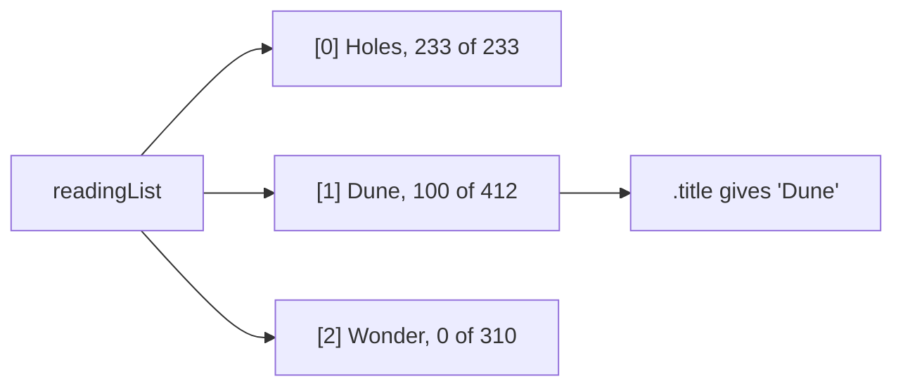

:::objectives
- Tell strings, numbers, and booleans apart, and predict what `+` does with each.
- Choose between `let` and `const` for a variable.
- Build readable text with template literals, and round numbers for display.
- Store a list in an array and a set of named facts in an object.
- Write a function, in both regular and arrow form, that returns a result.
:::

You read 120 pages on Saturday and 30 on Sunday. Your reading tracker adds them up and proudly reports that you read **12030** pages this weekend. Nothing crashed, and every line ran. JavaScript did exactly what it was told; it just wasn't told what the programmer meant.

```javascript run title="tracker-bug.js"
const saturday = "120";
const sunday = 30;
console.log(saturday + sunday);
```

The quotes around `"120"` make it text, and adding a number to text sticks them together. Bugs like this come from data that isn't what you think it is. So before you make pages respond to clicks, you need to describe your data precisely: what type each value is, which values are allowed to change, and how to group values into lists and records.

The `run` boxes on this page show real output from Node, which runs the same JavaScript language as your browser. To try any example yourself, type it into your browser's Console or into a `script.js` file.

## Every value has a type, and the type decides what `+` means

A **value** is one piece of data: `412`, `"Dune"`, `true`. JavaScript sorts every value into a **type**. The ones you'll use constantly are numbers, strings (text, in quotes), and booleans (`true` or `false`). There's also `undefined`, which means "no value has been given yet." The `typeof` operator tells you a value's type:

```javascript run title="types.js"
console.log(typeof 412);
console.log(typeof "Dune");
console.log(typeof true);
console.log(typeof undefined);
console.log(typeof ["Dune", "Holes"]);
console.log(typeof { title: "Dune" });
```

Arrays and objects both report `"object"`, which is a known oddity. You'll meet both properly below.

Now watch what happens when types mix:

```javascript run title="plus.js"
console.log(120 + 30);
console.log("120" + 30);
console.log("120" - 30);
console.log(Number("120") + 30);
console.log(Number("twelve"));
```

`+` has two jobs. If either side is a string, it joins text; otherwise it adds. The other math operators (`-`, `*`, `/`) only do math, so JavaScript quietly converts `"120"` to a number for them. That inconsistency is why you should convert text to a number yourself, with `Number()`, the moment it enters your program. If the conversion fails you get `NaN` ("not a number"), which spreads through every calculation it touches.

:::warning
Every value you read from a form field is a string, even from an `input type="number"`. Forgetting this produces the 12030 bug. Convert with `Number(input.value)` before doing math.
:::

## `const` for most variables, `let` for the ones that change

A **variable** is a name attached to a value. JavaScript gives you two ways to make one. `const` attaches a name permanently. `let` lets you attach the name to a new value later:

```javascript run title="goal.js" raises
let pagesRead = 120;
pagesRead = pagesRead + 30;
console.log(pagesRead);

const goal = 300;
goal = 400;
```

The `let` variable updated happily. Reassigning the `const` stopped the program with `TypeError: Assignment to constant variable.`

Start with `const` every time, and switch to `let` only when you know the value has to change, like a running count. Then anyone reading your code can see at a glance which values move. You'll also see `var` in older tutorials. It's the pre-2015 way of making variables, with confusing rules about where the name is visible, so this course doesn't use it.

## Strings and template literals

Gluing strings with `+` works, but long messages turn into a mess of quotes and plus signs. **Template literals** use backticks instead of quotes and let you drop any value into the text with `${…}`:

```javascript run title="strings.js"
const title = "The Hobbit";
const pagesRead = 95;
const totalPages = 310;

console.log("You've read " + pagesRead + " of " + totalPages + " pages of " + title + ".");
console.log(`You've read ${pagesRead} of ${totalPages} pages of ${title}.`);
console.log(`${totalPages - pagesRead} pages to go`);

console.log(title.length);
console.log(title.toUpperCase());
console.log(title.includes("Hobbit"));
console.log("  Dune  ".trim());
```

The first two lines print the same sentence, but the second is far easier to read and to get right. The third shows that `${…}` can hold a calculation, not just a variable name.

Strings also come with built-in tools. `length` (no parentheses) counts characters. `toUpperCase()`, `includes()`, and `trim()` are **methods**, actions you call with parentheses. `trim()` removes spaces from both ends, which matters as soon as people start typing into your pages and accidentally hit the spacebar.

## Numbers: dividing, rounding, and the decimal surprise

Progress bars, prices, and averages all need division, and division rarely comes out even:

```javascript run title="progress.js"
const pagesRead = 95;
const totalPages = 310;
const percent = (pagesRead / totalPages) * 100;

console.log(percent);
console.log(Math.round(percent));
console.log(percent.toFixed(1));
console.log(0.1 + 0.2);
```

`Math.round()` gives the nearest whole number. `toFixed(1)` gives exactly one decimal place, but it returns a **string**, so use it only for display, as the last step. The last line is the decimal surprise: computers store numbers in binary, and many decimals (like 0.1) can't be stored exactly, so tiny errors creep in. Every language has this. The practical rule is to keep full precision while calculating and round only when you show the result. The next lesson's tip calculator deals with it for money.

## Arrays keep a list in order

An **array** holds many values in one variable, in order, inside square brackets. Each item has a position number called an **index**, starting from 0:

```javascript run title="list.js"
const toRead = ["Dune", "Holes", "Wonder"];

console.log(toRead[0]);
console.log(toRead.length);
console.log(toRead[toRead.length - 1]);
console.log(toRead[5]);

toRead.push("Hatchet");
console.log(toRead);
console.log(toRead.includes("Holes"));
console.log(toRead.join(", "));
```

The first item is `toRead[0]`, so the last is always at `length - 1`. Asking for an index that doesn't exist gives `undefined`, not an error, which is why off-by-one mistakes can hide quietly. `push` adds to the end, `includes` checks membership, and `join` turns the list into one string.

Wait: `toRead` is a `const`, yet `push` changed it. That's allowed. `const` stops the *name* from being attached to a different array, but the array itself can still gain and lose items.

## Objects group the facts about one thing

An array is good for "many of the same kind of thing." For the details of one thing, like a single book, you want named slots. An **object** stores **properties** as `name: value` pairs inside curly braces:

```javascript run title="book.js"
const book = {
  title: "Holes",
  author: "Louis Sachar",
  pages: 233,
  pagesRead: 60,
};

console.log(book.title);
console.log(book.pages - book.pagesRead);

book.pagesRead = 90;
book.finished = false;
console.log(book);
console.log(book.rating);
```

A dot reads a property, and assigning to one changes it or adds it. A property that was never set reads as `undefined`, just like a missing array index.

Real apps combine the two: an array of objects, where each object is one record. Here is the reading tracker's data:

```javascript run title="reading-list.js"
const readingList = [
  { title: "Holes", pages: 233, pagesRead: 233 },
  { title: "Dune", pages: 412, pagesRead: 100 },
  { title: "Wonder", pages: 310, pagesRead: 0 },
];

console.log(readingList.length);
console.log(readingList[1].title);
console.log(readingList[1].pages - readingList[1].pagesRead);
```

Read `readingList[1].title` from left to right: take the list, go to index 1 (the second book), then read its `title`.



:::video w9078dAjcrY
Bro Code builds an array of objects and reads values out of it. Watch for how he reaches into one object with an index and then a dot. The array methods near the end are a preview of Module 3.
:::

## Functions package steps you'll repeat

Working out "percent read" means the same calculation for every book. A **function** gives those steps a name. Values go in through **parameters**, and `return` sends the result back to whoever called it:

```javascript run title="functions.js"
function percentRead(book) {
  return Math.round((book.pagesRead / book.pages) * 100);
}

const pagesLeft = (book) => book.pages - book.pagesRead;

const dune = { title: "Dune", pages: 412, pagesRead: 100 };

console.log(percentRead(dune));
console.log(pagesLeft(dune));
console.log(`${dune.title}: ${percentRead(dune)}% read, ${pagesLeft(dune)} pages to go`);
```

`percentRead` is a **function declaration**. `pagesLeft` is an **arrow function** stored in a `const`. When an arrow function's body is a single expression with no braces, its value is returned automatically. Both forms do the same job here; you'll see arrow functions a lot in this course, especially for short helpers and for code that runs on a click.

The most common function bug is printing a result instead of returning it:

```javascript run title="no-return.js"
function percentRead(book) {
  console.log(Math.round((book.pagesRead / book.pages) * 100));
}

const result = percentRead({ pages: 200, pagesRead: 50 });
console.log("result is", result);
```

The `25` appears, so it looks as if the function works. But nothing was returned, so `result` is `undefined`, and any code that tries to use it gets nothing.

:::warning
`console.log` shows a value to *you*; `return` hands it to *the rest of your program*. A function that only logs gives back `undefined`. The same trap appears with arrow functions that use braces: `(book) => { book.pages - book.pagesRead }` returns `undefined` because braces need an explicit `return`.
:::

## Check your data with labelled logs

When a result looks wrong, log the values that went into it, with labels. Wrapping variables in braces prints each one with its name and shows strings in quotes, so a sneaky `"120"` stands out:

```javascript run title="check.js"
const saturday = "120";
const sunday = 30;
console.log({ saturday, sunday });
```

:::quiz
Q: What does `console.log("5" + 2)` print?
- [ ] `7`
  That would need both values to be numbers. `"5"` is a string.
- [x] `52`
  With a string on either side, `+` joins text, so you get the string `"52"`.
- [ ] `NaN`
  `NaN` comes from a failed conversion to a number, but `+` never tried to convert here.

Q: You need a variable that holds how many pages you've read today, and it goes up every time you log more reading. Which do you use?
- [ ] `const pagesToday = 0;`
  A `const` can't be reassigned, so `pagesToday = pagesToday + 20` would throw an error.
- [x] `let pagesToday = 0;`
  The value has to change, which is exactly what `let` is for.
- [ ] Either; they behave the same
  They differ precisely in whether the name can be reassigned.

Q: What happens with `const shelf = ["Dune"]; shelf.push("Holes");`?
- [ ] A `TypeError`, because `shelf` is a `const`
  `const` blocks reassigning the name, not changing the array's contents.
- [x] It works, and `shelf` now holds two books
  `push` changes the array the name points to, which `const` allows.
- [ ] `shelf` becomes the string `"DuneHoles"`
  `push` adds an item to the array; it doesn't join strings.

Q: What does `const half = (n) => { n / 2 }; console.log(half(10));` print?
- [ ] `5`
  It would, without the braces: `(n) => n / 2`.
- [x] `undefined`
  With braces, an arrow function needs `return`. This one calculates 5 and throws it away.
- [ ] An error
  The code is valid; it just returns nothing.
:::

:::takeaways
- `+` joins text if either side is a string. Convert input with `Number()` before doing math.
- Use `const` by default and `let` only for values you'll reassign.
- Template literals (backticks and `${…}`) build readable messages. Round with `Math.round` or `toFixed` only for display.
- Arrays hold ordered lists, starting at index 0. Objects hold named properties. An array of objects describes a list of records.
- Functions take parameters and `return` a result; logging is not returning.
:::

## Further reading

-   [MDN: Grammar and types](https://developer.mozilla.org/en-US/docs/Web/JavaScript/Guide/Grammar_and_types): the official guide to variables, `let` and `const`, and every value type.
-   [MDN: Working with objects](https://developer.mozilla.org/en-US/docs/Web/JavaScript/Guide/Working_with_objects): creating objects, reading and changing properties, and objects inside arrays.
-   [MDN: Functions](https://developer.mozilla.org/en-US/docs/Web/JavaScript/Guide/Functions): parameters, return values, and arrow functions with many short examples.
