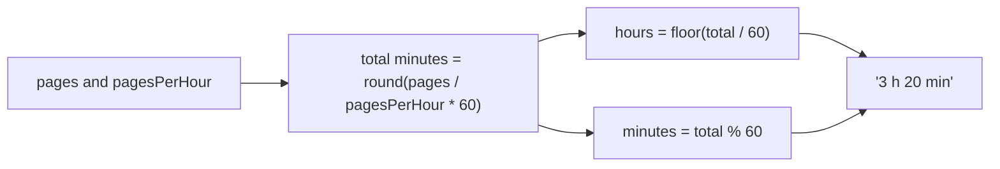

:::objectives
- Predict how `+`, `*`, and `typeof` treat strings and numbers.
- Write small functions that take parameters and return results.
- Read, add, and combine data in arrays and objects.
- Find bugs by logging values and reading what comes back.
- Make an updated copy of an object without changing the original.
:::

Every exercise here is about the same reading tracker. Write your answer in a `script.js` file (or straight into the Console), run it, and compare with the sample output before opening the solution. If you're stuck for more than ten minutes, open the hint; if you're still stuck, read the solution, close it, and write it again from memory.

## Warm-up: predict, then check

Write down what each line prints before you look:

```javascript
console.log(typeof "42");
console.log("4" * "2");
console.log("4" + 2 + 1);
console.log(4 + 2 + "1");
```

:::solution
```javascript run
console.log(typeof "42");
console.log("4" * "2");
console.log("4" + 2 + 1);
console.log(4 + 2 + "1");
```

JavaScript works left to right. In `"4" + 2 + 1`, the first `+` joins `"4"` and `2` into `"42"`, and the second joins `"42"` and `1`. In `4 + 2 + "1"`, the first `+` adds two numbers to get `6`, and only then meets a string, so the result is `"61"`. `*` never joins text, so `"4" * "2"` is `8`.
:::

### Exercise 1: Fix the weekend total

This code should report 75 pages, but it says 4530. Fix it without changing the first two lines (pretend they came from a form).

```javascript
const saturday = "45";
const sunday = "30";
const total = saturday + sunday;
console.log(`Weekend total: ${total} pages`);
```

```text
Weekend total: 75 pages
```

:::hint
Both values are strings. Which function turns `"45"` into the number `45`?
:::

:::solution
```javascript run
const saturday = "45";
const sunday = "30";
const total = Number(saturday) + Number(sunday);
console.log(`Weekend total: ${total} pages`);
```

`Number()` converts each string before `+` sees it, so `+` adds instead of joining.
:::

### Exercise 2: Percent finished

Write a function `percentDone(pagesRead, totalPages)` that returns the percentage finished as a whole number. Test it with these three calls:

```javascript
console.log(percentDone(50, 200));
console.log(percentDone(1, 3));
console.log(percentDone(310, 310));
```

```text
25
33
100
```

:::hint
Divide, multiply by 100, then round. Make sure the function uses `return`, not `console.log`.
:::

:::solution
```javascript run
function percentDone(pagesRead, totalPages) {
  return Math.round((pagesRead / totalPages) * 100);
}

console.log(percentDone(50, 200));
console.log(percentDone(1, 3));
console.log(percentDone(310, 310));
```

One third is 33.33…%, and `Math.round` turns it into `33`.
:::

### Exercise 3: Describe a book

Write an arrow function `describeBook` that takes a book object and returns one sentence built with a template literal.

```javascript
const holes = { title: "Holes", author: "Louis Sachar", pages: 233, genre: "adventure" };
console.log(describeBook(holes));
```

```text
Holes by Louis Sachar, 233 pages (adventure)
```

:::hint
Start with `const describeBook = (book) =>` followed by a template literal, and put `${book.title}` and the other properties inside its backticks.
:::

:::solution
```javascript run
const describeBook = (book) =>
  `${book.title} by ${book.author}, ${book.pages} pages (${book.genre})`;

const holes = { title: "Holes", author: "Louis Sachar", pages: 233, genre: "adventure" };
console.log(describeBook(holes));
```

The arrow function has no braces, so the template literal is returned automatically. Splitting it over two lines after `=>` is allowed and keeps long lines readable.
:::

### Exercise 4: Manage the to-read list

Start with `const toRead = ["Dune", "Holes"];`. Then, in order:

1.  Add `"Wonder"` and `"Hatchet"` to the end.
2.  Print how many books are on the list.
3.  Print the last book, using `length` rather than typing `3`.
4.  Print whether `"Holes"` is on the list.
5.  Print the sentence `Next up: Dune. 4 books on the list.` using values from the array.

```text
4
Hatchet
true
Next up: Dune. 4 books on the list.
```

:::hint
The last index is always `length - 1`. The first book is at index `0`.
:::

:::solution
```javascript run
const toRead = ["Dune", "Holes"];
toRead.push("Wonder");
toRead.push("Hatchet");

console.log(toRead.length);
console.log(toRead[toRead.length - 1]);
console.log(toRead.includes("Holes"));
console.log(`Next up: ${toRead[0]}. ${toRead.length} books on the list.`);
```

Using `toRead.length - 1` instead of `3` keeps working when the list grows or shrinks.
:::

### Exercise 5: Two bugs, no errors

This code runs without a single error and prints `undefined pages left in undefined`. Find both bugs. Add `console.log` lines to check your guesses before you fix anything.

```javascript
const book = { title: "Wonder", pages: 310, pagesRead: 120 };

const pagesLeft = (book) => {
  book.pages - book.pagesRead;
};

const left = pagesLeft(book);
console.log(`${left} pages left in ${book.titel}`);
```

```text
190 pages left in Wonder
```

:::hint
Log `left` on its own: why is it `undefined`? Then compare the property name in the last line with the one in the object, letter by letter.
:::

:::solution
```javascript run
const book = { title: "Wonder", pages: 310, pagesRead: 120 };

const pagesLeft = (book) => {
  return book.pages - book.pagesRead;
};

const left = pagesLeft(book);
console.log(`${left} pages left in ${book.title}`);
```

Bug 1: an arrow function with braces needs `return`; without it the subtraction is calculated and thrown away. Removing the braces also works: `(book) => book.pages - book.pagesRead`. Bug 2: `titel` is a typo, and reading a property that doesn't exist gives `undefined` instead of an error. Neither bug crashes, which is exactly why logging values matters.
:::

### Exercise 6: Log reading without breaking the original

Write `logReading(book, pages)` that returns a **new** book object with `pagesRead` increased by `pages`, but never above the book's total. The original object must not change.

```javascript
const wonder = { title: "Wonder", pages: 310, pagesRead: 120 };
console.log(logReading(wonder, 50).pagesRead);
console.log(logReading(wonder, 500).pagesRead);
console.log(wonder.pagesRead);
```

```text
170
310
120
```

:::hint
`Math.min(a, b)` gives the smaller of two numbers, which makes a ceiling. To copy an object and change one property, use spread syntax: `{ ...book, pagesRead: newValue }` copies every property of `book`, then overwrites `pagesRead`.
:::

:::solution
```javascript run
function logReading(book, pages) {
  const newTotal = Math.min(book.pages, book.pagesRead + pages);
  return { ...book, pagesRead: newTotal };
}

const wonder = { title: "Wonder", pages: 310, pagesRead: 120 };
console.log(logReading(wonder, 50).pagesRead);
console.log(logReading(wonder, 500).pagesRead);
console.log(wonder.pagesRead);
console.log(logReading(wonder, 50));
```

`...book` spreads all of the old properties into the new object, and the `pagesRead` written after it replaces the copied value. Because `wonder` itself is never assigned to, it still says 120. Returning updated copies instead of changing the original makes bugs easier to trace later, when several parts of an app share the same data.
:::

### Challenge: How long will it take?

Write `readingTime(pages, pagesPerHour)` that returns a string like `"3 h 20 min"`, rounded to the nearest minute.

```javascript
console.log(readingTime(250, 75));
console.log(readingTime(60, 40));
console.log(readingTime(30, 60));
```

```text
3 h 20 min
1 h 30 min
0 h 30 min
```

Work it in minutes, the same way the tip calculator worked in cents:



:::hint
`%` gives the remainder after division: `200 % 60` is `20`, because 200 minutes is 3 full hours with 20 minutes left over. `Math.floor(200 / 60)` gives the `3`.
:::

:::solution
```javascript run
function readingTime(pages, pagesPerHour) {
  const totalMinutes = Math.round((pages / pagesPerHour) * 60);
  const hours = Math.floor(totalMinutes / 60);
  const minutes = totalMinutes % 60;
  return `${hours} h ${minutes} min`;
}

console.log(readingTime(250, 75));
console.log(readingTime(60, 40));
console.log(readingTime(30, 60));
```

Rounding once, at the start, to whole minutes keeps both parts as whole numbers. If you round the hours and the minutes separately, you can end up with answers like "3 h 60 min".

Going further: `"0 h 30 min"` reads oddly. In Module 3 you'll use `if` to return `"30 min"` when there are no full hours.
:::
