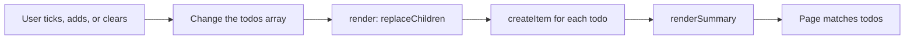

:::objectives
- Store an app's data in an array of objects and draw the page from it.
- Write a `render` function that clears a list and rebuilds it with `createElement` and `append`.
- Use `if` / `else if` / `else` to choose a status message.
- Use `filter` to count tasks and to remove finished ones.
- Keep data and page in agreement every time something changes.
:::

Here's the finished list. Tick a task, add a new one, try adding an empty one, then press **Clear completed**:

```html preview height="400" title="todo.html"
<h1>To-do</h1>
<label for="new-task">New task</label>
<input id="new-task" type="text" maxlength="60" placeholder="Return library books">
<button id="add" type="button">Add</button>
<p id="error" class="error"></p>
<ul id="list"></ul>
<p id="summary"></p>
<button id="clear" type="button">Clear completed</button>

<script>
  let todos = [
    { text: "Finish math worksheet", done: true },
    { text: "Practice guitar for 20 minutes", done: false },
    { text: "Email Ms. Rivera about the field trip", done: false },
  ];

  const list = document.querySelector("#list");
  const summary = document.querySelector("#summary");
  const input = document.querySelector("#new-task");
  const error = document.querySelector("#error");

  function renderSummary() {
    const left = todos.filter((todo) => !todo.done).length;
    if (todos.length === 0) {
      summary.textContent = "Nothing on the list. Add a task above.";
    } else if (left === 0) {
      summary.textContent = "All done!";
    } else {
      summary.textContent = `${left} of ${todos.length} left`;
    }
  }

  function createItem(todo) {
    const item = document.createElement("li");
    const label = document.createElement("label");
    const checkbox = document.createElement("input");
    checkbox.type = "checkbox";
    checkbox.checked = todo.done;
    item.classList.toggle("done", todo.done);

    checkbox.addEventListener("change", () => {
      todo.done = checkbox.checked;
      item.classList.toggle("done", todo.done);
      renderSummary();
    });

    label.append(checkbox, ` ${todo.text}`);
    item.append(label);
    return item;
  }

  function render() {
    list.replaceChildren();
    todos.forEach((todo) => list.append(createItem(todo)));
    renderSummary();
  }

  document.querySelector("#add").addEventListener("click", () => {
    const text = input.value.trim();
    if (text === "") {
      error.textContent = "Type a task before pressing Add.";
      input.focus();
      return;
    }
    error.textContent = "";
    todos.push({ text: text, done: false });
    input.value = "";
    input.focus();
    render();
  });

  document.querySelector("#clear").addEventListener("click", () => {
    todos = todos.filter((todo) => !todo.done);
    render();
  });

  render();
</script>
<style>
  body { font-family: system-ui, sans-serif; padding: 0 16px; }
  input[type="text"] { font-size: 1rem; padding: 6px; width: 16em; }
  button { font-size: 1rem; padding: 6px 12px; }
  ul { padding: 0; }
  li { list-style: none; padding: 6px 0; border-bottom: 1px solid #ddd; }
  .done { color: #888; text-decoration: line-through; }
  .error { color: #b00020; min-height: 1.2em; margin: 4px 0; }
</style>
```

The important idea is invisible: the page is never edited by hand. The tasks live in an array called `todos`, and a function called `render` draws the list from that array. When something changes, the code changes the array first and then redraws. You'll build it in that order.

## Step 1: Write the HTML and CSS

Create `03-todo-list` inside `js-course`, with `index.html`, `style.css`, and `script.js`. The HTML has an empty `ul`; JavaScript will fill it.

```html title="03-todo-list/index.html"
<!DOCTYPE html>
<html lang="en">
<head>
    <meta charset="UTF-8">
    <meta name="viewport" content="width=device-width, initial-scale=1.0">
    <title>To-do</title>
    <link rel="stylesheet" href="style.css">
    <script src="script.js" defer></script>
</head>
<body>
    <h1>To-do</h1>
    <label for="new-task">New task</label>
    <input id="new-task" type="text" maxlength="60" placeholder="Return library books">
    <button id="add" type="button">Add</button>
    <p id="error" class="error"></p>
    <ul id="list"></ul>
    <p id="summary"></p>
    <button id="clear" type="button">Clear completed</button>
</body>
</html>
```

```css title="03-todo-list/style.css"
body { font-family: system-ui, sans-serif; max-width: 32rem; margin: 2rem auto; padding: 0 1rem; }
input[type="text"] { font-size: 1rem; padding: 6px; width: 16em; }
button { font-size: 1rem; padding: 6px 12px; }
ul { padding: 0; }
li { list-style: none; padding: 6px 0; border-bottom: 1px solid #ddd; }
.done { color: #888; text-decoration: line-through; }
.error { color: #b00020; min-height: 1.2em; margin: 4px 0; }
```

The `.done` class is the only styling JavaScript will touch. It adds and removes the class, and the CSS decides what "done" looks like.

## Step 2: Describe the tasks as data

Each task has two facts: its text, and whether it's done. That's an object, and the list is an array of them. Start `script.js` with:

```javascript title="03-todo-list/script.js"
let todos = [
  { text: "Finish math worksheet", done: true },
  { text: "Practice guitar for 20 minutes", done: false },
  { text: "Email Ms. Rivera about the field trip", done: false },
];

console.table(todos);
```

Open the page with Live Server and look in the Console. `console.table` draws an array of objects as a table, which is easier to read than nested braces. Remove that line once you've seen it.

`todos` uses `let`, not `const`, because Step 7 replaces the whole array with a filtered copy.

## Step 3: Draw one task

Write a function that takes one task object and returns a finished `li`. Each task gets a real checkbox inside a `label`, so clicking the text ticks the box, and keyboard users can reach every task with **Tab** and tick it with **Space**.

```javascript
const list = document.querySelector("#list");

function createItem(todo) {
  const item = document.createElement("li");
  const label = document.createElement("label");
  const checkbox = document.createElement("input");
  checkbox.type = "checkbox";
  checkbox.checked = todo.done;
  item.classList.toggle("done", todo.done);

  label.append(checkbox, ` ${todo.text}`);
  item.append(label);
  return item;
}
```

`` label.append(checkbox, ` ${todo.text}`) `` adds two things at once: the checkbox element, then the text. When you pass `append` a string, it becomes plain text on the page, never HTML, so it's as safe as `textContent`. `classList.toggle("done", todo.done)` with a second argument adds the class when `todo.done` is `true` and removes it when it's `false`.

## Step 4: Draw the whole list

`render` empties the list and draws every task again:

```javascript
function render() {
  list.replaceChildren();
  todos.forEach((todo) => list.append(createItem(todo)));
}

render();
```

Save and check the browser: three tasks appear, and the first is crossed out. Then try this experiment. Temporarily delete the `list.replaceChildren();` line and add a second `render();` call at the bottom. Every task appears twice, because `render` added a fresh set below the old one. Put the line back and remove the extra call. Clearing first is what makes it safe to call `render` as often as you like.



## Step 5: Say how many are left

The summary line needs a decision with three outcomes, which is what `if` / `else if` / `else` is for:

```javascript
const summary = document.querySelector("#summary");

function renderSummary() {
  const left = todos.filter((todo) => !todo.done).length;
  if (todos.length === 0) {
    summary.textContent = "Nothing on the list. Add a task above.";
  } else if (left === 0) {
    summary.textContent = "All done!";
  } else {
    summary.textContent = `${left} of ${todos.length} left`;
  }
}
```

Add `renderSummary();` as the last line inside `render`. `filter((todo) => !todo.done)` keeps the unfinished tasks, and `.length` counts them. The empty-list check comes first: with zero tasks, `left` is also 0, so checking `left === 0` first would cheerfully announce "All done!" for a list that never had anything on it.

## Step 6: Tick a task off

When a checkbox changes, update the data, then update the page. Add this inside `createItem`, just before `label.append(…)`:

```javascript
checkbox.addEventListener("change", () => {
  todo.done = checkbox.checked;
  item.classList.toggle("done", todo.done);
  renderSummary();
});
```

`todo` here is the very object stored in the array, so `todo.done = …` changes the data itself. Notice that this handler updates just one item and the summary instead of calling `render`. Redrawing the whole list would replace the checkbox you just pressed with a brand-new one, and a keyboard user's focus would vanish from the list. Everywhere else, calling `render` is the simple choice.

:::video R8rmfD9Y5-c
Kyle from Web Dev Simplified runs through eight array methods in ten minutes. Watch the `filter` and `forEach` sections; this build uses both, and the others (`find`, `some`, `every`) are worth knowing for your own extensions.
:::

## Step 7: Add tasks and clear finished ones

Two buttons left. **Add** reads the input, refuses blank tasks, pushes a new object, and redraws. **Clear completed** replaces the array with a filtered copy and redraws.

```javascript
const input = document.querySelector("#new-task");
const error = document.querySelector("#error");

document.querySelector("#add").addEventListener("click", () => {
  const text = input.value.trim();
  if (text === "") {
    error.textContent = "Type a task before pressing Add.";
    input.focus();
    return;
  }
  error.textContent = "";
  todos.push({ text: text, done: false });
  input.value = "";
  input.focus();
  render();
});

document.querySelector("#clear").addEventListener("click", () => {
  todos = todos.filter((todo) => !todo.done);
  render();
});
```

`trim()` matters: without it, a task made of three spaces would pass the `=== ""` check. `return` inside the `if` ends the function early, so nothing below it runs for a blank task. After adding, `input.focus()` puts the cursor back in the box, ready for the next task.

**Clear completed** is why `todos` is a `let`. `filter` doesn't delete anything from the old array; it builds a new one with only the unfinished tasks, and `todos =` swaps it in.

## The finished script

Here is all of `script.js` in order. It's the same code as the preview at the top of this page.

```javascript title="03-todo-list/script.js"
let todos = [
  { text: "Finish math worksheet", done: true },
  { text: "Practice guitar for 20 minutes", done: false },
  { text: "Email Ms. Rivera about the field trip", done: false },
];

const list = document.querySelector("#list");
const summary = document.querySelector("#summary");
const input = document.querySelector("#new-task");
const error = document.querySelector("#error");

function renderSummary() {
  const left = todos.filter((todo) => !todo.done).length;
  if (todos.length === 0) {
    summary.textContent = "Nothing on the list. Add a task above.";
  } else if (left === 0) {
    summary.textContent = "All done!";
  } else {
    summary.textContent = `${left} of ${todos.length} left`;
  }
}

function createItem(todo) {
  const item = document.createElement("li");
  const label = document.createElement("label");
  const checkbox = document.createElement("input");
  checkbox.type = "checkbox";
  checkbox.checked = todo.done;
  item.classList.toggle("done", todo.done);

  checkbox.addEventListener("change", () => {
    todo.done = checkbox.checked;
    item.classList.toggle("done", todo.done);
    renderSummary();
  });

  label.append(checkbox, ` ${todo.text}`);
  item.append(label);
  return item;
}

function render() {
  list.replaceChildren();
  todos.forEach((todo) => list.append(createItem(todo)));
  renderSummary();
}

document.querySelector("#add").addEventListener("click", () => {
  const text = input.value.trim();
  if (text === "") {
    error.textContent = "Type a task before pressing Add.";
    input.focus();
    return;
  }
  error.textContent = "";
  todos.push({ text: text, done: false });
  input.value = "";
  input.focus();
  render();
});

document.querySelector("#clear").addEventListener("click", () => {
  todos = todos.filter((todo) => !todo.done);
  render();
});

render();
```

Test it the way a user would: tick and untick every task with the mouse, then again using only **Tab** and **Space**. Add a task, try adding a blank one, clear completed, then clear everything and check that the summary says the list is empty.

:::quiz
Q: Why is `todos` declared with `let` instead of `const`?
- [ ] Because `push` doesn't work on a `const` array
  `push` works fine on a `const` array; it changes the contents, not the name.
- [x] Because **Clear completed** assigns a brand-new filtered array to `todos`
  `filter` returns a new array, and `todos = …` reassigns the name, which `const` forbids.
- [ ] Because the tasks inside it change from not done to done
  Changing a property of an object inside the array is allowed even with `const`.

Q: What would happen if `render` didn't start with `list.replaceChildren()`?
- [ ] Nothing; the list would look the same
  It would look the same only the very first time.
- [x] Each call would add a full new copy of the tasks below the old ones
  `append` adds to whatever is already in the list, so old items would pile up.
- [ ] The browser would throw an error
  Appending more items is perfectly legal, which is why this bug is easy to miss.

Q: In `renderSummary`, why is `todos.length === 0` checked before `left === 0`?
- [x] An empty list also has zero tasks left, so it would wrongly say "All done!"
  The first true condition wins, so the more specific case has to come first.
- [ ] `filter` crashes on an empty array
  `filter` on an empty array just returns another empty array.
- [ ] The order doesn't matter in an `if` / `else if` chain
  It does: only the first block whose condition is true runs.
:::

:::takeaways
- Keep the app's data in one place (here an array of objects) and draw the page from it.
- A `render` function clears with `replaceChildren()` and rebuilds with `createElement` and `append`, so it's safe to call any time.
- Change the data first, then update the page. Never let them drift apart.
- `filter` counts things (`.length`) and removes things (by building a new array).
- Real checkboxes in labels make the list usable with a keyboard and a screen reader.
:::

## Ideas to extend it

-   Add a **Delete** button to each task that removes just that one. (Hint: `filter` out the object that matches.)
-   Show tabs for **All**, **Active**, and **Done** that change which tasks `render` draws.
-   Let **Enter** in the text box add a task. You'll do this properly with a form in Module 4.
-   Keep the list when the page reloads. That's `localStorage`, coming in Module 5.

## Further reading

-   [MDN: Document.createElement()](https://developer.mozilla.org/en-US/docs/Web/API/Document/createElement): creating elements, with examples of building and attaching them.
-   [MDN: Element.replaceChildren()](https://developer.mozilla.org/en-US/docs/Web/API/Element/replaceChildren): clearing an element or swapping its contents in one call.
-   [MDN: Element.classList](https://developer.mozilla.org/en-US/docs/Web/API/Element/classList): `add`, `remove`, `toggle` with its second argument, and `contains`.
