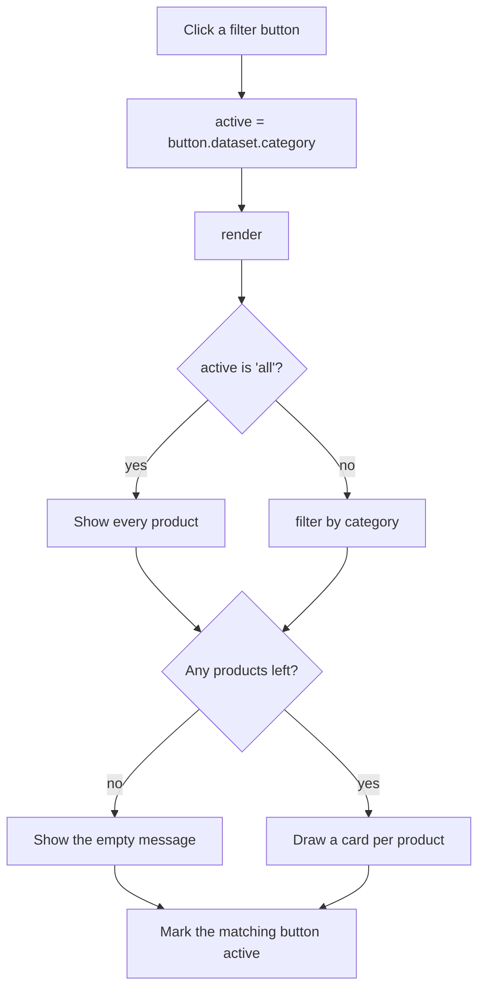

:::objectives
- Write `if` / `else if` chains that handle every case, including bad input.
- Use loops and array methods to count, average, and pick items.
- Draw lists and tables from arrays with `createElement`, `textContent`, and `classList`.
- Find bugs that don't throw errors by checking what the page shows.
:::

The first three exercises are plain JavaScript; run them in the Console or a `script.js` file and compare with the sample output. Exercises 4 to 6 and the challenge change a page, so build them in a project folder with Live Server. Each solution includes a live preview you can click.

## Warm-up: which branch runs?

For each call, predict which message is printed:

```javascript
function describe(temp) {
  if (temp > 30) {
    return "hot";
  } else if (temp > 20) {
    return "warm";
  } else if (temp > 30) {
    return "very hot";
  } else {
    return "cool";
  }
}

console.log(describe(35));
console.log(describe(25));
console.log(describe(20));
console.log(describe("25"));
```

:::solution
```javascript run
function describe(temp) {
  if (temp > 30) {
    return "hot";
  } else if (temp > 20) {
    return "warm";
  } else if (temp > 30) {
    return "very hot";
  } else {
    return "cool";
  }
}

console.log(describe(35));
console.log(describe(25));
console.log(describe(20));
console.log(describe("25"));
```

`"very hot"` can never be returned: anything above 30 is caught by the first check. `20` isn't greater than 20, so it falls through to `"cool"`. And `"25"` gives `"warm"` because `>` converts the string to a number, which works here but is the kind of luck you shouldn't depend on.
:::

### Exercise 1: Letter grades

Write `letterGrade(score)` that returns `"A"` for 90 and up, `"B"` for 80–89, `"C"` for 70–79, `"D"` for 60–69, and `"F"` below 60. Scores below 0 or above 100 should return `"Invalid score"`.

```javascript
console.log(letterGrade(95));
console.log(letterGrade(90));
console.log(letterGrade(72));
console.log(letterGrade(59));
console.log(letterGrade(101));
```

```text
A
A
C
F
Invalid score
```

:::hint
Check for invalid scores first, using `||`. Then go from the highest grade down, so each `else if` only needs a lower bound.
:::

:::solution
```javascript run
function letterGrade(score) {
  if (score < 0 || score > 100) {
    return "Invalid score";
  } else if (score >= 90) {
    return "A";
  } else if (score >= 80) {
    return "B";
  } else if (score >= 70) {
    return "C";
  } else if (score >= 60) {
    return "D";
  } else {
    return "F";
  }
}

console.log(letterGrade(95));
console.log(letterGrade(90));
console.log(letterGrade(72));
console.log(letterGrade(59));
console.log(letterGrade(101));
```

Because the checks run in order, reaching `score >= 80` already means the score is below 90, so there's no need to write `score >= 80 && score < 90`. Testing 90 exactly checks the boundary.
:::

### Exercise 2: Class statistics with a loop

Given `const scores = [88, 92, 67, 74, 59, 100];`, use one `for...of` loop to work out the number of passing scores (70 or more), the average, and the highest score. Don't use `Math.max`.

```text
Passed: 4 of 6
Average: 80.0
Highest: 100
```

:::hint
Before the loop, make three variables with `let`: a pass counter at 0, a running total at 0, and `highest` set to the first score. Inside the loop, update each one. Divide the total by `scores.length` after the loop.
:::

:::solution
```javascript run
const scores = [88, 92, 67, 74, 59, 100];

let passed = 0;
let total = 0;
let highest = scores[0];

for (const score of scores) {
  if (score >= 70) {
    passed = passed + 1;
  }
  total = total + score;
  if (score > highest) {
    highest = score;
  }
}

console.log(`Passed: ${passed} of ${scores.length}`);
console.log(`Average: ${(total / scores.length).toFixed(1)}`);
console.log(`Highest: ${highest}`);
```

Starting `highest` at the first score, not at 0, means the code still works if every score is negative (say, temperatures in winter).
:::

### Exercise 3: A shopping shortlist

From this list, make an array of labels for products that are in stock **and** cost under $10, formatted like `"Notebook - $4.50"`. Use `filter` and `map`, not a loop.

```javascript
const products = [
  { name: "Notebook", price: 4.5, inStock: true },
  { name: "Gel pens", price: 7, inStock: false },
  { name: "Calculator", price: 14.99, inStock: true },
  { name: "Highlighters", price: 5.25, inStock: true },
  { name: "Sticky notes", price: 3, inStock: true },
];
```

```text
[ 'Notebook - $4.50', 'Highlighters - $5.25', 'Sticky notes - $3.00' ]
```

:::hint
Filter first (both conditions joined with `&&`), then map the survivors to strings. `price.toFixed(2)` gives two decimal places.
:::

:::solution
```javascript run
const products = [
  { name: "Notebook", price: 4.5, inStock: true },
  { name: "Gel pens", price: 7, inStock: false },
  { name: "Calculator", price: 14.99, inStock: true },
  { name: "Highlighters", price: 5.25, inStock: true },
  { name: "Sticky notes", price: 3, inStock: true },
];

const shortlist = products
  .filter((product) => product.inStock && product.price < 10)
  .map((product) => `${product.name} - $${product.price.toFixed(2)}`);

console.log(shortlist);
```

Putting each method on its own line, starting with a dot, makes a chain read like a recipe: take the products, keep these, turn them into that.
:::

### Exercise 4: Flag low stock

Start with this page. Write the script that draws one `li` per item, with text like `Pencils: 3 left`, and adds the class `low` to any item with fewer than 5 left.

```html title="index.html (starter)"
<h2>Art room supplies</h2>
<ul id="inventory"></ul>
<style>.low { color: #b00020; font-weight: bold; }</style>
<script>
  const supplies = [
    { name: "Pencils", count: 3 },
    { name: "Glue sticks", count: 12 },
    { name: "Scissors", count: 4 },
    { name: "Paint brushes", count: 20 },
  ];
  // your code here
</script>
```

:::hint
Find the `ul` once with `querySelector`. Then `supplies.forEach`: inside, `createElement("li")`, set its `textContent`, use `classList.toggle("low", item.count < 5)`, and `append` it.
:::

:::solution
```html preview height="200" title="inventory.html"
<h2>Art room supplies</h2>
<ul id="inventory"></ul>
<style>.low { color: #b00020; font-weight: bold; } body { font-family: system-ui, sans-serif; }</style>
<script>
  const supplies = [
    { name: "Pencils", count: 3 },
    { name: "Glue sticks", count: 12 },
    { name: "Scissors", count: 4 },
    { name: "Paint brushes", count: 20 },
  ];

  const inventory = document.querySelector("#inventory");

  supplies.forEach((item) => {
    const li = document.createElement("li");
    li.textContent = `${item.name}: ${item.count} left`;
    li.classList.toggle("low", item.count < 5);
    inventory.append(li);
  });
</script>
```

`toggle` with a second argument replaces a whole `if` statement: it adds `low` when the condition is true and leaves it off when it's false.
:::

### Exercise 5: Draw a scoreboard table

Build a table body from an array of players: one row per player, with a name cell and a points cell. Highlight the leader's row with the class `leader`. If two players tie for first, highlight both.

```javascript
const players = [
  { name: "Ana", points: 14 },
  { name: "Jun", points: 21 },
  { name: "Priya", points: 21 },
  { name: "Leo", points: 9 },
];
```

:::hint
Do it in two passes. First loop to find the top score. Then `forEach` player: make a `tr`, make two `td` elements, `append` both to the row, and toggle `leader` when `player.points === topScore`. (Don't name the variable `top`: browsers already use that name for the top-level window.)
:::

:::solution
```html preview height="260" title="scoreboard.html"
<table>
  <thead><tr><th>Player</th><th>Points</th></tr></thead>
  <tbody id="rows"></tbody>
</table>

<script>
  const players = [
    { name: "Ana", points: 14 },
    { name: "Jun", points: 21 },
    { name: "Priya", points: 21 },
    { name: "Leo", points: 9 },
  ];

  let topScore = players[0].points;
  for (const player of players) {
    if (player.points > topScore) {
      topScore = player.points;
    }
  }

  const rows = document.querySelector("#rows");
  players.forEach((player) => {
    const row = document.createElement("tr");
    const nameCell = document.createElement("td");
    const pointsCell = document.createElement("td");
    nameCell.textContent = player.name;
    pointsCell.textContent = player.points;
    row.append(nameCell, pointsCell);
    row.classList.toggle("leader", player.points === topScore);
    rows.append(row);
  });
</script>
<style>
  body { font-family: system-ui, sans-serif; }
  table { border-collapse: collapse; min-width: 14em; }
  th, td { border: 1px solid #ccc; padding: 6px 10px; text-align: left; }
  .leader { background: #fff3b0; font-weight: bold; }
</style>
```

Finding the top score before drawing anything is what makes ties work. Comparing each player with the one before it would only ever mark a single leader.
:::

### Exercise 6: The button that lies

Each click on **Show results** should list every score and say how many passed. Instead, every click adds another copy of the list, and it claims all six scores passed. There are no errors in the Console. Find both bugs.

```html title="results.html (broken)"
<button id="show" type="button">Show results</button>
<p id="passed"></p>
<ul id="results"></ul>
<script>
  const scores = [88, 92, 67, 74, 59, 100];
  const results = document.querySelector("#results");

  document.querySelector("#show").addEventListener("click", () => {
    let passed = 0;
    scores.forEach((score) => {
      const li = document.createElement("li");
      li.textContent = score;
      results.append(li);
      if (score => 70) {
        passed = passed + 1;
      }
    });
    document.querySelector("#passed").textContent = `${passed} of ${scores.length} passed`;
  });
</script>
```

:::hint
Bug 1: what's already inside `results` the second time the button is clicked? Bug 2: read the `if` condition very slowly. `=>` and `>=` are different operators.
:::

:::solution
```html preview height="260" title="results.html"
<button id="show" type="button">Show results</button>
<p id="passed"></p>
<ul id="results"></ul>
<script>
  const scores = [88, 92, 67, 74, 59, 100];
  const results = document.querySelector("#results");

  document.querySelector("#show").addEventListener("click", () => {
    results.replaceChildren();
    let passed = 0;
    scores.forEach((score) => {
      const li = document.createElement("li");
      li.textContent = score;
      results.append(li);
      if (score >= 70) {
        passed = passed + 1;
      }
    });
    document.querySelector("#passed").textContent = `${passed} of ${scores.length} passed`;
  });
</script>
```

Bug 1: nothing cleared the list, so each click appended six more items; `results.replaceChildren()` at the start fixes it. Bug 2: `score => 70` isn't a comparison at all. It's an arrow function (take `score`, return 70), and a function counts as true, so every score "passed." Click the fixed button twice and the list stays at six, with 4 of 6 passing.
:::

### Challenge: A filter panel with an empty state

Build a product panel with buttons for **All**, **Paper**, **Writing**, **Bags**, and **Art**. Clicking a button shows only that category's products and marks that button as active. Art has no products, so it should show `No products in this category yet.` instead of an empty space.

Use this data, and give each button a `data-category` attribute (`all`, `paper`, `writing`, `bags`, `art`):

```javascript
const products = [
  { name: "Notebook", category: "paper" },
  { name: "Index cards", category: "paper" },
  { name: "Gel pens", category: "writing" },
  { name: "Mechanical pencil", category: "writing" },
  { name: "Backpack", category: "bags" },
];
```



:::hint
Store the current choice in one variable, `let active = "all";`. Every button gets the same listener: set `active` from `button.dataset.category` (an attribute written `data-category` in HTML is read as `dataset.category` in JavaScript), then call `render`. Inside `render`, pick the list with an `if`, check its `length` for the empty state, and loop over all the buttons to toggle an `active` class. For screen readers, also set `aria-pressed` to `"true"` or `"false"`.
:::

:::solution
```html preview height="300" title="filter-panel.html"
<div id="filters">
  <button type="button" class="filter" data-category="all">All</button>
  <button type="button" class="filter" data-category="paper">Paper</button>
  <button type="button" class="filter" data-category="writing">Writing</button>
  <button type="button" class="filter" data-category="bags">Bags</button>
  <button type="button" class="filter" data-category="art">Art</button>
</div>
<ul id="cards"></ul>

<script>
  const products = [
    { name: "Notebook", category: "paper" },
    { name: "Index cards", category: "paper" },
    { name: "Gel pens", category: "writing" },
    { name: "Mechanical pencil", category: "writing" },
    { name: "Backpack", category: "bags" },
  ];

  const cards = document.querySelector("#cards");
  const buttons = document.querySelectorAll(".filter");
  let active = "all";

  function render() {
    let shown = products;
    if (active !== "all") {
      shown = products.filter((product) => product.category === active);
    }

    cards.replaceChildren();
    if (shown.length === 0) {
      const empty = document.createElement("li");
      empty.textContent = "No products in this category yet.";
      empty.classList.add("empty");
      cards.append(empty);
    } else {
      shown.forEach((product) => {
        const card = document.createElement("li");
        card.textContent = product.name;
        card.classList.add("card");
        cards.append(card);
      });
    }

    buttons.forEach((button) => {
      const isActive = button.dataset.category === active;
      button.classList.toggle("active", isActive);
      button.setAttribute("aria-pressed", String(isActive));
    });
  }

  buttons.forEach((button) => {
    button.addEventListener("click", () => {
      active = button.dataset.category;
      render();
    });
  });

  render();
</script>
<style>
  body { font-family: system-ui, sans-serif; padding: 0 12px; }
  .filter { padding: 6px 12px; margin: 0 4px 4px 0; border: 1px solid #888; background: #fff; border-radius: 16px; }
  .filter.active { background: #222; color: #fff; }
  #cards { padding: 0; }
  .card, .empty { list-style: none; padding: 8px 12px; margin: 6px 0; border-radius: 6px; }
  .card { border: 1px solid #ccc; }
  .empty { color: #666; font-style: italic; }
</style>
```

Everything flows through one variable, `active`, and one function, `render`. The buttons never change the page directly; they only change `active` and ask for a redraw, so the cards and the highlighted button can't disagree. `aria-pressed` tells screen readers which filter is on, since they can't see the dark background.
:::
