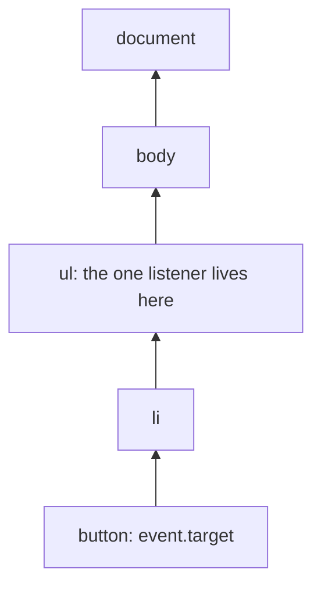

:::objectives
- Attach a listener with `addEventListener` and pass it a function without calling it.
- Read `event.type`, `event.target`, and `event.key` from the event object.
- Choose between the `input`, `change`, `keydown`, and `submit` events.
- Stop a form from reloading the page with `event.preventDefault()`.
- Write validation messages that say what's wrong and how to fix it, and connect them to their fields for screen readers.
- Handle clicks for a whole list with one delegated listener and `closest`.
:::

Here's a sign-up form that many beginners ship. You type a username, leave the email blank by accident, and press **Sign up**. The page flashes and reloads. Everything you typed is gone, the address bar now ends in `?username=sam&email=`, and nothing tells you what went wrong. Someone using only a keyboard and a screen reader gets even less: no message, and no idea which field to fix.

Each of those problems is fixed by handling **events**, the browser's announcements that something just happened. You've used `click` as a recipe; now you'll see how events really work.

## "When this happens, run that": addEventListener

`element.addEventListener(type, listener)` tells the browser: whenever an event of this type happens on this element, call this function. The function is called a **listener** or **handler**. One named function can serve several elements:

```html preview height="170" title="listeners.html"
<button id="like" type="button">Like</button>
<button id="dislike" type="button">Dislike</button>
<p id="report">Click a button.</p>

<script>
  const report = document.querySelector("#report");
  let clicks = 0;

  function handleClick(event) {
    clicks = clicks + 1;
    report.textContent =
      `Click ${clicks}: event.type is "${event.type}", and event.target is the ${event.target.textContent} button.`;
  }

  document.querySelector("#like").addEventListener("click", handleClick);
  document.querySelector("#dislike").addEventListener("click", handleClick);
</script>
<style>
  body { font-family: system-ui, sans-serif; padding: 0 12px; }
  button { padding: 6px 12px; margin-right: 6px; }
</style>
```

Look at how `handleClick` is passed: by name, with no parentheses. You're handing the browser the function so it can call it later, once per click.

:::warning
`button.addEventListener("click", handleClick())` is a silent bug. The parentheses call `handleClick` immediately, once, while the page loads, and then pass its return value (`undefined`) as the listener. There's no error, but clicking does nothing. Pass the function itself: `handleClick` or `() => handleClick()`.
:::

## The event object tells you what happened

When the browser calls your listener, it passes one argument: an **event object** describing what happened. Every event has `type` (like `"click"`) and `target`, the element the event happened on. That's how `handleClick` above knows which button was pressed. Other events add their own details. Keyboard events have `key`, the key that was pressed:

```html preview height="170" title="keys.html"
<label for="box">Type here, then press Enter:</label>
<input id="box" type="text">
<p>Last key: <strong id="key">none yet</strong></p>
<p id="enter"></p>

<script>
  const box = document.querySelector("#box");

  box.addEventListener("keydown", (event) => {
    document.querySelector("#key").textContent = `"${event.key}"`;
    if (event.key === "Enter") {
      document.querySelector("#enter").textContent = `You pressed Enter with "${box.value}" in the box.`;
    }
  });
</script>
<style> body { font-family: system-ui, sans-serif; padding: 0 12px; } </style>
```

Try Shift, an arrow key, and Backspace. Each has a name: `"Shift"`, `"ArrowLeft"`, `"Backspace"`. Comparing `event.key` with one of those names is how keyboard shortcuts work.

These are the events you'll use most:

| Event | Fires when | Good for |
|---|---|---|
| `click` | an element is clicked, or a focused button is activated with Enter or Space | buttons |
| `input` | the value of a field changes, on every keystroke, paste, or delete | live counters, search as you type |
| `change` | a value is committed: a checkbox is ticked, a menu choice is picked, or a text field is left after editing | checkboxes, menus |
| `keydown` | a key is pressed down | keyboard shortcuts |
| `focusout` | an element loses focus, for example when someone tabs away | checking a field when the user leaves it |
| `submit` | a form is sent, by its button or by pressing Enter in a field | forms |

## React while someone types: the input event

`input` fires after every change to a field's value, however it happened: typing, pasting, dictation, or autofill. That makes it the right event for anything that should update live:

```html preview height="200" title="bio-counter.html"
<label for="bio">Short bio</label>
<textarea id="bio" rows="3" aria-describedby="bio-count"></textarea>
<p id="bio-count">0 / 80 characters</p>

<script>
  const bio = document.querySelector("#bio");
  const counter = document.querySelector("#bio-count");
  const limit = 80;

  bio.addEventListener("input", () => {
    const used = bio.value.length;
    counter.textContent = `${used} / ${limit} characters`;
    counter.classList.toggle("over", used > limit);
  });
</script>
<style>
  body { font-family: system-ui, sans-serif; padding: 0 12px; }
  textarea { display: block; width: 100%; max-width: 26em; font: inherit; }
  .over { color: #b00020; font-weight: bold; }
</style>
```

Why not `keydown`? It fires *before* the new character lands in the box, so `bio.value` would always be one character behind, and it doesn't fire at all when someone pastes with the mouse. And `change` only fires when the user leaves a text field, which is too late for a live counter. `aria-describedby` links the counter to the textarea, so a screen reader reads "0 / 80 characters" along with the field's label.

## Forms: listen for submit, then call preventDefault

A `form` element has a built-in behavior from the days before JavaScript: when it's submitted, the browser sends the field values to the address in its `action` attribute and loads the reply as a new page. With no `action`, it reloads the current page with the values in the address bar. That's the vanishing form from the opening.

To handle a form yourself, listen for `submit` **on the form** and call `event.preventDefault()`, which cancels the browser's built-in behavior for that event. Run this one in your own project with Live Server. Submitting a form makes the browser load a new page, which the embedded previews on this site don't allow.

```html title="04-events/index.html (inside the body)"
<form id="signup">
  <label for="username">Username</label>
  <input id="username" name="username">
  <label for="email">Email</label>
  <input id="email" name="email" type="email">
  <button>Sign up</button>
</form>
<p id="message"></p>
```

```javascript title="04-events/script.js"
const form = document.querySelector("#signup");
const message = document.querySelector("#message");

form.addEventListener("submit", (event) => {
  event.preventDefault();
  const username = document.querySelector("#username").value.trim();
  message.textContent = `Thanks, ${username}! Check your inbox to finish signing up.`;
});
```

Type a name and press **Enter** in either field: the message appears and the page stays put. Now comment out the `preventDefault` line, save, and try again. The message flashes for an instant, then the page reloads and the address bar shows:

```text
http://127.0.0.1:5500/04-events/index.html?username=sam&email=sam%40example.com
```

Listen on the form, not on the button's `click`: pressing Enter in any field also submits the form, and `submit` catches both routes. (A `button` inside a form is a submit button unless it has `type="button"`.)

## Validation messages people can actually use

HTML can already check simple rules. Add `required`, `type="email"`, or `minlength="8"` to an input, and the browser refuses to submit the form and shows a small bubble until the rule passes. That's a good start and works even if your JavaScript fails. But the bubbles look different in every browser, vanish after a few seconds, and only show one problem at a time. Most real sites add `novalidate` to the form, which switches the bubbles off, and display their own messages next to each field.

A useful message says **what's wrong and how to fix it**:

| Vague | Useful |
|---|---|
| Invalid input | Include an @ in your email, like sam@school.org. |
| Error in password | Use at least 8 characters, including a number. |
| Field required | Enter a username. |

Three details make messages work for everyone:

-   Put the message in its own element right after the field, and link them with `aria-describedby="email-error"` on the input. Screen readers then read the message when the field gets focus.
-   Mark a failing field with `aria-invalid="true"`, and remove it once the field is fixed.
-   Don't rely on red alone. The text of the message has to carry the meaning, because some people can't tell red from green.

Timing matters too. Nobody likes being told off halfway through typing their email. A polite pattern is: check a field when the user **leaves** it (if they typed something), then re-check on every `input` while an error is showing, so it disappears the moment it's fixed. Try it: type `sam` and press **Tab**, then finish the address.

```html preview height="250" title="email-check.html"
<label for="email">School email</label>
<input id="email" type="email" aria-describedby="email-error">
<p id="email-error" class="error"></p>
<label for="next">Next field</label>
<input id="next" type="text">

<script>
  const email = document.querySelector("#email");
  const emailError = document.querySelector("#email-error");

  function emailProblem(value) {
    if (value === "") {
      return "Enter your email address.";
    }
    if (!value.includes("@")) {
      return "Include an @ in your email, like sam@school.org.";
    }
    return "";
  }

  function checkEmail() {
    const problem = emailProblem(email.value.trim());
    emailError.textContent = problem;
    if (problem === "") {
      email.removeAttribute("aria-invalid");
    } else {
      email.setAttribute("aria-invalid", "true");
    }
  }

  email.addEventListener("focusout", () => {
    if (email.value.trim() !== "") {
      checkEmail();
    }
  });

  email.addEventListener("input", () => {
    if (emailError.textContent !== "") {
      checkEmail();
    }
  });
</script>
<style>
  body { font-family: system-ui, sans-serif; padding: 0 12px; }
  label, input { display: block; }
  input { font-size: 1rem; padding: 4px; margin-bottom: 4px; }
  input[aria-invalid="true"] { border: 2px solid #b00020; }
  .error { color: #b00020; min-height: 1.2em; margin: 0 0 12px; }
</style>
```

`emailProblem` returns a message, or an empty string when all is well. Keeping the rule in its own function means you can test it with plain values and reuse it on submit. Its empty-field message never shows here, because leaving an empty field isn't checked; that one waits for **Sign up**. The CSS selector `input[aria-invalid="true"]` styles exactly the fields your code has marked.

:::note
Browser checks and JavaScript checks only help honest users fill in the form correctly. Anyone can switch off JavaScript or send data straight to a server, so a real site always checks everything again on the server before trusting it.
:::

## One listener for a whole list: event delegation

When you click a button inside an `li` inside a `ul`, the click event doesn't stop at the button. It **bubbles** up: first the button's listeners run, then the `li`'s, then the `ul`'s, and so on up to `document`.



So instead of attaching a listener to every Remove button, attach one to the list and ask which button was clicked. This is **event delegation**. It has a big advantage: buttons created later, by a `render` call, work automatically, because the listener lives on the list, which never gets replaced.

```html preview height="290" title="delegation.html"
<ul id="items"></ul>
<label for="item">New item</label>
<input id="item" type="text" value="Batteries">
<button id="add" type="button">Add</button>

<script>
  let items = [
    { id: 1, text: "Poster board" },
    { id: 2, text: "Glue sticks" },
    { id: 3, text: "Markers" },
  ];
  let nextId = 4;
  const list = document.querySelector("#items");
  const input = document.querySelector("#item");

  function render() {
    list.replaceChildren();
    items.forEach((item) => {
      const li = document.createElement("li");
      const remove = document.createElement("button");
      remove.type = "button";
      remove.textContent = "Remove";
      remove.dataset.id = item.id;
      remove.setAttribute("aria-label", `Remove ${item.text}`);
      li.append(`${item.text} `, remove);
      list.append(li);
    });
  }

  list.addEventListener("click", (event) => {
    const button = event.target.closest("button");
    if (!button) {
      return;
    }
    const id = Number(button.dataset.id);
    items = items.filter((item) => item.id !== id);
    render();
  });

  document.querySelector("#add").addEventListener("click", () => {
    const text = input.value.trim();
    if (text === "") {
      return;
    }
    items.push({ id: nextId, text: text });
    nextId = nextId + 1;
    input.value = "";
    render();
  });

  render();
</script>
<style>
  body { font-family: system-ui, sans-serif; padding: 0 12px; }
  li { margin: 4px 0; }
  button { margin-left: 4px; }
</style>
```

Add a few items, then remove them. Every new Remove button works, yet there's only one click listener for the whole list. Here's how it finds its way:

-   `event.target` is the exact element clicked. If you clicked the list's empty space or the item text, it's not a button.
-   `event.target.closest("button")` walks up from the target and returns the nearest `button`, or `null`. That also handles buttons with an icon or a `span` inside them, where `target` would be the inner element. If there's no button, the listener returns early.
-   `remove.dataset.id = item.id` stored the item's id on the button as a `data-id` attribute. Attributes are always text, so it comes back out as a string and needs `Number()` before comparing with `!==`.
-   The `aria-label` gives each button a full name like "Remove Glue sticks", so a screen reader user hears which item each button removes instead of "Remove, Remove, Remove."

:::video XF1_MlZ5l6M
Kyle from Web Dev Simplified covers event listeners from the basics through bubbling. Watch for how a click on a child element also reaches the listeners on its parents; that's the idea delegation is built on.
:::

:::quiz
Q: A page runs `saveButton.addEventListener("click", save());`. What happens?
- [ ] `save` runs every time the button is clicked
  That needs `save` without parentheses, so the browser can call it later.
- [x] `save` runs once when the page loads, and clicking does nothing
  The parentheses call `save` immediately and register its return value, `undefined`, as the listener.
- [ ] The browser throws an error when the button is clicked
  Registering `undefined` is allowed, so there's no error at all, which is why this bug is easy to miss.

Q: Which event should drive a "characters remaining" counter under a text box?
- [x] `input`
  It fires after every change to the value, including pastes, so the count is always current.
- [ ] `change`
  For text fields, `change` waits until the user leaves the field.
- [ ] `keydown`
  It fires before the new character is added, and not at all for a mouse paste.

Q: Why listen for `submit` on the form instead of `click` on its Sign up button?
- [ ] `click` events don't work on buttons inside forms
  They do work, but they miss one way of submitting.
- [x] Pressing Enter in a field also submits the form, and only `submit` catches every route
  One listener on the form handles the button and the Enter key.
- [ ] `submit` doesn't need `preventDefault`
  It's exactly the event that needs `preventDefault`, to stop the page reload.

Q: A `ul` has a delegated click listener. Later, `render()` adds a new `li` with its own Remove button. Does clicking that button trigger the listener?
- [x] Yes, because the click bubbles up to the `ul`, where the listener is
  Delegation works for elements created at any time, as long as they're inside the element with the listener.
- [ ] No, because the listener was attached before the button existed
  That's true for listeners attached to each button, not for one attached to the parent.
- [ ] Only if `render()` attaches the listener again
  Attaching it again would make it run twice per click.
:::

:::takeaways
- `addEventListener(type, handler)` takes the function itself; `handler()` with parentheses calls it too early.
- The event object tells you what happened: `type`, `target`, and extras like `key`.
- Use `input` for live updates, `change` for committed choices, `keydown` for shortcuts, and `submit` on the form for forms.
- `event.preventDefault()` cancels the browser's built-in behavior, such as reloading the page when a form submits.
- Good validation messages say how to fix the problem, sit next to their field, and are linked with `aria-describedby` and `aria-invalid`.
- One listener on a parent plus `event.target.closest(…)` handles every child, including ones added later.
:::

## Further reading

-   [MDN: Introduction to events](https://developer.mozilla.org/en-US/docs/Learn_web_development/Core/Scripting/Events): listeners, event objects, and `preventDefault`, with live examples.
-   [MDN: Event bubbling](https://developer.mozilla.org/en-US/docs/Learn_web_development/Core/Scripting/Event_bubbling): exactly how events travel through the page, and how delegation uses it.
-   [MDN: Client-side form validation](https://developer.mozilla.org/en-US/docs/Learn_web_development/Extensions/Forms/Form_validation): HTML validation attributes, the built-in messages, and writing your own.
