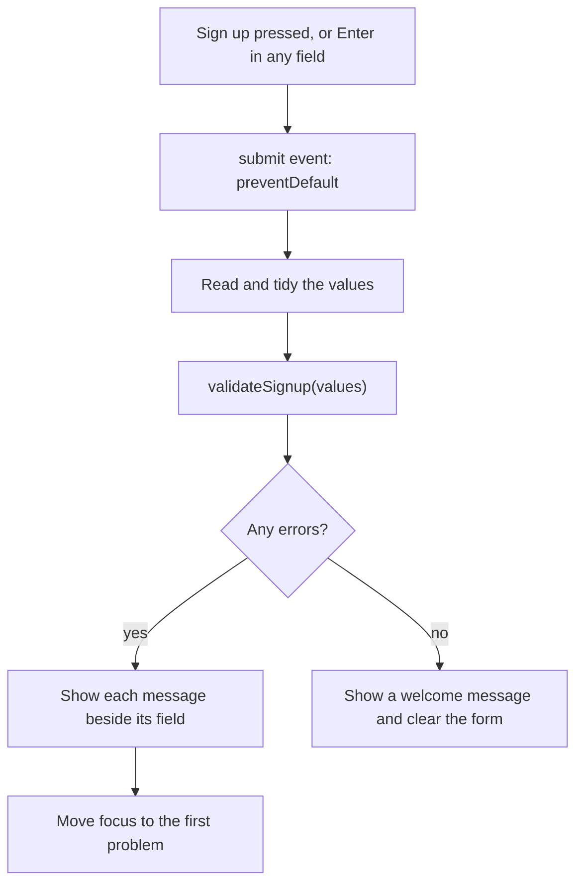

:::objectives
- Write validation rules as one plain function that you can test without a page.
- Show each error next to its field, linked with `aria-describedby` and `aria-invalid`.
- Handle `submit` with `preventDefault`, then either focus the first problem or show success.
- Re-check fields as people type and when they leave a field, without nagging.
- Test a form with only a keyboard.
:::

The school coding club needs a sign-up form. It has five fields: a username, an email, a password, the password again, and a checkbox to agree to the club rules. The form you'll build behaves like this when someone presses **Sign up**:



It also re-checks a field when the user leaves it, and clears a message the moment the problem is fixed. All of it runs in your own project, because the final step handles a real form submission.

## Step 1: Write the form

Create `04-signup` in `js-course` with `index.html`, `style.css`, and `script.js`. Every input gets a visible `label`, an empty paragraph waiting for its error message, and an `aria-describedby` that points at that paragraph (and at the hint text, when there is one).

```html title="04-signup/index.html"
<!DOCTYPE html>
<html lang="en">
<head>
    <meta charset="UTF-8">
    <meta name="viewport" content="width=device-width, initial-scale=1.0">
    <title>Join the coding club</title>
    <link rel="stylesheet" href="style.css">
    <script src="script.js" defer></script>
</head>
<body>
    <form id="signup" novalidate>
        <h1>Join the coding club</h1>

        <label for="username">Username</label>
        <input id="username" autocomplete="username" aria-describedby="username-hint username-error">
        <p class="hint" id="username-hint">3 to 15 characters, no spaces.</p>
        <p class="error" id="username-error"></p>

        <label for="email">Email</label>
        <input id="email" type="email" autocomplete="email" aria-describedby="email-error">
        <p class="error" id="email-error"></p>

        <label for="password">Password</label>
        <input id="password" type="password" autocomplete="new-password" aria-describedby="password-hint password-error">
        <p class="hint" id="password-hint">At least 8 characters, including a number.</p>
        <p class="error" id="password-error"></p>

        <label for="confirm">Confirm password</label>
        <input id="confirm" type="password" autocomplete="new-password" aria-describedby="confirm-error">
        <p class="error" id="confirm-error"></p>

        <label class="check"><input id="terms" type="checkbox" aria-describedby="terms-error"> I agree to the club rules</label>
        <p class="error" id="terms-error"></p>

        <button type="submit">Sign up</button>
        <p id="status" role="status"></p>
    </form>
</body>
</html>
```

```css title="04-signup/style.css"
body { font-family: system-ui, sans-serif; max-width: 26rem; margin: 2rem auto; padding: 0 1rem; }
label { display: block; font-weight: 600; margin-top: 12px; }
input:not([type="checkbox"]) { display: block; width: 100%; box-sizing: border-box; font-size: 1rem; padding: 6px; }
input[aria-invalid="true"] { border: 2px solid #b00020; }
.check { font-weight: normal; }
.hint { color: #555; font-size: 0.9rem; margin: 4px 0 0; }
.error { color: #b00020; font-size: 0.9rem; margin: 4px 0 0; min-height: 1.1em; }
button { margin-top: 16px; font-size: 1rem; padding: 8px 18px; }
#status { font-weight: 600; color: #1b5e20; }
```

Three attributes are doing quiet work. `novalidate` on the form turns off the browser's own pop-up bubbles, since you'll show better messages yourself. `autocomplete` lets password managers and browsers fill fields correctly; `new-password` tells them this is a new account, so they can suggest a strong password. `role="status"` on the last paragraph makes screen readers announce the welcome message when it appears.

## Step 2: Write the rules as one function

The rules don't need a page at all: given five values, decide what's wrong with them. Write them as a function that takes an object of values and returns an object of error messages, with one property per problem field. An empty object means everything passed. Because it's plain JavaScript, you can test it right here:

```javascript run title="rules-test.js"
function hasDigit(text) {
  for (const char of text) {
    if (char >= "0" && char <= "9") {
      return true;
    }
  }
  return false;
}

function looksLikeEmail(email) {
  const parts = email.split("@");
  if (email.includes(" ") || parts.length !== 2 || parts[0] === "") {
    return false;
  }
  const domain = parts[1];
  return domain.includes(".") && !domain.startsWith(".") && !domain.endsWith(".");
}

function validateSignup(values) {
  const errors = {};

  if (values.username === "") {
    errors.username = "Choose a username.";
  } else if (values.username.length < 3 || values.username.length > 15) {
    errors.username = "Use 3 to 15 characters for your username.";
  } else if (values.username.includes(" ")) {
    errors.username = "Usernames can't contain spaces. Try an underscore instead.";
  }

  if (values.email === "") {
    errors.email = "Enter your email address.";
  } else if (!looksLikeEmail(values.email)) {
    errors.email = "Enter an email address like sam@example.com.";
  }

  if (values.password.length < 8) {
    errors.password = "Use at least 8 characters for your password.";
  } else if (!hasDigit(values.password)) {
    errors.password = "Add at least one number to your password.";
  }

  if (values.confirm === "") {
    errors.confirm = "Type your password again.";
  } else if (values.confirm !== values.password) {
    errors.confirm = "This doesn't match the password above.";
  }

  if (!values.terms) {
    errors.terms = "Tick the box to agree to the club rules.";
  }

  return errors;
}

const good = { username: "sam_lee", email: "sam@example.com", password: "pizza2026", confirm: "pizza2026", terms: true };

console.log(validateSignup(good));
console.log(validateSignup({ username: "", email: "", password: "", confirm: "", terms: false }));
console.log(validateSignup({ ...good, email: "sam@example" }));
console.log(validateSignup({ ...good, username: "sam lee", password: "pizzapie", confirm: "pizzapie" }));
console.log(validateSignup({ ...good, confirm: "pizza2025" }));
```

Each test starts from `good`, a set of values that should pass, and changes one or two things with spread syntax. The first result is `{}`, so a valid form really is accepted, and each later test shows exactly the message you expected. That's five tests in a fraction of a second, with no clicking. Writing the tests first, before touching the page, catches most mistakes in the rules.

A few decisions are worth noticing:

-   Each field's checks are an `if` / `else if` chain, so a field gets **one** message at a time, the most basic problem first. Telling someone their empty username is both missing and too short isn't helpful.
-   `hasDigit` loops over a string with `for...of`, which visits one character at a time. `char >= "0" && char <= "9"` works because digits sit next to each other in character order.
-   `looksLikeEmail` only catches obvious typos. No simple rule can prove an address is real; real sites confirm by sending an email to it.

Copy the three functions (without the test lines) into `script.js`.

:::warning
Never put your own password in test data or source code, even as an example. Code gets shared, uploaded, and screenshotted. Use obviously made-up values like `pizza2026`.
:::

## Step 3: Read the values and show messages

Next, the code that connects the rules to the page. Add this below the rules in `script.js`:

```javascript
const fields = ["username", "email", "password", "confirm", "terms"];
const form = document.querySelector("#signup");
const statusMessage = document.querySelector("#status");

function readValues() {
  return {
    username: document.querySelector("#username").value.trim(),
    email: document.querySelector("#email").value.trim(),
    password: document.querySelector("#password").value,
    confirm: document.querySelector("#confirm").value,
    terms: document.querySelector("#terms").checked,
  };
}

function showFieldError(field, message) {
  const input = document.querySelector(`#${field}`);
  const error = document.querySelector(`#${field}-error`);
  error.textContent = message;
  if (message === "") {
    input.removeAttribute("aria-invalid");
  } else {
    input.setAttribute("aria-invalid", "true");
  }
}

function showErrors(errors) {
  fields.forEach((field) => {
    showFieldError(field, errors[field] || "");
  });
}
```

`readValues` trims the username and email, because a stray space there is always a mistake. It doesn't trim passwords: a space might be a deliberate part of one, and silently changing a password means the person can't log in later. For the checkbox, `.checked` gives `true` or `false`.

Two new pieces of syntax appear. `` `#${field}` `` builds a selector from a variable, so one function can handle every field. And `errors[field]` reads the property whose name is stored in `field`: when `field` is `"email"`, it's the same as `errors.email`. Fields with no problem aren't in the object, so `errors[field]` is `undefined`, and `|| ""` swaps that for an empty string, which clears the message.

## Step 4: Handle the submit

Now the moment from the diagram. Add the submit listener:

```javascript
form.addEventListener("submit", (event) => {
  event.preventDefault();
  const values = readValues();
  const errors = validateSignup(values);
  showErrors(errors);

  const problems = fields.filter((field) => errors[field]);
  if (problems.length > 0) {
    statusMessage.textContent = "";
    document.querySelector(`#${problems[0]}`).focus();
    return;
  }

  statusMessage.textContent = `Welcome to the club, ${values.username}! Your account is ready.`;
  form.reset();
});
```

Start Live Server and press **Sign up** with everything empty. You should see:

```text
Username         Choose a username.
Email            Enter your email address.
Password         Use at least 8 characters for your password.
Confirm password Type your password again.
Club rules box   Tick the box to agree to the club rules.
(the cursor is now in the Username box)
```

`fields.filter((field) => errors[field])` keeps the names of fields that have a message, in the order they appear on the page, so `problems[0]` is the problem nearest the top. Moving focus there does two jobs. Sighted users see where to start. Screen reader users hear the field's label followed by its hint and error message, because of `aria-describedby`, instead of being left on a button with no idea what went wrong.

On success, `form.reset()` empties every field, and the welcome message appears in the `role="status"` paragraph. This form doesn't send the data anywhere; in a real app, this is where you'd send it to a server, which you'll learn to do with `fetch` in Module 6.

:::video In0nB0ABaUk
Kyle from Web Dev Simplified validates a form in under seven minutes. Watch for where he calls `preventDefault` and how he collects the messages, then compare his choice of showing them together with this build's choice of putting each one beside its own field.
:::

## Step 5: Check fields as people go

Waiting for **Sign up** works, but it's nicer to hear about a typo while you're still near the field. Add two more listeners. Both go on the form, using delegation: `focusout` and `input` events from every field bubble up to it.

```javascript
form.addEventListener("focusout", (event) => {
  const field = event.target.id;
  if (!fields.includes(field) || event.target.type === "checkbox" || event.target.value === "") {
    return;
  }
  const errors = validateSignup(readValues());
  showFieldError(field, errors[field] || "");
});

form.addEventListener("input", () => {
  const errors = validateSignup(readValues());
  fields.forEach((field) => {
    const error = document.querySelector(`#${field}-error`);
    if (error.textContent !== "") {
      showFieldError(field, errors[field] || "");
    }
  });
});
```

The `focusout` listener checks the field the user just left, but skips empty fields and the checkbox: tabbing past something isn't a mistake yet. The `input` listener re-checks only fields that are **already showing** a message, so errors disappear the moment they're fixed, but new ones never pop up mid-word. It re-checks all of them, not just the field being typed in, because fixing the password can also fix the "doesn't match" message under **Confirm password**.

Here's that behavior on its own. The preview leaves out the **Sign up** button and the submit listener, which need your Live Server project. Type `sam lee` as a username and press **Tab**, then replace the space with an underscore. Try a password without a number, too.

```html preview height="560" title="signup-live-checks.html"
<form id="signup" novalidate>
  <label for="username">Username</label>
  <input id="username" autocomplete="username" aria-describedby="username-hint username-error">
  <p class="hint" id="username-hint">3 to 15 characters, no spaces.</p>
  <p class="error" id="username-error"></p>

  <label for="email">Email</label>
  <input id="email" type="email" autocomplete="email" aria-describedby="email-error">
  <p class="error" id="email-error"></p>

  <label for="password">Password</label>
  <input id="password" type="password" autocomplete="new-password" aria-describedby="password-hint password-error">
  <p class="hint" id="password-hint">At least 8 characters, including a number.</p>
  <p class="error" id="password-error"></p>

  <label for="confirm">Confirm password</label>
  <input id="confirm" type="password" autocomplete="new-password" aria-describedby="confirm-error">
  <p class="error" id="confirm-error"></p>

  <label class="check"><input id="terms" type="checkbox" aria-describedby="terms-error"> I agree to the club rules</label>
  <p class="error" id="terms-error"></p>
</form>

<script>
  function hasDigit(text) {
    for (const char of text) {
      if (char >= "0" && char <= "9") {
        return true;
      }
    }
    return false;
  }

  function looksLikeEmail(email) {
    const parts = email.split("@");
    if (email.includes(" ") || parts.length !== 2 || parts[0] === "") {
      return false;
    }
    const domain = parts[1];
    return domain.includes(".") && !domain.startsWith(".") && !domain.endsWith(".");
  }

  function validateSignup(values) {
    const errors = {};
    if (values.username === "") {
      errors.username = "Choose a username.";
    } else if (values.username.length < 3 || values.username.length > 15) {
      errors.username = "Use 3 to 15 characters for your username.";
    } else if (values.username.includes(" ")) {
      errors.username = "Usernames can't contain spaces. Try an underscore instead.";
    }
    if (values.email === "") {
      errors.email = "Enter your email address.";
    } else if (!looksLikeEmail(values.email)) {
      errors.email = "Enter an email address like sam@example.com.";
    }
    if (values.password.length < 8) {
      errors.password = "Use at least 8 characters for your password.";
    } else if (!hasDigit(values.password)) {
      errors.password = "Add at least one number to your password.";
    }
    if (values.confirm === "") {
      errors.confirm = "Type your password again.";
    } else if (values.confirm !== values.password) {
      errors.confirm = "This doesn't match the password above.";
    }
    if (!values.terms) {
      errors.terms = "Tick the box to agree to the club rules.";
    }
    return errors;
  }

  const fields = ["username", "email", "password", "confirm", "terms"];
  const form = document.querySelector("#signup");

  function readValues() {
    return {
      username: document.querySelector("#username").value.trim(),
      email: document.querySelector("#email").value.trim(),
      password: document.querySelector("#password").value,
      confirm: document.querySelector("#confirm").value,
      terms: document.querySelector("#terms").checked,
    };
  }

  function showFieldError(field, message) {
    const input = document.querySelector(`#${field}`);
    const error = document.querySelector(`#${field}-error`);
    error.textContent = message;
    if (message === "") {
      input.removeAttribute("aria-invalid");
    } else {
      input.setAttribute("aria-invalid", "true");
    }
  }

  form.addEventListener("focusout", (event) => {
    const field = event.target.id;
    if (!fields.includes(field) || event.target.type === "checkbox" || event.target.value === "") {
      return;
    }
    const errors = validateSignup(readValues());
    showFieldError(field, errors[field] || "");
  });

  form.addEventListener("input", () => {
    const errors = validateSignup(readValues());
    fields.forEach((field) => {
      const error = document.querySelector(`#${field}-error`);
      if (error.textContent !== "") {
        showFieldError(field, errors[field] || "");
      }
    });
  });
</script>
<style>
  body { font-family: system-ui, sans-serif; padding: 0 12px; }
  label { display: block; font-weight: 600; margin-top: 10px; }
  input:not([type="checkbox"]) { display: block; width: 100%; max-width: 22em; box-sizing: border-box; font-size: 1rem; padding: 5px; }
  input[aria-invalid="true"] { border: 2px solid #b00020; }
  .check { font-weight: normal; }
  .hint { color: #555; font-size: 0.85rem; margin: 3px 0 0; }
  .error { color: #b00020; font-size: 0.85rem; margin: 3px 0 0; min-height: 1em; }
</style>
```

## Step 6: Test it like a user

Run through this list in your Live Server project. Do the first three with your mouse untouched.

1.  Press **Tab** from the top of the page. Focus should visit every field and the checkbox in order, then **Sign up**.
2.  With the cursor in any text box, press **Enter** on an empty form. Every message appears, and the cursor jumps to **Username**.
3.  Tick the checkbox with **Space**, fill everything in correctly, and press **Enter**. The welcome message appears and the form clears.
4.  Type a password, then a different confirmation, and leave the field. Fix the *first* password to match; the confirm message should disappear.
5.  Type `  sam_lee  ` with spaces around it. It should be accepted, because the spaces are trimmed.

If you have time, turn on your computer's screen reader (Narrator on Windows with **Windows logo key+Ctrl+Enter**, VoiceOver on a Mac with **Cmd+F5**, ChromeVox on a Chromebook with **Ctrl+Alt+Z**) and submit the empty form. You should hear the username label, its hint, and its error message.

## The finished script

All of `script.js`, in order: the rules from Step 2, then Steps 3, 4, and 5.

```javascript title="04-signup/script.js"
function hasDigit(text) {
  for (const char of text) {
    if (char >= "0" && char <= "9") {
      return true;
    }
  }
  return false;
}

function looksLikeEmail(email) {
  const parts = email.split("@");
  if (email.includes(" ") || parts.length !== 2 || parts[0] === "") {
    return false;
  }
  const domain = parts[1];
  return domain.includes(".") && !domain.startsWith(".") && !domain.endsWith(".");
}

function validateSignup(values) {
  const errors = {};

  if (values.username === "") {
    errors.username = "Choose a username.";
  } else if (values.username.length < 3 || values.username.length > 15) {
    errors.username = "Use 3 to 15 characters for your username.";
  } else if (values.username.includes(" ")) {
    errors.username = "Usernames can't contain spaces. Try an underscore instead.";
  }

  if (values.email === "") {
    errors.email = "Enter your email address.";
  } else if (!looksLikeEmail(values.email)) {
    errors.email = "Enter an email address like sam@example.com.";
  }

  if (values.password.length < 8) {
    errors.password = "Use at least 8 characters for your password.";
  } else if (!hasDigit(values.password)) {
    errors.password = "Add at least one number to your password.";
  }

  if (values.confirm === "") {
    errors.confirm = "Type your password again.";
  } else if (values.confirm !== values.password) {
    errors.confirm = "This doesn't match the password above.";
  }

  if (!values.terms) {
    errors.terms = "Tick the box to agree to the club rules.";
  }

  return errors;
}

const fields = ["username", "email", "password", "confirm", "terms"];
const form = document.querySelector("#signup");
const statusMessage = document.querySelector("#status");

function readValues() {
  return {
    username: document.querySelector("#username").value.trim(),
    email: document.querySelector("#email").value.trim(),
    password: document.querySelector("#password").value,
    confirm: document.querySelector("#confirm").value,
    terms: document.querySelector("#terms").checked,
  };
}

function showFieldError(field, message) {
  const input = document.querySelector(`#${field}`);
  const error = document.querySelector(`#${field}-error`);
  error.textContent = message;
  if (message === "") {
    input.removeAttribute("aria-invalid");
  } else {
    input.setAttribute("aria-invalid", "true");
  }
}

function showErrors(errors) {
  fields.forEach((field) => {
    showFieldError(field, errors[field] || "");
  });
}

form.addEventListener("submit", (event) => {
  event.preventDefault();
  const values = readValues();
  const errors = validateSignup(values);
  showErrors(errors);

  const problems = fields.filter((field) => errors[field]);
  if (problems.length > 0) {
    statusMessage.textContent = "";
    document.querySelector(`#${problems[0]}`).focus();
    return;
  }

  statusMessage.textContent = `Welcome to the club, ${values.username}! Your account is ready.`;
  form.reset();
});

form.addEventListener("focusout", (event) => {
  const field = event.target.id;
  if (!fields.includes(field) || event.target.type === "checkbox" || event.target.value === "") {
    return;
  }
  const errors = validateSignup(readValues());
  showFieldError(field, errors[field] || "");
});

form.addEventListener("input", () => {
  const errors = validateSignup(readValues());
  fields.forEach((field) => {
    const error = document.querySelector(`#${field}-error`);
    if (error.textContent !== "") {
      showFieldError(field, errors[field] || "");
    }
  });
});
```

:::quiz
Q: Why are the rules in `validateSignup(values)` instead of inside the submit listener?
- [ ] Event listeners aren't allowed to contain `if` statements
  Listeners can contain any code at all.
- [x] So the rules can be tested without a page, and reused by the submit, `focusout`, and `input` listeners
  Step 2 tested every rule in plain JavaScript, and three different listeners call the same function.
- [ ] It makes the form submit faster
  Speed isn't the point; the checks take microseconds either way.

Q: After a failed submit, why does the code call `focus()` on the first field with a problem?
- [x] Keyboard and screen reader users land right on the problem and hear its message
  `aria-describedby` makes the error part of what's announced when that field gets focus.
- [ ] Focusing a field clears its error message
  Focus doesn't change the message; fixing the value does.
- [ ] Browsers refuse to show messages for fields without focus
  The messages show either way; focus is about where the user is, not what's visible.

Q: `readValues` trims the email but not the password. Why?
- [ ] Passwords can't contain spaces anyway
  They can, and some people use passphrases with spaces in them.
- [x] A space in a password might be deliberate, and changing it silently would lock the person out later
  Trimming is safe for an email, where a stray space is always a typo, but not for a secret the user chose.
- [ ] `trim()` only works on fields with `type="email"`
  `trim()` is a string method and works on any text.
:::

:::takeaways
- Put validation rules in one plain function that returns an object of messages, and test it with sample values before building the page.
- Show one message per field, the most basic problem first, right beside the field it describes.
- `aria-describedby`, `aria-invalid`, and moving focus to the first problem make errors usable without a mouse or a screen.
- Listen for `submit` on the form and call `preventDefault`. Check on `focusout` only when something was typed, and re-check on `input` only where a message is already showing.
- Browser-side checks help people fill in a form; a server must still check everything before trusting it.
:::

## Ideas to extend it

-   Add a **Show password** checkbox that switches both password fields between `type="password"` and `type="text"`.
-   Show a strength meter under the password that updates on every `input` event.
-   Add an age field that only accepts whole numbers between 13 and 18, with a clear message for each kind of mistake.
-   Check whether a username is taken. That needs a server to ask, which is what `fetch` is for in Module 6.

## Further reading

-   [W3C WAI: User notifications](https://www.w3.org/WAI/tutorials/forms/notifications/): the accessibility standards group's guide to success and error messages in forms, with code.
-   [MDN: the submit event](https://developer.mozilla.org/en-US/docs/Web/API/HTMLFormElement/submit_event): when `submit` fires, and what `event.submitter` tells you about the button used.
-   [MDN: aria-describedby](https://developer.mozilla.org/en-US/docs/Web/Accessibility/ARIA/Reference/Attributes/aria-describedby): how linking a field to its hint and error changes what screen readers announce.
