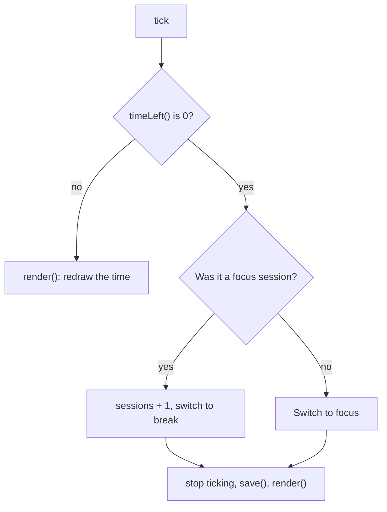

:::objectives
- Turn a number of milliseconds into a `mm:ss` display.
- Run exactly one countdown at a time, timed with `Date.now()` so it stays accurate.
- Switch between focus and break sessions when the clock reaches zero.
- Save the timer to `localStorage` and restore it, mid-countdown, after a refresh.
:::

The pomodoro technique is simple: work on one thing for 25 minutes, take a 5-minute break, repeat. The timer you'll build does that, and it fixes both bugs from the last lesson. Clicking Start ten times still runs one countdown, and refreshing the page (or closing the tab and coming back) doesn't lose your place.

Here is the finished app. In this preview a "minute" lasts one second, so a whole focus-and-break cycle takes 30 seconds. Press Start, try Pause and Reset, and let it run to zero.

```html preview height="330" title="pomodoro.html"
<main class="app" data-mode="focus">
  <p class="mode" id="mode">Focus</p>
  <p class="time" id="time" role="timer">25:00</p>
  <div class="buttons">
    <button id="toggle">Start</button>
    <button id="reset">Reset</button>
  </div>
  <p id="sessions">Focus sessions finished: 0</p>
  <p id="status" aria-live="polite"></p>
</main>
<script>
  // In this preview a "minute" lasts one second. Use 60 in your real app.
  const SECONDS_PER_MINUTE = 1;
  const MINUTES = { focus: 25, break: 5 };
  const KEY = "pomodoro";

  const app = document.querySelector(".app");
  const modeEl = document.querySelector("#mode");
  const timeEl = document.querySelector("#time");
  const toggleBtn = document.querySelector("#toggle");
  const resetBtn = document.querySelector("#reset");
  const sessionsEl = document.querySelector("#sessions");
  const statusEl = document.querySelector("#status");

  function durationFor(mode) {
    return MINUTES[mode] * SECONDS_PER_MINUTE * 1000;
  }

  function formatTime(ms) {
    const totalSeconds = Math.ceil(ms / 1000);
    const minutes = Math.floor(totalSeconds / 60);
    const seconds = totalSeconds % 60;
    return `${String(minutes).padStart(2, "0")}:${String(seconds).padStart(2, "0")}`;
  }

  function freshState() {
    return {
      mode: "focus",
      running: false,
      endAt: null,
      remainingMs: durationFor("focus"),
      sessions: 0,
      message: "",
    };
  }

  function save() {
    try {
      localStorage.setItem(KEY, JSON.stringify(state));
    } catch {
      // Storage is blocked (private browsing, or this lesson's preview frame).
      // The timer still works; it just won't remember anything.
    }
  }

  function load() {
    try {
      const saved = JSON.parse(localStorage.getItem(KEY));
      return { ...freshState(), ...saved };
    } catch {
      return freshState();
    }
  }

  let state = load();
  let timerId = null;

  function timeLeft() {
    if (!state.running) return state.remainingMs;
    return Math.max(0, state.endAt - Date.now());
  }

  function startTicking() {
    if (timerId !== null) return;
    timerId = setInterval(tick, 250);
  }

  function stopTicking() {
    clearInterval(timerId);
    timerId = null;
  }

  function start() {
    if (state.running) return;
    state.running = true;
    state.endAt = Date.now() + state.remainingMs;
    state.message = "";
    startTicking();
    save();
    render();
  }

  function pause() {
    if (!state.running) return;
    state.remainingMs = timeLeft();
    state.running = false;
    state.endAt = null;
    stopTicking();
    save();
    render();
  }

  function reset() {
    stopTicking();
    state.running = false;
    state.endAt = null;
    state.remainingMs = durationFor(state.mode);
    state.message = "";
    save();
    render();
  }

  function finishSession() {
    stopTicking();
    if (state.mode === "focus") {
      state.sessions = state.sessions + 1;
      state.mode = "break";
      state.message = "Focus session done. Time for a break.";
    } else {
      state.mode = "focus";
      state.message = "Break over. Press Start when you're ready.";
    }
    state.running = false;
    state.endAt = null;
    state.remainingMs = durationFor(state.mode);
    save();
    render();
  }

  function tick() {
    if (timeLeft() === 0) finishSession();
    else render();
  }

  function render() {
    const label = state.mode === "focus" ? "Focus" : "Break";
    const time = formatTime(timeLeft());
    app.dataset.mode = state.mode;
    modeEl.textContent = label;
    timeEl.textContent = time;
    toggleBtn.textContent = state.running ? "Pause" : "Start";
    sessionsEl.textContent = `Focus sessions finished: ${state.sessions}`;
    statusEl.textContent = state.message;
    document.title = `${time} ${label}`;
  }

  toggleBtn.addEventListener("click", () => {
    if (state.running) pause();
    else start();
  });
  resetBtn.addEventListener("click", reset);

  // Pick up where we left off after a refresh.
  if (state.running) {
    if (timeLeft() === 0) finishSession(); // it ended while the page was closed
    else startTicking();
  }
  render();
</script>
<style>
  body { font-family: system-ui, sans-serif; margin: 0; }
  .app { max-width: 360px; margin: 12px auto; padding: 16px; border-radius: 16px; text-align: center; background: #fde8e4; color: #3b1d17; }
  .app[data-mode="break"] { background: #e2f4e8; color: #14341f; }
  .mode { margin: 0; font-weight: 600; letter-spacing: 0.08em; text-transform: uppercase; }
  .time { margin: 4px 0 12px; font-size: 64px; font-variant-numeric: tabular-nums; }
  .buttons { display: flex; gap: 8px; justify-content: center; }
  button { font-size: 16px; padding: 8px 20px; border-radius: 8px; border: 2px solid currentColor; background: white; color: inherit; cursor: pointer; }
  button:focus-visible { outline: 3px solid #1a56db; outline-offset: 2px; }
  #status { min-height: 1.4em; font-weight: 600; }
</style>
```

This preview runs in a locked-down frame where saving is switched off, so it forgets everything when you leave the page. The copy you build in VS Code will remember.

## The plan: one state object and a handful of functions

Everything the timer needs to know lives in one object called `state`. The buttons never touch the page directly. They call a function that changes `state`, saves it, and calls `render()` to redraw the page from it.

```javascript
const state = {
  mode: "focus",          // "focus" or "break"
  running: false,         // is the clock ticking?
  endAt: null,            // when the running session ends (a Date.now() value)
  remainingMs: 1500000,   // time left while paused: 25 minutes in milliseconds
  sessions: 0,            // focus sessions finished
  message: "",            // short status line, like "Time for a break."
};
```

There are two ways to know the time left, and the `running` flag picks between them. While the clock runs, the truth is `endAt - Date.now()`. While paused, there is no end time yet, so `remainingMs` holds the frozen value.



## Step 1: Make the files

Make a folder called `pomodoro` and open it in VS Code. Add three files.

```html title="index.html"
<!DOCTYPE html>
<html lang="en">
  <head>
    <meta charset="UTF-8" />
    <meta name="viewport" content="width=device-width, initial-scale=1" />
    <title>Pomodoro</title>
    <link rel="stylesheet" href="style.css" />
    <script src="script.js" defer></script>
  </head>
  <body>
    <main class="app" data-mode="focus">
      <p class="mode" id="mode">Focus</p>
      <p class="time" id="time" role="timer">25:00</p>
      <div class="buttons">
        <button id="toggle">Start</button>
        <button id="reset">Reset</button>
      </div>
      <p id="sessions">Focus sessions finished: 0</p>
      <p id="status" aria-live="polite"></p>
    </main>
  </body>
</html>
```

For `style.css`, copy the rules from the `style` block at the bottom of the preview above. Leave `script.js` empty for now. Right-click `index.html` and choose **Open with Live Server**. You should see a pink card showing 25:00 with two buttons that do nothing yet.

Two accessibility choices are already in the HTML. `role="timer"` tells screen readers this number is a clock, and timers are not read aloud on every change (hearing "24:59, 24:58…" would be unbearable). The status line has `aria-live="polite"`, so when it changes to "Time for a break", a screen reader announces it once.

## Step 2: Show milliseconds as `mm:ss`

Everything in the timer is measured in milliseconds, because that's what `Date.now()` returns. People want to read `24:59`. This function does the conversion, and it is pure (no page, no clock), so you can test it on its own.

```javascript run title="format-time.js"
function formatTime(ms) {
  const totalSeconds = Math.ceil(ms / 1000);
  const minutes = Math.floor(totalSeconds / 60);
  const seconds = totalSeconds % 60;
  return `${String(minutes).padStart(2, "0")}:${String(seconds).padStart(2, "0")}`;
}

console.log(formatTime(25 * 60 * 1000)); // a full focus session
console.log(formatTime(61000));          // 61 seconds
console.log(formatTime(59001));          // just over 59 seconds
console.log(formatTime(400));            // under half a second left
console.log(formatTime(0));
```

`padStart(2, "0")` adds a leading zero to one-digit numbers, so 1 minute shows as `01`. `Math.ceil` rounds partial seconds **up**: with 400 ms left the display still says `00:01`, and it only shows `00:00` when time has truly run out. With `Math.floor` the clock would sit on `00:00` for most of a second before anything happened.

## Step 3: Start and pause, with exactly one interval

Put this at the top of `script.js`, followed by the `formatTime` function from Step 2.

```javascript title="script.js"
// While testing, make a "minute" last 1 second. Use 60 for real.
const SECONDS_PER_MINUTE = 60;
const MINUTES = { focus: 25, break: 5 };

const app = document.querySelector(".app");
const modeEl = document.querySelector("#mode");
const timeEl = document.querySelector("#time");
const toggleBtn = document.querySelector("#toggle");
const resetBtn = document.querySelector("#reset");
const sessionsEl = document.querySelector("#sessions");
const statusEl = document.querySelector("#status");

function durationFor(mode) {
  return MINUTES[mode] * SECONDS_PER_MINUTE * 1000;
}
```

Next come the state and the functions that run the clock. `start()` turns "time left" into a fixed end time; `pause()` does the reverse.

```javascript title="script.js"
let state = {
  mode: "focus",
  running: false,
  endAt: null,
  remainingMs: durationFor("focus"),
  sessions: 0,
  message: "",
};
let timerId = null;

function timeLeft() {
  if (!state.running) return state.remainingMs;
  return Math.max(0, state.endAt - Date.now());
}

function startTicking() {
  if (timerId !== null) return;
  timerId = setInterval(tick, 250);
}

function stopTicking() {
  clearInterval(timerId);
  timerId = null;
}

function start() {
  if (state.running) return;
  state.running = true;
  state.endAt = Date.now() + state.remainingMs;
  state.message = "";
  startTicking();
  render();
}

function pause() {
  if (!state.running) return;
  state.remainingMs = timeLeft();
  state.running = false;
  state.endAt = null;
  stopTicking();
  render();
}

function tick() {
  render();
}

function render() {
  const label = state.mode === "focus" ? "Focus" : "Break";
  const time = formatTime(timeLeft());
  app.dataset.mode = state.mode;
  modeEl.textContent = label;
  timeEl.textContent = time;
  toggleBtn.textContent = state.running ? "Pause" : "Start";
  sessionsEl.textContent = `Focus sessions finished: ${state.sessions}`;
  statusEl.textContent = state.message;
  document.title = `${time} ${label}`;
}

toggleBtn.addEventListener("click", () => {
  if (state.running) pause();
  else start();
});

render();
```

Save, and Live Server reloads the page. Now Start counts down, the button turns into Pause, and pausing freezes the time. Start again and it continues from the frozen value. Click Start-Pause-Start as fast as you can: the countdown never speeds up.

That's thanks to two separate guards. `if (state.running) return;` in `start()` protects the *logic* (don't recompute the end time while running). `if (timerId !== null) return;` in `startTicking()` protects the *mechanics* (never create a second interval). Each one is a single line, and together they make the double-start bug impossible.

`render()` also writes the time into `document.title`, so the countdown shows in the browser tab while you work in another one.

## Step 4: Switch between focus and break

When time runs out, the app should count the session (if it was a focus one), flip the mode, and wait for the next Start. Replace `tick()` and add `finishSession()` and `reset()`.

```javascript title="script.js"
function tick() {
  if (timeLeft() === 0) finishSession();
  else render();
}

function finishSession() {
  stopTicking();
  if (state.mode === "focus") {
    state.sessions = state.sessions + 1;
    state.mode = "break";
    state.message = "Focus session done. Time for a break.";
  } else {
    state.mode = "focus";
    state.message = "Break over. Press Start when you're ready.";
  }
  state.running = false;
  state.endAt = null;
  state.remainingMs = durationFor(state.mode);
  render();
}

function reset() {
  stopTicking();
  state.running = false;
  state.endAt = null;
  state.remainingMs = durationFor(state.mode);
  state.message = "";
  render();
}

resetBtn.addEventListener("click", reset);
```

Nobody wants to wait 25 minutes to test this. Set `SECONDS_PER_MINUTE = 1` while you work, so a focus session lasts 25 seconds. Let it reach zero and you should see:

```text
BREAK
00:05
Focus sessions finished: 1
Focus session done. Time for a break.
```

The card turns green because `render()` sets `data-mode="break"` on it, and the CSS rule `.app[data-mode="break"]` picks a different background.

## Step 5: Save after every change, load once at the start

Add these two functions near the top of the file, under `durationFor`, and replace the `let state = { … }` object with `let state = load();`.

```javascript title="script.js"
const KEY = "pomodoro";

function freshState() {
  return {
    mode: "focus",
    running: false,
    endAt: null,
    remainingMs: durationFor("focus"),
    sessions: 0,
    message: "",
  };
}

function save() {
  try {
    localStorage.setItem(KEY, JSON.stringify(state));
  } catch {
    // Storage can be blocked, for example in some private windows.
    // The timer still works; it just won't remember anything.
  }
}

function load() {
  try {
    const saved = JSON.parse(localStorage.getItem(KEY));
    return { ...freshState(), ...saved };
  } catch {
    return freshState();
  }
}
```

Then call `save()` just before `render()` in `start`, `pause`, `reset`, and `finishSession`. Every change is now written down the moment it happens.

Here is `load()` tested in Node with a stand-in for `localStorage`, covering the three cases from the last lesson: nothing saved, good data, and damaged data.

```javascript run title="load-test.js"
const fakeStorage = {
  data: {},
  getItem(key) {
    return key in this.data ? this.data[key] : null;
  },
};

function freshState() {
  return { mode: "focus", running: false, endAt: null, remainingMs: 1500000, sessions: 0, message: "" };
}

function load() {
  try {
    const saved = JSON.parse(fakeStorage.getItem("pomodoro"));
    return { ...freshState(), ...saved };
  } catch {
    return freshState();
  }
}

console.log("first visit:", load().sessions, load().mode);

fakeStorage.data.pomodoro = '{"mode":"break","sessions":3}';
console.log("saved data:", load().sessions, load().mode, load().remainingMs);

fakeStorage.data.pomodoro = "{oops";
console.log("damaged data:", load().sessions, load().mode);
```

On the first visit `getItem` returns `null`, `JSON.parse(null)` gives `null`, and spreading `null` adds nothing, so you get a fresh state. The saved data only had two fields, and the defaults filled in the rest. The damaged text threw a `SyntaxError`, which `catch` turned into a fresh start instead of a blank page.

Finally, a refresh may happen while the clock is running. `endAt` is a moment on the clock, so it means the same thing after a reload. Put this at the very bottom of the file, replacing the lone `render();`:

```javascript title="script.js"
// Pick up where we left off after a refresh.
if (state.running) {
  if (timeLeft() === 0) finishSession(); // it ended while the page was closed
  else startTicking();
}
render();
```

Now test it properly. Start a session and refresh: the countdown carries on. Open DevTools, go to **Application › Storage › Local storage**, and click your Live Server address to see the `pomodoro` key with its JSON. Double-click the value, change it to `{oops`, and refresh. The app starts fresh instead of crashing. One more nice side effect: Live Server reloads the page every time you save a file, and the timer no longer loses its place when that happens.

:::tip
If you switch `SECONDS_PER_MINUTE` from 1 back to 60, click **Reset** once. The saved `remainingMs` was measured with the old setting.
:::

:::video 5o8krh_Qduk
A three-minute tour of the storage view in Chrome DevTools. Watch for how to edit and delete a saved value, which is the fastest way to test your first-visit and damaged-data cases.
:::

## The finished `script.js`

```javascript title="script.js"
const SECONDS_PER_MINUTE = 60; // use 1 while testing
const MINUTES = { focus: 25, break: 5 };
const KEY = "pomodoro";

const app = document.querySelector(".app");
const modeEl = document.querySelector("#mode");
const timeEl = document.querySelector("#time");
const toggleBtn = document.querySelector("#toggle");
const resetBtn = document.querySelector("#reset");
const sessionsEl = document.querySelector("#sessions");
const statusEl = document.querySelector("#status");

function durationFor(mode) {
  return MINUTES[mode] * SECONDS_PER_MINUTE * 1000;
}

function formatTime(ms) {
  const totalSeconds = Math.ceil(ms / 1000);
  const minutes = Math.floor(totalSeconds / 60);
  const seconds = totalSeconds % 60;
  return `${String(minutes).padStart(2, "0")}:${String(seconds).padStart(2, "0")}`;
}

function freshState() {
  return {
    mode: "focus",
    running: false,
    endAt: null,
    remainingMs: durationFor("focus"),
    sessions: 0,
    message: "",
  };
}

function save() {
  try {
    localStorage.setItem(KEY, JSON.stringify(state));
  } catch {
    // Storage can be blocked; the timer still works without it.
  }
}

function load() {
  try {
    const saved = JSON.parse(localStorage.getItem(KEY));
    return { ...freshState(), ...saved };
  } catch {
    return freshState();
  }
}

let state = load();
let timerId = null;

function timeLeft() {
  if (!state.running) return state.remainingMs;
  return Math.max(0, state.endAt - Date.now());
}

function startTicking() {
  if (timerId !== null) return;
  timerId = setInterval(tick, 250);
}

function stopTicking() {
  clearInterval(timerId);
  timerId = null;
}

function start() {
  if (state.running) return;
  state.running = true;
  state.endAt = Date.now() + state.remainingMs;
  state.message = "";
  startTicking();
  save();
  render();
}

function pause() {
  if (!state.running) return;
  state.remainingMs = timeLeft();
  state.running = false;
  state.endAt = null;
  stopTicking();
  save();
  render();
}

function reset() {
  stopTicking();
  state.running = false;
  state.endAt = null;
  state.remainingMs = durationFor(state.mode);
  state.message = "";
  save();
  render();
}

function finishSession() {
  stopTicking();
  if (state.mode === "focus") {
    state.sessions = state.sessions + 1;
    state.mode = "break";
    state.message = "Focus session done. Time for a break.";
  } else {
    state.mode = "focus";
    state.message = "Break over. Press Start when you're ready.";
  }
  state.running = false;
  state.endAt = null;
  state.remainingMs = durationFor(state.mode);
  save();
  render();
}

function tick() {
  if (timeLeft() === 0) finishSession();
  else render();
}

function render() {
  const label = state.mode === "focus" ? "Focus" : "Break";
  const time = formatTime(timeLeft());
  app.dataset.mode = state.mode;
  modeEl.textContent = label;
  timeEl.textContent = time;
  toggleBtn.textContent = state.running ? "Pause" : "Start";
  sessionsEl.textContent = `Focus sessions finished: ${state.sessions}`;
  statusEl.textContent = state.message;
  document.title = `${time} ${label}`;
}

toggleBtn.addEventListener("click", () => {
  if (state.running) pause();
  else start();
});
resetBtn.addEventListener("click", reset);

if (state.running) {
  if (timeLeft() === 0) finishSession();
  else startTicking();
}
render();
```

:::quiz
Q: A focus session is running. You close the tab, come back 10 minutes later, and the timer shows the right time. Why?
- [ ] `setInterval` kept running after the tab closed
  Closing or refreshing a page stops all of its timers. Nothing ran while you were away.
- [x] `endAt` was saved, and it's a fixed moment on the clock
  On load, `timeLeft()` works out `endAt - Date.now()`. Ten minutes later, that subtraction gives exactly 10 minutes less.
- [ ] `localStorage` counts down by itself
  `localStorage` only stores text. It never changes a value on its own.

Q: Why does the interval run every 250 ms instead of every 1,000 ms?
- [x] So the display updates within a quarter-second of each real second changing
  Ticks can be late. With one tick a second, a late one could make the display skip a number or lag behind. Four cheap redraws a second hide that.
- [ ] Because the timer counts quarter-seconds
  The timer doesn't count ticks at all. The time left always comes from `endAt - Date.now()`.
- [ ] Because `setInterval` can't use 1,000
  Any delay works. 250 is a choice for smoothness.

Q: Why does `load()` return `{ ...freshState(), ...saved }` instead of just `saved`?
- [ ] To turn the saved text back into an object
  `JSON.parse` already did that. The spread is about which fields end up in the result.
- [x] So any field missing from the saved data still gets a default
  If an older version of your app saved only `mode` and `sessions`, the fresh state supplies `running`, `endAt`, and the rest, and nothing is ever `undefined`.
- [ ] Because spreading makes the code run faster
  It's slightly more work, not less. It's there for safety.
:::

:::takeaways
- One `state` object holds everything the timer knows, and every button follows the same pattern: change `state`, `save()`, `render()`.
- Store a running countdown as an end time (`endAt`). It stays correct across late ticks, background tabs, and page reloads.
- Two small guards (`state.running` and `timerId !== null`) make double starts impossible.
- `load()` merges saved data over fresh defaults inside `try`/`catch`, so first visits and damaged data both start cleanly.
- Speed up time while testing (`SECONDS_PER_MINUTE = 1`) instead of waiting 25 minutes.
:::

## Ideas to extend it

- **Long breaks.** After every fourth focus session, make the break 15 minutes. `state.sessions % 4 === 0` tells you when.
- **Custom lengths.** Add a small form for focus and break minutes, validate that each is a whole number from 1 to 90, and save the choice with the rest of the state.
- **A sound at zero.** Browsers only allow audio after the person has interacted with the page, and pressing Start counts, so `new Audio("ding.mp3").play()` in `finishSession()` will work.
- **A keyboard shortcut.** Let the Space bar toggle the timer from anywhere on the page, but skip it when a button already has focus, or one press will toggle twice.
- **Daily history.** Save sessions per date (`{ "2026-11-15": 4 }`) and show a small table of the last seven days.

## Further reading

- [Chrome DevTools: view and edit local storage](https://developer.chrome.com/docs/devtools/storage/localstorage): every way to inspect, edit, and clear what your app saved.
- [MDN: String.prototype.padStart()](https://developer.mozilla.org/en-US/docs/Web/JavaScript/Reference/Global_Objects/String/padStart): the leading-zero trick, with more examples.
- [MDN: ARIA timer role](https://developer.mozilla.org/en-US/docs/Web/Accessibility/ARIA/Reference/Roles/timer_role): why a countdown shouldn't be announced on every change, and when it should.
