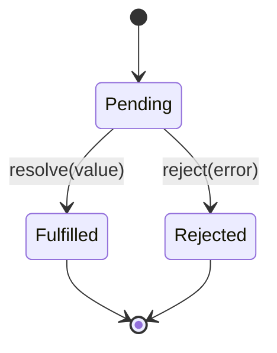

:::objectives
- Explain why JavaScript never freezes while it waits, using the call stack and the event loop.
- Predict the order of synchronous code, promise callbacks, and timer callbacks.
- Write `async` functions that `await` promises and catch their errors with `try`/`catch`.
- Load JSON with `fetch`, check `response.ok`, and show loading, success, and error states.
:::

Open the DevTools Console on any page you've made with Live Server and type this:

```javascript
fetch("https://api.github.com/users/octocat")
```

You'd expect GitHub's mascot's profile. What you get is this:

```text
Promise {<pending>}
```

The data lives on a server, perhaps thousands of kilometres away, and it takes a moment to arrive. JavaScript refuses to stand still while it waits, so `fetch` hands you a **promise**, a placeholder for a value that isn't ready yet. Here is how that waiting works, and how to get at the data when it lands.

## JavaScript does one thing at a time, so it never waits around

Picture a restaurant with one cook. A good cook doesn't stare at the oven for 12 minutes. They put the pizza in, set a timer, and start the next order. When the timer rings, they take the pizza out as soon as their hands are free.

JavaScript in a page is that cook. It has one **call stack**: one piece of code running at a time, always to the end. The waiting (timers, network requests, listening for clicks) is done by the browser, outside your code. When a wait is over, the browser puts the callback in a queue. The **event loop** hands the next queued callback to JavaScript whenever the stack is empty.

```mermaid caption="Your code runs on one thread; the browser does the waiting and queues callbacks"
flowchart LR
    A["Call stack: your code"] -->|"setTimeout, fetch, listeners"| B["Browser: timers, network, events"]
    B -->|"timer done, click"| C[Task queue]
    B -->|"promise settled"| D[Microtask queue]
    D -->|"all of these first"| E((Event loop))
    C -->|"then one task"| E
    E -->|"when the stack is empty"| A
```

There are two queues. Promise callbacks go in the **microtask** queue, which is emptied completely before the next ordinary task (like a timer callback) gets a turn. Predict the order of these four lines before you look.

```javascript run title="order.js"
console.log("1: script starts");

setTimeout(() => console.log("4: timer callback"), 0);

Promise.resolve().then(() => console.log("3: promise callback"));

console.log("2: script ends");
```

The two plain `console.log` lines run first, because the current script always finishes. Then the microtask (the promise callback) runs, and only then the timer callback, even though its delay was 0. The flip side: if your own code runs a long loop, nothing else can happen. No clicks are handled and the page doesn't redraw until the stack is empty. That's the "busy page" from Module 5 that made timer ticks late.

## A promise is an order number for a value that isn't ready yet

At a sandwich shop you get an order number. Right now it's **pending**. Later it either becomes a sandwich (**fulfilled**) or the cashier tells you they're out of bread (**rejected**). Either way it only happens once: a fulfilled order never turns into a rejection afterwards.



You'll rarely create promises yourself, because `fetch` and other browser features give you one. Building one by hand shows the shape, though. This fake weather service answers after 200 ms.

```javascript run title="forecast.js"
function getForecast(city) {
  return new Promise((resolve, reject) => {
    setTimeout(() => {
      const forecasts = { Austin: "sunny, 31°C", Oslo: "snow, -4°C" };
      if (city in forecasts) resolve(forecasts[city]);
      else reject(new Error(`No forecast for ${city}`));
    }, 200);
  });
}

getForecast("Oslo")
  .then((text) => console.log("Oslo:", text))
  .catch((error) => console.log("Problem:", error.message));

getForecast("Atlantis")
  .then((text) => console.log("Atlantis:", text))
  .catch((error) => console.log("Problem:", error.message));

console.log("Asked for two forecasts...");
```

`.then` runs when the promise is fulfilled and receives the value; `.catch` runs when it's rejected and receives the error. Both requests were waiting at the same time, which is why "Asked for two forecasts..." printed first.

## `async` and `await` let you write it top to bottom

Chains of `.then` get hard to read. Inside a function marked `async`, you can write `await promise` instead. It pauses **that function** until the promise settles, then gives you the value, or throws the error so `try`/`catch` can handle it.

```javascript run title="breakfast.js"
const wait = (ms) => new Promise((resolve) => setTimeout(resolve, ms));

async function makeToast() {
  console.log("Toast goes in");
  await wait(300);
  console.log("Toast pops up");
  return "toast";
}

async function breakfast() {
  try {
    const food = await makeToast();
    console.log("Eating", food);
  } catch (error) {
    console.log("Breakfast failed:", error.message);
  }
}

breakfast();
console.log("Meanwhile, pouring juice");
```

"Meanwhile" printed before the toast popped. `await` paused `makeToast`, not the whole program, so the rest of the script kept running. One more rule: an `async` function always returns a promise, even when you `return "toast"`. That's why `breakfast` had to `await makeToast()` to get the actual string.

## `fetch` in two steps: the response, then the body

`fetch(url)` returns a promise for a **response**. The response arrives as soon as the server sends its status and headers, which may be before the whole body has downloaded. Reading the body is a second wait: `response.json()` returns another promise that gives you the parsed data.

```javascript title="script.js"
async function showOctocat() {
  const response = await fetch("https://api.github.com/users/octocat");
  console.log(response.status, response.ok);

  const user = await response.json();
  console.log(user.name, "has", user.public_repos, "public repos");
}

showOctocat();
```

Put that in a `script.js` served by Live Server and the Console shows (the numbers may change over time):

```text
200 true
The Octocat has 8 public repos
```

This page can't run `fetch` for you (its examples have no network access), but your own pages can. Open the Network panel in DevTools while it runs and you'll see the request to `api.github.com` and its JSON reply.

## A 404 is not an error to `fetch`

Here is the trap that catches nearly everyone. If you ask GitHub for a user that doesn't exist, it replies with status **404** and a small JSON body saying "Not Found". To `fetch`, that's a perfectly good response, so the promise is **fulfilled**, not rejected. This program uses a stand-in for `fetch` that answers exactly like GitHub does for a missing user.

```javascript run title="not-found.js"
// Answers the way GitHub does when the user doesn't exist.
async function fakeFetch(url) {
  return {
    ok: false,
    status: 404,
    json: async () => ({ message: "Not Found", status: "404" }),
  };
}

async function showUser(username) {
  const response = await fakeFetch(`https://api.github.com/users/${username}`);
  const user = await response.json();
  console.log(`${user.name} has ${user.public_repos} public repos`);
}

showUser("no-such-person-123");
```

No error, just `undefined` on the screen. The fix is to check `response.ok`, which is `true` only for statuses 200 to 299, and throw your own error otherwise:

```javascript title="script.js"
async function getUser(username) {
  const response = await fetch(`https://api.github.com/users/${username}`);
  if (!response.ok) {
    throw new Error(`GitHub answered ${response.status}`);
  }
  return response.json();
}
```

`fetch` itself only rejects when there's no response at all: you're offline, the address doesn't exist, or the browser blocked the request. In Chrome that error is `TypeError: Failed to fetch`. So there are two kinds of failure, and one `try`/`catch` around `await getUser(...)` handles both.

## Show every state: loading, success, and error

A request takes time and might fail, so the page has to show something in each case. Leave out the loading state and people click again and again; leave out the error state and they stare at a blank box. This preview fakes a slow server (1.5 seconds) so you can see all three. Tick the box to make it fail.

```html preview height="200" title="fact-loader.html"
<button id="load">Load a fact</button>
<label><input type="checkbox" id="fail" /> Make the request fail</label>
<p id="status" aria-live="polite"></p>
<p id="fact" hidden></p>
<script>
  const facts = [
    "Octopuses have three hearts.",
    "A day on Venus is longer than its year.",
    "Sunlight takes about 8 minutes to reach Earth.",
    "Bananas are berries, but strawberries aren't.",
  ];

  // Pretends to be a slow server.
  function fakeRequest(shouldFail) {
    return new Promise((resolve, reject) => {
      setTimeout(() => {
        if (shouldFail) reject(new Error("the server didn't answer"));
        else resolve(facts[Math.floor(Math.random() * facts.length)]);
      }, 1500);
    });
  }

  const button = document.querySelector("#load");
  const statusEl = document.querySelector("#status");
  const factEl = document.querySelector("#fact");

  button.addEventListener("click", async () => {
    button.disabled = true;
    factEl.hidden = true;
    statusEl.textContent = "Loading…";
    try {
      const fact = await fakeRequest(document.querySelector("#fail").checked);
      factEl.textContent = fact;
      factEl.hidden = false;
      statusEl.textContent = "";
    } catch (error) {
      statusEl.textContent = `Couldn't load a fact (${error.message}). Try again.`;
    } finally {
      button.disabled = false;
    }
  });
</script>
<style>
  body { font-family: system-ui, sans-serif; margin: 12px; }
  button { font-size: 16px; padding: 8px 16px; margin-right: 12px; }
  #fact { font-size: 20px; background: #eef3ff; padding: 10px 14px; border-radius: 8px; }
</style>
```

`finally` runs whether the `try` succeeded or the `catch` ran, so the button is always switched back on. Disabling it during the request also stops impatient double-clicks from sending three requests.

:::video eiC58R16hb8
Lydia Hallie animates the call stack, Web APIs, and both queues. Watch for the moment a `setTimeout` callback waits in the task queue while promise callbacks jump ahead of it.
:::

:::warning
**The three async bugs you'll write at least once.**

1. **Forgetting `await`.** `const response = fetch(url);` stores the promise, not the response, so `response.json()` fails with `TypeError: response.json is not a function`.
2. **Using `await` outside an `async` function.** In a normal script this is `SyntaxError: await is only valid in async functions and the top level bodies of modules`. Add `async` to the function that contains the `await`.
3. **Trusting every response.** Without `if (!response.ok)`, a 404 or 500 sails through and your page shows `undefined`.
:::

:::quiz
Q: What does this print? `console.log(1); setTimeout(() => console.log(2), 0); Promise.resolve().then(() => console.log(3)); console.log(4);`
- [ ] 1 2 3 4
  That's the order in the file, but both callbacks must wait for the script to finish.
- [ ] 1 4 2 3
  The script part is right, but promise callbacks (microtasks) run before timer callbacks.
- [x] 1 4 3 2
  The script finishes (1, 4), the microtask queue empties (3), and then the timer task runs (2).

Q: You `fetch` a GitHub user that doesn't exist. What happens to the promise?
- [x] It's fulfilled with a response where `ok` is `false` and `status` is 404
  The server answered, so `fetch` succeeded. It's your job to check `response.ok`.
- [ ] It's rejected with a 404 error
  `fetch` only rejects when no response arrives at all, for example when you're offline.
- [ ] It's fulfilled with `null`
  You always get a response object. Its body holds GitHub's "Not Found" message.

Q: What happens when you run `const user = fetch(url).json();`?
- [ ] `user` holds the parsed data
  `fetch(url)` is a promise, and promises don't have a `.json()` method.
- [x] It throws `TypeError: fetch(...).json is not a function`
  You need the response first: `const response = await fetch(url);`, then `await response.json()`.
- [ ] `user` holds a promise for the data
  That would be true of `response.json()`, but here `.json()` is called on the promise from `fetch`, which fails.

Q: In the fact loader, why does `button.disabled = false` go in `finally`?
- [ ] Because `finally` runs before `try`
  `finally` runs last, after `try` or `catch` has finished.
- [x] So the button comes back on whether the request worked or failed
  If it were only at the end of `try`, one failed request would leave the button disabled forever.
- [ ] Because a disabled button can't be changed inside `catch`
  You can change any property anywhere. The point is to write it once for both outcomes.
:::

:::takeaways
- JavaScript runs one thing at a time; the browser does the waiting and queues callbacks. Promise callbacks run before timer callbacks.
- A promise is pending, then fulfilled or rejected, exactly once. `await` pauses only the `async` function it's in.
- `fetch` takes two waits: `await fetch(url)` for the response, then `await response.json()` for the data.
- `fetch` rejects only when there's no response. Check `response.ok` and throw for 404s and 500s.
- Every request needs a loading state, a success state, and an error state with a way to try again.
:::

## Further reading

- [MDN: Using promises](https://developer.mozilla.org/en-US/docs/Web/JavaScript/Guide/Using_promises): chaining, error handling, and how `async`/`await` relates to `.then`.
- [MDN: Using the Fetch API](https://developer.mozilla.org/en-US/docs/Web/API/Fetch_API/Using_Fetch): every part of a request and a response, including headers and status checks.
- [javascript.info: Event loop](https://javascript.info/event-loop): a careful written explanation of tasks and microtasks, with exercises.
