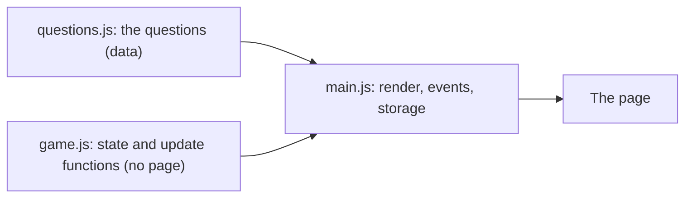

:::objectives
- Store quiz questions as data and check them before the game starts.
- Describe the whole game with one `state` object and four small update functions.
- Test the game logic in Node before any page exists.
- Draw every screen from `state` with `render()`, using one click listener for all buttons.
- Keep keyboard focus in a sensible place, save the best score, and split the code into modules.
:::

The quiz below reviews this course so far. Play it once with the mouse, then play it again using only **Tab** and **Enter**. Every part of it, from the question number to the colour of each button, is drawn from one small object, and Play again can't leave a stale score behind because it builds a fresh one.

```html preview height="430" title="quiz.html"
<div id="app"></div>
<script>
  // ---- questions.js ----
  const questions = [
    {
      prompt: "What does localStorage.getItem() return for a key that was never saved?",
      choices: ["undefined", "null", "An empty string", "It throws an error"],
      answer: 1,
      why: "Missing keys give null, which is why load() functions check for it.",
    },
    {
      prompt: "Which callback runs first: one from setTimeout(f, 0) or one from Promise.resolve().then(g)?",
      choices: ["f, the timer callback", "g, the promise callback", "Whichever was written first"],
      answer: 1,
      why: "Promise callbacks are microtasks, and the microtask queue empties before the next timer task.",
    },
    {
      prompt: "fetch() receives a 404 response. What happens to its promise?",
      choices: ["It is rejected", "It is fulfilled, and response.ok is false", "It never settles"],
      answer: 1,
      why: "fetch only rejects when no response arrives, so you check response.ok yourself.",
    },
    {
      prompt: "Which method stops a repeating timer?",
      choices: ["clearTimeout()", "stopInterval()", "clearInterval()"],
      answer: 2,
      why: "clearInterval() takes the id that setInterval() returned.",
    },
    {
      prompt: "Saved settings say volume: 0. What does saved.volume ?? 50 give?",
      choices: ["0", "50", "null"],
      answer: 0,
      why: "?? only replaces null and undefined, so a real 0 is kept.",
    },
  ];

  // ---- game.js ----
  function checkQuestions(questions) {
    if (!Array.isArray(questions) || questions.length === 0) {
      throw new Error("There are no questions to ask.");
    }
    questions.forEach((q, i) => {
      const where = `Question ${i + 1}`;
      if (typeof q.prompt !== "string" || q.prompt.trim() === "") {
        throw new Error(`${where} has no prompt.`);
      }
      if (!Array.isArray(q.choices) || q.choices.length < 2) {
        throw new Error(`${where} needs at least two choices.`);
      }
      if (!Number.isInteger(q.answer) || q.answer < 0 || q.answer >= q.choices.length) {
        throw new Error(`${where} has answer ${q.answer}, but its choices are numbered 0 to ${q.choices.length - 1}.`);
      }
    });
  }

  function createGame(best = 0) {
    return { screen: "start", index: 0, score: 0, picked: null, best };
  }

  function startGame(state) {
    return { ...createGame(state.best), screen: "question" };
  }

  function pickAnswer(state, questions, choice) {
    if (state.screen !== "question") return state; // ignore extra clicks
    const correct = choice === questions[state.index].answer;
    return { ...state, screen: "feedback", picked: choice, score: state.score + (correct ? 1 : 0) };
  }

  function nextQuestion(state, questions) {
    if (state.screen !== "feedback") return state;
    const index = state.index + 1;
    if (index < questions.length) {
      return { ...state, screen: "question", index, picked: null };
    }
    return { ...state, screen: "done", picked: null, best: Math.max(state.best, state.score) };
  }

  // ---- main.js ----
  const app = document.querySelector("#app");
  const BEST_KEY = "quiz-best";

  function loadBest() {
    try {
      return Number(localStorage.getItem(BEST_KEY)) || 0; // missing or damaged becomes 0
    } catch {
      return 0;
    }
  }

  function saveBest(best) {
    try {
      localStorage.setItem(BEST_KEY, String(best));
    } catch {
      // Storage is blocked here; the game still works.
    }
  }

  let state = createGame(loadBest());
  let problem = null;
  try {
    checkQuestions(questions);
  } catch (error) {
    problem = error.message;
  }

  function el(tag, text, attributes = {}) {
    const node = document.createElement(tag);
    if (text !== undefined) node.textContent = text;
    for (const [name, value] of Object.entries(attributes)) node.setAttribute(name, value);
    return node;
  }

  function renderStart() {
    return [
      el("h2", "JavaScript review quiz"),
      el("p", `${questions.length} questions. Your best score: ${state.best}`),
      el("button", "Start", { "data-action": "start", "data-focus": "" }),
    ];
  }

  function renderQuestion() {
    const q = questions[state.index];
    const answered = state.screen === "feedback";
    const list = el("div", undefined, { class: "choices" });
    q.choices.forEach((choice, i) => {
      let label = choice;
      if (answered && i === q.answer) label = `✓ ${choice}`;
      else if (answered && i === state.picked) label = `✗ ${choice} (your answer)`;
      const button = el("button", label, { "data-action": "pick", "data-choice": i });
      if (answered) {
        button.disabled = true;
        if (i === q.answer) button.classList.add("right");
        else if (i === state.picked) button.classList.add("wrong");
      }
      if (!answered && i === 0) button.setAttribute("data-focus", "");
      list.append(button);
    });

    const parts = [
      el("p", `Question ${state.index + 1} of ${questions.length} · Score ${state.score}`, { class: "meta" }),
      el("h2", q.prompt),
      list,
    ];
    if (answered) {
      const isLast = state.index === questions.length - 1;
      parts.push(
        el("p", state.picked === q.answer ? `Correct! ${q.why}` : `Not quite. ${q.why}`, { class: "why", id: "why" }),
        el("button", isLast ? "See results" : "Next question", {
          "data-action": "next",
          "data-focus": "",
          "aria-describedby": "why",
        })
      );
    }
    return parts;
  }

  function renderDone() {
    const newBest = state.score === state.best && state.score > 0;
    return [
      el("h2", `You scored ${state.score} out of ${questions.length}`),
      el("p", newBest ? "That's a new best score!" : `Your best is ${state.best}.`),
      el("button", "Play again", { "data-action": "restart", "data-focus": "" }),
    ];
  }

  function render() {
    if (problem) {
      app.replaceChildren(el("h2", "This quiz can't start"), el("p", problem));
      return;
    }
    if (state.screen === "start") app.replaceChildren(...renderStart());
    else if (state.screen === "done") app.replaceChildren(...renderDone());
    else app.replaceChildren(...renderQuestion());
    app.querySelector("[data-focus]")?.focus();
  }

  app.addEventListener("click", (event) => {
    const button = event.target.closest("button[data-action]");
    if (!button) return;
    const action = button.dataset.action;
    if (action === "start" || action === "restart") {
      state = startGame(state);
    } else if (action === "pick") {
      state = pickAnswer(state, questions, Number(button.dataset.choice));
    } else if (action === "next") {
      state = nextQuestion(state, questions);
      if (state.screen === "done") saveBest(state.best);
    }
    render();
  });

  render();
</script>
<style>
  body { font-family: system-ui, sans-serif; margin: 0; padding: 12px; color: #1f2430; }
  #app { max-width: 520px; margin: 0 auto; }
  h2 { font-size: 20px; margin: 4px 0 12px; }
  .meta { color: #555; margin: 0; font-size: 14px; }
  .choices { display: grid; gap: 8px; margin-bottom: 12px; }
  button { font: inherit; font-size: 16px; padding: 10px 14px; border-radius: 8px; border: 2px solid #9aa3c0; background: #f6f7fb; color: inherit; text-align: left; cursor: pointer; }
  button:focus-visible { outline: 3px solid #1a56db; outline-offset: 2px; }
  button:disabled { cursor: default; opacity: 1; }
  button.right { border-color: #1b7a3d; background: #e2f4e8; }
  button.wrong { border-color: #b3261e; background: #fde8e4; }
  .why { background: #eef3ff; padding: 8px 12px; border-radius: 8px; }
</style>
```

The plan has three files, each with one job:



`game.js` never touches the page, so you can test it in Node. `main.js` is the only file that knows about HTML.

## Step 1: Questions are data

A question is an object with a prompt, a list of choices, the index of the right choice, and a short explanation. Adding a question means adding an object, not writing new code.

```javascript title="questions.js"
export const questions = [
  {
    prompt: "What does localStorage.getItem() return for a key that was never saved?",
    choices: ["undefined", "null", "An empty string", "It throws an error"],
    answer: 1,
    why: "Missing keys give null, which is why load() functions check for it.",
  },
  {
    prompt: "Which callback runs first: one from setTimeout(f, 0) or one from Promise.resolve().then(g)?",
    choices: ["f, the timer callback", "g, the promise callback", "Whichever was written first"],
    answer: 1,
    why: "Promise callbacks are microtasks, and the microtask queue empties before the next timer task.",
  },
  // …three more in the same shape
];
```

`answer` counts from 0, which is easy to get wrong when you're typing questions late at night. A quiz that marks the right answer wrong is worse than one that doesn't start, so the game checks the data first and throws a clear error for the first problem it finds.

```javascript run title="check-questions.js"
function checkQuestions(questions) {
  if (!Array.isArray(questions) || questions.length === 0) {
    throw new Error("There are no questions to ask.");
  }
  questions.forEach((q, i) => {
    const where = `Question ${i + 1}`;
    if (typeof q.prompt !== "string" || q.prompt.trim() === "") {
      throw new Error(`${where} has no prompt.`);
    }
    if (!Array.isArray(q.choices) || q.choices.length < 2) {
      throw new Error(`${where} needs at least two choices.`);
    }
    if (!Number.isInteger(q.answer) || q.answer < 0 || q.answer >= q.choices.length) {
      throw new Error(`${where} has answer ${q.answer}, but its choices are numbered 0 to ${q.choices.length - 1}.`);
    }
  });
}

const good = [{ prompt: "2 + 2?", choices: ["3", "4"], answer: 1 }];
const typo = [
  { prompt: "2 + 2?", choices: ["3", "4"], answer: 1 },
  { prompt: "Capital of France?", choices: ["Paris", "Rome", "Oslo"], answer: 3 },
];

for (const set of [good, typo, []]) {
  try {
    checkQuestions(set);
    console.log(`OK: ${set.length} question(s)`);
  } catch (error) {
    console.log("Problem:", error.message);
  }
}
```

The message names the question and says what's wrong with it, so whoever wrote the questions can fix it in seconds. `checkQuestions` goes in `game.js`.

## Step 2: The whole game is one object and four functions

What does the game need to know at any moment? Which screen it's on, which question, the score, which choice was picked, and the best score. That's the entire state:

```javascript
{ screen: "question", index: 2, score: 1, picked: null, best: 4 }
```

`screen` is one of `"start"`, `"question"`, `"feedback"` (an answer was picked), or `"done"`. Each update function takes the current state and returns a **new** one. None of them touches the page.

```javascript title="game.js"
export function createGame(best = 0) {
  return { screen: "start", index: 0, score: 0, picked: null, best };
}

export function startGame(state) {
  return { ...createGame(state.best), screen: "question" };
}

export function pickAnswer(state, questions, choice) {
  if (state.screen !== "question") return state; // ignore extra clicks
  const correct = choice === questions[state.index].answer;
  return { ...state, screen: "feedback", picked: choice, score: state.score + (correct ? 1 : 0) };
}

export function nextQuestion(state, questions) {
  if (state.screen !== "feedback") return state;
  const index = state.index + 1;
  if (index < questions.length) {
    return { ...state, screen: "question", index, picked: null };
  }
  return { ...state, screen: "done", picked: null, best: Math.max(state.best, state.score) };
}
```

`startGame` builds on `createGame`, so a new game always starts from the same clean values; only `best` carries over. The first line of `pickAnswer` and `nextQuestion` is a guard: a second click on an answer can't add another point, because by then the screen is `"feedback"`.

Because these are plain functions, you can play a whole game in Node. The `export` keywords are left off here so it runs as one file.

```javascript run title="play-test.js"
function createGame(best = 0) {
  return { screen: "start", index: 0, score: 0, picked: null, best };
}
function startGame(state) {
  return { ...createGame(state.best), screen: "question" };
}
function pickAnswer(state, questions, choice) {
  if (state.screen !== "question") return state;
  const correct = choice === questions[state.index].answer;
  return { ...state, screen: "feedback", picked: choice, score: state.score + (correct ? 1 : 0) };
}
function nextQuestion(state, questions) {
  if (state.screen !== "feedback") return state;
  const index = state.index + 1;
  if (index < questions.length) return { ...state, screen: "question", index, picked: null };
  return { ...state, screen: "done", picked: null, best: Math.max(state.best, state.score) };
}

const questions = [
  { prompt: "2 + 2?", choices: ["3", "4"], answer: 1 },
  { prompt: "Capital of France?", choices: ["Paris", "Rome"], answer: 0 },
];

let state = startGame(createGame(0));
state = pickAnswer(state, questions, 1);   // right
state = pickAnswer(state, questions, 1);   // a double click
console.log(state.screen, "score:", state.score);

state = nextQuestion(state, questions);
state = pickAnswer(state, questions, 1);   // wrong
state = nextQuestion(state, questions);
console.log(state.screen, "score:", state.score, "best:", state.best);

state = startGame(state);                  // play again
console.log(state.screen, "score:", state.score, "best:", state.best);
```

The double click didn't count twice, the best score went from 0 to 1, and playing again reset the score but kept the best. You've tested the hardest part of the game without opening a browser.

## Step 3: `render()` draws whichever screen the state says

Now the page. `index.html` contains almost nothing, because `render()` builds each screen from scratch:

```html title="index.html"
<!DOCTYPE html>
<html lang="en">
  <head>
    <meta charset="UTF-8" />
    <meta name="viewport" content="width=device-width, initial-scale=1" />
    <title>JavaScript review quiz</title>
    <link rel="stylesheet" href="style.css" />
    <script type="module" src="main.js"></script>
  </head>
  <body>
    <div id="app"></div>
  </body>
</html>
```

The start of `main.js` imports the other two files and sets up the state. The helper `el` creates an element with text and attributes in one line.

```javascript title="main.js"
import { questions } from "./questions.js";
import { checkQuestions, createGame, startGame, pickAnswer, nextQuestion } from "./game.js";

const app = document.querySelector("#app");

let state = createGame(loadBest());
let problem = null;
try {
  checkQuestions(questions);
} catch (error) {
  problem = error.message;
}

function el(tag, text, attributes = {}) {
  const node = document.createElement(tag);
  if (text !== undefined) node.textContent = text;
  for (const [name, value] of Object.entries(attributes)) node.setAttribute(name, value);
  return node;
}
```

Each screen gets a function that returns a list of elements, and `render()` picks one:

```javascript title="main.js"
function render() {
  if (problem) {
    app.replaceChildren(el("h2", "This quiz can't start"), el("p", problem));
    return;
  }
  if (state.screen === "start") app.replaceChildren(...renderStart());
  else if (state.screen === "done") app.replaceChildren(...renderDone());
  else app.replaceChildren(...renderQuestion());
  app.querySelector("[data-focus]")?.focus();
}
```

The question and feedback screens share `renderQuestion()`, because feedback is the same question with the answer revealed. When `state.screen` is `"feedback"`, it disables the choices, adds a ✓ to the right answer and a ✗ with "(your answer)" to a wrong pick, and adds the explanation and a Next button. Marking answers with symbols and words as well as green and red means the quiz still works for someone who can't tell those colours apart. The full function is in the finished `main.js` below.

## Step 4: One click listener for every button

`render()` throws away the old buttons and makes new ones every time, so a listener attached to a button would be thrown away with it. Instead, listen once on `#app`, which never changes, and look at what was clicked. Each button carries a `data-action` attribute saying what it's for.

```javascript title="main.js"
app.addEventListener("click", (event) => {
  const button = event.target.closest("button[data-action]");
  if (!button) return;
  const action = button.dataset.action;

  if (action === "start" || action === "restart") {
    state = startGame(state);
  } else if (action === "pick") {
    state = pickAnswer(state, questions, Number(button.dataset.choice));
  } else if (action === "next") {
    state = nextQuestion(state, questions);
    if (state.screen === "done") saveBest(state.best);
  }
  render();
});

render();
```

This is the **event delegation** you met in Module 4. Clicks bubble up from the button to its parents, and `closest("button[data-action]")` finds the button even if the click landed on text inside it. Look at the shape of the handler: every branch is "replace `state` with what an update function returns", followed by a single `render()`. There's nowhere for a second copy of the score to hide.

## Step 5: Put the keyboard focus somewhere useful

When `render()` replaces the buttons, the button that had focus disappears, and focus falls back to the top of the page. A keyboard user would have to Tab all the way back down after every answer. So each screen marks one element with `data-focus`, and the last line of `render()` focuses it: the Start button, the first choice, the Next button, or Play again.

The Next button also has `aria-describedby="why"`, pointing at the explanation paragraph. When focus lands on it, a screen reader reads the button's name and then the explanation, so "Correct!" or "Not quite" is heard straight away.

## Step 6: Save the best score, safely

The best score is a single number, so it's stored as a string and read back with `Number`. Both functions use `try`/`catch`, because storage can be blocked, and a quiz should still be playable without it. Put this code near the top of `main.js`, above `let state`, because `loadBest()` runs as soon as the state is created.

```javascript title="main.js"
const BEST_KEY = "quiz-best";

function loadBest() {
  try {
    return Number(localStorage.getItem(BEST_KEY)) || 0; // missing or damaged becomes 0
  } catch {
    return 0;
  }
}

function saveBest(best) {
  try {
    localStorage.setItem(BEST_KEY, String(best));
  } catch {
    // Storage is blocked; the game still works.
  }
}
```

Here `||` is the right tool. `Number(null)` is 0 and `Number("oops")` is `NaN`, and `NaN || 0` turns damaged data into 0. A real saved 0 also becomes 0, which is the same thing.

Now break it on purpose. In `questions.js`, change one `answer` to `7` and save. Instead of a quiz that quietly marks the right answer wrong, you get "This quiz can't start" with the exact question to fix. Change it back.

## The finished `main.js`

Put `checkQuestions` from Step 1 and the four functions from Step 2 in `game.js` (each with `export` in front), the questions in `questions.js`, the CSS from the preview in `style.css`, and this in `main.js`. Open `index.html` with Live Server, since modules don't load from a double-clicked file.

```javascript title="main.js"
import { questions } from "./questions.js";
import { checkQuestions, createGame, startGame, pickAnswer, nextQuestion } from "./game.js";

const app = document.querySelector("#app");
const BEST_KEY = "quiz-best";

function loadBest() {
  try {
    return Number(localStorage.getItem(BEST_KEY)) || 0; // missing or damaged becomes 0
  } catch {
    return 0;
  }
}

function saveBest(best) {
  try {
    localStorage.setItem(BEST_KEY, String(best));
  } catch {
    // Storage is blocked; the game still works.
  }
}

let state = createGame(loadBest());
let problem = null;
try {
  checkQuestions(questions);
} catch (error) {
  problem = error.message;
}

function el(tag, text, attributes = {}) {
  const node = document.createElement(tag);
  if (text !== undefined) node.textContent = text;
  for (const [name, value] of Object.entries(attributes)) node.setAttribute(name, value);
  return node;
}

function renderStart() {
  return [
    el("h2", "JavaScript review quiz"),
    el("p", `${questions.length} questions. Your best score: ${state.best}`),
    el("button", "Start", { "data-action": "start", "data-focus": "" }),
  ];
}

function renderQuestion() {
  const q = questions[state.index];
  const answered = state.screen === "feedback";
  const list = el("div", undefined, { class: "choices" });
  q.choices.forEach((choice, i) => {
    let label = choice;
    if (answered && i === q.answer) label = `✓ ${choice}`;
    else if (answered && i === state.picked) label = `✗ ${choice} (your answer)`;
    const button = el("button", label, { "data-action": "pick", "data-choice": i });
    if (answered) {
      button.disabled = true;
      if (i === q.answer) button.classList.add("right");
      else if (i === state.picked) button.classList.add("wrong");
    }
    if (!answered && i === 0) button.setAttribute("data-focus", "");
    list.append(button);
  });

  const parts = [
    el("p", `Question ${state.index + 1} of ${questions.length} · Score ${state.score}`, { class: "meta" }),
    el("h2", q.prompt),
    list,
  ];
  if (answered) {
    const isLast = state.index === questions.length - 1;
    parts.push(
      el("p", state.picked === q.answer ? `Correct! ${q.why}` : `Not quite. ${q.why}`, { class: "why", id: "why" }),
      el("button", isLast ? "See results" : "Next question", {
        "data-action": "next",
        "data-focus": "",
        "aria-describedby": "why",
      })
    );
  }
  return parts;
}

function renderDone() {
  const newBest = state.score === state.best && state.score > 0;
  return [
    el("h2", `You scored ${state.score} out of ${questions.length}`),
    el("p", newBest ? "That's a new best score!" : `Your best is ${state.best}.`),
    el("button", "Play again", { "data-action": "restart", "data-focus": "" }),
  ];
}

function render() {
  if (problem) {
    app.replaceChildren(el("h2", "This quiz can't start"), el("p", problem));
    return;
  }
  if (state.screen === "start") app.replaceChildren(...renderStart());
  else if (state.screen === "done") app.replaceChildren(...renderDone());
  else app.replaceChildren(...renderQuestion());
  app.querySelector("[data-focus]")?.focus();
}

app.addEventListener("click", (event) => {
  const button = event.target.closest("button[data-action]");
  if (!button) return;
  const action = button.dataset.action;
  if (action === "start" || action === "restart") {
    state = startGame(state);
  } else if (action === "pick") {
    state = pickAnswer(state, questions, Number(button.dataset.choice));
  } else if (action === "next") {
    state = nextQuestion(state, questions);
    if (state.screen === "done") saveBest(state.best);
  }
  render();
});

render();
```

:::video riDzcEQbX6k
Web Dev Simplified builds a quiz app with plain JavaScript. It's a useful comparison: watch how it keeps track of the current question and moves between questions, and think about which parts would be simpler with a single state object and a `render()` function.
:::

:::quiz
Q: Why does the click listener go on `#app` instead of on each button?
- [ ] Buttons can't have click listeners
  They can. The problem is that these buttons don't last long enough to keep one.
- [x] `render()` replaces the buttons every time, and `#app` is the one element that stays
  Listeners on the old buttons would be thrown away with them. A single listener on `#app` catches every click as it bubbles up.
- [ ] Listening on `#app` makes clicks faster
  Speed is the same. Delegation is about elements that come and go.

Q: Why do `pickAnswer` and `nextQuestion` return a new object instead of changing the page?
- [x] So the game logic can be tested in Node and can't fall out of step with the page
  They only turn one state into another. `render()` is the only code that touches the page, so the page always matches `state`.
- [ ] Because modules aren't allowed to touch the page
  Modules can do anything a normal script can. Keeping `game.js` page-free is a design choice.
- [ ] To save memory
  Making new objects uses slightly more memory, not less. The benefit is clarity and testability.

Q: You change a question's `answer` to 7, but it only has three choices. What happens?
- [ ] The quiz marks every answer to that question wrong
  That's what would happen without `checkQuestions`, which is exactly why it's there.
- [ ] The page crashes with a `TypeError`
  `checkQuestions` throws a normal `Error`, which is caught before anything renders.
- [x] The quiz shows "This quiz can't start" and names the broken question
  The `try`/`catch` around `checkQuestions` stores the message in `problem`, and `render()` shows it instead of a broken game.
:::

:::takeaways
- Data (`questions.js`), logic (`game.js`), and the page (`main.js`) each get their own module.
- The game state is one small object. Update functions take a state and return a new one, and they never touch the page.
- Pure logic can be tested in Node, a whole playthrough in a few lines.
- `render()` rebuilds the current screen from state, so a single click listener on a parent that never changes handles every button.
- Moving focus after each render, and marking answers with words as well as colours, keeps the quiz usable for everyone.
- Check data on startup and show a clear error screen rather than a quietly broken app.
:::

## Ideas to extend it

- **Load the questions with `fetch`.** Move them to `questions.json` and load it with `await fetch("./questions.json")`, adding a loading screen and an error screen to `state.screen`.
- **Shuffle.** Shuffle the questions in `startGame` so each game is in a different order (look up the Fisher-Yates shuffle).
- **A timer per question.** Give each question 15 seconds with the `endAt` pattern from the pomodoro build; when time runs out, treat it as a wrong answer.
- **Number keys.** Let keys 1 to 4 pick an answer. Listen for `keydown` on `document` and call the same `pickAnswer`.
- **Review screen.** Save each pick in an `answers` array in state and show a summary of every question on the results screen.

## Further reading

- [MDN: JavaScript modules](https://developer.mozilla.org/en-US/docs/Web/JavaScript/Guide/Modules): named exports, default exports, and how the browser loads module files.
- [MDN: Element.closest()](https://developer.mozilla.org/en-US/docs/Web/API/Element/closest): the method that makes event delegation short.
- [MDN: aria-describedby](https://developer.mozilla.org/en-US/docs/Web/Accessibility/ARIA/Reference/Attributes/aria-describedby): how to connect a control to the text that explains it.
