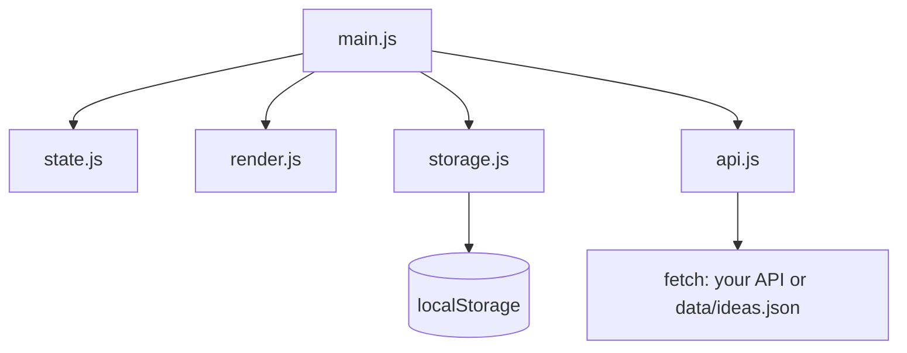

:::objectives
- Set up a project from a starter that already handles saving, loading, errors, and focus.
- Build in milestones that each end with something that works.
- Know when a milestone is done, using a concrete checklist for each.
- Debug with the Console, breakpoints, `console.table`, and the Network and Application panels.
:::

Most unfinished projects fail the same way: everything is half-built and nothing works. The cure is to build in **milestones**. Each one adds one layer, ends with an app that runs, and has a checklist that says when you're done. If you run out of time at milestone 4, you still have a working app that saves its data, not a pile of pieces.

## The starter

The starter is a small, complete app: a list you can add to, tick off, and remove from, that saves itself and loads "ideas" from a JSON file. It's deliberately plain, so you can turn it into any of the five project ideas (or your own) by changing the data and the screens. Every place you're expected to change is marked `CHANGE`.

```text
capstone/
├── index.html
├── style.css
├── data/
│   └── ideas.json
└── js/
    ├── main.js       events, and the one update() function
    ├── state.js      pure update functions (no page code)
    ├── render.js     turns state into the page
    ├── storage.js    load and save, never crashes
    └── api.js        getJSON with status checks and a timeout
```



Make the folders and files, and paste in the code below. Then right-click `index.html`, choose **Open with Live Server**, and check it runs before you change anything.

```html title="index.html"
<!DOCTYPE html>
<html lang="en">
  <head>
    <meta charset="UTF-8" />
    <meta name="viewport" content="width=device-width, initial-scale=1" />
    <title>My app</title>
    <link rel="stylesheet" href="style.css" />
    <script type="module" src="js/main.js"></script>
  </head>
  <body>
    <main>
      <h1>My app</h1>
      <form id="add-form" novalidate>
        <label for="new-item">New item</label>
        <div class="row">
          <input id="new-item" autocomplete="off" aria-describedby="form-error" />
          <button>Add</button>
        </div>
        <p id="form-error" class="error" aria-live="polite"></p>
      </form>
      <h2 id="list-heading" tabindex="-1">Your list</h2>
      <ul id="list"></ul>
      <h2>Ideas</h2>
      <div id="ideas" aria-live="polite"></div>
    </main>
  </body>
</html>
```

```css title="style.css"
* { box-sizing: border-box; }
body { margin: 0; font-family: system-ui, sans-serif; line-height: 1.5; color: #1f2430; background: #f6f7fb; }
main { max-width: 640px; margin: 0 auto; padding: 16px; }
h1 { font-size: 1.6rem; margin: 0 0 12px; }
h2 { font-size: 1.1rem; margin: 20px 0 8px; }
label { font-weight: 600; }
.row { display: flex; gap: 8px; }
#new-item { flex: 1; min-width: 0; font: inherit; padding: 8px 10px; border: 1px solid #8a93ad; border-radius: 6px; }
button { font: inherit; padding: 6px 14px; border-radius: 6px; border: 1px solid #5b6480; background: white; color: inherit; cursor: pointer; }
:focus-visible { outline: 3px solid #1a56db; outline-offset: 2px; }
.error { color: #b3261e; min-height: 1.5em; margin: 4px 0 0; }
#list { list-style: none; padding: 0; margin: 0; display: grid; gap: 6px; }
#list li { display: flex; justify-content: space-between; align-items: center; gap: 8px; background: white; padding: 8px 12px; border-radius: 8px; }
#list label { font-weight: 400; }
#list .empty { color: #555; }
.chip { margin: 0 6px 6px 0; border-radius: 999px; }
@media (min-width: 700px) {
  main { padding: 32px; }
  h1 { font-size: 2rem; }
}
```

```json title="data/ideas.json"
["Drink a glass of water", "Read for 20 minutes", "Stretch for 5 minutes", "Practise an instrument", "Write three lines in a journal"]
```

`storage.js` is the Module 5 pattern, made unbreakable: `loadSaved` returns the saved value or `null`, and `save` returns `false` instead of throwing. Put a version in the key (`-v1`) so that if you change the shape of your saved data later, you can switch to `-v2` and start clean.

```javascript title="js/storage.js"
const KEY = "my-app-v1"; // CHANGE: a key that's unique to your app

// Returns whatever was saved, or null. Never throws.
export function loadSaved() {
  try {
    return JSON.parse(localStorage.getItem(KEY));
  } catch {
    return null;
  }
}

// Returns true if it saved, false if storage is blocked or full.
export function save(data) {
  try {
    localStorage.setItem(KEY, JSON.stringify(data));
    return true;
  } catch {
    return false;
  }
}
```

`api.js` is the `getJSON` helper from the GitHub viewer, with the timeout from the Module 6 challenge built in, plus one function that turns any error into a sentence.

```javascript title="js/api.js"
export async function getJSON(url, timeoutMs = 8000) {
  const response = await fetch(url, { signal: AbortSignal.timeout(timeoutMs) });
  if (!response.ok) {
    const error = new Error(`Request failed with status ${response.status}`);
    error.status = response.status;
    throw error;
  }
  return response.json();
}

export function messageFor(error) {
  if (error.name === "TimeoutError") return "That took too long. Try again.";
  if (error.status === 404) return "Couldn't find that.";
  if (error.status === 403 || error.status === 429) return "Too many requests. Wait a minute, then try again.";
  if (error.status) return `The server had a problem (${error.status}). Try again soon.`;
  return "Couldn't connect. Check your internet connection and try again.";
}
```

`state.js` holds every rule of the app, and none of it touches the page. Notice two different ways of saying no. Bad input is *expected*, so `addItem` returns a state with a `formError` message to show. Damaged saved data is cleaned up by `createInitialState`, which keeps only items with the right shape. Errors are thrown only for things that really shouldn't happen, and those are caught in `main.js`.

```javascript title="js/state.js"
// Pure functions only: each takes a state and returns a new one. No page code here.

function isItem(item) {
  return typeof item?.id === "number" && typeof item.name === "string" && typeof item.done === "boolean";
}

export function createInitialState(saved) {
  const items = Array.isArray(saved?.items) ? saved.items.filter(isItem) : [];
  const biggestId = Math.max(0, ...items.map((item) => item.id));
  return {
    items,
    nextId: biggestId + 1,
    formError: "",
    ideas: [],
    ideasStatus: "idle", // "idle" | "loading" | "ready" | "error"
    ideasError: "",
  };
}

// What gets saved. Everything else can be rebuilt or reloaded.
export function toSave(state) {
  return { items: state.items };
}

export function addItem(state, rawName) {
  const name = rawName.trim();
  if (name === "") return { ...state, formError: "Type a name first." };
  if (name.length > 60) return { ...state, formError: "Keep it under 60 characters." };
  const taken = state.items.some((item) => item.name.toLowerCase() === name.toLowerCase());
  if (taken) return { ...state, formError: `"${name}" is already on your list.` };
  const item = { id: state.nextId, name, done: false };
  return { ...state, items: [...state.items, item], nextId: state.nextId + 1, formError: "" };
}

export function toggleItem(state, id) {
  const items = state.items.map((item) => (item.id === id ? { ...item, done: !item.done } : item));
  return { ...state, items };
}

export function removeItem(state, id) {
  return { ...state, items: state.items.filter((item) => item.id !== id) };
}

export function ideasLoading(state) {
  return { ...state, ideasStatus: "loading", ideasError: "" };
}

export function ideasLoaded(state, ideas) {
  const clean = Array.isArray(ideas) ? ideas.filter((idea) => typeof idea === "string") : [];
  return { ...state, ideasStatus: "ready", ideas: clean };
}

export function ideasFailed(state, message) {
  return { ...state, ideasStatus: "error", ideasError: message };
}
```

`render.js` builds the page from state, with an empty message for an empty list and a separate branch for each of the four states of the ideas panel.

```javascript title="js/render.js"
function el(tag, text, attributes = {}) {
  const node = document.createElement(tag);
  if (text !== undefined) node.textContent = text;
  for (const [name, value] of Object.entries(attributes)) node.setAttribute(name, value);
  return node;
}

function renderItem(item) {
  const box = el("input", undefined, { type: "checkbox", "data-action": "toggle", "data-id": item.id });
  box.checked = item.done;
  const label = el("label");
  label.append(box, ` ${item.name}`);
  const remove = el("button", "Remove", {
    "data-action": "remove",
    "data-id": item.id,
    "aria-label": `Remove ${item.name}`,
  });
  const li = el("li");
  li.append(label, remove);
  return li;
}

function renderIdeas(state) {
  if (state.ideasStatus === "loading") return [el("p", "Loading ideas…")];
  if (state.ideasStatus === "error") {
    return [el("p", state.ideasError, { class: "error" }), el("button", "Try again", { "data-action": "reload-ideas" })];
  }
  if (state.ideas.length === 0) return [el("p", "No ideas right now.")];
  return state.ideas.map((idea) =>
    el("button", `+ ${idea}`, { class: "chip", "data-action": "use-idea", "data-idea": idea })
  );
}

export function render(state, refs) {
  refs.formError.textContent = state.formError;
  refs.input.setAttribute("aria-invalid", state.formError ? "true" : "false");

  if (state.items.length === 0) {
    refs.list.replaceChildren(el("li", "Nothing here yet. Add your first item above.", { class: "empty" }));
  } else {
    refs.list.replaceChildren(...state.items.map(renderItem));
  }

  refs.ideas.replaceChildren(...renderIdeas(state));
}
```

`main.js` connects everything. All changes go through `update()`, which saves, redraws, and then puts keyboard focus back on the same control. Without that last part, ticking a box with the Space bar would redraw the list and throw focus back to the top of the page.

```javascript title="js/main.js"
import { getJSON, messageFor } from "./api.js";
import { loadSaved, save } from "./storage.js";
import { render } from "./render.js";
import {
  createInitialState, toSave, addItem, toggleItem, removeItem,
  ideasLoading, ideasLoaded, ideasFailed,
} from "./state.js";

const refs = {
  form: document.querySelector("#add-form"),
  input: document.querySelector("#new-item"),
  formError: document.querySelector("#form-error"),
  listHeading: document.querySelector("#list-heading"),
  list: document.querySelector("#list"),
  ideas: document.querySelector("#ideas"),
};

let state = createInitialState(loadSaved());

// The only place state changes. Saves, redraws, and keeps keyboard focus in place.
function update(next) {
  const focused = document.activeElement?.closest("[data-action][data-id]");
  const selector = focused && `[data-action="${focused.dataset.action}"][data-id="${focused.dataset.id}"]`;

  state = next;
  save(toSave(state));
  render(state, refs);

  if (selector) {
    const again = document.querySelector(selector);
    if (again) again.focus();
    else refs.listHeading.focus(); // the item was removed
  }
}

async function loadIdeas() {
  update(ideasLoading(state));
  try {
    const ideas = await getJSON("./data/ideas.json"); // CHANGE: your API or JSON file
    update(ideasLoaded(state, ideas));
  } catch (error) {
    update(ideasFailed(state, messageFor(error)));
  }
}

refs.form.addEventListener("submit", (event) => {
  event.preventDefault();
  const before = state.items.length;
  update(addItem(state, refs.input.value));
  if (state.items.length > before) refs.input.value = "";
  refs.input.focus();
});

refs.input.addEventListener("input", () => {
  if (state.formError) update({ ...state, formError: "" });
});

document.addEventListener("click", (event) => {
  const target = event.target.closest("[data-action]");
  if (!target) return;
  const { action } = target.dataset;
  const id = Number(target.dataset.id);
  if (action === "toggle") update(toggleItem(state, id));
  else if (action === "remove") update(removeItem(state, id));
  else if (action === "use-idea") update(addItem(state, target.dataset.idea));
  else if (action === "reload-ideas") loadIdeas();
});

render(state, refs);
loadIdeas();
```

Try it: add an item, tick it, refresh. Add the same item twice. Click an idea. Then open DevTools and work through the milestones below, turning the starter into your app.

## Milestone 1: The layout, on a phone first

Change `index.html` and `style.css` to match your plan's screens, with a few hard-coded example entries so you can see the design. No JavaScript changes yet. Then open DevTools, click **Toggle device toolbar**, leave **Dimensions** on **Responsive**, and type 320 into the width box.

:::video f7kokNyRe7U
The Chrome DevTools team shows Device Mode. Watch for the responsive width and height boxes, which you'll use to test at 320 pixels wide.
:::

**Done when:**
- Nothing scrolls sideways at 320 pixels wide, and the layout still looks deliberate at 1,200.
- Every input has a visible `label`, and every button says what it does.
- Pressing Tab moves through the controls in the same order you read them.

## Milestone 2: State and `render()`, with fake data

Delete the hard-coded entries from the HTML. Change `createInitialState` so it starts with two or three example items in **your** app's shape (a habit with `doneDays`, a city with `latitude`, a book with `status`), and change `render.js` to draw them.

**Done when:**
- Editing the example data in `state.js` changes the page, and nothing in `render.js` reads values back from the page.
- Values you can calculate (counts, streaks, totals) are calculated in `render`, not stored.
- `console.table(state.items)` in `update()` shows exactly what you expect.

## Milestone 3: Events and validation

Add the update functions your EVENTS list needs (each one in `state.js`, each returning a new state) and connect them with `data-action` buttons. Write a validation message for every way input can be wrong, and test each one in Node before wiring it to the page, the way you tested the quiz.

**Done when:**
- Every action works with the mouse **and** with Tab, Enter, and Space.
- Every bad input (empty, too long, duplicate, out of range) shows a specific message, and the message disappears when the person starts fixing it.
- Clicking any button twice quickly never breaks anything.

## Milestone 4: Save and restore

Change the storage key, and change `toSave` and `createInitialState` so they save and restore your app's real data, keeping only well-formed entries.

**Done when:**
- A refresh keeps everything the person would be upset to lose.
- In **Application › Storage**, clicking **Clear site data** and refreshing gives a clean first-visit screen with no errors.
- Editing your saved value in **Local storage** to `{oops` and refreshing starts fresh instead of crashing.

## Milestone 5: Load data, and show all four states

Point `getJSON` at your real API or JSON file and adapt `ideasLoaded` (rename it for your app) to clean up the response. Before testing with the network, check that each state looks intentional. A quick way is a **state switcher**: render the same function with an example state for each case and flip between them. Here it is for the starter's ideas panel; use the menu to see each state.

```html preview height="190" title="state-switcher.html"
<label for="pick">Show the ideas panel as:</label>
<select id="pick">
  <option value="loading">loading</option>
  <option value="ready">success</option>
  <option value="empty">empty</option>
  <option value="error">error</option>
</select>
<div id="ideas"></div>
<script>
  function el(tag, text, attributes = {}) {
    const node = document.createElement(tag);
    if (text !== undefined) node.textContent = text;
    for (const [name, value] of Object.entries(attributes)) node.setAttribute(name, value);
    return node;
  }

  // The same function as in render.js.
  function renderIdeas(state) {
    if (state.ideasStatus === "loading") return [el("p", "Loading ideas…")];
    if (state.ideasStatus === "error") {
      return [el("p", state.ideasError, { class: "error" }), el("button", "Try again", { "data-action": "reload-ideas" })];
    }
    if (state.ideas.length === 0) return [el("p", "No ideas right now.")];
    return state.ideas.map((idea) =>
      el("button", `+ ${idea}`, { class: "chip", "data-action": "use-idea", "data-idea": idea })
    );
  }

  const examples = {
    loading: { ideasStatus: "loading", ideas: [], ideasError: "" },
    ready: { ideasStatus: "ready", ideas: ["Drink a glass of water", "Read for 20 minutes"], ideasError: "" },
    empty: { ideasStatus: "ready", ideas: [], ideasError: "" },
    error: { ideasStatus: "error", ideas: [], ideasError: "Couldn't connect. Check your internet connection and try again." },
  };

  const pick = document.querySelector("#pick");
  const box = document.querySelector("#ideas");
  function show() {
    box.replaceChildren(...renderIdeas(examples[pick.value]));
  }
  pick.addEventListener("change", show);
  show();
</script>
<style>
  body { font-family: system-ui, sans-serif; margin: 12px; }
  select, button { font: inherit; padding: 6px 10px; border-radius: 6px; }
  #ideas { margin-top: 12px; padding: 10px; border: 1px dashed #99a; border-radius: 8px; }
  .chip { margin: 0 6px 6px 0; border-radius: 999px; }
  .error { color: #b3261e; }
</style>
```

This works because `renderIdeas` only looks at its argument. Then test the real thing in the **Network** panel.

**Done when:**
- With throttling on **Slow 4G**, you can read the loading message.
- With **Offline**, you get your error message, and **Try again** works once you go back to **No throttling**.
- A response with no results (an empty search, or `[]` in your JSON file) shows the empty state, not a blank space.
- If you search as the person types, the latest request always wins (Module 6, Exercise 6).

## Milestone 6: Polish

Now make it feel finished. Work through the test plan in the next lesson and fix what it finds. Typical polish: a page `title` that names your app, messages that say what to do next, visible focus on every control, alt text for every image that carries information, and removing leftover `console.log` and `console.table` lines.

**Done when:** every row of the next lesson's test plan passes.

## When you get stuck

Use the routine from Module 1 (read the error, check the line, add a log), and add these tools:

- **Click the file name in a Console error** (like `render.js:27`) to jump to the exact line in the **Sources** panel.
- **Set a breakpoint** by clicking a line number in **Sources**, or write `debugger;` in your code. When execution stops there, hover over any variable to see its value, and use **Step over** to run one line at a time.
- **`console.table(state.items)`** prints an array of objects as a table, which makes a wrong field obvious.
- **Network › Fetch/XHR** shows every request, its status, and the exact response, so you can tell "my code is wrong" from "the server said no".
- **Application › Local storage** shows what you actually saved, which is often not what you think you saved.

:::video H0XScE08hy8
Chrome DevTools 101 on debugging JavaScript. Watch for setting a breakpoint, stepping through code line by line, and watching a variable change, which is faster than adding log after log.
:::

:::tip
At the end of each milestone, copy the whole project folder (for example to `capstone-m3`). If milestone 4 goes badly wrong, you can go back to a version that worked in seconds. If you already know Git, commit at the end of every milestone instead.
:::

:::takeaways
- Build in layers: layout, state and render, events, storage, async data, polish. Each layer ends with an app that runs.
- Keep every rule in `state.js` as a pure function, and test it in Node before wiring it up.
- Route every change through one `update()` that saves, renders, and restores focus.
- Look at each state on purpose (a state switcher makes it quick), then prove it with throttling and Offline.
- Save a copy at every milestone, and debug with breakpoints instead of guesswork.
:::

## Further reading

- [Chrome DevTools: Debug JavaScript](https://developer.chrome.com/docs/devtools/javascript): a hands-on tutorial on breakpoints, stepping, and watching values.
- [Chrome DevTools: Device Mode](https://developer.chrome.com/docs/devtools/device-mode): every option for testing a layout at phone sizes.
- [MDN: Responsive design](https://developer.mozilla.org/en-US/docs/Learn_web_development/Core/CSS_layout/Responsive_Design): media queries, flexible layouts, and the viewport meta tag, if your layout struggles at 320 pixels.
