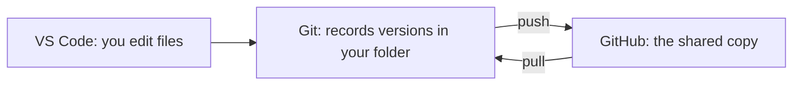

:::objectives
- Install VS Code and Git on your own computer.
- Confirm the install by running `git --version` in VS Code's terminal.
- Create a free GitHub account with a username you won't regret later.
:::

By the end of this course you will have done what working developers do many times a week: written down a problem, fixed it on a branch, opened a pull request, answered a reviewer's comments, and merged the result into a shared project. Everything you need for that is free. It comes down to three programs, and each has one job.

## Three tools, three jobs

| Tool | Where it lives | Its job |
| --- | --- | --- |
| **Git** | Your computer | Records the history of a project folder: every saved version, who made it, and why. |
| **GitHub** | A website (github.com) | Hosts a shared copy of that history and adds teamwork features: pull requests, reviews, and issues. |
| **VS Code** | Your computer | The editor where you write files. It has a terminal and a Source Control panel that talk to Git. |

People mix up Git and GitHub all the time. Git works with no internet connection and no account. GitHub is one popular place to *share* what Git records, the way a photo-sharing site is a place to share photos your camera took.



## Before you start

-   You need a Windows PC, a Mac, or a Chromebook that allows Linux apps. Phones and tablets won't work.
-   You need permission to install software. School-managed laptops often block this, so try it early and tell your instructor if you get stuck.
-   GitHub's terms say you must be **13 or older** to have an account (older in some countries). If you're younger, all of Module 2 works without an account, and you can follow the GitHub parts with an adult or your instructor.
-   Set aside about 30 minutes. Install VS Code **first**, because the Git installer for Windows looks for it.

## Step 1: Install VS Code

:::tabs
@tab Windows
1.  Go to [code.visualstudio.com/download](https://code.visualstudio.com/download) and click the **Windows** button. This downloads the *User Installer*, which doesn't need an administrator password.
2.  Run the installer and accept the license.
3.  On the **Select Additional Tasks** screen, leave **Add to PATH** ticked. Ticking the two **Open with Code** boxes is handy too: you'll be able to right-click a folder and open it in VS Code.
4.  Finish the installer and open VS Code once.
@tab macOS
1.  Go to [code.visualstudio.com/download](https://code.visualstudio.com/download) and click the **Mac** button.
2.  Open the downloaded `.zip` if your Mac didn't unzip it automatically, then drag **Visual Studio Code.app** into your **Applications** folder. Running it from Downloads causes update problems later.
3.  Open VS Code from Applications.
4.  Press **Cmd+Shift+P** to open the Command Palette, type `shell command`, and run the command that installs `code` in your PATH. Now you can type `code .` in a terminal to open the current folder.
@tab Chromebook
1.  Turn on Linux first: open **Settings**, go to **About ChromeOS**, then **Developers**, and click **Set up** next to **Linux development environment**. Accept the defaults and wait a few minutes.
2.  Go to [code.visualstudio.com/download](https://code.visualstudio.com/download) and download the `.deb` file for your Chromebook's chip (**x64** for Intel or AMD, **Arm64** for ARM).
3.  In the **Files** app, drag the `.deb` from Downloads into **Linux files**.
4.  Open the **Terminal** app and install it:

```bash
sudo apt install ./code_*.deb
```

5.  Find **Visual Studio Code** in the launcher's **Linux apps** folder.
:::

## Step 2: Install Git

:::tabs
@tab Windows
1.  Go to [git-scm.com/install/windows](https://git-scm.com/install/windows) and click the download link for the latest version. Most PCs need **x64 Setup**; laptops with ARM chips (such as Snapdragon) need **ARM64 Setup**.
2.  Run the installer. It has many screens; the defaults are fine except for two:
    -   **Choosing the default editor used by Git**: pick **Use Visual Studio Code as Git's default editor**. The default is Vim, which confuses almost every beginner.
    -   **Adjusting the name of the initial branch in new repositories**: choose **Override the default branch name for new repositories** and type `main`. GitHub uses `main`, so this keeps you consistent.
3.  Keep the recommended choices on the other screens, including **Git from the command line and also from 3rd-party software** and **Git Credential Manager**. That last one handles signing in to GitHub in the next lesson.
4.  The installer also adds **Git Bash**, a terminal that understands the same commands as Mac and Linux. You'll use it in VS Code below.
@tab macOS
1.  Open **Terminal** (press **Cmd+Space**, type `Terminal`, press Enter).
2.  Type this and press Enter:

```bash
git --version
```

3.  If a version number appears, Git is already installed. If a box pops up saying the `git` command requires the **command line developer tools**, click **Install** and wait for it to finish (it can take 10 minutes). You can also start that install yourself with `xcode-select --install`.
4.  If you already use [Homebrew](https://brew.sh/), `brew install git` gets you a newer version. You don't need Homebrew for this course.
@tab Chromebook
In the Linux **Terminal**, run these two commands:

```bash
sudo apt update
sudo apt install -y git
```

Git installs in under a minute.
:::

## Step 3: Check both tools from VS Code

Open VS Code and choose **Terminal > New Terminal** from the menu bar. A terminal panel opens at the bottom. Type:

```bash
git --version
```

```text
git version 2.47.0
```

Any version from 2.28 up handles everything in this course; yours will probably be newer than this one. Seeing a version number means VS Code can find Git, which is the whole point of this step.

:::tip
**Windows users:** VS Code's terminal opens PowerShell by default. Switch it to Git Bash so the commands in this course work exactly as written. Press **Ctrl+Shift+P**, run **Terminal: Select Default Profile**, and pick **Git Bash**. Then close the terminal and open a new one.
:::

## Step 4: Create your GitHub account

1.  Go to [github.com/signup](https://github.com/signup).
2.  Enter your email address, a password, and a username, then solve the puzzle GitHub shows you.
3.  Type the code GitHub emails to you. Choose the **Free** plan if asked.

Your username shows up in every link to your work, like `github.com/your-username/project`. Choose something you'd be comfortable showing a teacher or putting on a college application in three years. If you'd rather stay private, leave your full name and birth year out of it. GitHub may also ask you to turn on two-factor authentication; it's worth doing, and an authenticator app on your phone is the easiest way.

:::video r8jQ9hVA2qs start=3:06
GitHub's own beginner series. From 3:06, watch the Windows installer screens and the two `git config` commands at the end; you'll run those yourself in the next lesson.
:::

## What usually goes wrong

-   **`git: command not found`, or on Windows `'git' is not recognized as the name of a cmdlet`.** The terminal was opened before Git finished installing, so it doesn't know where Git lives. Close VS Code completely, reopen it, and open a new terminal. If that fails, restart the computer.
-   **On a Mac, `xcrun: error: invalid active developer path`.** A macOS update removed the developer tools. Run `xcode-select --install` again and accept the prompt.
-   **No Linux option on a Chromebook.** Your school or family account has turned it off. Ask your instructor about another computer before the first session.
-   **You picked Vim by mistake on Windows.** No need to reinstall. The next lesson sets VS Code as Git's editor with one command.

:::warning
Only download Git from **git-scm.com** and VS Code from **code.visualstudio.com**. Search ads for "free Git download" sometimes lead to look-alike sites that bundle unwanted software.
:::

## Further reading

-   [Pro Git: Installing Git](https://git-scm.com/book/en/v2/Getting-Started-Installing-Git): the official Git book's install chapter, with extra detail for each OS.
-   [VS Code: Source control quickstart](https://code.visualstudio.com/docs/sourcecontrol/quickstart): a short official walkthrough you can try once setup is done.
