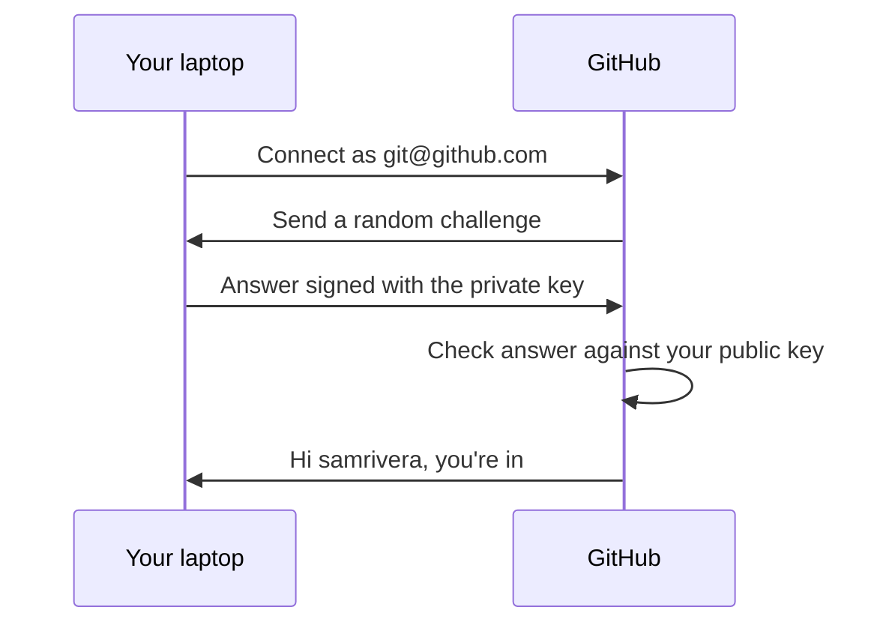

:::objectives
- Tell Git your name and a private GitHub email so every commit is labeled correctly.
- Set `main` as the default branch name and VS Code as Git's editor.
- Connect your computer to GitHub with an SSH key or a credential manager.
- Prove the setup works by cloning a real project and reading its history.
:::

Every commit you make carries a name and an email address, and once a commit is shared, that label travels with it. Make your first commit with your personal email, push it to a public project, and anyone who downloads that project can read the address. Ten minutes of setup avoids that, and it's the same setup professionals do on every new laptop.

Do all of this in VS Code's terminal (**Terminal > New Terminal**). On Windows, use the Git Bash profile you chose in the last lesson.

## Step 1: Use GitHub's private email address

GitHub gives every account a "noreply" address that links commits to your profile without revealing your real inbox.

1.  On GitHub, click your profile picture (top right), then **Settings**.
2.  In the **Access** section of the sidebar, click **Emails**.
3.  Tick **Keep my email addresses private**. GitHub now shows your noreply address, which looks like `12345678+yourname@users.noreply.github.com`. Copy it.
4.  Also tick **Block command line pushes that expose my email**. If you ever forget and commit with your real address, GitHub will refuse the push instead of publishing it.

## Step 2: Tell Git who you are

Replace the name and email with yours (keep the quotes):

```bash
git config --global user.name "Sam Rivera"
git config --global user.email "12345678+samrivera@users.noreply.github.com"
```

These commands print nothing when they work. Ask Git to read the name back to check:

```bash
git config user.name
```

```text
Sam Rivera
```

`--global` means "for every repository on this computer, for my user account". Without it, the setting applies only to the repository you're standing in, which is how you'd use a different email for one school project.

:::note
`user.name` is a label, not a login. It doesn't have to match your GitHub username, and Git never checks it. Use the name you want people to see next to your work.
:::

## Step 3: Two defaults that prevent confusion

```bash
git config --global init.defaultBranch main
git config --global core.editor "code --wait"
```

The first makes every new repository start on a branch called `main`, matching GitHub. The second tells Git to open VS Code whenever it needs you to type a longer message. The `--wait` part makes Git pause until you close that tab, so it knows you've finished writing.

Now list everything you've set:

```bash
git config --global --list
```

```text
user.name=Sam Rivera
user.email=12345678+samrivera@users.noreply.github.com
init.defaultbranch=main
core.editor=code --wait
```

Git stores these in a plain text file called `.gitconfig` in your home folder. Running a `git config` command again with a new value simply overwrites the old one, so typos are easy to fix.

## Step 4: Choose how your computer proves it's you

Reading a public project from GitHub needs no login. Sending your work *to* GitHub does. GitHub stopped accepting your account password from Git years ago, so you need one of two methods:

-   **HTTPS with a credential manager.** The first time you push, a browser window asks you to sign in to GitHub. The credential manager stores a token securely so you never type it again.
-   **An SSH key.** You create a pair of matching keys. The *private* key stays on your laptop; the *public* key goes on GitHub. When you connect, your laptop proves it holds the private key without ever sending it.



Both are secure. The tabs below give the simplest route for each computer.

:::tabs
@tab Windows (HTTPS)
Nothing to do yet. The Git installer already set up **Git Credential Manager**. The first time you push in Module 3, a sign-in window appears; choose to sign in with your browser and approve the request on the GitHub page that opens. After that, pushes just work.

Prefer SSH? Follow the Chromebook steps in Git Bash; they work the same on Windows. To paste your public key, use `cat ~/.ssh/id_ed25519.pub | clip` to copy it.
@tab macOS (SSH)
1.  Create a key, using your noreply email as its label. Press Enter to accept the default file, then type a passphrase (the screen stays blank while you type, which is normal):

```bash
ssh-keygen -t ed25519 -C "12345678+samrivera@users.noreply.github.com"
```

```text
Generating public/private ed25519 key pair.
Enter file in which to save the key (/Users/sam/.ssh/id_ed25519):
Enter passphrase (empty for no passphrase):
Enter same passphrase again:
Your identification has been saved in /Users/sam/.ssh/id_ed25519
Your public key has been saved in /Users/sam/.ssh/id_ed25519.pub
The key fingerprint is:
SHA256:9otp6LYTholzvTnYwY6v+vcbRlUzE+BkdpnMmNTkY2o 12345678+samrivera@users.noreply.github.com
```

2.  So you don't retype the passphrase every time, create `~/.ssh/config` (run `touch ~/.ssh/config`, then `code ~/.ssh/config`) and paste:

```text
Host github.com
  AddKeysToAgent yes
  UseKeychain yes
  IdentityFile ~/.ssh/id_ed25519
```

3.  Add the key to the Mac keychain, then copy the **public** key:

```bash
ssh-add --apple-use-keychain ~/.ssh/id_ed25519
pbcopy < ~/.ssh/id_ed25519.pub
```

4.  On GitHub: profile picture > **Settings** > **SSH and GPG keys** > **New SSH key**. Give it a title like "MacBook", leave the type as **Authentication Key**, paste into **Key**, and click **Add SSH key**.
@tab Chromebook (SSH)
1.  In the Linux Terminal, create a key. Press Enter for the default file and type a passphrase:

```bash
ssh-keygen -t ed25519 -C "12345678+samrivera@users.noreply.github.com"
```

2.  Print the **public** key and copy the whole line it shows (it starts with `ssh-ed25519`):

```bash
cat ~/.ssh/id_ed25519.pub
```

3.  On GitHub: profile picture > **Settings** > **SSH and GPG keys** > **New SSH key**. Name it "Chromebook", paste the line into **Key**, and click **Add SSH key**.
:::

If you used SSH, test the connection:

```bash
ssh -T git@github.com
```

The first time, SSH asks whether you trust github.com and shows a fingerprint. GitHub publishes its fingerprints; for the modern key type it's `SHA256:+DiY3wvvV6TuJJhbpZisF/zLDA0zPMSvHdkr4UvCOqU`. If yours matches, type `yes`. Then you'll see:

```text
Hi samrivera! You've successfully authenticated, but GitHub does not provide shell access.
```

That "does not provide shell access" part is GitHub's normal greeting, not an error. Your username in the message is the proof.

:::warning
The file **without** `.pub` (`id_ed25519`) is your private key. Never paste it into GitHub, a chat, or an AI tool. If you think it leaked, delete it from GitHub's SSH keys page and generate a new pair.
:::

## Step 5: Prove it works with a real repository

Make one folder to hold every project in this course, then clone GitHub's practice repository into it:

```bash
mkdir ~/git-course
cd ~/git-course
git clone https://github.com/octocat/Spoon-Knife.git
```

```text
Cloning into 'Spoon-Knife'...
remote: Enumerating objects: 16, done.
remote: Total 16 (delta 0), reused 0 (delta 0), pack-reused 16 (from 1)
Receiving objects: 100% (16/16), done.
Resolving deltas: 100% (3/3), done.
```

`clone` downloaded the project *and its entire history*. Look at both:

```bash
cd Spoon-Knife
ls
git log --oneline
```

```text
README.md
index.html
styles.css
d0dd1f6 (HEAD -> main, origin/main, origin/HEAD) Pointing to the guide for forking
bb4cc8d Create styles.css and updated README
a30c19e Created index page for future collaborative edits
```

The first three lines are files. The last three are commits, newest first: a short ID, then the message someone wrote. The labels in parentheses show where your copy and GitHub's copy currently point; Module 3 explains them. You'll be writing lines like these in the next module.

:::video yVP3sYgd0bY
NeuralNine creates an SSH key, adds it on GitHub's settings page, and tests it. Watch how he copies only the `.pub` file, then compare his `ssh -T` greeting with yours.
:::

## What usually goes wrong

-   **`Permission denied (publickey).`** GitHub didn't find a matching public key. Check that you pasted the `.pub` file's contents, all on one line, and that the key shows on your **SSH and GPG keys** page.
-   **`Host key verification failed.`** You pressed Enter or typed `no` at the fingerprint question. Run `ssh -T git@github.com` again and type `yes`.
-   **Git opens a strange editor full of `~` symbols.** That's Vim, which means `core.editor` isn't set. Type `:q!` and press Enter to escape, then run the `core.editor` command from Step 3.
-   **`code: command not found` when Git opens the editor.** On a Mac, run the Command Palette's shell command from the last lesson so the `code` command exists.

:::quiz
Q: Which file do you paste into GitHub's **New SSH key** box?
- [ ] `~/.ssh/id_ed25519`
  That's the private key. It must never leave your computer.
- [x] `~/.ssh/id_ed25519.pub`
  The public key is safe to share. GitHub uses it to check answers signed by your private key.
- [ ] `~/.gitconfig`
  That file holds your name and email settings, not a key.

Q: You ran `git config --global user.email` with a typo. What's the fix?
- [ ] Delete the `.gitconfig` file and reinstall Git
  Far more than needed; you'd lose your other settings too.
- [x] Run the same command again with the correct email
  `git config` overwrites the old value, so the newest command wins.
- [ ] Nothing, because Git checks the email against GitHub
  Git never checks. It stamps whatever you typed onto every commit.
:::

## Further reading

-   [GitHub Docs: Connecting to GitHub with SSH](https://docs.github.com/en/authentication/connecting-to-github-with-ssh): the official steps for every OS, including passphrase tips.
-   [GitHub Docs: Caching your GitHub credentials in Git](https://docs.github.com/en/get-started/git-basics/caching-your-github-credentials-in-git): how Git Credential Manager and the GitHub CLI handle HTTPS sign-in.
-   [Pro Git: First-Time Git Setup](https://git-scm.com/book/en/v2/Getting-Started-First-Time-Git-Setup): what each `git config` level means.
