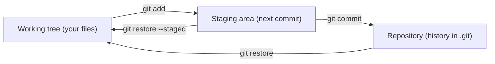

:::objectives
- Explain what a commit stores and why each one has a long ID.
- Move changes from the working tree to the staging area to the repository with `git add` and `git commit`.
- Read the output of `git status`, `git diff`, and `git log`.
- Write commit messages someone else can understand, and undo uncommitted changes with `git restore`.
:::

A group project lands in your shared drive looking like this:

```text
poster/
├── poster.docx
├── poster-v2.docx
├── poster-final.docx
├── poster-final-2.docx
├── poster-final-final-2.docx
└── poster-USE-THIS-ONE.docx
```

Which one is newest? What changed between `final-2` and `final-final-2`, and who changed it? Was the chart removed on purpose? The folder can't answer any of that. Git replaces the pile with **one** set of files plus a list of labeled snapshots, each saying what changed, who changed it, when, and why.

## What a commit actually stores

Think of a save point in a video game that also makes you write a note: "beat the boss, low on health". A **commit** is a save point for a project folder.

More precisely, each commit records:

-   a **snapshot** of every file Git is tracking, exactly as they were at that moment,
-   the **author's** name and email and the **time**,
-   a **message** describing the change,
-   a link to its **parent**, the commit that came right before it.

Git names each commit with a 40-character ID (a *hash*) calculated from all of that, such as `449ccec1b2bd7d5beb7d2de9575441160c108d81`. Change one letter in a file or the message and the ID comes out completely different, which is how Git notices tampering or corruption. You'll usually see just the first seven characters, `449ccec`, which is enough to identify it.

```mermaid caption="History is a chain: each commit points back to its parent"
gitGraph
    commit id: "bc3c7ab Add pancake recipe"
    commit id: "449ccec Use one egg and add salt"
```

## Three places your work lives

Here's the part that confuses most beginners. Saving a file in VS Code doesn't put it in Git's history. A change passes through three places:

1.  **Working tree**: the files in your folder, the ones you open and edit.
2.  **Staging area** (also called the *index*): a waiting area for the next commit. You choose what goes in.
3.  **Repository**: the committed history, stored in the hidden `.git` folder.



Why not commit straight from your folder? Because you're often in the middle of two things. Say you fixed a typo in the README and you're also halfway through a new page. Staging lets you commit just the typo fix now, with a clear message, and keep working on the page.

## Watch one file make the trip

Make a folder called `recipes` inside `git-course`, open it in VS Code, and run `git init` in its terminal. That creates the hidden `.git` folder. Then create `pancakes.md` with a short ingredient list and ask Git what it sees:

```bash
git status
```

```text
On branch main

No commits yet

Untracked files:
  (use "git add <file>..." to include in what will be committed)
	pancakes.md

nothing added to commit but untracked files present (use "git add" to track)
```

**Untracked** means Git can see the file but has never recorded it. Stage it and check again:

```bash
git add pancakes.md
git status
```

```text
On branch main

No commits yet

Changes to be committed:
  (use "git rm --cached <file>..." to unstage)
	new file:   pancakes.md
```

The heading changed to **Changes to be committed**: the file is in the staging area. Now commit, with a message after `-m`:

```bash
git commit -m "Add pancake recipe"
```

```text
[main (root-commit) bc3c7ab] Add pancake recipe
 1 file changed, 5 insertions(+)
 create mode 100644 pancakes.md
```

That first line packs in a lot: the branch (`main`), the fact that this is the very first commit (`root-commit`), the short ID, and your message. Run `git status` now and it says `nothing to commit, working tree clean`, meaning your folder matches the last snapshot exactly.

## See what changed with diff and log

Edit the recipe: change `2 eggs` to `1 egg` and add a line for salt. Then:

```bash
git diff
```

```diff
diff --git a/pancakes.md b/pancakes.md
index 606e11c..271accd 100644
--- a/pancakes.md
+++ b/pancakes.md
@@ -1,5 +1,6 @@
 # Pancakes
 
 - 2 cups flour
-- 2 eggs
+- 1 egg
 - 1 cup milk
+- A pinch of salt
```

Lines starting with `-` were removed and lines starting with `+` were added. A changed line shows up as one of each. The `@@ -1,5 +1,6 @@` line says "this chunk covers 5 lines starting at line 1 in the old version, and 6 lines in the new one". Lines with a leading space are unchanged context, there to help you find your place.

:::try
Run `git add pancakes.md`, then predict what `git diff` prints. Run it to check, then try `git diff --staged`.
:::

Plain `git diff` compares your **working tree** to the **staging area**. Once you stage everything, there's no difference, so it prints nothing. `git diff --staged` compares the staging area to the last commit, which is exactly what you're about to commit. Checking it before every commit is a good habit.

Commit that change, then look at the history:

```bash
git commit -m "Use one egg and add salt"
git log
```

```text
commit 449ccec1b2bd7d5beb7d2de9575441160c108d81 (HEAD -> main)
Author: Sam Rivera <12345678+samrivera@users.noreply.github.com>
Date:   Tue Sep 15 18:40:00 2026 -0700

    Use one egg and add salt

commit bc3c7ab178bc2dc739e3ca0d23fd3920b4cd99a8
Author: Sam Rivera <12345678+samrivera@users.noreply.github.com>
Date:   Mon Sep 14 16:02:00 2026 -0700

    Add pancake recipe
```

Newest commits come first. `(HEAD -> main)` marks where you are now. For a compact view, use `git log --oneline`, and to see exactly what one commit changed, use `git show` followed by its ID.

:::video e9lnsKot_SQ
ByteByteGo animates the same three places (working directory, staging area, repository) plus the remote copy you'll meet in Module 3. Watch which command moves files across each boundary.
:::

## Messages your future self can read

Six months from now, `git log --oneline` is how you'll find the commit that broke something. Compare:

| Unhelpful | Helpful |
| --- | --- |
| `stuff` | `Add pancake recipe` |
| `fixed it` | `Fix negative total when cart is empty` |
| `changes` | `Use one egg and add salt` |
| `Updated index.html` | `Link the events page from the home page` |

A few conventions most teams share:

-   Start with a verb in the command form: **Add**, **Fix**, **Remove**, **Rename**. A handy test: the message should complete the sentence "If applied, this commit will ___."
-   Keep the first line short, around 50 characters, with no period at the end.
-   If the *why* isn't obvious, add a body. A second `-m` becomes a separate paragraph: `git commit -m "Use one egg" -m "Two made the batter rubbery."`
-   One idea per commit. "Fix typo and redesign the menu" should be two commits.

## Undo changes you haven't committed

`git status` already showed the tool for this, in its hints. Two commands cover most situations:

```bash
git restore pancakes.md
```

This throws away your edits and puts the file back the way it was at the last commit (or the staged version, if you'd staged it). It's how you recover when you've made a mess of a file and want a clean start.

```bash
git restore --staged pancakes.md
```

This takes the file *out* of the staging area but keeps your edits in the folder. Use it when you staged something by mistake.

:::warning
`git restore pancakes.md` deletes uncommitted work for good. There's no recycle bin, because Git never recorded those edits. If you might want them later, commit first or copy the file somewhere safe.
:::

## Common mistakes

:::warning
**Editing a file after staging it.** `git add` stages the file *as it was at that moment*. Edit it again and `git status` lists the same file twice:

```text
Changes to be committed:
  (use "git restore --staged <file>..." to unstage)
	modified:   pancakes.md

Changes not staged for commit:
  (use "git add <file>..." to update what will be committed)
  (use "git restore <file>..." to discard changes in working directory)
	modified:   pancakes.md
```

If you commit now, the newer edits are left out. Run `git add pancakes.md` again to stage the latest version.
:::

:::warning
**Running `git add .` without looking.** The dot means "everything in this folder", including junk files and anything private. Run `git status` first and read the list. The next lesson shows how `.gitignore` keeps junk out for good.
:::

:::quiz
Q: You run `git add notes.md`, then type two more lines into `notes.md` and save, then run `git commit -m "Add notes"`. What does the commit contain?
- [x] `notes.md` as it was when you ran `git add`
  The staging area holds the version from the moment you staged it. The two new lines are still only in your working tree.
- [ ] `notes.md` including the two new lines
  Saving a file never changes the staging area; you'd need to run `git add` again.
- [ ] Nothing, because the file changed after staging
  Git commits the staged version without complaint and leaves the newer edits as unstaged changes.

Q: Right after `git add pancakes.md`, `git diff` prints nothing. Why?
- [ ] The add failed
  If `git add` failed, it would print an error.
- [ ] `git diff` only works after a commit
  It works any time; it just compares two specific places.
- [x] Plain `git diff` compares the working tree to the staging area, and they now match
  Use `git diff --staged` to compare the staging area to the last commit.

Q: Which is the most useful commit message?
- [ ] `Updated files`
  Every commit updates files. This says nothing about what or why.
- [ ] `I fixed the thing that was broken yesterday!!!`
  Which thing? This won't mean anything in a month.
- [x] `Fix total when the cart is empty`
  It starts with a verb, names the specific problem, and fits on one short line.

Q: You staged `secret-notes.txt` by mistake but want to keep the file in your folder. Which command?
- [ ] `git restore secret-notes.txt`
  For a file that has never been committed, that does nothing useful; for a committed file, it would throw away your edits.
- [x] `git restore --staged secret-notes.txt`
  This unstages the file and leaves it untouched in your working tree.
- [ ] `git commit` and then delete it
  The file would then be in history forever.
:::

:::takeaways
- A commit is a snapshot of every tracked file, plus author, time, message, and a link to its parent.
- Changes move from the **working tree** to the **staging area** with `git add`, and into **history** with `git commit`.
- `git status` tells you where every changed file is; `git diff` and `git diff --staged` show the exact lines.
- Good messages start with a verb and say what changed and, when it isn't obvious, why.
- `git restore --staged` unstages; `git restore` discards uncommitted edits permanently.
:::

## Further reading

-   [Pro Git: Recording Changes to the Repository](https://git-scm.com/book/en/v2/Git-Basics-Recording-Changes-to-the-Repository): the official book's chapter on status, add, diff, and commit, with more examples.
-   [How to Write a Git Commit Message](https://cbea.ms/git-commit/): Chris Beams's widely shared guide, with the reasoning behind each convention.
