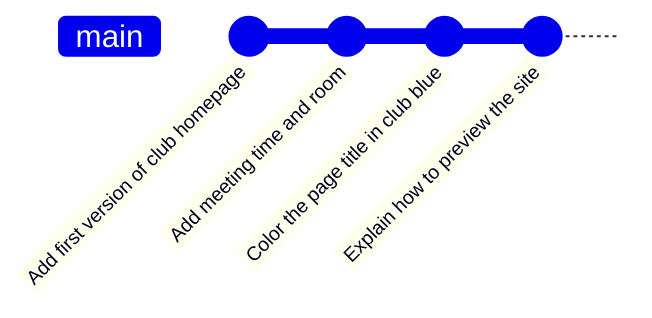

:::objectives
- Turn a project folder into a repository and keep junk out of it with `.gitignore`.
- Make focused commits, staging one file at a time when two changes are unrelated.
- Check every change with `git diff` before committing it.
- Rescue a broken file with `git restore`.
:::

You're going to build the website for a school robotics club and give it a history that someone joining the club next year could read and trust. The site is tiny on purpose; the point is the history. This same project carries on through Modules 3 and 4, where it gets branches, pull requests, issues, and reviews.

Here's the page you'll end up with:

```html preview height="200"
<h1>Robotics Club</h1>
<p>We build robots after school. Everyone is welcome.</p>
<p>Meetings: Thursdays, 3:30 pm, Room 214.</p>
<style>
  body { font-family: sans-serif; max-width: 40rem; margin: 2rem auto; }
  h1 { color: #1d4ed8; }
</style>
```

And here's the history behind it, four commits that each do one thing:



## Step 1: Create the project files

In VS Code's terminal:

```bash
mkdir ~/git-course/club-site
cd ~/git-course/club-site
code .
```

A new VS Code window opens on the empty folder. Create these three files with **File > New File** and save each one:

```html title="index.html"
<!DOCTYPE html>
<html lang="en">
<head>
  <meta charset="utf-8">
  <title>Robotics Club</title>
  <link rel="stylesheet" href="style.css">
</head>
<body>
  <h1>Robotics Club</h1>
  <p>We build robots after school. Everyone is welcome.</p>
</body>
</html>
```

```css title="style.css"
body {
  font-family: sans-serif;
  max-width: 40rem;
  margin: 2rem auto;
}
```

```markdown title="README.md"
# Robotics Club website

The website for our school's robotics club.
```

Real project folders also collect things that don't belong in history. To see that happen, make a `drafts` folder with a file of private ideas in it. On a Mac, Finder quietly creates a `.DS_Store` file in folders you open; on Windows, File Explorer sometimes makes `Thumbs.db`.

## Step 2: Turn the folder into a repository

```bash
git init
git status
```

```text
Initialized empty Git repository in /Users/sam/git-course/club-site/.git/
On branch main

No commits yet

Untracked files:
  (use "git add <file>..." to include in what will be committed)
	.DS_Store
	README.md
	drafts/
	index.html
	style.css

nothing added to commit but untracked files present (use "git add" to track)
```

Git sees five things (on Windows or a Chromebook you probably won't have `.DS_Store`). Three are the website. `.DS_Store` is Mac clutter that would show up as noise in every future `git status`, and `drafts/` holds notes you don't want published. If you typed `git add .` now, both would be in history permanently.

## Step 3: Write a .gitignore before the first commit

A `.gitignore` file lists patterns for files Git should pretend it can't see. Create it in the project's top folder:

```ini title=".gitignore"
# Clutter that macOS and Windows create
.DS_Store
Thumbs.db

# My private notes
drafts/
```

Lines starting with `#` are comments. A plain name matches that file anywhere in the project, and a trailing `/` matches a folder and everything in it. Now ask again:

```bash
git status
```

```text
On branch main

No commits yet

Untracked files:
  (use "git add <file>..." to include in what will be committed)
	.gitignore
	README.md
	index.html
	style.css

nothing added to commit but untracked files present (use "git add" to track)
```

The clutter and the drafts are gone from the list, and `.gitignore` itself appears. You *do* commit `.gitignore`, so everyone who works on the project gets the same rules. If you're curious what's being hidden, `git status --ignored` lists it.

## Step 4: Make the first commit

The list now holds only what belongs in the project, so `git add .` is safe:

```bash
git add .
git status
```

```text
On branch main

No commits yet

Changes to be committed:
  (use "git rm --cached <file>..." to unstage)
	new file:   .gitignore
	new file:   README.md
	new file:   index.html
	new file:   style.css
```

```bash
git commit -m "Add first version of club homepage"
```

```text
[main (root-commit) 63fa7c6] Add first version of club homepage
 4 files changed, 26 insertions(+)
 create mode 100644 .gitignore
 create mode 100644 README.md
 create mode 100644 index.html
 create mode 100644 style.css
```

## Step 5: Add a change, and record why

New members keep asking when the club meets. Add one line to `index.html`, under the first paragraph:

```html
  <p>Meetings: Thursdays, 3:30 pm, Room 214.</p>
```

Before committing, read the diff to make sure it says only what you meant:

```bash
git diff
```

```diff
diff --git a/index.html b/index.html
index 42ef7d7..3e2d36c 100644
--- a/index.html
+++ b/index.html
@@ -8,5 +8,6 @@
 <body>
   <h1>Robotics Club</h1>
   <p>We build robots after school. Everyone is welcome.</p>
+  <p>Meetings: Thursdays, 3:30 pm, Room 214.</p>
 </body>
 </html>
```

One `+` line and nothing else, which is exactly the change you intended. This time the reason is worth recording, so give the commit a body with a second `-m`:

```bash
git add index.html
git commit -m "Add meeting time and room" -m "New members kept asking where and when we meet."
```

```text
[main 3bc85cb] Add meeting time and room
 1 file changed, 1 insertion(+)
```

## Step 6: Two unrelated changes, two commits

Now make two edits before committing anything. In `style.css`, color the heading:

```css
h1 {
  color: #1d4ed8;
}
```

In `README.md`, add a section telling people how to preview the site:

```markdown
## Preview it

Open `index.html` in any web browser.
```

These have nothing to do with each other, so they deserve separate commits. The short form of `status` makes the staging visible:

```bash
git status --short
```

```text
 M README.md
 M style.css
```

```bash
git add style.css
git status --short
```

```text
 M README.md
M  style.css
```

Each line has two columns before the file name: the left column is the staging area and the right column is the working tree. ` M` means "modified, not staged" and `M ` means "modified and staged". After `git add style.css`, only the CSS moved to the left column. Commit it, then stage and commit the README:

```bash
git commit -m "Color the page title in club blue"
git add README.md
git commit -m "Explain how to preview the site"
```

```text
[main 1ddde56] Color the page title in club blue
 1 file changed, 4 insertions(+)
[main d873084] Explain how to preview the site
 1 file changed, 4 insertions(+)
```

If the color turns out to be a mistake next month, you can undo that one commit without touching the README.

:::tip
In VS Code's Source Control view, this step is just two clicks: hover over `style.css` in **Changes**, click **+**, type the message, click **Commit**. Then repeat for `README.md`.
:::

## Step 7: Rescue a broken file

Accidents happen. Suppose a bad paste wipes out the bottom half of `index.html` and you save it. `git diff --stat` gives a quick summary of the damage:

```bash
git diff --stat
```

```text
 index.html | 7 -------
 1 file changed, 7 deletions(-)
```

Seven lines gone, none added. Since the last commit had the good version, bring it back:

```bash
git restore index.html
git status
```

```text
On branch main
nothing to commit, working tree clean
```

The file is exactly as it was at the last commit. This is the everyday payoff of committing often: the last commit is always a safe place to return to.

## Step 8: Read the history you made

```bash
git log --oneline
```

```text
d873084 (HEAD -> main) Explain how to preview the site
1ddde56 Color the page title in club blue
3bc85cb Add meeting time and room
63fa7c6 Add first version of club homepage
```

Read it bottom to top and it's the story of the project. To see the reason you recorded in Step 5, show that commit:

```bash
git show 3bc85cb --stat
```

```text
commit 3bc85cb3376aa871131fb8eb73aa6f50b8eede0a
Author: Sam Rivera <12345678+samrivera@users.noreply.github.com>
Date:   Tue Sep 22 16:45:00 2026 -0700

    Add meeting time and room
    
    New members kept asking where and when we meet.

 index.html | 1 +
 1 file changed, 1 insertion(+)
```

Your IDs and dates will be different, because IDs come from your name, the time, and the content.

## The finished project

Four files are tracked, and two things are deliberately ignored:

```bash
git status --ignored
```

```text
On branch main
Ignored files:
  (use "git add -f <file>..." to include in what will be committed)
	.DS_Store
	drafts/

nothing to commit, working tree clean
```

Keep `club-site` exactly where it is. In Module 3 you'll put it on GitHub and add a new page on a branch.

:::video NUELGzIHT-I start=8:44
GitHub's "Beginner Git commands you need to know" segment runs from 8:44 to about 22:50. It repeats `init`, `status`, `add`, and `commit` on a different project; notice how often the presenter runs `git status` between steps.
:::

:::quiz
Q: Why write `.gitignore` *before* the first commit instead of after?
- [x] Once a file is committed, ignoring it later doesn't remove it from history
  `.gitignore` only affects untracked files. Anything already committed stays in history, so it's easiest to keep junk out from the start.
- [ ] Git refuses to create `.gitignore` after the first commit
  You can add or edit `.gitignore` at any time.
- [ ] `.gitignore` has to be the first file in a repository
  Order doesn't matter to Git; it reads the file whenever it checks status.

Q: In Step 6, why stage `style.css` and `README.md` separately?
- [ ] Git can only commit one file at a time
  A commit can include any number of files, as Step 4 showed.
- [x] They're unrelated changes, so separate commits can be understood and undone independently
  One idea per commit keeps the log readable and lets you reverse the color change without losing the README section.
- [ ] CSS files must be committed before Markdown files
  Git doesn't care about file types or order.

Q: `git status --short` shows `M  style.css` (M in the left column). What does that mean?
- [ ] The file is modified but not staged
  That would be ` M`, with the M in the right column.
- [x] The file is modified and staged for the next commit
  The left column describes the staging area, so the change is ready to commit.
- [ ] The file was merged
  There are no branches or merges yet; `M` here just means modified.
:::

:::takeaways
- Write `.gitignore` before your first commit, and commit the `.gitignore` itself.
- Read `git diff` before every commit to catch changes you didn't intend.
- Give each commit one idea; stage files separately when you've made unrelated changes.
- Add a message body with a second `-m` when the reason for a change isn't obvious.
- `git restore` returns a file to its last committed version, which makes frequent commits a safety net.
:::

## Extend it

-   Add a `projects.html` page listing two robots the club has built, linked from `index.html`. Commit the new page and the link as one commit, since one makes no sense without the other.
-   Make a change, stage it, then decide you don't want it in this commit. Use `git restore --staged` and confirm with `git status --short`.
-   Open the **Source Control Graph** in VS Code's Source Control view and click each commit to see its changes.

## Further reading

-   [GitHub's gitignore templates](https://github.com/github/gitignore): ready-made `.gitignore` files for Python, Node, Java, Unity, and dozens more.
-   [Git documentation: gitignore](https://git-scm.com/docs/gitignore): the exact pattern rules, including `*`, `**`, and `!` for exceptions.
