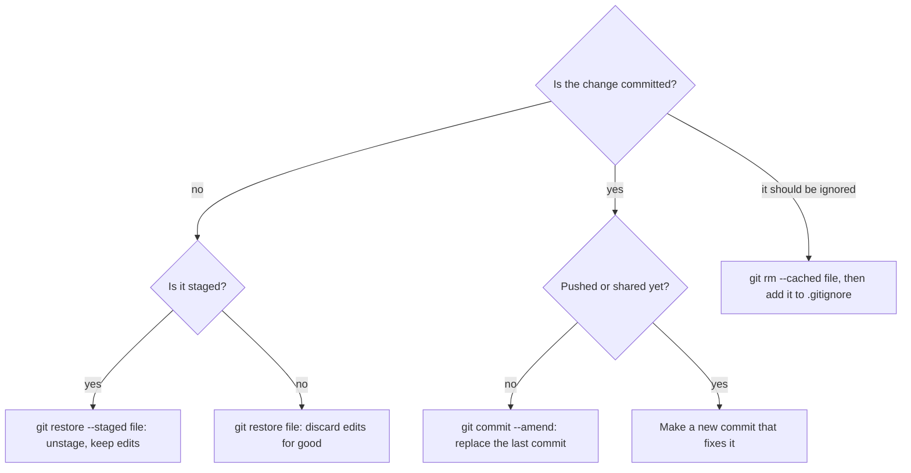

:::objectives
- Decode `git status --short` output at a glance.
- Rewrite vague commit messages and split mixed work into focused commits.
- Write and test a `.gitignore`, and stop tracking a file that was committed by mistake.
- Choose the right undo command, search history for a change, and amend the last commit.
:::

Make a folder called `practice` inside `git-course` and give each exercise its own small repository inside it (`mkdir` the folder, `cd` into it, `git init`). They're throwaway, so experiment freely. Your commit IDs will differ from the ones shown here.

## Warm-up: read the short status

A classmate runs `git status --short` and gets this:

```text
 M about.md
M  contact.md
MM faq.md
A  news.md
?? todo.md
```

For each file, say whether it's untracked, staged, unstaged, or some mix. Remember: the left column is the staging area and the right column is the working tree.

:::solution
-   `about.md`: modified, **not staged** (M on the right only).
-   `contact.md`: modified and **staged** (M on the left only).
-   `faq.md`: **both**. Some edits were staged, then the file was edited again. Committing now would leave the newer edits out.
-   `news.md`: a **new file, staged** (A for added).
-   `todo.md`: **untracked**. Git has never recorded it.
:::

### Exercise 1: Rewrite the messages

These are real-looking messages from a group project. Rewrite each so it starts with a verb and says what changed. Invent reasonable details.

```text
stuff
fixed bug
asdf
Updated style.css
final version!!!
```

:::hint
Use the test "If applied, this commit will ___." A reader should be able to guess the diff from the message alone.
:::

:::solution
Many answers work. What matters is a specific verb and a specific thing:

| Before | After |
| --- | --- |
| `stuff` | `Add photo gallery page` |
| `fixed bug` | `Fix score resetting when the game restarts` |
| `asdf` | `Remove test text from the footer` |
| `Updated style.css` | `Increase body text size for readability` |
| `final version!!!` | `Add conclusion section to the report` |

Notice that "Updated style.css" names the file but not the change; Git already records which files changed, so the message should say *what* and *why*.
:::

### Exercise 2: One messy afternoon, two commits

Make a repository called `study-notes` with `biology.md` containing `Mitochondria are the powerhouse of the sell.` and commit it. Now, without committing in between, (a) fix the typo "sell" to "cell", and (b) create `chemistry.md` with one line of notes. Commit these as **two** separate commits with good messages.

Your `git log --oneline` should end up with three commits.

:::hint
Stage one file, commit, then stage the other. `git status --short` before each commit shows what's going in.
:::

:::solution
```bash
git status --short
```

```text
 M biology.md
?? chemistry.md
```

```bash
git add biology.md
git commit -m "Fix spelling of cell in biology notes"
git add chemistry.md
git commit -m "Start chemistry notes"
git log --oneline
```

```text
[main a048c52] Fix spelling of cell in biology notes
 1 file changed, 1 insertion(+), 1 deletion(-)
[main 970c4c3] Start chemistry notes
 1 file changed, 3 insertions(+)
 create mode 100644 chemistry.md
970c4c3 (HEAD -> main) Start chemistry notes
a048c52 Fix spelling of cell in biology notes
7d3ac46 Add biology notes
```

The typo fix shows as `1 insertion(+), 1 deletion(-)`: Git sees a changed line as one line removed and one added.
:::

### Exercise 3: Write a .gitignore for a Python project

A `weather-bot` folder contains:

```text
.env                          (holds a real API key)
.venv/                        (a Python virtual environment)
__pycache__/bot.cpython-313.pyc
bot.py
debug.log
example.env                   (fake values, safe to share)
logs/today.log
```

Write a `.gitignore` so that `git status` shows only `.gitignore`, `bot.py`, and `example.env`. Then prove each rule works with `git check-ignore -v`, which prints the rule that matched a file.

:::hint
You need four patterns. One of them uses `*` to match any file ending in `.log`, wherever it is. Be careful that your `.env` rule doesn't also hide `example.env`.
:::

:::solution
```ini title=".gitignore"
# Python's compiled files and virtual environment
__pycache__/
.venv/

# Logs
*.log

# Secrets: never commit these
.env
```

```bash
git status
```

```text
On branch main

No commits yet

Untracked files:
  (use "git add <file>..." to include in what will be committed)
	.gitignore
	bot.py
	example.env

nothing added to commit but untracked files present (use "git add" to track)
```

```bash
git check-ignore -v .env debug.log logs/today.log __pycache__/bot.cpython-313.pyc
```

```text
.gitignore:9:.env	.env
.gitignore:6:*.log	debug.log
.gitignore:6:*.log	logs/today.log
.gitignore:2:__pycache__/	__pycache__/bot.cpython-313.pyc
```

Each line shows the file, the line number in `.gitignore`, and the pattern that caught it. The pattern `.env` matches only a file named exactly `.env`, so `example.env` stays visible, which is what you want: it shows other people which settings exist without revealing the real key. Running `git check-ignore -v example.env` prints nothing, meaning no rule matches.
:::

### Exercise 4: Stop tracking a file that was already committed

In a `game-scores` repository, someone committed `settings.local.txt` (personal settings that differ per computer). You add `settings.local.txt` to `.gitignore`, edit the file, and run `git status --short`:

```text
 M settings.local.txt
?? .gitignore
```

Git still reports changes to it. Explain why, then fix it so the file stays on your computer but is no longer tracked.

:::hint
`.gitignore` only applies to files Git isn't already tracking. You need to remove the file from the staging area (and so from the next snapshot) without deleting it from your folder. `git rm` has an option for "only from the index".
:::

:::solution
`.gitignore` doesn't affect files that are already in a commit, so Git keeps watching it. Remove it from tracking with `--cached`, which leaves your copy alone:

```bash
git rm --cached settings.local.txt
git status
```

```text
rm 'settings.local.txt'
On branch main
Changes to be committed:
  (use "git restore --staged <file>..." to unstage)
	deleted:    settings.local.txt

Untracked files:
  (use "git add <file>..." to include in what will be committed)
	.gitignore
```

"Deleted" here means deleted *from the next snapshot*. Commit it together with the `.gitignore`:

```bash
git add .gitignore
git commit -m "Stop tracking settings.local.txt"
ls
```

```text
[main 7ccd116] Stop tracking settings.local.txt
 2 files changed, 1 insertion(+), 1 deletion(-)
 create mode 100644 .gitignore
 delete mode 100644 settings.local.txt
scores.py
settings.local.txt
```

The file is still in your folder, and future edits to it won't appear in `git status`. The old commit still contains it, though. If the file had held a password, you'd also need to change that password.
:::

### Exercise 5: Two kinds of undo

In a `poems` repository with two committed files, you've done two things you regret: you typed `asdfjkl` over all of `haiku.txt` and saved it, and you staged a half-finished edit to `limerick.txt`. `git status` shows:

```text
On branch main
Changes to be committed:
  (use "git restore --staged <file>..." to unstage)
	modified:   limerick.txt

Changes not staged for commit:
  (use "git add <file>..." to update what will be committed)
  (use "git restore <file>..." to discard changes in working directory)
	modified:   haiku.txt
```

Get `haiku.txt` back to its committed version, and unstage `limerick.txt` **while keeping** your limerick edits.

:::hint
The hints in parentheses in that output contain both answers. One command takes an option and one doesn't.
:::

:::solution
```bash
git restore --staged limerick.txt
git restore haiku.txt
git status --short
cat haiku.txt
```

```text
 M limerick.txt
An old silent pond
A frog jumps into the pond
Splash! Silence again.
```

`limerick.txt` is back to ` M`: modified but unstaged, with your edits intact. `haiku.txt` no longer appears because it matches the last commit again.
:::

### Exercise 6: Find when something changed

Build a `band` repository with `schedule.txt` and four commits: add the schedule (Tuesday, 4:00 pm, Room 101), move practice to Thursday, add a README, then change the time to 4:30 pm and the place to the music room. Now pretend you forgot all that. Use Git to answer: **which commit stopped mentioning Room 101, and what else did it change?**

:::hint
`git log -S "some text"` lists only the commits that added or removed that exact text. Then `git show` with an ID shows that commit's full diff.
:::

:::solution
```bash
git log -S "Room 101" --oneline
```

```text
696760f Move practice to the music room at 4:30
c086daa Add practice schedule
```

Two commits touched the text: the one that added it and the one that removed it. Show the newer one:

```bash
git show 696760f
```

```diff
commit 696760fc5151508b2a432eb51f62618301bf0891 (HEAD -> main)
Author: Sam Rivera <12345678+samrivera@users.noreply.github.com>
Date:   Tue Sep 15 10:00:00 2026 -0700

    Move practice to the music room at 4:30

diff --git a/schedule.txt b/schedule.txt
index b84a9d7..30a2ce3 100644
--- a/schedule.txt
+++ b/schedule.txt
@@ -1,4 +1,4 @@
 Band practice
 Day: Thursday
-Time: 4:00 pm
-Place: Room 101
+Time: 4:30 pm
+Place: Music room
```

It also moved the time from 4:00 to 4:30. Another useful view is `git log --oneline -- schedule.txt`, which lists every commit that touched that one file and skips the README commit.
:::

### Challenge: Fix the commit you just made

In a `mixtape` repository, you commit with a typo in the message and forget to include a new file:

```bash
git commit -m "Add secnod song and cover art"
git status --short
```

```text
[main 27f7a06] Add secnod song and cover art
 1 file changed, 1 insertion(+)
?? cover.txt
```

Fix both problems so the history shows **one** commit with the right message and both files, not a second "oops" commit.

:::hint
`git commit --amend` replaces the most recent commit with a new one built from the staging area. Stage the missing file first.
:::

:::solution
```bash
git add cover.txt
git commit --amend -m "Add second song and cover art"
git log --oneline
```

```text
[main d040155] Add second song and cover art
 Date: Wed Sep 30 19:30:00 2026 -0700
 2 files changed, 2 insertions(+)
 create mode 100644 cover.txt
d040155 (HEAD -> main) Add second song and cover art
f38d270 Start the playlist
```

The bad commit `27f7a06` is gone from the log and `d040155` replaces it with both files. The ID changed because the content and message changed.

Only amend commits you **haven't pushed** yet. Once a teammate has a copy of a commit, replacing it rewrites history they depend on; make a new commit instead.
:::


