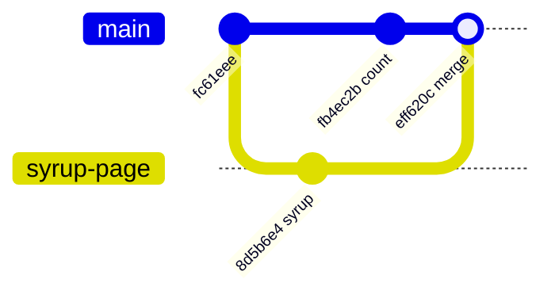
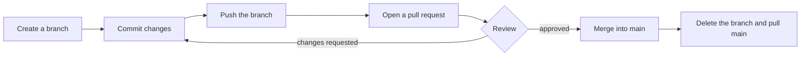

:::objectives
- Explain a branch as a movable name for a commit, and `HEAD` as "the branch you're on".
- Create, switch, merge, and delete branches with `git switch` and `git merge`.
- Predict whether a merge will fast-forward or create a merge commit.
- Describe how `origin`, `push`, and `pull` connect your repository to GitHub, and what a pull request adds.
:::

The robotics club's website is live, and `main` is what visitors see. Two people want to change it: Priya is building an events page that will take a week, and Marcus is adding a dark mode. If they both commit half-finished work straight to `main`, visitors get a page that says "EVENTS: TODO" in dark gray on black. Branches fix this. Each person works on their own line of history, and `main` changes only when a piece of work is finished and checked.

## A branch is a name stuck on a commit

The intuition: a branch is a sticky note with a name on it, stuck to one commit. Making a new branch doesn't copy any files; it just adds another sticky note. When you commit, the sticky note for the branch you're on moves forward to the new commit.

Precisely: a branch is a tiny file inside `.git` that holds one commit ID. `HEAD` is another file that says which branch you're on. You can look at them yourself in the `recipes` repository from Module 2:

```bash
git branch
cat .git/HEAD
cat .git/refs/heads/main
```

```text
* main
ref: refs/heads/main
449ccec1b2bd7d5beb7d2de9575441160c108d81
```

`git branch` lists branches and stars the current one. `HEAD` points at `main`, and `main` is literally a file containing the ID of the newest commit. That's the whole trick, and it's why branches in Git are instant and cheap.

Step through this small Python model of the same idea. `branches` maps names to commits, `head` is the branch you're on, and every commit moves only the current branch:

:::trace Watch the branch names move
```python
parent = {"A": None}        # each commit remembers its parent
branches = {"main": "A"}    # a branch is just a name for a commit
head = "main"               # HEAD: the branch you're on

def commit(new_id):
    parent[new_id] = branches[head]   # the new commit points back
    branches[head] = new_id           # only the current branch moves

commit("B")
branches["add-waffles"] = branches[head]   # git branch add-waffles
head = "add-waffles"                       # git switch add-waffles
commit("C")
head = "main"                              # git switch main
print(branches)
branches["main"] = branches["add-waffles"] # fast-forward merge
print(branches)
```
:::

Notice that when `C` is committed, `main` stays on `B`. The final line is a fast-forward merge: nothing new is created, a name just slides forward.

## Make a branch and work on it

`git switch -c` creates a branch and switches to it in one step:

```bash
git switch -c add-waffles
```

```text
Switched to a new branch 'add-waffles'
```

Create `waffles.md`, stage it, and commit. Then look at the log:

```bash
git log --oneline
```

```text
fc61eee (HEAD -> add-waffles) Add waffle recipe
449ccec (main) Use one egg and add salt
bc3c7ab Add pancake recipe
```

The labels tell the story: you're on `add-waffles`, one commit ahead, and `main` still points at the older commit. Now switch back:

```bash
git switch main
ls
```

```text
Switched to branch 'main'
pancakes.md
```

`waffles.md` vanished from your folder. Don't panic: it's safely stored in the `add-waffles` commit. Switching branches rewrites your working tree to match the commit that branch points at. Switch back and the file reappears.

:::note
Branch names can't contain spaces. Short, lowercase, hyphenated names that describe the work are the norm: `add-events-page`, `fix-footer-year`. Avoid names like `sam-stuff` that say nothing about the change.
:::

## Bring the work back with git merge

To merge, switch to the branch you want to *receive* the work (usually `main`), then name the branch to merge in. There are two possible outcomes.

### Fast-forward: main hadn't moved

Since you branched, nobody committed to `main`. So Git doesn't need to combine anything; it can slide `main` forward to the waffle commit.

```mermaid caption="Before the merge: main is behind, but hasn't moved since the branch started"
gitGraph
    commit id: "bc3c7ab"
    commit id: "449ccec"
    branch add-waffles
    checkout add-waffles
    commit id: "fc61eee waffles"
```

```bash
git merge add-waffles
```

```text
Updating 449ccec..fc61eee
Fast-forward
 waffles.md | 5 +++++
 1 file changed, 5 insertions(+)
 create mode 100644 waffles.md
```

After a fast-forward, history is a straight line again, and `main` and `add-waffles` point at the same commit. The branch has done its job, so delete the name (the commits stay):

```bash
git branch -d add-waffles
```

```text
Deleted branch add-waffles (was fc61eee).
```

### Merge commit: both sides moved

Now suppose you branch off to write `syrup.md`, and meanwhile someone commits a change to `pancakes.md` on `main`. The two lines of history have *diverged*:

```text
* fb4ec2b (HEAD -> main) Say how many pancakes the recipe makes
| * 8d5b6e4 (syrup-page) Add blueberry syrup recipe
|/
* fc61eee Add waffle recipe
```

Sliding `main` forward would lose `fb4ec2b`. Instead, Git makes a new **merge commit** with *two* parents, combining both sides. Git opens your editor with a ready-made message, `Merge branch 'syrup-page'`; close the tab to accept it.

```bash
git merge syrup-page
```

```text
Merge made by the 'ort' strategy.
 syrup.md | 3 +++
 1 file changed, 3 insertions(+)
 create mode 100644 syrup.md
```

`ort` is the name of Git's merge algorithm. Look at the shape it made:

```bash
git log --oneline --graph
```

```text
*   eff620c (HEAD -> main) Merge branch 'syrup-page'
|\
| * 8d5b6e4 (syrup-page) Add blueberry syrup recipe
* | fb4ec2b Say how many pancakes the recipe makes
|/
* fc61eee Add waffle recipe
* 449ccec Use one egg and add salt
* bc3c7ab Add pancake recipe
```



Here the two branches changed different files, so Git combined them automatically. When both sides change the same lines, Git stops and asks you to choose; that's a *merge conflict*, and Module 5 covers it.

## Your repository and GitHub's copy

So far everything has been on your computer. A **remote** is another copy of the repository that yours knows about, and by convention the main one is called `origin`. When it lives on GitHub, it looks like this:

```bash
git remote -v
```

```text
origin	git@github.com:samrivera/recipes.git (fetch)
origin	git@github.com:samrivera/recipes.git (push)
```

Three commands move commits between the copies:

-   `git push` sends your new commits on a branch up to GitHub.
-   `git fetch` downloads new commits from GitHub without changing your files.
-   `git pull` fetches *and* merges them into your current branch.

Your repository also remembers where GitHub's branches were the last time you talked to it, under names like `origin/main`. That's how `git status` can tell you this after you commit without pushing:

```text
On branch main
Your branch is ahead of 'origin/main' by 1 commit.
  (use "git push" to publish your local commits)
```

## Pull requests: a merge with a conversation

On a team you don't usually merge your own branch into `main` from the terminal. You push the branch to GitHub and open a **pull request** (PR): a page that says "please merge `add-events-page` into `main`", showing every commit and every changed line. Teammates read it, comment on specific lines, and approve it or ask for changes. Automated checks can run on it too. Only then does someone click **Merge pull request**.



One detail surprises people: GitHub's default **Merge pull request** button always makes a merge commit, even when a fast-forward was possible. That keeps a visible record of each PR in the history. The button's menu also offers **Squash and merge** (combine the PR's commits into one) and **Rebase and merge**; projects pick whichever they prefer.

:::video Ala6PHlYjmw start=1:45
From 1:45 to about 5:40, this video shows commits as a chain, branches as tiny pointers, and how `HEAD` moves. It's the same model as the trace above, drawn as an animation.
:::

## Common mistakes

:::warning
**Forgetting which branch you're on.** Before you commit, glance at the first line of `git status` (`On branch …`) or the branch name in VS Code's bottom-left corner. Committing to `main` by mistake is the most common branch error; Practice shows how to move the commit.
:::

:::warning
**Switching branches with unsaved, uncommitted work.** If your edits would be overwritten, Git refuses:

```text
error: Your local changes to the following files would be overwritten by checkout:
	pancakes.md
Please commit your changes or stash them before you switch branches.
Aborting
```

Commit your work (on the right branch), or undo it with `git restore`, and then switch. Edits that wouldn't clash may come along with you to the other branch, which is confusing in its own way, so make switching with a clean `git status` a habit.
:::

:::quiz
Q: You're on `main` and run `git switch -c dark-mode`, then make two commits. Where does `main` point?
- [ ] At the newest `dark-mode` commit
  Only the branch you're on moves when you commit. `main` stayed put.
- [x] At the commit it pointed to before you created `dark-mode`
  Creating a branch adds a new name; committing then moves only `dark-mode`.
- [ ] Nowhere, because switching away from `main` deletes it
  Branches are only deleted when you run `git branch -d`.

Q: Since you created `fix-typo` from `main`, nobody has committed to `main`. What does `git merge fix-typo` on `main` do?
- [x] A fast-forward: `main` slides forward to the last `fix-typo` commit
  `main` has nothing new, so there's nothing to combine and no merge commit is needed.
- [ ] Creates a merge commit with two parents
  That happens only when both branches have new commits.
- [ ] Reports a merge conflict
  Conflicts need both sides to have changed the same lines; here only one side changed.

Q: Both `main` and `syrup-page` have new commits that touch different files. What does `git merge syrup-page` produce?
- [ ] A fast-forward
  Sliding `main` forward would lose its own new commit, so Git can't fast-forward.
- [x] A merge commit that has both branches' latest commits as parents
  That's the `Merge made by the 'ort' strategy` result, shown as a diamond in `git log --graph`.
- [ ] An error asking you to delete one branch first
  Diverged branches are normal; merging them is exactly what `git merge` is for.

Q: What's the difference between `git fetch` and `git pull`?
- [ ] They're the same command with different names
  They differ in whether your branch changes.
- [x] `fetch` downloads new commits only; `pull` downloads and then merges them into your current branch
  `fetch` updates names like `origin/main` but leaves your files alone.
- [ ] `fetch` works with GitHub; `pull` only works with local branches
  Both talk to a remote such as `origin`.
:::

:::takeaways
- A branch is a movable name for a commit; `HEAD` says which branch you're on. Creating one copies nothing.
- `git switch -c name` creates and switches; committing moves only the current branch.
- A merge fast-forwards when the receiving branch hasn't moved, and makes a two-parent merge commit when both sides have.
- `origin` is GitHub's copy; `push` sends commits up, `fetch` downloads them, `pull` downloads and merges.
- A pull request is a proposed merge with a review and discussion attached; GitHub's default button records it with a merge commit.
:::

## Further reading

-   [Pro Git: Branches in a Nutshell](https://git-scm.com/book/en/v2/Git-Branching-Branches-in-a-Nutshell): the classic explanation of branches as pointers, with clear diagrams.
-   [Pro Git: Basic Branching and Merging](https://git-scm.com/book/en/v2/Git-Branching-Basic-Branching-and-Merging): a realistic story of a hotfix and a feature branch, including both kinds of merge.
-   [GitHub Docs: GitHub flow](https://docs.github.com/en/get-started/using-github/github-flow): GitHub's short description of the branch, pull request, and merge cycle.
