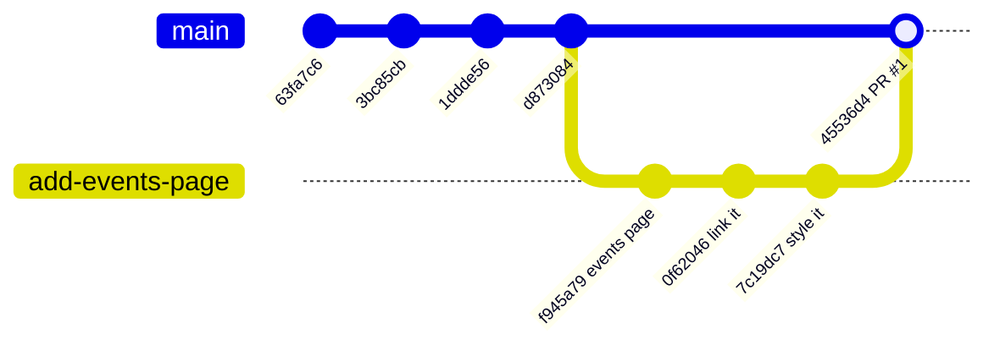

:::objectives
- Create an empty GitHub repository and push an existing project to it.
- Build a feature on a branch and push that branch to GitHub.
- Open a pull request with a useful title and description, then update it with another commit.
- Merge the pull request on GitHub and bring your local `main` up to date.
:::

The club website from Module 2 lives only on your laptop. In this build you'll put it on GitHub and add an events page the way teams do: on a branch, through a pull request, merged only when it's ready. By the end, `git log --graph` will show this:



Everything below runs in VS Code's terminal inside `~/git-course/club-site`. Your commit IDs will differ.

## Step 1: Create an empty repository on GitHub

1.  On GitHub, click the **+** in the top-right corner and choose **New repository**.
2.  Name it `club-site`. Add a one-line description if you like.
3.  Choose **Public** or **Private**. Either works for this course; private is fine if you'd rather keep practice work to yourself.
4.  Leave the README, `.gitignore`, and license options **off**. Your project already has commits, and starting GitHub's copy with its own first commit would give the two histories nothing in common.
5.  Click **Create repository**.

GitHub shows a Quick Setup page with your repository's address. Pick the **SSH** address if you set up a key in Module 1, or **HTTPS** if you're using a credential manager.

## Step 2: Connect your project and push main

Tell your repository about GitHub's copy, naming it `origin`, then push:

```bash
git remote add origin git@github.com:samrivera/club-site.git
git push -u origin main
```

With your username in place of `samrivera` (or the `https://github.com/...` address), you'll see something like this. The object counts and speeds vary:

```text
Enumerating objects: 15, done.
Counting objects: 100% (15/15), done.
Delta compression using up to 8 threads
Compressing objects: 100% (11/11), done.
Writing objects: 100% (15/15), 1.62 KiB | 1.62 MiB/s, done.
Total 15 (delta 3), reused 0 (delta 0), pack-reused 0
To github.com:samrivera/club-site.git
 * [new branch]      main -> main
branch 'main' set up to track 'origin/main'.
```

The `-u` ("upstream") links your `main` to GitHub's `main`, so from now on plain `git push` and `git pull` know where to go. On Windows with HTTPS, this is when the Git Credential Manager sign-in window appears.

Refresh the GitHub page. Your four files are there, and clicking the commit count shows the same four commits as `git log`. Notice that `drafts/` and `.DS_Store` aren't: `.gitignore` kept them home.

## Step 3: Start a branch for the new page

```bash
git switch -c add-events-page
```

```text
Switched to a new branch 'add-events-page'
```

From here until the merge, `main` doesn't change. If the club needs a quick fix to the home page while you work, someone can make it on another branch without tripping over your half-built page.

## Step 4: Build the page in small commits

Create `events.html`:

```html title="events.html"
<!DOCTYPE html>
<html lang="en">
<head>
  <meta charset="utf-8">
  <title>Events | Robotics Club</title>
</head>
<body>
  <h1>Upcoming events</h1>
  <ul>
    <li>Oct 17: Build night, Room 214</li>
    <li>Nov 7: Regional robot competition</li>
    <li>Dec 5: Demo day for families</li>
  </ul>
</body>
</html>
```

```bash
git add events.html
git commit -m "Add events page with fall schedule"
```

```text
[add-events-page f945a79] Add events page with fall schedule
 1 file changed, 15 insertions(+)
 create mode 100644 events.html
```

A page nobody can find isn't much use, so link it from the home page. Add this line in `index.html` below the meetings paragraph, check the diff, and commit:

```html
  <p><a href="events.html">Upcoming events</a></p>
```

```bash
git diff
```

```diff
@@ -9,5 +9,6 @@
   <h1>Robotics Club</h1>
   <p>We build robots after school. Everyone is welcome.</p>
   <p>Meetings: Thursdays, 3:30 pm, Room 214.</p>
+  <p><a href="events.html">Upcoming events</a></p>
 </body>
 </html>
```

```bash
git add index.html
git commit -m "Link the events page from the home page"
git log --oneline
```

```text
[add-events-page 0f62046] Link the events page from the home page
 1 file changed, 1 insertion(+)
0f62046 (HEAD -> add-events-page) Link the events page from the home page
f945a79 Add events page with fall schedule
d873084 (origin/main, main) Explain how to preview the site
1ddde56 Color the page title in club blue
3bc85cb Add meeting time and room
63fa7c6 Add first version of club homepage
```

Read the labels: your branch is two commits ahead, while `main` and GitHub's `origin/main` both still point at `d873084`.

## Step 5: Push the branch

```bash
git push -u origin add-events-page
```

```text
Enumerating objects: 7, done.
Counting objects: 100% (7/7), done.
Delta compression using up to 8 threads
Compressing objects: 100% (5/5), done.
Writing objects: 100% (5/5), 789 bytes | 789.00 KiB/s, done.
Total 5 (delta 2), reused 0 (delta 0), pack-reused 0
remote: Resolving deltas: 100% (2/2), completed with 2 local objects.
remote:
remote: Create a pull request for 'add-events-page' on GitHub by visiting:
remote:      https://github.com/samrivera/club-site/pull/new/add-events-page
remote:
To github.com:samrivera/club-site.git
 * [new branch]      add-events-page -> add-events-page
branch 'add-events-page' set up to track 'origin/add-events-page'.
```

Lines starting with `remote:` come from GitHub itself, and it's handing you a link to open a pull request. Pushing a branch doesn't change GitHub's `main` at all.

## Step 6: Open the pull request

Open the repository page on GitHub. A yellow banner says your branch had recent pushes; click **Compare & pull request**. (The link from the push output goes to the same place.)

1.  Check the branch boxes at the top: **base: main** ← **compare: add-events-page**. Read that arrow as "merge `add-events-page` into `main`".
2.  Write a title that says what the PR does: `Add an events page`.
3.  Write a description. Reviewers read it before any code, so answer three questions:

```markdown title="Pull request description"
## What
Adds `events.html` with the fall schedule and links it from the home page.

## Why
Members keep asking about upcoming events in the group chat.

## How to check it
Open `index.html` in a browser, click "Upcoming events", and confirm all three dates show.
```

4.  Click **Create pull request**.

The pull request has tabs worth knowing. **Conversation** holds the description and every comment. **Commits** lists your two commits. **Files changed** shows the combined diff, line by line, and it's where reviewers leave comments.

:::video nCKdihvneS0
GitHub's four-minute walkthrough of creating a pull request. Watch where the base and compare branches are chosen, and listen for the tips about keeping PRs small that start around 2:27.
:::

## Step 7: Review your own pull request, then fix it

Before asking anyone else to look, read your own **Files changed** tab as if you were the reviewer. Two problems jump out: `events.html` doesn't load `style.css`, so it won't match the home page, and there's no way back to the home page. Fix both in `events.html` on the same branch:

```diff
@@ -3,6 +3,7 @@
 <head>
   <meta charset="utf-8">
   <title>Events | Robotics Club</title>
+  <link rel="stylesheet" href="style.css">
 </head>
 <body>
   <h1>Upcoming events</h1>
@@ -11,5 +12,6 @@
     <li>Nov 7: Regional robot competition</li>
     <li>Dec 5: Demo day for families</li>
   </ul>
+  <p><a href="index.html">Back to home</a></p>
 </body>
 </html>
```

```bash
git add events.html
git commit -m "Style the events page and link back home"
git status
```

```text
[add-events-page 7c19dc7] Style the events page and link back home
 1 file changed, 2 insertions(+)
On branch add-events-page
Your branch is ahead of 'origin/add-events-page' by 1 commit.
  (use "git push" to publish your local commits)
```

```bash
git push
```

Refresh the pull request: the new commit appears in the conversation and the **Files changed** diff updates. A pull request follows its branch, so you never need to open a second PR to fix the first one.

## Step 8: Merge on GitHub

Scroll to the bottom of the **Conversation** tab. GitHub reports whether the branch can merge without conflicts. Click **Merge pull request**, then **Confirm merge**. The PR turns purple and is marked **Merged**.

GitHub then offers a **Delete branch** button. Click it. The branch's commits are now part of `main`, so the name is just clutter, and GitHub can restore it if you ever need it.

## Step 9: Bring your computer up to date

The merge happened on GitHub, so your laptop doesn't know about it yet. Switch to `main` and pull:

```bash
git switch main
git pull
```

```text
Switched to branch 'main'
Your branch is up to date with 'origin/main'.
From github.com:samrivera/club-site
   d873084..45536d4  main       -> origin/main
Updating d873084..45536d4
Fast-forward
 events.html | 17 +++++++++++++++++
 index.html  |  1 +
 2 files changed, 18 insertions(+)
 create mode 100644 events.html
```

That "up to date" line is Git going by the last thing it heard from GitHub, before pulling. Over the network you'll also see a few `remote:` lines counting objects. The pull fast-forwarded your `main` to GitHub's merge commit. Now clean up the local branch name and the stale `origin/add-events-page` label:

```bash
git branch -d add-events-page
git fetch --prune
```

```text
Deleted branch add-events-page (was 7c19dc7).
From github.com:samrivera/club-site
 - [deleted]         (none)     -> origin/add-events-page
```

Finally, admire the history:

```bash
git log --oneline --graph
```

```text
*   45536d4 (HEAD -> main, origin/main) Merge pull request #1 from samrivera/add-events-page
|\
| * 7c19dc7 Style the events page and link back home
| * 0f62046 Link the events page from the home page
| * f945a79 Add events page with fall schedule
|/
* d873084 Explain how to preview the site
* 1ddde56 Color the page title in club blue
* 3bc85cb Add meeting time and room
* 63fa7c6 Add first version of club homepage
```

GitHub made a merge commit even though a fast-forward was possible, and named it after the PR. Anyone reading the log later can find PR #1 and its whole discussion.

## The finished events page

```html title="events.html"
<!DOCTYPE html>
<html lang="en">
<head>
  <meta charset="utf-8">
  <title>Events | Robotics Club</title>
  <link rel="stylesheet" href="style.css">
</head>
<body>
  <h1>Upcoming events</h1>
  <ul>
    <li>Oct 17: Build night, Room 214</li>
    <li>Nov 7: Regional robot competition</li>
    <li>Dec 5: Demo day for families</li>
  </ul>
  <p><a href="index.html">Back to home</a></p>
</body>
</html>
```

:::quiz
Q: In Step 1, why leave GitHub's "Add a README" option off?
- [ ] GitHub can't display README files in new repositories
  It displays them fine; the problem is the extra commit.
- [x] It would give GitHub's copy a first commit that your local history doesn't share
  Your push would then be rejected until you merged the two unrelated histories. An empty repository accepts your existing commits as they are.
- [ ] Your project isn't allowed to have a README
  It already has one, committed in Module 2.

Q: After opening the PR, you found two problems. Why commit and push to the same branch instead of opening a new pull request?
- [x] A pull request shows whatever is on its branch, so new commits update it automatically
  The reviewer sees one PR with the whole story, including the fix.
- [ ] GitHub only allows one pull request per repository
  Repositories can have any number of open pull requests.
- [ ] Pushing to `main` would have been safer
  That skips review entirely, which is the opposite of the goal.

Q: After merging on GitHub, your local `git log` still ends at `d873084`. Why?
- [ ] The merge failed
  GitHub marked it **Merged**; the commits are on GitHub's `main`.
- [x] Your laptop hasn't downloaded the merge yet; `git pull` on `main` fetches and applies it
  Git only learns about remote changes when you fetch or pull.
- [ ] You need to merge the branch again locally
  The merge already exists on GitHub. Pulling brings it down; merging again would be redundant.
:::

:::takeaways
- `git remote add origin <url>` plus `git push -u origin main` puts an existing project on GitHub.
- Build features on a branch and push the branch; GitHub's `main` stays untouched until the merge.
- A good PR description says what changed, why, and how to check it.
- New commits pushed to a PR's branch update the PR, so fixes go on the same branch.
- After merging on GitHub: switch to `main`, `git pull`, delete the local branch, and `git fetch --prune`.
:::

## Extend it

-   Open a second pull request on a branch called `fix-footer`: add a footer to both pages with the club's email. Merge it with **Squash and merge** this time and compare the shape of `git log --graph` afterward.
-   Try the same cycle entirely in VS Code: create the branch from the branch name in the status bar, commit in Source Control, and click **Publish Branch**.
-   Turn on **Settings > General > Automatically delete head branches** in your repository so GitHub deletes merged branches for you.

## Further reading

-   [GitHub Docs: Creating a pull request](https://docs.github.com/en/pull-requests/collaborating-with-pull-requests/proposing-changes-to-your-work-with-pull-requests/creating-a-pull-request): the official steps, including draft pull requests.
-   [GitHub Docs: About pull request merges](https://docs.github.com/en/pull-requests/collaborating-with-pull-requests/incorporating-changes-from-a-pull-request/about-pull-request-merges): what merge, squash, and rebase do to your history.
