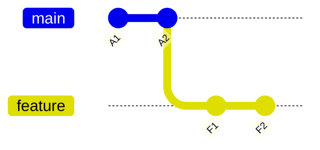
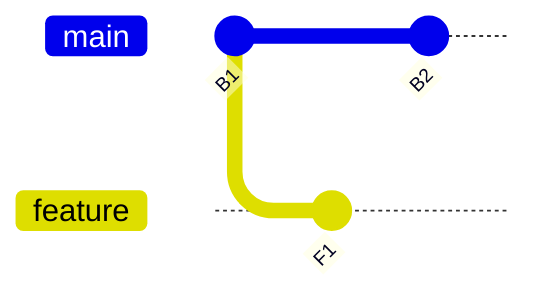
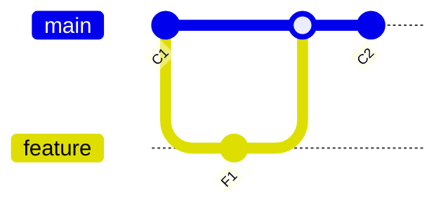
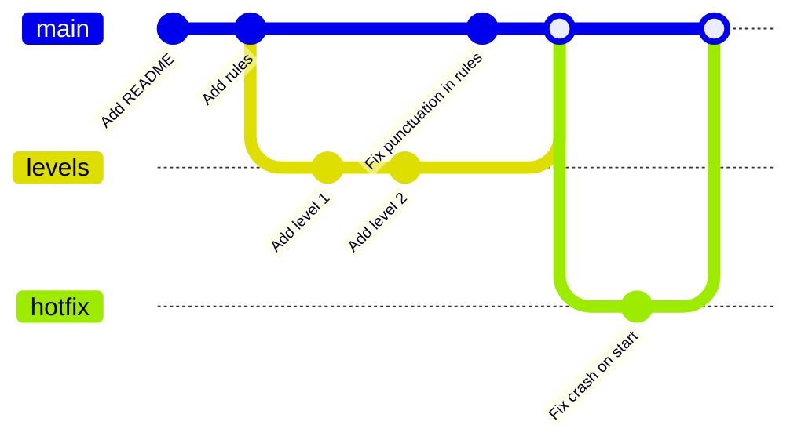

:::objectives
- Predict whether a merge will fast-forward or create a merge commit.
- Run two feature branches at once and merge both into `main`.
- Move a commit you made on `main` by mistake onto its own branch.
- Delete branches safely, write a reviewable PR description, and bring `main` into a feature branch.
:::

Work in `~/git-course/practice`, making a fresh repository for each exercise unless it says otherwise. Keep `git log --oneline --graph --all` handy: it's the fastest way to see what your branches are doing.

## Warm-up: read the labels

```text
* 6a63665 (add-scoreboard) Add an empty scoreboard
| * 6fbef63 (add-timer) Add a 20-second timer setting
|/
* 276e4be (HEAD -> main) Add first quiz question
```

Which branch are you on? How many branches have work that `main` doesn't? If you ran `git merge add-timer` right now, would it fast-forward?

:::solution
You're on `main` (that's where `HEAD ->` points). Two branches, `add-scoreboard` and `add-timer`, each have one commit that `main` doesn't. Merging `add-timer` would fast-forward, because `main` hasn't moved since either branch started.
:::

### Exercise 1: Fast-forward or merge commit?

For each picture, you're on `main` and about to run `git merge feature`. Predict the result before opening the solution.







:::hint
Ask one question: does `main` have any commits that `feature` doesn't? If not, Git can just slide `main` forward.
:::

:::solution
-   **A: fast-forward.** `main` hasn't moved since `feature` started, so `main` slides forward to `F2`. No new commit.
-   **B: merge commit.** Both sides have a new commit (`B2` and `F1`). Git creates a commit with two parents.
-   **C: nothing to do.** `feature` was already merged, and `main` has moved on. Git prints `Already up to date.` because every commit on `feature` is already in `main`.

On GitHub, the default **Merge pull request** button would make a merge commit in A too, because GitHub always records the PR.
:::

### Exercise 2: Two features at the same time

In a new `quiz-app` repository with one commit, create two branches from `main`: `add-timer` (commit a `timer.txt`) and `add-scoreboard` (commit a `scores.txt`). Make sure each branch starts from `main`, not from the other branch. Then merge both into `main` and delete them.

Before merging, predict: which merge will fast-forward, and which will make a merge commit?

:::hint
Run `git switch main` before creating the second branch, or it will start from `add-timer`. After the first merge, has `main` moved?
:::

:::solution
```bash
git switch -c add-timer
git add timer.txt
git commit -m "Add a 20-second timer setting"
git switch main
git switch -c add-scoreboard
git add scores.txt
git commit -m "Add an empty scoreboard"
git switch main
git merge add-timer
```

```text
Updating 276e4be..6fbef63
Fast-forward
 timer.txt | 1 +
 1 file changed, 1 insertion(+)
 create mode 100644 timer.txt
```

The first merge fast-forwards. But now `main` has a commit (`6fbef63`) that `add-scoreboard` doesn't, so the second one can't:

```bash
git merge add-scoreboard
git log --oneline --graph
```

```text
Merge made by the 'ort' strategy.
 scores.txt | 2 ++
 1 file changed, 2 insertions(+)
 create mode 100644 scores.txt
*   259b136 (HEAD -> main) Merge branch 'add-scoreboard'
|\
| * 6a63665 (add-scoreboard) Add an empty scoreboard
* | 6fbef63 (add-timer) Add a 20-second timer setting
|/
* 276e4be Add first quiz question
```

Finish with `git branch -d add-timer add-scoreboard`. This is exactly what happens on a team when two pull requests are open at once: whichever merges second needs a merge commit.
:::

### Exercise 3: You committed to main by mistake

In a repository connected to a remote, you meant to start a branch but forgot, and committed straight to `main`. `git status` gives it away:

```text
On branch main
Your branch is ahead of 'origin/main' by 1 commit.
  (use "git push" to publish your local commits)
```

Move that commit onto a new branch called `add-space-round`, and put `main` back where `origin/main` is. You **haven't pushed**. Don't lose the commit.

:::hint
Two steps. First, stick a new branch name on the commit you're on, so it's saved. Then move `main` back one commit with `git reset --keep HEAD~1` (`HEAD~1` means "the commit before this one").
:::

:::solution
```bash
git branch add-space-round
git reset --keep HEAD~1
git status
```

```text
On branch main
Your branch is up to date with 'origin/main'.

nothing to commit, working tree clean
```

```bash
git log --oneline --all --graph
git switch add-space-round
```

```text
* 99abc41 (add-space-round) Add a space round
* ae9e5f7 (HEAD -> main, origin/main) Add round 1
Switched to branch 'add-space-round'
```

`git branch add-space-round` creates a name pointing at your commit, so the commit is safe. `git reset --keep HEAD~1` then moves `main` back one commit. `--keep` refuses to run if it would destroy uncommitted changes, which makes it a safer choice than `--hard` for this job.

Only do this before pushing. If the commit is already on GitHub's `main`, rewriting `main` would break everyone else's copy.
:::

### Exercise 4: Delete branches without losing work

Your `quiz-app` repository has three branches:

```text
  experiment
  fix-typo
* main
```

`fix-typo` was merged into `main`. `experiment` was a rainbow theme you decided against and never merged. Use Git to *check* which branches are merged, delete both, and explain why Git treats them differently.

:::hint
`git branch --merged` and `git branch --no-merged` list branches by whether `main` already contains their commits. Try `-d` on both before reaching for anything stronger.
:::

:::solution
```bash
git branch --merged
git branch --no-merged
```

```text
  fix-typo
* main
  experiment
```

```bash
git branch -d fix-typo
git branch -d experiment
```

```text
Deleted branch fix-typo (was f5af136).
error: the branch 'experiment' is not fully merged
hint: If you are sure you want to delete it, run 'git branch -D experiment'
hint: Disable this message with "git config advice.forceDeleteBranch false"
```

`-d` is the safe delete: it only removes a branch whose commits are already in `main`, because only the name is lost. Deleting `experiment` would orphan its commit, so Git asks you to be sure. Since you really don't want the rainbow theme, force it:

```bash
git branch -D experiment
```

```text
Deleted branch experiment (was 3910049).
```

Make `-d` your habit and use `-D` only after reading that warning.
:::

### Exercise 5: Write a PR description a reviewer can use

A teammate's branch makes this change to the club website's `style.css`. Write the pull request title and description.

```diff
 body {
   font-family: sans-serif;
   max-width: 40rem;
   margin: 2rem auto;
+  font-size: 1.125rem;
+  line-height: 1.6;
 }
```

Context: two club members said the site was hard to read on their phones.

:::hint
Cover what changed, why, and how a reviewer can check it in under a minute. Skip "I changed style.css"; the diff already shows that.
:::

:::solution
One good version:

```markdown title="Pull request"
Title: Make body text larger and easier to read

## What
Increases body text to 1.125rem and line spacing to 1.6.

## Why
Two members said the site was hard to read on their phones.

## How to check it
Open index.html, then use your browser's device toolbar (or a phone)
at about 375px wide. Paragraphs should be readable without zooming.
```

The title works on its own in a list of PRs. The "how to check it" section saves the reviewer from guessing what to test.
:::

### Exercise 6: Bring main's new work into your branch

You're halfway through `add-hints` when a teammate's PR changing `timer.txt` gets merged into `main`. You want to test your hints *with* the new timer before opening your PR. Starting from this situation, update your branch:

```text
* d1e9c74 (HEAD -> main) Raise the timer to 30 seconds
| * 8281667 (add-hints) Add a hint for question 1
|/
* f5af136 Fix typo in question 1
```

:::hint
Merging works in either direction. Switch to the branch that should *receive* the commits, then merge the other one in.
:::

:::solution
```bash
git switch add-hints
git merge main
cat timer.txt
```

```text
Switched to branch 'add-hints'
Merge made by the 'ort' strategy.
 timer.txt | 2 +-
 1 file changed, 1 insertion(+), 1 deletion(-)
Seconds per question: 30
```

```bash
git log --oneline --graph -5
```

```text
*   14eb099 (HEAD -> add-hints) Merge branch 'main' into add-hints
|\
| * d1e9c74 (main) Raise the timer to 30 seconds
* | 8281667 Add a hint for question 1
|/
* f5af136 Fix typo in question 1
```

Your branch now has everything from `main` plus your hint. On a real team, run `git switch main` and `git pull` first so your `main` matches GitHub. If both sides had edited the same lines, this is where a conflict would appear, and it's better to meet it on your branch than in the middle of someone's review.
:::

### Challenge: Recreate this history exactly

Make a new `maze-game` repository whose `git log --oneline --graph` has this shape, with these messages:



One catch: the `hotfix` merge must be a **fast-forward**, so your final graph shows no second merge commit. Delete both branches at the end.

:::hint
Work in the order the commits appear. You need `main` to receive a commit while `levels` exists, then merge `levels`. Create `hotfix` *after* that merge, and don't commit to `main` before merging `hotfix`.
:::

:::solution
```bash
git init
# commit README.md, then rules.txt, on main
git switch -c levels
# commit level1.txt, then level2.txt
git switch main
# edit rules.txt and commit "Fix punctuation in rules"
git merge levels
git switch -c hotfix
# commit start.txt as "Fix crash on start"
git switch main
git merge hotfix
git branch -d levels hotfix
git log --oneline --graph
```

```text
Updating e7edaf1..0ddeb1e
Fast-forward
 start.txt | 1 +
 1 file changed, 1 insertion(+)
 create mode 100644 start.txt
Deleted branch levels (was 8113621).
Deleted branch hotfix (was 0ddeb1e).
* 0ddeb1e (HEAD -> main) Fix crash on start
*   e7edaf1 Merge branch 'levels'
|\
| * 8113621 Add level 2
| * de5f82f Add level 1
* | 4da221e Fix punctuation in rules
|/
* 287a66a Add rules
* 7326dc1 Add README
```

The diagram draws the hotfix merge as a dot, but Git fast-forwarded it, so `Fix crash on start` sits directly on top of the merge commit. That's the gap between a picture of *intent* and what Git actually records.
:::

:::video b9LTz6joMf8
If you'd rather click than type, the VS Code team shows creating, switching, renaming, and deleting branches from the status bar and Command Palette. Try Exercise 2 again this way.
:::
