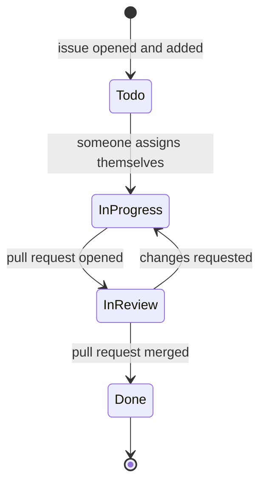

:::objectives
- Write an issue with a clear problem, steps to reproduce, and acceptance criteria.
- Sort work with labels and assignees, and track it on a GitHub project board.
- Link a pull request to an issue so merging closes it automatically.
- Review a pull request with line comments and suggested changes, and choose between Comment, Approve, and Request changes.
:::

Issue #7 on the club website said, in full: **"Fix the signup page."** Jordan picked it up and opened a pull request that made the signup button bigger and brighter. Alex glanced at it, typed "LGTM" (looks good to me), and approved it forty seconds later. It merged.

The next morning the real problem was still there: the form rejected any email address with a `+` in it, like `sam+club@example.com`, so two new members couldn't sign up. Nobody did anything lazy on purpose. The issue never said what was wrong, and the review never checked whether the change solved it. This lesson is about the two cheap habits that would have caught it: writing the problem down properly, and reviewing against it.

## An issue is a written-down problem anyone can pick up

An **issue** is a numbered page in a GitHub repository for one bug, idea, or task. It has a title, a description written in Markdown, a comment thread, and a sidebar for labels, assignees, and links. Because it's numbered, you can refer to it anywhere on GitHub as `#7`, and GitHub turns that into a link.

A good issue lets someone who wasn't in the room start work without asking you anything. Here's issue #7 rewritten:

```markdown title="Issue #7: Signup form rejects emails that contain a plus sign"
## What happens
Submitting the signup form with `sam+club@example.com` shows
"Please enter a valid email" and nothing is saved.

## Steps to reproduce
1. Open signup.html
2. Enter any name and the email `sam+club@example.com`
3. Click "Join"

## Expected
The form accepts the address and shows "Thanks for joining!"

## Done when
- [ ] Addresses with `+` are accepted
- [ ] Addresses without `@` are still rejected
- [ ] The error message still appears for invalid input
```

The parts that matter most:

-   **A title that states the problem**, not the fix. "Signup form rejects emails that contain a plus sign" beats "Fix signup".
-   **Steps to reproduce**, so anyone can see the bug for themselves. If they can't make it happen, they can't prove it's fixed.
-   **Expected versus actual**, which turns "it's broken" into something checkable.
-   **Acceptance criteria** ("Done when"): a checklist that both the author and the reviewer will use. GitHub renders `- [ ]` as clickable checkboxes.

Feature requests follow the same shape: what problem the user has, what they'd like to happen, and what "done" looks like.

## Labels and assignees sort the pile

A busy repository has dozens of open issues. **Labels** are colored tags for sorting them. Every new repository starts with a standard set, including:

| Label | Use it for |
| --- | --- |
| `bug` | Something is broken or behaving unexpectedly |
| `enhancement` | A new feature or improvement |
| `documentation` | README and docs changes |
| `good first issue` | Small, well-described tasks for newcomers |
| `help wanted` | The maintainers would welcome outside help |
| `question` | Needs more information before anyone can act |
| `duplicate`, `invalid`, `wontfix` | Reasons an issue is being closed without a change |

You can rename these or add your own from the **Labels** page in **Issues**. An **assignee** is the person doing the work; assigning yourself is how you say "I've got this" so two people don't fix the same bug.

## A project board shows who's doing what

A list of issues tells you what exists. A **project board** tells you where each piece of work stands. GitHub Projects lets you create a board, add issues and pull requests to it as cards, and drag them between columns. A new board starts with a **Status** field whose columns are **Todo**, **In Progress**, and **Done**, plus a **No Status** column for anything not yet sorted. Many teams add an **In review** column.



Boards also automate the boring part. Two built-in workflows are on by default: when an issue or pull request on the board is closed, or a pull request is merged, its card moves to **Done**.

## Link the pull request so the issue closes itself

Write a closing keyword followed by the issue number in your pull request's description:

```text
Closes #7
```

GitHub links the two pages, shows the PR in the issue's sidebar, and closes the issue the moment the PR is merged. The keywords are `close`, `closes`, `closed`, `fix`, `fixes`, `fixed`, `resolve`, `resolves`, and `resolved`, in any capitalization. Two details trip people up:

-   It only works when the pull request merges into the repository's **default branch** (usually `main`).
-   Words like "Related to #7" or "See #7" create a link but don't close anything. That's useful when a PR is only part of the fix.

:::video c67GaAkf1BE
GitHub's own episode on issues and projects. From 1:15 it shows creating an issue, and from 4:12 managing the board; the workflow demo at 6:33 ties issues, projects, and pull requests together.
:::

## Code review: read the change against the issue

A **review** is a teammate reading your pull request before it merges. On the **Files changed** tab, a reviewer can hover over any line and click the blue comment icon to comment on it. They can comment once, or click **Start a review** to collect several comments as *pending* (visible only to them) and send them together, which gives the author one notification instead of ten.

When they finish, they submit the review as one of three types:

| Review type | Means | Use it when |
| --- | --- | --- |
| **Comment** | Feedback, no verdict | You have questions, or you only looked at part of it |
| **Approve** | Ready to merge | It meets the acceptance criteria and you'd be comfortable shipping it |
| **Request changes** | Must be fixed first | Something is wrong or missing |

GitHub won't let you approve your own pull request; only someone else can do that.

What should a reviewer actually check? In order of importance:

1.  **Does it solve the issue?** Walk through the "Done when" list. This is the step Alex skipped.
2.  **Does it work?** For small projects, check out the branch and try it. For the signup bug: does `sam+club@example.com` go through now?
3.  **Did it break anything else?** Does a bad address still get rejected?
4.  **Can the next person understand it?** Clear names, no leftover test code, no secrets.

### Suggested changes

For small fixes, typing "there's a typo on line 12" makes the author find and fix it by hand. A **suggested change** does it in one click. In a line comment, the reviewer clicks the suggestion button in the comment toolbar, which inserts a block containing the current line, and edits it:

~~~markdown title="A review comment with a suggestion"
Missing the closing quote, so the link won't work.

```suggestion
  <p>Email us at <a href="mailto:robotics@example.com">robotics@example.com</a></p>
```
~~~

The author sees the old and new lines side by side with a **Commit suggestion** button. Clicking it adds a commit to the PR's branch, crediting the reviewer as co-author. With several suggestions, **Add suggestion to batch** combines them into one commit.

## Review etiquette that keeps teams friendly

Reviews go wrong more often from tone than from code. Compare:

| Unhelpful | Helpful |
| --- | --- |
| "This is wrong." | "This rejects `a+b@example.com`, which issue #7 says should work. Could the pattern allow `+`?" |
| "Why would you do it this way?" | "I'd have reached for a `<label>` here. Was there a reason for the `<span>`?" |
| "LGTM" (after reading nothing) | "Tested both addresses from the issue; both behave as described. Approving." |
| A comment on every tiny thing, all blocking | "nit: extra blank line. Not blocking." |

As a **reviewer**: comment on the code, never the person. Explain *why*, so the author learns something. Ask questions when you're unsure instead of declaring. Mark small preferences as `nit:` so the author knows they're optional, and say what you liked. Review promptly; a PR waiting three days goes stale.

As an **author**: keep pull requests small so they can be reviewed properly. Reply to every comment, even with "Done in 3f2a1c9". Click **Resolve conversation** once you've handled a comment. If you disagree, say why calmly; the reviewer might be missing context, or you might be. Then re-request a review so they know it's their turn.

## Common mistakes

:::warning
**Rubber-stamp approvals.** An approval says "I checked this and it's ready." If you only skimmed, submit a **Comment** saying what you did and didn't check. The signup bug shipped because an approval meant less than it looked.
:::

:::warning
**Applying a suggestion on GitHub, then pushing from your laptop.** **Commit suggestion** adds a commit to the branch *on GitHub*. Your local branch doesn't have it, so your next `git push` gets rejected. Run `git pull` on the branch first, then keep working.
:::

:::quiz
Q: Which issue title gives a developer the most to work with?
- [ ] "Signup broken!!"
  It says something's wrong but not what, so the first reply will be a question.
- [ ] "Fix the regex in signup.js"
  That names a solution, which might be the wrong one. Describe the problem and let the fix follow.
- [x] "Signup form rejects emails that contain a plus sign"
  It names the page, the input that fails, and the behavior, so anyone can reproduce it.

Q: Your PR description says "Related to #7". You merge it into `main`. What happens to issue #7?
- [ ] It closes automatically
  Only closing keywords such as `Closes`, `Fixes`, or `Resolves` close an issue on merge.
- [x] It stays open, with a link to the PR
  "Related to" just references the issue, which is right when the PR is only part of the fix.
- [ ] GitHub shows an error
  Mentioning an issue number is always allowed; it just creates a link.

Q: Reviewing a PR, you find that the new contact link points to a misspelled email address, so messages would bounce. Which review type fits?
- [ ] Approve, and mention the typo in a comment
  Approving tells everyone it's ready to merge, but this would ship a broken link.
- [x] Request changes, with a suggested change fixing the address
  It's a real defect, so it should block the merge, and a suggestion makes the fix one click.
- [ ] Comment "nit: typo"
  "nit" signals something optional. A link that doesn't work isn't optional.

Q: A reviewer writes "nit: I'd put the footer styles at the end of the file." What are they telling you?
- [x] It's a minor preference, and the PR can merge without it
  "nit" (short for nitpick) marks small, non-blocking comments.
- [ ] The PR can't merge until you move the styles
  That would be a blocking comment, usually sent with **Request changes**.
- [ ] They found a bug in the footer
  A bug would be described as a problem, not a preference.
:::

:::takeaways
- A good issue has a problem-stating title, steps to reproduce, expected versus actual behavior, and a "Done when" checklist.
- Labels sort issues, assignees claim them, and a project board shows each one's status.
- `Closes #7` in a PR description closes the issue when the PR merges into the default branch.
- Review against the issue first: does it solve the problem, does it work, did it break anything?
- Use suggested changes for small fixes, mark optional comments as `nit:`, and always explain why.
:::

## Further reading

-   [GitHub Docs: Linking a pull request to an issue](https://docs.github.com/en/issues/tracking-your-work-with-issues/using-issues/linking-a-pull-request-to-an-issue): every closing keyword and the default-branch rule.
-   [Google Engineering Practices: How to do a code review](https://google.github.io/eng-practices/review/reviewer/): Google's public guide for reviewers, short and practical.
-   [GitHub Docs: Quickstart for Projects](https://docs.github.com/en/issues/planning-and-tracking-with-projects/learning-about-projects/quickstart-for-projects): set up a board with views, fields, and automations.
