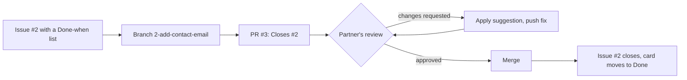

:::objectives
- Write an issue with acceptance criteria, label it, assign it, and track it on a project board.
- Name a branch after its issue and link the pull request with `Closes #2`.
- Review a partner's pull request with a suggested change and a **Request changes** review.
- Respond to feedback: apply a suggestion, pull it locally, push a fix, resolve conversations, and merge.
:::

Last module, you merged a pull request that only you had read. Real projects add two things around that: a written plan before the work starts, and a second person checking the work against the plan. In this build you'll run one complete cycle on `club-site` with a partner, where one of you is the author and the other reviews. Then swap roles and do it again on the other person's repository.



The examples use Sam as the author and Priya as the reviewer.

## Step 1: Invite your partner

Your partner needs access to your repository before GitHub will let you request their review. On your `club-site` repository, open **Settings**, click **Collaborators** in the **Access** section, then **Add people**, and search for your partner's username. They accept the invitation from their email or notifications.

:::note
Working alone? Do every step yourself except approving. GitHub doesn't allow authors to approve their own pull requests, but you can still leave line comments on your own PR and submit them as a **Comment** review. Reading your own diff as a stranger would is a skill worth practicing anyway.
:::

## Step 2: Write the issue

New members have no way to reach the club between meetings. On GitHub, open **Issues**, click **New issue**, and write:

```markdown title="Issue: Add a way for new members to contact the club"
## What's missing
Someone who finds the site has no way to ask a question
except turning up at a meeting.

## Proposal
Show the club email, robotics@example.com, as a link that
opens the visitor's email app.

## Done when
- [ ] The home page shows the email as a clickable link
- [ ] The events page shows it too
- [ ] The address is spelled correctly everywhere it appears
```

Before submitting, use the sidebar: click **Labels** and pick `enhancement` and `good first issue`, then click **Assignees** and assign yourself. Click **Submit new issue**. GitHub numbers it **#2**, because pull request #1 already used the first number; issues and pull requests share one numbering sequence.

The "Done when" list is the most important part. In Step 6 your reviewer will check the work against it, item by item.

## Step 3: Track it on a project board

1.  Click your profile picture, then **Your profile**, then the **Projects** tab, and **New project**.
2.  Under **Start from scratch**, choose **Board**, name it `Club website`, and click **Create project**.
3.  Back on issue #2, click **Projects** in the sidebar and choose **Club website**.

The issue appears as a card. When you start working, drag it to **In Progress** so your partner can see it's claimed. You won't need to move it to **Done**: the board's built-in workflow does that when the pull request merges.

## Step 4: Branch, build, commit

Always start from an up-to-date `main`:

```bash
git switch main
git pull
git switch -c 2-add-contact-email
```

```text
Already on 'main'
Your branch is up to date with 'origin/main'.
Already up to date.
Switched to a new branch '2-add-contact-email'
```

Starting the branch name with the issue number is a common convention; anyone listing branches can find the issue behind each one. (The issue's sidebar also has a **Create a branch** link under **Development** that does this for you on GitHub.)

Add the contact line to `index.html` under the events link. This version has a typo in it on purpose; leave it in so your reviewer has something real to catch:

```bash
git diff
```

```diff
@@ -10,5 +10,6 @@
   <p>We build robots after school. Everyone is welcome.</p>
   <p>Meetings: Thursdays, 3:30 pm, Room 214.</p>
   <p><a href="events.html">Upcoming events</a></p>
+  <p>Questions? Email <a href="mailto:robtics@example.com">robtics@example.com</a>.</p>
 </body>
 </html>
```

```bash
git add index.html
git commit -m "Add contact email to the home page"
git push -u origin 2-add-contact-email
```

```text
[2-add-contact-email 2c549fe] Add contact email to the home page
 1 file changed, 1 insertion(+)
```

The push output looks like Module 3's, ending with GitHub's link to open a pull request.

## Step 5: Open the pull request and ask for a review

Click **Compare & pull request**. Title it `Add the club's contact email`, and in the description, link the issue:

```markdown title="Pull request description"
Closes #2

## What
Adds the club email as a mailto link on the home page.

## How to check it
Open index.html and click the email link; your email app should open.
```

Click **Create pull request**. It becomes **#3**. In the sidebar, click **Reviewers** and choose your partner. Check the issue page: under **Development**, it now lists PR #3.

Notice that this PR doesn't do everything the issue asked for yet. That's realistic, and it's exactly what review is for.

## Step 6: Review your partner's pull request

Switch roles. As the reviewer, open the PR from your notifications or the repository's **Pull requests** tab. Read the description and the linked issue first, so you know what "done" means. Then open **Files changed**.

**A suggested change for the typo.** Hover over the new line in `index.html` and click the blue comment icon. Click the suggestion button in the comment toolbar; it inserts the current line inside a `suggestion` block. Fix both misspellings in that block and add a sentence explaining why:

~~~markdown title="Review comment on index.html"
The address is missing an "o", so emails would bounce.

```suggestion
  <p>Questions? Email <a href="mailto:robotics@example.com">robotics@example.com</a>.</p>
```
~~~

Click **Start a review**. The comment is now *pending*, visible only to you.

**A comment about the missing requirement.** The issue's second checkbox says the events page should show the email, and `events.html` isn't in this PR at all. That can't be a line comment on a file that didn't change, so save it for the summary.

**Submit.** Click **Review changes** (in GitHub's newer layout the button reads **Submit review**), write a summary, choose **Request changes**, and submit:

```text
Thanks for picking this up! Two things before it merges:
1. The email is misspelled (suggestion attached).
2. Issue #2 also asks for the email on the events page.
The link itself works nicely; it opened my mail app straight away.
```

The summary says exactly what's blocking, points back to the issue, and mentions what worked.

:::video lSnbOtw4izI
CoderDave contrasts a careless review with a careful one. Watch for the difference between **Add single comment** and **Start a review**, and how he finishes with one summary.
:::

## Step 7: Respond to the review

Switch back to the author. Open the PR and find the suggestion. Click **Commit suggestion**, replace GitHub's generic message with `Fix spelling of the club email`, and confirm. GitHub adds that commit to your branch and credits your partner as co-author.

That commit exists only on GitHub. Pull it before doing anything else on your laptop:

```bash
git pull
git log --oneline -3
```

```text
From github.com:samrivera/club-site
   2c549fe..a3b3c25  2-add-contact-email -> origin/2-add-contact-email
Updating 2c549fe..a3b3c25
Fast-forward
 index.html | 2 +-
 1 file changed, 1 insertion(+), 1 deletion(-)
a3b3c25 (HEAD -> 2-add-contact-email, origin/2-add-contact-email) Fix spelling of the club email
2c549fe Add contact email to the home page
45536d4 (origin/main, main) Merge pull request #1 from samrivera/add-events-page
```

The commit message carries the credit as a *trailer*, a line GitHub reads to show both people's pictures on the commit:

```bash
git log -1 --format=%B
```

```text
Fix spelling of the club email

Co-authored-by: Priya Shah <87654321+priya-shah@users.noreply.github.com>
```

Now handle the second point. Add the same line to `events.html`, above the "Back to home" link:

```diff
@@ -12,6 +12,7 @@
     <li>Nov 7: Regional robot competition</li>
     <li>Dec 5: Demo day for families</li>
   </ul>
+  <p>Questions? Email <a href="mailto:robotics@example.com">robotics@example.com</a>.</p>
   <p><a href="index.html">Back to home</a></p>
 </body>
 </html>
```

```bash
git add events.html
git commit -m "Show the contact email on the events page too"
git push
```

```text
[2-add-contact-email 8e79849] Show the contact email on the events page too
 1 file changed, 1 insertion(+)
```

:::warning
If you skip the `git pull` and push anyway, Git refuses with a `[rejected]` message and a hint to pull first, because GitHub's branch has a commit yours doesn't. That's Git protecting the reviewer's suggestion, not an error in your work. Run `git pull`, then push again.
:::

On the PR's **Conversation** tab, reply to the review: "Fixed the typo with your suggestion, and added the email to events.html in 8e79849." Click **Resolve conversation** on the suggestion thread. Then, next to your partner's name under **Reviewers**, click the re-request icon so they know it's their turn.

## Step 8: Approve, merge, and watch the issue close

As the reviewer, walk through the "Done when" list once more: home page link, events page link, spelling. All three pass, so submit a review with **Approve** and a short note on what you checked.

As the author, click **Merge pull request**, **Confirm merge**, and **Delete branch**. Now look around:

-   Issue #2 shows **Closed**, with a note that PR #3 closed it.
-   On the **Club website** board, the card has moved to **Done** by itself.

## Step 9: Sync your laptop

```bash
git switch main
git pull
git branch -d 2-add-contact-email
git fetch --prune
git log --oneline --graph -5
```

```text
Switched to branch 'main'
Your branch is up to date with 'origin/main'.
From github.com:samrivera/club-site
   45536d4..e099daf  main       -> origin/main
Updating 45536d4..e099daf
Fast-forward
 events.html | 1 +
 index.html  | 1 +
 2 files changed, 2 insertions(+)
Deleted branch 2-add-contact-email (was 8e79849).
From github.com:samrivera/club-site
 - [deleted]         (none)     -> origin/2-add-contact-email
*   e099daf (HEAD -> main, origin/main) Merge pull request #3 from samrivera/2-add-contact-email
|\
| * 8e79849 Show the contact email on the events page too
| * a3b3c25 Fix spelling of the club email
| * 2c549fe Add contact email to the home page
|/
*   45536d4 Merge pull request #1 from samrivera/add-events-page
```

Three commits tell the honest story: the first attempt, the reviewer's fix, and the missing requirement. Now swap roles and repeat the cycle on your partner's repository.

:::quiz
Q: Why did the reviewer leave the "missing events page" point in the review summary rather than as a line comment?
- [ ] Line comments can't mention issues
  They can; `#2` links from any comment.
- [x] `events.html` wasn't changed in the PR, so there was no line in the diff to attach it to
  Line comments attach to lines in **Files changed**. Feedback about something missing belongs in the summary.
- [ ] GitHub only allows one line comment per review
  A review can hold any number of line comments.

Q: After clicking **Commit suggestion** on GitHub, why must the author run `git pull` before pushing again?
- [x] The suggestion created a commit on GitHub's copy of the branch that the laptop doesn't have yet
  Pushing without it would be rejected; pulling first fast-forwards the local branch.
- [ ] Suggestions are stored in a separate branch
  The commit lands on the PR's own branch.
- [ ] `git pull` is needed to close the issue
  The issue closes when the PR merges; pulling only updates your laptop.

Q: The PR description says `Closes #2`, but suppose the PR had targeted a branch called `dev` instead of `main`. What happens when it merges?
- [ ] The issue closes as usual
  Closing keywords only act when a PR merges into the repository's default branch.
- [x] The issue stays open, because keywords are ignored for non-default branches
  You'd close it by hand, or when `dev` is later merged into `main` by a PR that says `Closes #2`.
- [ ] GitHub refuses to merge the PR
  The merge works fine; only the automatic closing is skipped.
:::

:::takeaways
- Put acceptance criteria in the issue; the reviewer checks against them, which catches requirements the author missed.
- Name branches after issues and put `Closes #N` in the PR description so merging closes the issue and updates the board.
- Batch comments with **Start a review**, use suggested changes for small fixes, and put "something's missing" points in the summary.
- After committing a suggestion on GitHub, `git pull` before you push.
- Reply to every comment, resolve handled conversations, and re-request review when it's the reviewer's turn.
:::

## Extend it

-   Add a pull request template so every PR starts with the right headings: create `.github/pull_request_template.md` containing `Closes #`, `## What`, and `## How to check it`, and merge it through a PR. Open another PR and watch the description fill itself in.
-   Add an issue template at `.github/ISSUE_TEMPLATE/feature.md` with front matter (`name`, `about`, `labels`) and a body containing the three headings from Step 2.
-   Add an **In review** column to the board, and move cards there when a PR is opened.

## Further reading

-   [GitHub Docs: Reviewing proposed changes in a pull request](https://docs.github.com/en/pull-requests/collaborating-with-pull-requests/reviewing-changes-in-pull-requests/reviewing-proposed-changes-in-a-pull-request): line comments, pending reviews, and the three review types.
-   [GitHub Docs: Incorporating feedback in your pull request](https://docs.github.com/en/pull-requests/collaborating-with-pull-requests/reviewing-changes-in-pull-requests/incorporating-feedback-in-your-pull-request): committing and batching suggestions, and re-requesting review.
-   [GitHub Docs: Using the built-in automations](https://docs.github.com/en/issues/planning-and-tracking-with-projects/automating-your-project/using-the-built-in-automations): the board workflows that moved your card to Done.
