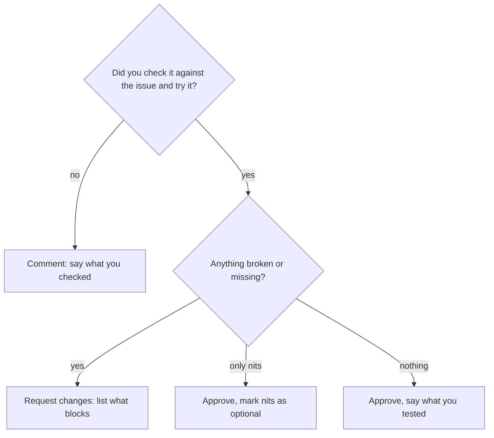

:::objectives
- Turn vague requests into issues with steps to reproduce and a "Done when" list.
- Split oversized tasks into issues that each fit in one pull request.
- Predict which pull request descriptions will close an issue on merge.
- Review a diff against its issue, write kind and specific comments, and reply to feedback as an author.
:::

Most of these exercises are writing, not commands, because that's what planning and review mostly are. Write your answers in a scratch file, or better, try them for real in your `club-site` repository's issues and pull requests. Compare with the solutions afterward; many good answers are possible.

## Warm-up: pick the labels

Using GitHub's default labels, label each issue. Some need two.

1.  "The 'Back to home' link on events.html goes to a 404 page."
2.  "Could we add a photo gallery of past robots?"
3.  "README doesn't say how to preview the site."
4.  "Is the club open to 6th graders?"

:::solution
1.  `bug`: something that should work doesn't.
2.  `enhancement`: a new feature. If it's simple and well described, add `good first issue` too.
3.  `documentation`, and probably `good first issue`, since it's a small, low-risk change.
4.  `question`. It isn't a code change at all, so it might be answered and closed, or moved to wherever the club handles questions.
:::

### Exercise 1: Rewrite a vague bug report

A club member files this:

```text
Title: events page broken on phones
Body: it looks bad
```

Rewrite it as an issue a teammate could fix without asking any questions. You discover by testing that on a 375px-wide screen, the longest event line runs off the right edge and the page scrolls sideways.

:::hint
Use the four parts from the Notes: a title that states the problem, steps to reproduce, expected versus actual, and a "Done when" checklist. Include the screen width, since that's what makes it reproducible.
:::

:::solution
```markdown title="Issue: Events page scrolls sideways on narrow phone screens"
## What happens
On a 375px-wide screen, "Nov 7: Regional robot competition"
runs past the right edge and the whole page scrolls sideways.

## Steps to reproduce
1. Open events.html in Chrome
2. Open DevTools and turn on the device toolbar
3. Choose a 375px-wide phone, such as iPhone SE

## Expected
Long lines wrap; no sideways scrolling.

## Done when
- [ ] No sideways scrolling at 375px on events.html
- [ ] index.html still looks the same on a laptop
```

The title now says *where* and *what*. Anyone can see the bug in under a minute, and the reviewer knows exactly what to check.
:::

### Exercise 2: Split an issue that's too big

The club president opens one issue: **"Redesign the website."** It has twelve bullet points, from a new color scheme to a members-only login. Explain why one issue is a problem here, and split it into four smaller issues with good titles, choosing the parts you'd do first.

:::hint
Think about the pull request that would close the big issue. How long would a review of it take? What happens if one part is controversial and the rest isn't?
:::

:::solution
One giant issue becomes one giant pull request: hard to review properly, impossible to merge piece by piece, and blocked entirely if one part (say, the login) needs a long discussion. Smaller issues can be assigned to different people and finished in parallel.

A good split, each about one PR:

-   `Pick a club color palette and apply it in style.css`
-   `Add a shared navigation bar to the home and events pages`
-   `Make all pages readable on 375px-wide screens`
-   `Add a photo gallery page`

The login idea becomes a `question` issue first ("Do we need members-only pages?"), because it needs a decision before anyone writes code. You can keep the original issue open as a checklist that links to the small ones, then close it when they're done.
:::

### Exercise 3: Will it close the issue?

Issue #12 is open. The repository's default branch is `main`. For each merged pull request below, does #12 close automatically?

| PR | Targets | Description contains |
| --- | --- | --- |
| A | `main` | `Fixes #12` |
| B | `main` | `RESOLVES: #12` |
| C | `main` | `Related to #12` |
| D | `dev` | `Closes #12` |
| E | `main` | `Closes #11, #12` |

:::hint
Two rules from the Notes: the keyword must come right before each issue number, and the PR must merge into the default branch. Keywords can be any capitalization and can have a colon.
:::

:::solution
-   **A: closes.** A keyword, then the issue, into `main`.
-   **B: closes.** Capital letters and a colon are both allowed.
-   **C: doesn't close.** "Related to" creates a link but isn't a closing keyword. Right for a PR that's only part of the work.
-   **D: doesn't close.** Keywords are ignored when a PR targets a branch other than the default.
-   **E: closes #11 only.** Each issue needs its own keyword: `Closes #11, closes #12`.
:::

### Exercise 4: Rewrite harsh review comments

Rewrite each comment so it's specific, explains why, and treats the author as a teammate. Keep the technical point.

```text
1. "Wrong. Did you even test this?"
2. "Ugh, inline styles everywhere."
3. "Why didn't you just use a list?"
```

The context: (1) the new "Join" link points to `join.htm` but the file is `join.html`; (2) the PR adds `style="color: blue"` to five paragraphs; (3) the events are written as separate `<p>` tags.

:::hint
A useful shape is: what you noticed, why it matters, and what you'd suggest (as a question if you're unsure). Mark optional preferences as `nit:`.
:::

:::solution
1.  "The Join link points to `join.htm`, but the file is `join.html`, so it 404s for me. Suggestion attached." Then attach a suggested change with the fixed line. This is blocking.
2.  "These five paragraphs each set `style="color: blue"`. Could we move that into one rule in `style.css`? Then changing the color later is a one-line edit." Probably not blocking, but worth fixing in this PR.
3.  "nit: a `<ul>` might be a nice fit for the events, since screen readers announce how many items a list has. Fine to leave as-is if you'd rather." Optional, and it says so.

All three keep the point and lose the sting. Notice that none of them uses "you" as the subject of a criticism; they describe the code.
:::

### Exercise 5: Review a pull request against its issue

Here's issue #9 and the pull request meant to close it. Find every problem, decide which ones block merging, and write the review: a summary, the review type, and at least one suggested change.

```markdown title="Issue #9: Footer still says 2025"
## Done when
- [ ] Footer says 2026 on the home page
- [ ] Footer says 2026 on the events page
- [ ] Footer text is gray, to match the design
```

```diff
diff --git a/index.html b/index.html
@@ -14,5 +14,5 @@
-  <footer>© 2025 Robotics Club</footer>
+  <footer class="footer">© 2026 Robotics Club</footer>
 </body>
 </html>
diff --git a/style.css b/style.css
@@ -9,3 +9,8 @@
 h1 {
   color: #1d4ed8;
 }
+
+.footer {
+  colour: gray;
+}
+
```

:::hint
Walk the "Done when" list line by line, then read every changed line. Which file isn't in the diff at all? And is `colour` a CSS property? (Browsers quietly ignore properties they don't recognize.)
:::

:::solution
Three findings:

1.  **Blocking: the events page isn't updated.** `events.html` doesn't appear in the diff, so the second checkbox fails.
2.  **Blocking: `colour` isn't a CSS property.** CSS uses the American spelling, `color`. The browser silently ignores the rule, so the footer won't be gray and the third checkbox fails.
3.  **Not blocking: an extra blank line** at the end of `style.css`.

Line comment on `colour: gray;`:

~~~markdown title="Review comment on style.css"
CSS only recognizes the spelling `color`, so this line is ignored
and the footer stays black.

```suggestion
  color: gray;
```
~~~

Review summary, submitted as **Request changes**:

```text
Thanks! The home page year is right. Two things before merging:
1. Issue #9 also needs the events page footer updated; events.html
   isn't in this PR yet.
2. `colour` is ignored by browsers (suggestion attached).
nit: there's an extra blank line at the end of style.css. Not blocking.
```

The first problem is the kind a quick skim misses, because nothing in the diff looks *wrong*. You only catch it by checking the issue.
:::

### Exercise 6: Answer a review as the author

You opened a PR adding a gallery page. Your reviewer left three comments. Write a reply to each.

```text
A. "The image of Robot 3 has no alt text, so screen reader users
    won't know what it shows."
B. "nit: I'd name the file robots.html instead of gallery.html."
C. "Could we load the images from the club's Google Drive
    instead of committing them?"
```

You agree with A. You'd rather keep the name in B because the issue calls it "gallery". For C, you know Drive links for that folder require a sign-in, so visitors couldn't see the images.

:::hint
Every comment deserves a reply, even when you don't change anything. When you disagree, give the reason so the reviewer can weigh it. Point to the commit when you've made a fix.
:::

:::solution
-   **A:** "Good catch, thanks. Added alt text for all three robots in 4d1e0b2." Then click **Resolve conversation**.
-   **B:** "I'd like to keep `gallery.html` to match the wording in issue #14 and the nav link. Happy to rename if you feel strongly." A nit is optional, so declining politely is fine.
-   **C:** "I looked into that, but the Drive folder needs a sign-in, so visitors would see broken images. The three photos are under 200 KB each, so committing them seemed safer. Does that work for you?" A respectful disagreement with a reason and a question back.

Then re-request review so the reviewer knows it's their turn.
:::

### Challenge: Build an issue template

Every bug report in `club-site` keeps arriving without steps to reproduce. Create a Markdown issue template so that **New issue** offers a "Bug report" option with your headings already filled in and the `bug` label applied automatically. Then merge it through a pull request and try it.

:::hint
Templates live in `.github/ISSUE_TEMPLATE/` on the default branch, so they only appear after the PR merges. A Markdown template starts with YAML front matter between `---` lines; the keys GitHub reads include `name`, `about`, `title`, `labels`, and `assignees`.
:::

:::solution
```markdown title=".github/ISSUE_TEMPLATE/bug_report.md"
---
name: Bug report
about: Something on the site isn't working
title: ''
labels: bug
assignees: ''
---

## What happens

## Steps to reproduce
1.
2.
3.

## Expected

## Done when
- [ ]
```

```bash
git switch -c add-bug-template
mkdir -p .github/ISSUE_TEMPLATE
# create bug_report.md with the content above, then:
git add .github/ISSUE_TEMPLATE/bug_report.md
git commit -m "Add a bug report issue template"
git push -u origin add-bug-template
```

Open and merge the PR. Now **New issue** shows a chooser with **Bug report**, and picking it pre-fills the body and adds the `bug` label. GitHub sorts templates alphabetically; prefix file names with numbers (`1-bug.md`, `2-feature.md`) to control the order.
:::


