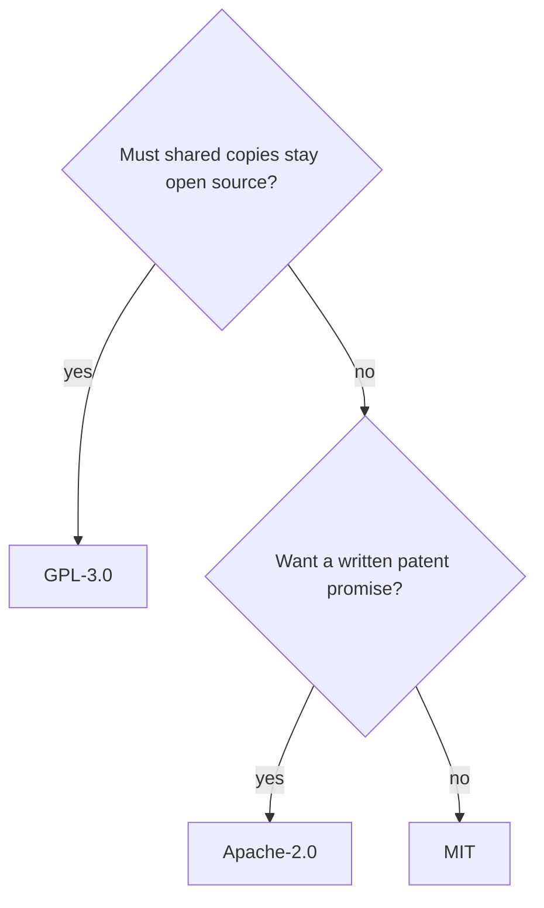
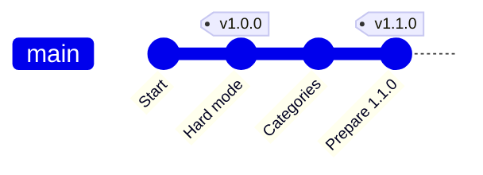

:::objectives
- Explain what others may do with a public repo that has no license.
- Compare MIT, Apache-2.0, and GPL-3.0, and know when a Creative Commons license fits instead.
- Decide whether a change is a major, minor, or patch release.
- Mark a release with an annotated Git tag and turn it into a GitHub Release.
:::

You find a public repo with exactly the countdown timer Quiz Night needs. There's no LICENSE file. Can you copy the code into your project?

Legally, no. Without a license, normal copyright applies: the author keeps every right, and nobody may copy, change, or share the work. GitHub's terms let other users view and fork a public repo on GitHub, and that's all. Being public is not the same as being open source. One file, `LICENSE`, is the difference.

:::note
This lesson explains licenses in everyday words so you can make sensible choices for school and hobby projects. It isn't legal advice. If money, a company, or a school's rules are involved, ask someone who can give it.
:::

## What a license actually does

A license is the author saying in advance: "You may do these things with my work, as long as you follow these conditions." Without it, every person who wants to reuse your code would have to ask you and get an answer. With it, they already know the answer.

Open-source licenses all allow using, studying, changing, and sharing. They differ mostly in their **conditions**: what you must do in return.

## Three software licenses in plain words

| | MIT | Apache-2.0 | GPL-3.0 |
| --- | --- | --- | --- |
| Use, change, share, even sell | Yes | Yes | Yes |
| Must keep the copyright and license notice | Yes | Yes | Yes |
| Must mark files you changed | No | Yes | Yes |
| Contributors grant patent rights in writing | No | Yes | Yes |
| Shared modified versions must stay open, under the same license | No | No | Yes |

**MIT** is the short one, about 170 words. Do nearly anything, keep the notice, and don't sue the author if it breaks. It is the most common license on GitHub because it asks so little.

**Apache-2.0** allows the same freedoms with more paperwork. Its big addition is an explicit patent grant: everyone who contributes gives users permission to use any of their patents that the contribution needs. Companies often prefer it for that reason.

**GPL-3.0** is *copyleft*. Anyone can use and change the code, but if you **distribute** a modified version, or a program that includes GPL code, you must share its complete source under the GPL too. Changes you keep to yourself carry no obligation. The point is that improvements stay open for everyone.



## Licenses for things that aren't code

Quiz Night also has a question bank, artwork, and documentation. Creative Commons licenses are written for that kind of work:

- **CC BY 4.0**: anyone may reuse it if they credit you.
- **CC BY-SA 4.0**: credit you, and share their adapted versions under the same license.
- **CC0**: you give up your rights as far as the law allows. No conditions at all.

Creative Commons itself recommends **against** using its licenses for software, because they say nothing about source code or patents. A project can mix: code under MIT, `questions/` under CC BY 4.0. Say which is which in the README. Variants with NC (non-commercial) or ND (no derivatives) are valid licenses, but they aren't open source, since they forbid uses open source allows.

## Picking one with choosealicense.com

GitHub runs [choosealicense.com](https://choosealicense.com/), which asks what you care about and shows each license's permissions, conditions, and limitations side by side. Its page for MIT tells you exactly what to do: create a file named `LICENSE`, paste the text, and replace `[year]` and `[fullname]`.

On GitHub you can do the same without leaving the browser: **Add file › Create new file**, type `LICENSE` as the name, click **Choose a license template**, pick one, and click **Review and submit**. Once GitHub detects the file, the license name appears in the repo's sidebar.

## Version numbers that mean something

A release name like "Quiz Night, the good one" tells users nothing. **Semantic versioning** (semver) uses three numbers, `MAJOR.MINOR.PATCH`, and each one has a job:

- **PATCH** (1.0.0 → 1.0.1): a bug fix that changes nothing anyone relies on.
- **MINOR** (1.0.1 → 1.1.0): something new that doesn't break what already worked.
- **MAJOR** (1.1.0 → 2.0.0): a change that can break things for existing users.

Bumping a number resets everything to its right, so the minor release after 1.4.7 is 1.5.0, not 1.5.7. Versions starting with 0, like 0.3.0, mean "still in early development; anything may change." Releasing 1.0.0 is a promise that you'll follow the rules from now on.

What counts as "breaking" depends on what users rely on. For Quiz Night, players and club leaders rely on the format of `settings.json`. Adding a `categories` list is minor, because old settings files still work. Renaming `time_limit_seconds` is major, because every existing settings file stops working.

Version numbers look like decimals, but they aren't, and comparing them as text gives wrong answers. Predict what each line prints, then run it:

```python run title="versions.py"
versions = ["1.9.0", "1.10.0", "1.2.3"]
print(sorted(versions))
print("1.10.0" > "1.9.0")


def parse(version):
    return tuple(int(part) for part in version.split("."))


print(sorted(versions, key=parse))
print(parse("1.10.0") > parse("1.9.0"))
```

Text comparison goes character by character, and `"1"` comes before `"9"`, so `"1.10.0"` sorts first. Turning each part into a number compares 10 with 9 as numbers.

## Tags mark the commit, releases tell the story

A **tag** is a permanent name for one commit. Unlike a branch, it never moves. Releases use **annotated** tags, which store who made them, when, and a message:

```bash
git tag -a v1.0.0 -m "Quiz Night 1.0.0"
git push origin v1.0.0
```

The `v` is a common habit, not part of semver itself. Note the second line: `git push` on its own doesn't send tags, so you push each one by name.



A **GitHub Release** is built on a tag. It adds a title, release notes, and download links. GitHub attaches the source code as `.zip` and `.tar.gz` files automatically, and a **Generate release notes** button drafts notes from the merged pull requests. The next lesson walks through creating one.

:::warning
**Mistakes that cause real trouble.**
1. Publishing without a license and assuming people may reuse your work. They may not.
2. Switching licenses later and expecting it to apply backward. People who already got a copy under the old license keep those rights, and once others have contributed, changing usually needs their agreement too.
3. Tagging, then forgetting `git push origin v1.0.0`. The tag exists only on your computer, and GitHub has nothing to build a release from.
:::

:::video UMIG4KnM8xw start=1:31
What to watch for: the GPL section first, then MIT and Apache. For each one, listen for the answer to "what must I do if I share a modified version?" The Creative Commons part at 9:06 matches the section above on licenses for things that aren't code.
:::

:::quiz
Q: A public GitHub repo has no LICENSE file. What may you do with its code?
- [ ] Anything, since it's public
  Public means visible. Without a license, copyright keeps every right with the author.
- [x] View it and fork it on GitHub, but not reuse it in your own project
  GitHub's terms allow viewing and forking; reuse needs the author's permission.
- [ ] Use it if you credit the author
  Credit is a condition some licenses add. With no license, there is no permission to attach it to.

Q: Quiz Night 1.4.2 adds a "music" category. Old settings files still work. What's the next version?
- [ ] 1.4.3
  Patch is for fixes. A new feature is more than a fix.
- [x] 1.5.0
  New, non-breaking functionality bumps minor and resets patch to 0.
- [ ] 2.0.0
  Nothing broke, so a major bump would wrongly warn users.

Q: You want anyone who shares an improved version of your app to share its source too. Which license matches?
- [ ] MIT
  MIT lets people share modified versions without their source.
- [ ] Apache-2.0
  Apache-2.0 adds a patent grant, but modified versions can still be closed.
- [x] GPL-3.0
  Its copyleft condition requires distributed modified versions to stay open under the GPL.

Q: You ran `git tag -a v1.1.0 -m "Quiz Night 1.1.0"` and then `git push`. GitHub's release page doesn't list `v1.1.0`. Why?
- [x] `git push` doesn't send tags unless you name them
  Run `git push origin v1.1.0` to send it.
- [ ] Annotated tags can't be pushed
  They can, and they are the recommended kind for releases.
- [ ] GitHub needs a `release` branch first
  Releases are built from tags, not from a special branch.
:::

:::takeaways
- No license means all rights reserved, even on a public repo.
- MIT asks for the notice, Apache-2.0 adds a patent grant and change notes, GPL-3.0 keeps shared modified versions open.
- Use Creative Commons for writing, images, and data; use a software license for code.
- MAJOR breaks things, MINOR adds things, PATCH fixes things, and bumping one resets the numbers to its right.
- Releases get annotated tags, pushed by name, and GitHub Releases add notes and downloads on top.
:::

## Further reading

- [choosealicense.com: Licenses](https://choosealicense.com/licenses/): every common license with a color-coded list of permissions, conditions, and limitations.
- [Semantic Versioning 2.0.0](https://semver.org/): the full rules, plus an FAQ that answers "what if I release a breaking change by accident?"
- [Pro Git: Tagging](https://git-scm.com/book/en/v2/Git-Basics-Tagging): annotated versus lightweight tags, tagging old commits, and sharing tags.
