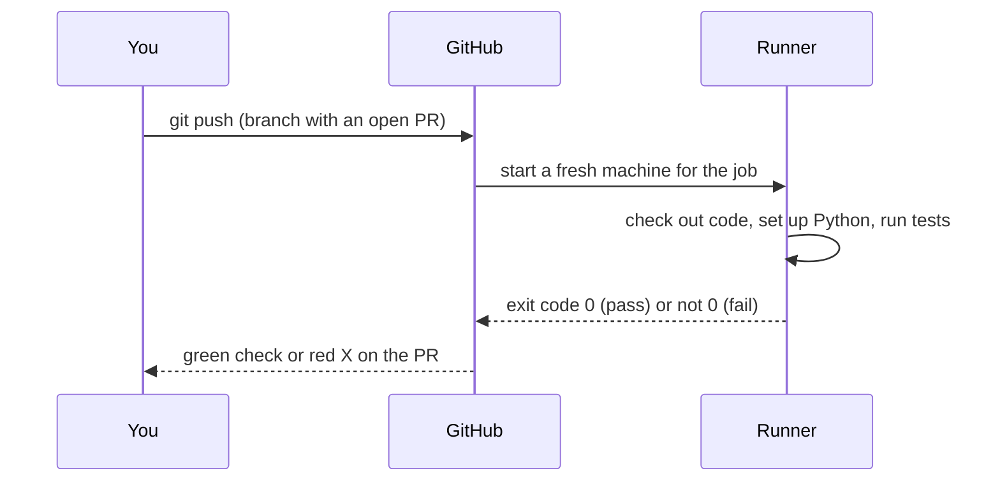

:::objectives
- Read a GitHub Actions workflow and say when it runs and what it does.
- Explain how a failing command becomes a red X on a pull request.
- Use branch protection so `main` only accepts reviewed, passing changes.
- Contribute to someone else's project through a fork, an `upstream` remote, and its CONTRIBUTING guide.
- Keep secrets out of Git, and know what to do first if one leaks.
:::

In one month, Quiz Night's `main` branch broke three times: a missing comma after a merge, a hard mode slower than normal mode, and a renamed setting that merged cleanly but broke the game. Players found each bug on Friday night. A program that runs the tests on every pull request, before anyone clicks **Merge**, would have caught all three in under a minute.

That program is a **GitHub Actions workflow**, and it's one YAML file.

## What a workflow is

A workflow is a file in your repo's `.github/workflows/` folder. It says three things:

- **When** to run: on events such as a push or a pull request.
- **Where** to run: on a *runner*, a fresh virtual computer GitHub starts for each run and throws away afterward.
- **What** to run: a list of *steps*, in order, inside a *job*.

If any step's command fails, the job fails, and GitHub shows a red X next to the commit and on the pull request. If every step succeeds, you get a green check.



GitHub's standard runners are free for public repositories.

## A workflow, line by line

Here is the workflow you'll add to Quiz Night in the next lesson:

```yaml title=".github/workflows/tests.yml"
name: Tests

on:
  push:
    branches: [main]
  pull_request:

jobs:
  unittest:
    runs-on: ubuntu-latest
    steps:
      - name: Check out the code
        uses: actions/checkout@v7

      - name: Set up Python
        uses: actions/setup-python@v7
        with:
          python-version: "3.13"

      - name: Run the tests
        run: python -m unittest -v
```

- `name: Tests` is how the workflow appears in the **Actions** tab.
- `on:` lists the triggers: every push to `main`, and every pull request (including each new push to one).
- `jobs:` holds one job with the id `unittest`. That id becomes part of the check's name on pull requests.
- `runs-on: ubuntu-latest` asks for a Linux runner.
- Each `-` under `steps:` is one step. A step either **uses** a ready-made action or **runs** a shell command.
- `actions/checkout` copies your repo onto the runner, which starts empty. Forget it and the next steps find no files.
- `actions/setup-python` installs the Python version you name under `with:`.
- `run: python -m unittest -v` finds every file whose name starts with `test` and runs the tests in it.

The `@v7` picks the action's major version. New majors come out every year or so and GitHub's docs sometimes lag, so check each action's README for the current number. YAML indentation must be spaces, never tabs: `with:` sits two spaces deeper than `uses:` because it belongs to that step.

## Pass or fail is just an exit code

The runner doesn't read your test output. It only checks whether each command **exited with code 0**, the code programs return when they succeed. `python -m unittest` exits with 0 when all tests pass and 1 when any fail, so anything you can check with a command can become a check: tests, a JSON validator, a spell checker.

When a run fails, click **Details** next to the check on the pull request (or open the **Actions** tab), then the red step. Its log shows the same output you'd see in your own terminal.

## Branch protection turns a check into a rule

A red X is a warning. Anyone can still click **Merge**. Branch protection makes it a rule. In your repo, go to **Settings › Branches**, click **Add classic branch protection rule**, type `main` as the **Branch name pattern**, and tick:

- **Require a pull request before merging**, so nobody pushes straight to `main`.
- **Require status checks to pass before merging**, then search for your job's name (`unittest`) and select it.

Click **Create**. The check's name shows up in that search box once the workflow has run at least once, so push the workflow before you make the rule. On a free account, branch protection works on public repositories. GitHub also offers *rulesets* under **Settings › Rules**, a newer way to set the same kind of rules; either works for this course.

:::note
By default, repository admins can bypass these rules. On your own repo, that's you. Tick **Do not allow bypassing the above settings** if you want the rules to apply to you too.
:::

## Contributing to a project you don't own

You can't push branches to someone else's repository. Instead you **fork** it: GitHub makes a copy under your account, and you push there.

```mermaid caption="Two remotes: your fork is origin, the original project is upstream"
flowchart LR
    U["upstream: owner/quiz-night"] -->|Fork button| F["origin: you/quiz-night"]
    F -->|git clone| L[Your computer]
    U -->|git fetch upstream| L
    L -->|git push origin branch| F
    F -->|pull request| U
```

After cloning your fork, add the original as a second remote called `upstream`:

```bash
git remote add upstream https://github.com/octocat/Spoon-Knife.git
git remote -v
```

```text
origin	https://github.com/YOUR-USERNAME/Spoon-Knife.git (fetch)
origin	https://github.com/YOUR-USERNAME/Spoon-Knife.git (push)
upstream	https://github.com/octocat/Spoon-Knife.git (fetch)
upstream	https://github.com/octocat/Spoon-Knife.git (push)
```

`octocat/Spoon-Knife` is GitHub's practice repo for forking. To pick up new work from the original, run `git fetch upstream` and `git merge upstream/main`, or click **Sync fork** on your fork's page.

Before writing code, read the project's `CONTRIBUTING.md`. GitHub links to it when you open an issue or pull request, and it explains that project's rules: how to run tests, how to name branches, whether to open an issue first. Look for issues labeled `good first issue`, which also appear on the repo's `/contribute` page. Comment that you'd like to take one and wait for a maintainer's reply, so two people don't fix the same thing.

## Secrets never go in Git

An API key, password, or token in a commit isn't "hidden in the history." Once pushed to a public repo it's public, and bots scan new commits for keys around the clock. Three habits prevent it:

1. Keep secrets in a file named `.env`, and add `.env` to `.gitignore` **before** you create the file.
2. Have your code read the value from the environment, never from a string in the source.
3. When a workflow needs a secret, store it under **Settings › Secrets and variables › Actions** with **New repository secret**, and refer to it as `${{ secrets.WEATHER_KEY }}`. GitHub hides the value in logs, and it doesn't hand secrets to workflows triggered by pull requests from forks.

GitHub helps too. **Secret scanning** runs automatically for free on public repositories and alerts you to known kinds of keys. **Push protection** for users is on by default and blocks pushes to public repositories that contain keys it recognizes.

If a key leaks anyway, the order matters:

1. **Revoke or rotate the key first**, at the service that issued it. Deleting the commit doesn't help; it may already be copied.
2. Put a new key in `.env` and check that `.gitignore` covers it.
3. Tell whoever owns the project, so they can check for misuse.
4. Only then decide whether to scrub the old key from history. A revoked key is useless, and rewriting history is a big job every collaborator has to repeat.

:::warning
**Classic mistakes.**
1. Saving the workflow in `.github/workflow/` (no s) or using tabs. GitHub silently ignores the first and rejects the second.
2. Requiring a check by a name that never ran, then wondering why it can't be found.
3. Deleting the commit that leaked a key and calling it fixed. Revoke the key.
4. Opening a big pull request on a project you've never talked to. Ask in the issue first.
:::

:::video BQrohJ3PT7I
What to watch for: the explanation of events, jobs, and steps, then the workflow they build. It labels new issues instead of running tests, but the file has the same shape; spot its `on:` and `steps:` parts.
:::

:::quiz
Q: A teammate pushes a new commit to a branch with an open pull request. With the workflow above, what happens?
- [x] The tests run on the new commit and the PR shows the new result
  The `pull_request` trigger fires on each new push to an open pull request.
- [ ] Nothing, because the workflow only runs on `main`
  `branches: [main]` limits the push trigger. The `pull_request` trigger has no such limit here.
- [ ] The tests run only after the PR is merged
  That would be too late to catch the bug; pull request checks run before merging.

Q: The tests pass on your laptop, but on GitHub the test step prints `Ran 0 tests` and `NO TESTS RAN`, and the job fails. Which step is most likely missing?
- [ ] `actions/setup-python`
  Python clearly ran, since it printed a result. The problem is what it found.
- [x] `actions/checkout`
  The runner starts empty, so unittest found no test files. Checkout is what copies your files onto it.
- [ ] `name: Tests`
  The workflow name is a label. It doesn't affect what runs.

Q: You find a `good first issue` in a project you've never contributed to. What should you do first?
- [ ] Fork, fix, and open a big pull request that also tidies up other files
  Unrelated changes make review hard. Keep the change small and about the issue.
- [x] Read CONTRIBUTING.md and comment on the issue that you'd like to take it
  It tells you the project's rules and stops two people from doing the same work.
- [ ] Push a branch directly to the project
  You can't push to a repo you don't have write access to; that's what forks are for.

Q: You pushed a commit containing a real API key to a public repo. What comes first?
- [ ] Delete the commit and force-push
  The key may already be copied, so it would still work for whoever has it.
- [ ] Make the repository private
  Copies made while it was public still exist, and the key still works.
- [x] Revoke or rotate the key with the service that issued it
  A revoked key is useless to anyone who copied it. Cleanup comes after.
:::

:::takeaways
- A workflow lives in `.github/workflows/`, runs on events, and fails when any step's command exits with a non-zero code.
- `actions/checkout` comes first, because a runner starts with no files.
- Branch protection with required status checks turns "please run the tests" into a rule.
- Contribute through a fork: `origin` is your copy, `upstream` is the original, and CONTRIBUTING.md is the rulebook.
- Secrets live in `.env` (ignored) or in GitHub's Actions secrets. If one leaks, revoke it before anything else.
:::

## Further reading

- [GitHub Docs: Building and testing Python](https://docs.github.com/en/actions/tutorials/build-and-test-code/python): official examples for testing on several Python versions and installing dependencies.
- [Open Source Guides: How to Contribute](https://opensource.guide/how-to-contribute/): finding a project, reading its signals, and communicating well with maintainers.
- [GitHub Docs: Push protection](https://docs.github.com/en/code-security/secret-scanning/introduction/about-push-protection): what push protection blocks and what happens when it does.
