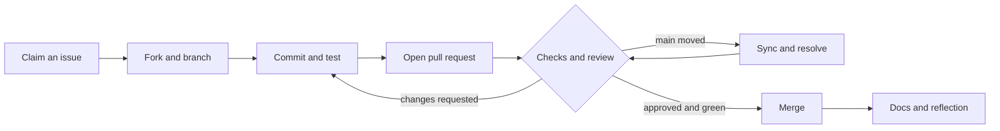
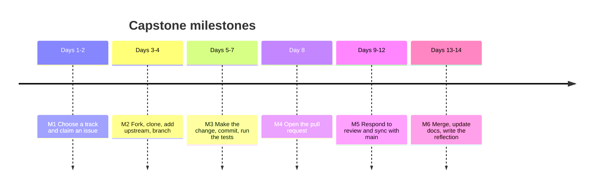

:::objectives
- Describe every stage of a contribution, from issue to merged pull request.
- Choose a capstone project that matches your skills and time.
- Follow the safety and etiquette rules for public repositories.
- Write a plan with a claimed issue, a branch name, a test plan, and milestones.
:::

A stranger opens a pull request on your repo that fixes a typo in the README. It's six characters, and it involves almost everything in this course: an issue, a fork, a branch, a commit, a pull request, an automated check, a review, maybe a conflict, and a merge. Small contributions like that keep open source running.

Your capstone is to make one such contribution, carefully, and show the evidence for every step.

## The brief

Take one change all the way from an issue to a merged pull request (or, on the solo track, a pull request you merge yourself). Along the way you must:

1. **Claim an issue** that describes the change, or write one.
2. **Work on a branch** in a fork (or in your own repo on the solo track).
3. **Make focused commits** with messages that say what and why.
4. **Open a pull request** that links the issue and explains how you tested.
5. **Respond to review** with at least one follow-up commit and a reply.
6. **Sync with the latest `main`** before merging, and resolve any conflict without losing anyone's work.
7. **Update documentation**: the README, the CHANGELOG, or a decision record, whichever fits.
8. **Pass an automated check**: the project's own, or one you add.

You'll hand in three things: a link to the pull request (or screenshots, if it's private), the output of `git log --oneline --graph` for your branch, and a short reflection, covered in the last lesson.



## Pick a project at your level

| Track | What you do | Where | Good for |
| --- | --- | --- | --- |
| 1. Solo rehearsal | Write an issue for yourself, fix it on a branch, open a PR, review your own diff, rehearse a conflict by editing `main` on GitHub first | Your `quiz-night` repo | Working alone, or under 13 with an adult's account |
| 2. Partner swap | Each of you forks the other's repo and fixes an issue its owner wrote; each owner reviews | A classmate's repo from this course | Classes and clubs |
| 3. First Contributions | Add your name to a contributors list through a fork | [firstcontributions/first-contributions](https://github.com/firstcontributions/first-contributions) | A real public PR with very little risk |
| 4. Real project | Fix a `good first issue`, often in documentation | A project you actually use | Confident learners with time to wait for replies |
| 5. Maintainer track | Make your repo contributor-ready (CONTRIBUTING, branch protection, CI, a release), then review and merge a friend's PR | Your `quiz-night` repo | Anyone who wants to run a project |

Track 3 is a project built for first pull requests, and its README walks you through the steps. So many people edit the same file that your branch often falls behind while you work, which makes it good practice for syncing with `upstream`.

Track 4 needs the most patience. Maintainers are usually volunteers, and a reply can take days. Pick an issue that's still open, has no one assigned, and hasn't been claimed in the comments.

## Rules for working in public

- **Age:** GitHub accounts are for people 13 and older. Younger learners do track 1 with an adult or teacher's help.
- **Privacy:** issues, comments, and commits on public repos are visible to everyone, forever. Don't include your full name, school, address, or phone number. Use the private noreply commit email from Module 1.
- **Secrets:** never paste a key, password, or token into code, an issue, or a screenshot.
- **Respect:** read and follow the project's code of conduct. Assume good intent, and thank reviewers even when they ask for changes.
- **Ask first:** comment on the issue and wait for a maintainer to say yes before you spend hours on it.
- **No spam:** pull requests that change one space just to get a contribution count waste maintainers' time, and some projects block accounts that send them.
- **Understand every line:** if a tool or a friend wrote part of your change, you must still be able to explain it in review. If you can't, don't submit it.

## Your plan

Copy this into a file called `PLAN.md` on your computer (not in the project you're contributing to) and fill in every line before you write any code:

```markdown title="PLAN.md"
# Capstone plan

Track (1-5):
Project and link:
Issue link (or the issue text I will post):

## The change
What I will change, in one or two sentences:
Why it helps the project's users:
Files I expect to touch:

## The project's rules
Where CONTRIBUTING.md is, and three rules from it I must follow:
How the project runs its tests:
Branch name I will use:

## Testing
How I will check my change works before opening the pull request:
Which automated check must pass:

## Risks
What could go wrong (slow reply, conflict, failing check) and my backup:

## Milestones
M1 claim issue:      date
M2 fork and branch:  date
M3 change and test:  date
M4 pull request:     date
M5 review and sync:  date
M6 merged and docs:  date
```

For a partner swap, write each other's issues first. A good issue describes the problem and what "done" looks like, without dictating the fix: "The README doesn't say how to run the tests. Done when a newcomer can run them by following the README alone."

## Milestones and timing



Track 1 fits in two or three sessions. Track 4 can take longer, because M5 depends on someone else's schedule; start your reflection while you wait.

:::tip
Choose a smaller change than you think you need. A typo fix that goes through every step teaches more than a big feature that never gets reviewed.
:::

:::video WldXhauP024
What to watch for: "Finding OSS projects" from 1:11, on choosing a project that suits your skills, then the walk-through of a first contribution from 3:07. Compare their steps with the contribution loop above.
:::

:::takeaways
- The capstone is one small change taken through every stage: issue, branch, commits, pull request, review, sync, docs, and a passing check.
- Pick the track that matches your time; a finished small contribution beats an unfinished big one.
- Public means permanent: no personal details, no secrets, and respect for the code of conduct.
- Claim the issue and wait for a yes before you start.
:::
