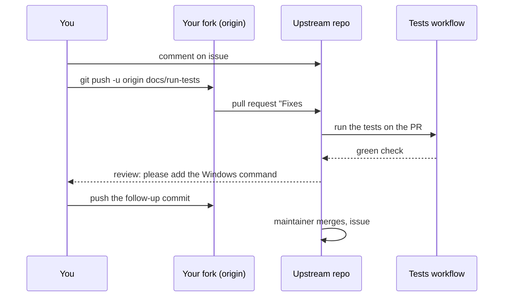

:::objectives
- Set up a fork with `origin` and `upstream`, and branch from the newest code.
- Make, test, and push a focused change, then open a pull request that links its issue.
- Sync with `upstream` when `main` moves, and resolve the conflict so both changes survive.
- Answer review with a follow-up commit, and check exactly what your pull request contains.
:::

This lesson follows one real contribution from start to finish, so you can compare each step with your own. Maya owns the original `quiz-night` repo (the **upstream**). You fork it and fix her issue #3: "The README doesn't say how to run the tests." Here is the branch at the end, ready to merge:

```text
* 030ad30 Add the Windows test command, as asked in review
*   b9da731 Merge upstream/main into docs/run-tests
|\  
| * cc5d58f List the Python version in the README
* | 25c0516 Explain how to run the tests in the README
|/  
*   7380946 Merge pull request #2 from YOUR-USERNAME/add-tests
```

Read it from the bottom. You branched from Maya's latest `main`, made your change, merged in a change she made meanwhile, and added a commit her review asked for.



## Starter kit

On tracks 1, 2, and 5 you contribute to a `quiz-night` repo built in Modules 5 to 7. If yours is missing pieces, add them from those lessons: `settings.json`, `quiz.py`, `test_quiz.py`, `README.md`, `CHANGELOG.md`, `LICENSE`, and `.github/workflows/tests.yml`. On tracks 3 and 4, the project you picked is your starter.

Whoever owns the repo should also add a pull request template. GitHub pre-fills every new pull request's description with it:

```markdown title=".github/pull_request_template.md"
## What this changes

## Why

Fixes #

## How I tested it

- [ ] `python -m unittest -v` passes on my computer
- [ ] I updated the README or CHANGELOG if users will notice
```

## Milestone 1: Claim the issue

On the issue, write a short comment and wait for a reply before you start:

```text
Hi! I'd like to work on this. My plan is to add a "Run the tests"
section to the README with the exact command. Does that sound right?
```

That one comment lets the maintainer correct your plan before you write anything, and it tells other contributors the issue is taken. Note the issue number; you'll need it in Milestone 4.

## Milestone 2: Fork, clone, connect upstream

Click **Fork** on the upstream repo, keep the default name, and create the fork. Then clone **your fork**, not the original:

```bash
git clone https://github.com/YOUR-USERNAME/quiz-night.git
cd quiz-night
git remote add upstream https://github.com/MAYA-USERNAME/quiz-night.git
git remote -v
```

`git remote -v` should list four lines: `origin` twice, pointing at your account, and `upstream` twice, pointing at the original. If `origin` points at the original, you cloned the wrong one; clone your fork into a fresh folder.

On track 1 there's no fork. Work in your own clone, and treat `origin` as the upstream.

## Milestone 3: Branch, change, test, commit

Name the branch after the change, not after yourself:

```bash
git switch -c docs/run-tests
```

```text
Switched to a new branch 'docs/run-tests'
```

Add a section to the README, just above `## License`:

```markdown title="README.md (new section)"
## Run the tests

From the project folder, run:

    python -m unittest -v

Every test should end in `ok`. GitHub runs the same tests on each pull request.
```

Before committing, check the size of your change and follow your own instructions exactly as a newcomer would:

```bash
git diff --stat
python -m unittest -v
git commit -am "Explain how to run the tests in the README"
```

```text
 README.md | 8 ++++++++
 1 file changed, 8 insertions(+)
[docs/run-tests 25c0516] Explain how to run the tests in the README
 1 file changed, 8 insertions(+)
```

One file, eight lines, one purpose. That's a pull request anyone can review in two minutes. (The test output is the same four `ok` lines from Module 7.)

## Milestone 4: Push and open the pull request

```bash
git push -u origin docs/run-tests
```

On GitHub, click **Compare & pull request**. Check the bar at the top: the **base repository** must be Maya's repo with base `main`, and the **head repository** must be your fork with `docs/run-tests`. Fill in the template:

```markdown title="Pull request description"
## What this changes
Adds a "Run the tests" section to the README.

## Why
New contributors couldn't tell how to run the tests.

Fixes #3

## How I tested it
- [x] `python -m unittest -v` passes on my computer
- [x] I updated the README or CHANGELOG if users will notice
```

`Fixes #3` is a linking keyword: when the pull request is merged into the default branch, GitHub closes issue #3 automatically. Within a minute, the Tests check appears at the bottom of the page and should turn green.

## Milestone 5: Main moved, so sync and resolve

While you waited, Maya merged her own change, and your pull request now says the branch has conflicts that must be resolved. Bring her work into your branch on your computer:

```bash
git fetch upstream
git merge upstream/main
```

```text
Auto-merging README.md
CONFLICT (content): Merge conflict in README.md
Automatic merge failed; fix conflicts and then commit the result.
```

```markdown title="README.md (during the merge)"
<<<<<<< HEAD
## Run the tests

From the project folder, run:

    python -m unittest -v

Every test should end in `ok`. GitHub runs the same tests on each pull request.
=======
## Requirements

Python 3.10 or newer. No other packages are needed.
>>>>>>> upstream/main
```

You both added a section in the same spot. Neither should disappear, and requirements make sense before instructions, so put Maya's section first and yours after it. Remove the markers, then verify before committing:

```bash
git diff --check
git add README.md
git commit -m "Merge upstream/main into docs/run-tests"
python -m unittest
```

```text
[docs/run-tests b9da731] Merge upstream/main into docs/run-tests
....
----------------------------------------------------------------------
Ran 4 tests in 0.001s

OK
```

`git push` updates the pull request, and the conflict warning disappears. Merging `upstream/main` into your branch, rather than rebasing, keeps every commit reviewers have already seen, so you never need to force-push. If a project's CONTRIBUTING asks for rebasing instead, follow it.

## Milestone 6: Answer the review

Maya reviews and comments: "Looks great. Could you add the Windows command too? `python` often isn't found there." Make the change as a new commit:

```bash
git commit -am "Add the Windows test command, as asked in review"
git push
```

```text
[docs/run-tests 030ad30] Add the Windows test command, as asked in review
 1 file changed, 2 insertions(+)
```

Then reply to her comment so she knows it's done: "Added in 030ad30, thanks for catching that." Linking the commit lets her check it in one click. Leave **Resolve conversation** to the reviewer unless the project says otherwise.

Before asking for a final look, check exactly what your pull request will add to upstream:

```bash
git log --oneline upstream/main..HEAD
```

```text
030ad30 Add the Windows test command, as asked in review
b9da731 Merge upstream/main into docs/run-tests
25c0516 Explain how to run the tests in the README
```

Three commits, all about issue #3. If anything unrelated shows up here, it would show up in the pull request too.

## Milestone 7: Docs, check, merge

Your change *is* a documentation update, so the README is covered. It doesn't change what players see, so it doesn't need a CHANGELOG line here; follow the project's own rule if it has one. Confirm the Tests check is green on the latest commit. When the maintainer merges, issue #3 closes itself. Then tidy up your own copy:

```bash
git switch main
git fetch upstream
git merge upstream/main
git branch -d docs/run-tests
```

If the project squash-merges pull requests, your exact commits never reach `main`, so Git may warn about the delete or refuse it. Once GitHub shows the pull request as merged, `git branch -D docs/run-tests` is safe.

On the maintainer track (5), you are Maya: review the pull request in the **Files changed** tab, leave a comment, wait for the follow-up, and merge. Then add the change to the CHANGELOG's Unreleased section if it affects users, and tag a release when you have enough for one.

:::warning
**The problems contributors hit most, and the fixes.**
- **Permission denied on push:** you pushed to `upstream`. Push to `origin`, your fork.
- **The pull request shows dozens of unrelated commits:** you branched from an old `main`. Make a fresh branch from `upstream/main` and move your change onto it.
- **The check is red but tests pass for you:** click **Details** and read the failing step. A missing file you forgot to `git add` is the usual cause.
- **No reply after several days:** leave one polite follow-up comment. If there's still nothing, your work is still done and your evidence still counts.
:::

## Hand-in checklist

- [ ] Link to the pull request, or screenshots of it.
- [ ] `git log --oneline --graph` for your branch.
- [ ] Your filled-in `PLAN.md`.
- [ ] Notes for your reflection: what surprised you, and what you'd do differently. The next lesson turns them into a write-up.
