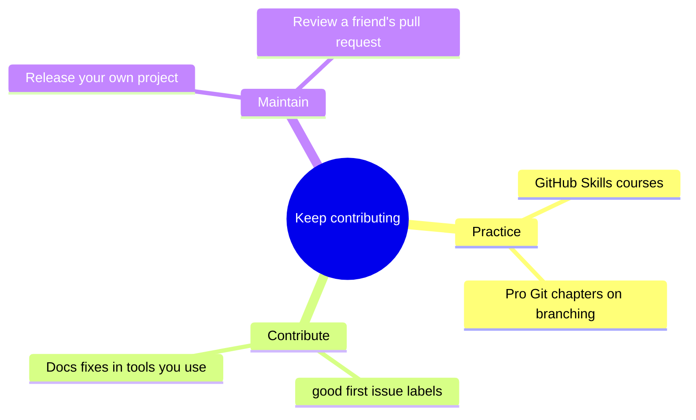

:::objectives
- Run a test plan that proves your pull request contains only what it should.
- Polish a pull request title, description, and commit history so a stranger can review it.
- Present your contribution as a short story: problem, change, process, lesson.
- Assess your work against the rubric and plan your next contribution.
:::

A pull request can be merged and still be hard to understand: a title that says "Update", a description that's empty, a stray debug file. A maintainer reading your work next year and a teacher grading it now look at the same things. This lesson is the final pass before you call the capstone done.

## Run the test plan

Do every check on the latest commit of your branch. The outputs here come from the worked example in the previous lesson.

| What to check | How | Passes when |
| --- | --- | --- |
| Tests pass locally | `python -m unittest -v` | Every test says `ok` |
| The automated check is green | The checks area at the bottom of the pull request | Green check on the newest commit, not an older one |
| No leftover conflict markers | `git diff --check upstream/main` | Prints nothing |
| Only the files you meant to change | `git diff --stat upstream/main` | Every file listed belongs to the issue |
| Every commit is on topic | `git log --oneline upstream/main..HEAD` | Each message relates to the issue |
| No secrets | `git grep -n -i -E "api_key\|token\|password\|secret"` | Every hit is harmless |
| Your docs work | Follow your own README in a fresh clone | You never have to guess a step |
| The issue is linked | The pull request description | It says `Fixes #N` and the issue shows the link |

Three of these, run on the example branch:

```bash
git diff --check upstream/main
git diff --stat upstream/main
git grep -n -i -E "api_key|token|password|secret"
```

```text
 README.md | 10 ++++++++++
 1 file changed, 10 insertions(+)
.gitignore:1:# Secrets and personal settings: never commit these
```

The first command printed nothing, so no markers survived. The second shows exactly one file, which matches the issue. The search found one hit, and reading it shows it's a comment in `.gitignore`, not a key. That's the point of the secrets check: a tool finds candidates, and you read each one.

The "fresh clone" test catches the most embarrassing bug in documentation changes: instructions that only work on the author's computer. Clone the branch into a new folder, follow the README word for word, and fix whatever you had to work out on your own.

## Polish what reviewers read first

Reviewers see the title, then the description, then the commits. Make each one carry its weight.

| | Hard to review | Easy to review |
| --- | --- | --- |
| Title | Update README | Explain how to run the tests in the README |
| Description | (empty) | What, why, `Fixes #3`, how you tested |
| Commits | fix, more fixes, oops | Explain how to run the tests in the README |

Change a pull request's title any time with **Edit** next to it. Answer every review comment, even if only with "Done in 030ad30". If the project's CONTRIBUTING asks for tidy history, ask the maintainer before rewriting commits on an open pull request; many projects squash everything into one commit when they merge, so a few small commits are usually fine.

## Present it in three minutes

You'll present to your class, a club, or your instructor. Tell it as a story with five beats, and show one artifact for each:

1. **The problem** (show the issue): "New contributors couldn't tell how to run the tests."
2. **The change** (show the **Files changed** tab): "I added one README section with the exact command."
3. **The process** (show the graph below): "I branched from the latest `main`, opened a PR, and the tests ran on it automatically."
4. **What went wrong** (point at the merge commit): "Maya added a section in the same spot while I worked. I merged `upstream/main` and kept both sections."
5. **What I learned**: one sentence you couldn't have said before the course.

```text
* 030ad30 Add the Windows test command, as asked in review
*   b9da731 Merge upstream/main into docs/run-tests
|\  
| * cc5d58f List the Python version in the README
* | 25c0516 Explain how to run the tests in the README
|/  
*   7380946 Merge pull request #2 from YOUR-USERNAME/add-tests
```

The graph is your best visual. Every beat of the story is visible in it: where you started, the parallel change, the merge, and the review fix.

## Write your reflection

Keep it to one page in a file called `REFLECTION.md`, next to your `PLAN.md`. Answer honestly; "I got stuck for an hour on the wrong remote" is more useful than "everything went well."

```markdown title="REFLECTION.md"
# Capstone reflection

Pull request link:
Track:

## What I changed and why (2-3 sentences)

## The hardest moment
What happened, what the error or message said, and how I got past it.

## Feedback I received
The most useful review comment, and what I changed because of it.

## Compared with my plan
One thing that went as planned, and one that didn't.

## Next time I will...
```

## The rubric

| Criterion | Beginning | Developing | Strong |
| --- | --- | --- | --- |
| Issue and plan | No issue, or plan left mostly blank | Issue exists; plan partly filled in | Clear issue with a "done when"; complete plan, claimed before starting |
| Branch and commits | Work committed on `main` | Branch used; some vague messages | Well-named branch; each commit focused, with a message saying what and why |
| Pull request | No description | Description present but missing testing or issue link | What, why, `Fixes #N`, and how it was tested |
| Review response | Comments ignored | Changes made without replies | Every comment answered, with follow-up commits linked |
| Sync and conflicts | Branch far behind `main`, or someone's work lost | Synced, but resolution dropped part of a change | Synced with `upstream`; conflict resolved keeping both intentions, explained in the merge message |
| Documentation | None | README or CHANGELOG touched but unclear | Docs updated so a newcomer can follow them; CHANGELOG or decision record where it fits |
| Automated check | No check runs | Check runs but was red when merged, or ignored | Green check on the final commit; on track 5, a required check |
| Safety and etiquette | Personal details or secrets exposed | Minor slips, fixed when pointed out | No personal data or secrets; followed CONTRIBUTING and the code of conduct |
| Reflection and presentation | Missing | Describes what happened | Explains decisions and lessons, and the three-minute story is clear |

A "Strong" in every row on a typo fix beats "Developing" on a big feature. The rubric grades the process, not the size of the change.

## Keep contributing



- **Practice** with [GitHub Skills](https://skills.github.com/), free interactive courses that run inside real repositories, and the free [Pro Git book](https://git-scm.com/book/en/v2), especially the branching chapter.
- **Contribute** by browsing [github.com/topics/good-first-issue](https://github.com/topics/good-first-issue) or the `/contribute` page of a project you already use. Documentation fixes are almost always welcome and are a good way to learn a codebase.
- **Maintain** your own project. Give `quiz-night` a CONTRIBUTING file, a pull request template, a required check, and a release, then invite a friend to send a pull request. Reviewing someone else's change teaches as much as writing your own.

:::tip
Keep a short list of every contribution you make: the link, what it changed, and one thing you learned. After a year it shows exactly what you can do.
:::

:::takeaways
- Prove a pull request is clean with commands: tests, `git diff --check`, `git diff --stat`, the commit list, and a search for secrets.
- Titles, descriptions, and commit messages are written for a reviewer who has never seen your work.
- Present a contribution as a story, and use `git log --graph` to show it.
- The rubric rewards careful process over big changes.
:::

## Further reading

- [Open Source Guides: How to Contribute](https://opensource.guide/how-to-contribute/): the "Anatomy of an open source project" section explains the roles you'll meet in real projects.
- [GitHub Docs: Finding ways to contribute to open source](https://docs.github.com/en/get-started/exploring-projects-on-github/finding-ways-to-contribute-to-open-source-on-github): topics pages, labels, and other ways to find a first issue.
- [Pro Git](https://git-scm.com/book/en/v2): the free book on Git, from first commit to how Git stores data.
