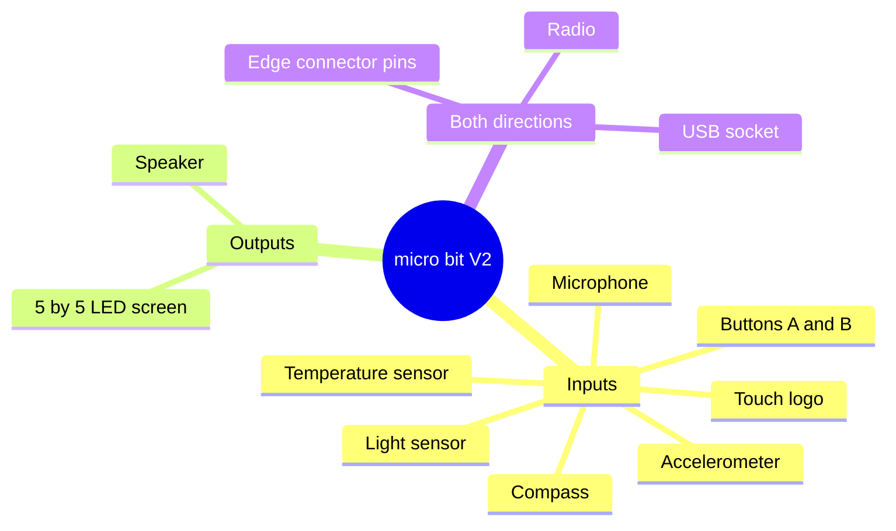

:::objectives
- Open Microsoft MakeCode for micro:bit in a browser and create a named project.
- Point to each part of a micro:bit and say whether it is an input or an output.
- Find the toolbox, the workspace, the simulator, and the Download button.
- Paste a MakeCode JavaScript program from this course and see it turn into blocks.
:::

The BBC micro:bit is a complete computer on a board about 5 cm by 4 cm. It has 25 red LEDs, two buttons, a motion sensor, a compass, a thermometer, and a radio, and the V2 version adds a speaker, a microphone, and a touch-sensitive logo. In this course you will turn it into a name badge, a reaction-time game, a step counter, a compass, and radio messengers.

You don't need to own one. Every program in this course runs in **Microsoft MakeCode**, a free editor that works in your web browser. MakeCode includes a **simulator**: a virtual micro:bit on the screen that runs your code, with buttons you can click and sensors you can drag. Nothing to install, no account, no cost.

## Two ways through the course

Pick the one that matches what you have. You can switch at any time, because the same project file works on both.

| What you need | Simulator only | With a real board |
| --- | --- | --- |
| A computer or Chromebook with a current browser | yes | yes |
| A BBC micro:bit (V2) | no | yes |
| A micro-USB cable that carries **data** | no | yes |
| A battery pack with 2 AAA batteries | no | only for projects you carry or wear |

Every lesson, exercise, and project works in the simulator. A real board adds something the screen can't: the feel of shaking dice in your hand, wearing a badge, or walking around with a step counter. If your school or library lends micro:bits, borrow one for the motion and sound modules.

:::tip
If you get a board, get a **V2**. You can spot one by its gold logo and the small notches in the gold edge connector. The older V1 has no speaker, microphone, or touch logo, and programs that use those parts show the number **927** on its screen instead of running.
:::

## Meet the board

Every invention you build follows the same shape: something in the world changes (an **input**), your code decides what that means, and the micro:bit does something you can see or hear (an **output**). Here is where each kind lives on the board.



A few of these hide in surprising places:

- The **light sensor** is the LED screen itself. The same LEDs that light up can also measure how much light falls on them.
- The **temperature sensor** is inside the main processor chip, so it reads the chip's temperature, which is usually close to the room's.
- The **microphone** is a tiny hole on the front, with a small LED beside it that lights while the microphone is listening.
- On the back you'll find the **reset button**, the **USB socket**, the **battery socket**, and a small light that flashes while a program is being copied onto the board.

:::video u2u7UJSRuko
A two-minute tour from the micro:bit Educational Foundation. Watch for where each sensor sits, so the diagram above matches a real board in your head.
:::

## Open MakeCode and make a project

These steps are the same on every computer:

1. Open your browser and go to **makecode.microbit.org**.
2. On the home page, under **My Projects**, click **New Project**.
3. Type a name such as `c4t-hello` and click **Create**.

The editor opens with two blocks already on the workspace: **on start** and **forever**. That's your proof the editor loaded. Which browser to use depends on your computer and whether you'll connect a real board:

:::tabs
@tab Windows
Use **Microsoft Edge** (already installed) or **Google Chrome**. Both can send programs straight to a micro:bit over USB, so you'll never need to drag files around. Firefox also runs the editor and simulator, but it saves programs as files that you copy to the board yourself.

To make MakeCode easy to reopen, pin the tab or add it to your favorites. After the first visit the editor is cached, so it keeps working if the internet drops out.
@tab macOS
Use **Google Chrome** or **Microsoft Edge** if you plan to connect a real board: they can send programs straight to it. **Safari** runs the editor and simulator perfectly well, but it can't talk to USB devices, so it downloads each program as a file that you drag onto the board in Finder. If you're simulator-only, any of the three is fine.
@tab Chromebook
Use the built-in **Chrome** browser. It can send programs straight to a micro:bit over USB.

On a school-managed Chromebook, your administrator may have switched off direct USB access. If MakeCode later says **WebUSB is disabled by browser policies**, you can still download programs as files and copy them with the **Files** app; the next lesson shows how.
:::

## A tour of the editor

Take a minute to find each of these, because every later lesson refers to them by name:

- **Simulator** (left). A virtual micro:bit that runs your program and restarts every time you change the code. Click its A and B buttons with the mouse.
- **Toolbox** (middle). Blocks grouped into colored categories: **Basic**, **Input**, **Music**, **LED**, **Radio**, **Loops**, **Logic**, **Variables**, **Math**, and more under **Advanced**. A search box sits at the top.
- **Workspace** (right). Where you snap blocks together.
- **Blocks / JavaScript** switch (top center). The same program shown as blocks or as text. There's a Python view as well.
- **Download** button (bottom left), with a **...** button beside it for download options, then the project name box and a save icon.
- **Undo**, **redo**, and **zoom** buttons (bottom right).

:::video ItcTxWW3c5Q start=1:27
Science Buddies walks through the MakeCode screen and writes a first program. Watch how dragging a block from a category into **on start** changes the simulator right away.
:::

## How programs appear in this course

Lessons show programs as MakeCode JavaScript in boxes like this one. It's the exact text MakeCode generates from blocks, so you can build it from blocks or paste it in.

```makecode
basic.showIcon(IconNames.Heart)
```

To paste a program:

1. Click **JavaScript** at the top of the editor.
2. Select everything in the text area and delete it.
3. Paste the program, then click **Blocks**.

You'll see a **show icon** block (from the **Basic** category) sitting inside **on start**. Any code that isn't inside an event or a loop belongs to **on start**, which runs once when the board powers up. On the simulator:

```text
A heart appears on the LED screen and stays there.
```

:::try
Click the heart picture inside the **show icon** block and choose a different icon. The simulator restarts and shows your new choice. Then switch to **JavaScript** and find the name that changed, such as `IconNames.Happy`.
:::

## Fixes for the problems beginners hit

- **The editor never finishes loading, or the page is blank.** School and library networks sometimes block it. Try a different browser first. If it's still blank, ask whoever runs the network to allow `makecode.microbit.org`. Ad or script blockers can cause the same thing, so try with them switched off.
- **There's no simulator.** On a narrow window or small screen, MakeCode can hide it. Make the window wider, or look for the button that shows the simulator again.
- **The simulator makes no sound.** Browsers block sound until you interact with the page. Click once inside the simulator and sound starts working.
- **A block in a lesson isn't where you expect.** MakeCode updates now and then, and categories shift slightly. Type the block's name, such as `show icon`, into the toolbox search box.
- **Your project is gone the next day.** You were probably in a private or incognito window, which throws away its storage when you close it. Use a normal window. Lesson 3 of this module covers saving properly.

:::takeaways
- The MakeCode simulator runs every program in this course, so a real micro:bit is optional.
- Inputs (buttons, logo, sensors) feed your code; outputs (LEDs, speaker) show the result.
- Chrome and Edge can send programs straight to a board; Safari and Firefox download a file instead.
- Code shown in `makecode` boxes can be pasted into the JavaScript view and turned into blocks.
:::

## Further reading

- [micro:bit features overview](https://microbit.org/get-started/features/overview/): the official guide to every part of the board, with short videos for each sensor.
- [MakeCode reference](https://makecode.microbit.org/reference): every block, with its JavaScript name and a small example. Keep it open in a tab.
