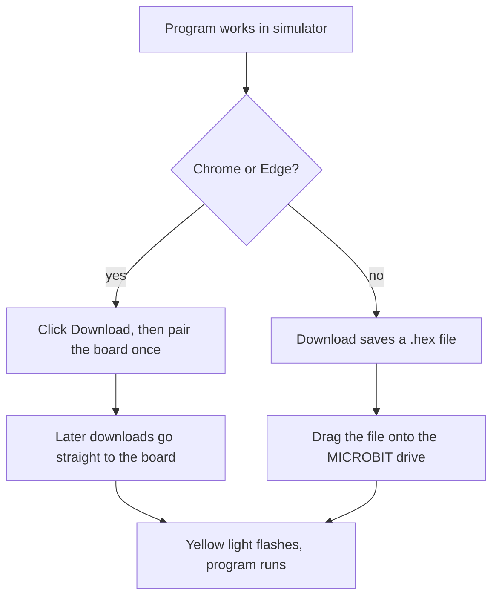

:::objectives
- Build a program that uses **on start**, **forever**, and a button event.
- Run it in the simulator and prove the behavior comes from your code.
- Match each block to its line of MakeCode JavaScript.
- Send the program to a real micro:bit, if you have one, and fix the transfer problems that trip up most beginners.
:::

A tool you haven't seen working is a tool you can't trust yet. So the first job is small and visible: get a program running, change one detail, and watch the change appear. If that works in the simulator and on a board, everything after this is about ideas, not setup.

## The program

Here's the whole thing. It greets you once, then shows a beating heart forever, and plays a note whenever you press button A.

```makecode title="c4t-hello"
basic.showString("Hi!")
basic.forever(function () {
    basic.showIcon(IconNames.Heart)
    basic.showIcon(IconNames.SmallHeart)
})
input.onButtonPressed(Button.A, function () {
    music.play(music.tonePlayable(262, music.beat(BeatFraction.Whole)), music.PlaybackMode.UntilDone)
})
```

## Step 1: Build it

Start a new project named `c4t-hello`, then either paste the code into the **JavaScript** view or build it from blocks:

1. From **Basic**, drag **show string** into **on start** and change the text to `Hi!`.
2. From **Basic**, drag two **show icon** blocks into **forever**. Set the second one to the small heart.
3. From **Input**, drag **on button A pressed** onto an empty part of the workspace.
4. From **Music**, drag **play tone Middle C for 1 beat until done** into the button block.

Switch between **Blocks** and **JavaScript** a few times. The two views are the same program, and editing either one updates the other.

## Step 2: Run it in the simulator

The simulator starts by itself. Watch it and click its **A** button.

```text
"Hi!" scrolls across the screen once, one letter at a time.
Then a big heart and a small heart take turns, about 0.6 seconds each.
Clicking A plays one beat of Middle C.
```

Three parts of the program are at work. **on start** runs once, which is why "Hi!" never comes back. **forever** runs its blocks, rests for a moment, and starts over, so the heart keeps beating. There's no pause block, yet each heart stays up for 0.6 seconds, because **show icon** holds its picture for 600 milliseconds before the next block runs. The button block is an **event**: it does nothing until A is pressed and released, then runs its note.

:::tip
No sound? Browsers stay silent until you interact with the page. Click once inside the simulator, then press A again.
:::

:::try
Prove the simulator is running *your* code. Change `"Hi!"` to your initials and watch the simulator restart with the new text. Then add a **pause (ms) 1000** block from **Basic** at the end of **forever** and predict how the heartbeat changes before you look.
:::

## Step 3: Read it as JavaScript

Each block became one line of text. Knowing the mapping lets you read any program in this course:

| JavaScript | Block | Category |
| --- | --- | --- |
| `basic.showString("Hi!")` | show string "Hi!" (inside on start) | Basic |
| `basic.forever(function () { ... })` | forever | Basic |
| `basic.showIcon(IconNames.Heart)` | show icon (heart) | Basic |
| `input.onButtonPressed(Button.A, function () { ... })` | on button A pressed | Input |
| `music.play(music.tonePlayable(262, ...), ...)` | play tone Middle C for 1 beat until done | Music |

The `262` is Middle C written as a frequency: the speaker vibrates 262 times per second. In blocks you pick notes from a little piano instead.

## Step 4: Send it to a real micro:bit (optional)

If you have no board, skip to the quiz; the simulator has already proven your program works. With a board, there are two routes, and your browser decides which one you get.



Plug the micro:bit into the computer with the USB cable first. A drive called **MICROBIT** appears, the same way a USB stick would.

:::tabs
@tab Windows
**Chrome or Edge (direct):**
1. Click **Download**. MakeCode asks you to connect your micro:bit; click **Next**, then **Pair**.
2. In the browser's device list, choose **BBC micro:bit CMSIS-DAP** (it may say **DAPLink CMSIS-DAP**) and click **Connect**.
3. Click **Download** again if needed. From now on, one click on **Download** sends the program.

**Firefox or any other browser (file):**
1. Click **Download**. A file whose name starts with `microbit-` lands in your **Downloads** folder.
2. Open **File Explorer** and drag that file onto the **MICROBIT** drive, or right-click it and choose **Send to**, then **MICROBIT**.
@tab macOS
**Chrome or Edge (direct):**
1. Click **Download**. When MakeCode asks you to connect your micro:bit, click **Next**, then **Pair**.
2. Choose **BBC micro:bit CMSIS-DAP** (or **DAPLink CMSIS-DAP**) in the list and click **Connect**.
3. From now on, **Download** sends programs straight to the board.

**Safari (file):**
1. Click **Download**. The `.hex` file goes to your **Downloads** folder.
2. Open **Finder**, find **MICROBIT** under **Locations**, and drag the file onto it.
3. macOS may warn that a disk wasn't ejected properly. That's expected: the micro:bit restarts itself to run the new program, which makes the drive vanish for a moment.
@tab Chromebook
**Chrome (direct):**
1. Click **Download**, then **Next** and **Pair** when MakeCode asks.
2. Choose **BBC micro:bit CMSIS-DAP** (or **DAPLink CMSIS-DAP**) and click **Connect**.

**If direct USB is blocked on a school device:**
1. Click the **...** button next to **Download** and choose **Download as File**.
2. Open the **Files** app, find the file in **Downloads**, and drag it onto **MICROBIT** in the left sidebar.
:::

**What success looks like:** the small yellow light on the back flickers for a few seconds, the board restarts, "Hi!" scrolls by, and the heart starts beating. Press the real A button and the speaker on the back plays the note. If you look inside the MICROBIT drive afterward, the `.hex` file isn't there. That's normal: the board reads the file, stores the program, and throws the file away.

:::video PxfPs1zwKl0
The micro:bit Educational Foundation shows the direct route in about a minute. Watch for the pairing window and the device name you should pick.
:::

## Step 5: Run it without a computer

Unplug the USB cable. The program is stored in the board's memory, so it doesn't vanish. Connect the battery pack's white plug to the battery socket on the back (it only fits one way, so don't force it) and the heart starts beating again. Press the **reset** button on the back to restart the program from **on start**. On a V2, holding reset for about four seconds switches the board off; press it again to switch it back on.

## When the transfer doesn't work

- **No MICROBIT drive, or the board isn't in the pairing list.** The usual culprit is a cable that only charges and carries no data. Try a different cable, then a different USB port.
- **"Failed to connect."** Another tab, maybe a second MakeCode window or the micro:bit Python Editor, is already holding the connection. Close it, unplug the board, plug it back in, and try again. **Download as File** always works as a backup.
- **The board still runs the old program.** You probably dragged an older file. Repeated downloads get names ending in `(1)`, `(2)`, and so on, so sort your Downloads folder by date and use the newest.
- **A sad face, then 927.** The board is a V1 and the program uses a V2-only block. Playing sound through the built-in speaker is one of them, so this program shows 927 on a V1 when you press A.
- **An old V1 won't pair at all.** It may need a firmware update. Open `DETAILS.TXT` on the MICROBIT drive; if the version number is below 0249, follow the firmware link in Further reading.

:::quiz
Q: There's no pause block in **forever**, yet each heart stays up for about 0.6 seconds. Why?
- [ ] The forever loop always waits one second between passes
  It only rests for a few milliseconds between passes, far less than 0.6 seconds.
- [x] **show icon** holds its picture for 600 ms before the next block runs
  That built-in hold is what sets the heartbeat speed.
- [ ] The simulator runs slower than a real board
  The real board beats at the same speed.

Q: You download with Safari, drag the file onto MICROBIT, and the board still shows yesterday's program. What's the most likely cause?
- [ ] Safari can't program a micro:bit
  Safari can't use the direct route, but copying a downloaded file works fine.
- [ ] The .hex file is missing from the drive, so the copy failed
  The file always disappears after a successful copy; that's normal.
- [x] You dragged an older download instead of the newest file
  Repeated downloads stack up in your Downloads folder, so sort by date and use the newest.
:::

## Further reading

- [Transfer code to the micro:bit](https://microbit.org/get-started/user-guide/transfer-code-to-the-microbit/): the official guide for every computer, plus tablets and phones.
- [WebUSB in MakeCode](https://makecode.microbit.org/device/usb/webusb): the pairing steps with screenshots, and how to unpair a board.
- [Troubleshooting WebUSB](https://makecode.microbit.org/device/usb/webusb/troubleshoot): checking cables and firmware, and updating a V1 board.
