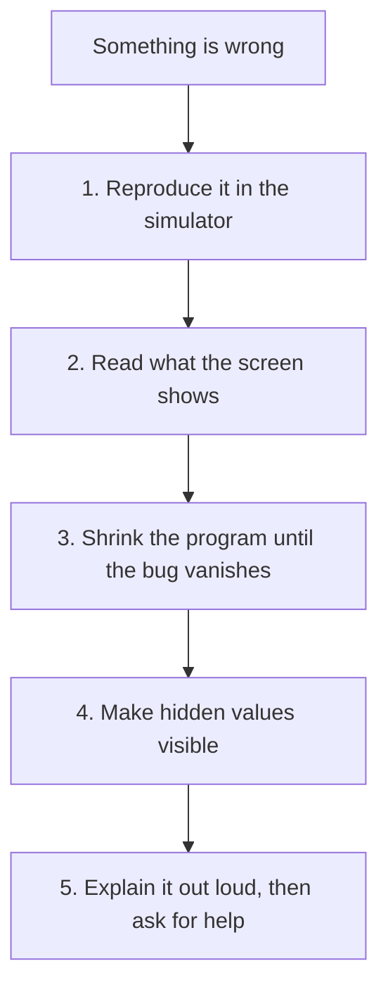

:::objectives
- Explain where MakeCode keeps your projects and back them up as files.
- Name projects so you can find any version later.
- Handle a micro:bit, a USB cable, and a battery pack safely.
- Use zoom, themes, keyboard controls, and the text views to make the editor comfortable.
- Follow a five-step routine when a program doesn't do what you expected.
:::

Here's how students lose a week of work. They build a project on a shared school computer, the computer wipes its browsing data overnight, and the next morning **My Projects** is empty. Nothing was broken. MakeCode simply keeps your projects inside the browser you used, on the computer you used, and that storage can be cleared.

Ten minutes of habits now prevents that, along with the other two classic setbacks: a damaged board and a bug you can't find.

## Where your projects actually live

MakeCode saves your work automatically as you go, but "saved" means saved in the browser's own storage. Three things follow from that:

- **Another browser or computer can't see it.** Projects made in Chrome don't show up in Edge, even on the same laptop.
- **Clearing browsing data deletes it.** So does closing a private or incognito window.
- **"Untitled" projects pile up.** Every project you never named is still there, which makes the one you want harder to find.

## Three ways to keep a project safe

1. **Download a copy.** Click the save icon next to the project name box at the bottom of the editor. You get a `.hex` file that holds both the program the board runs and your blocks, so it works as a backup. To open it later, go to the MakeCode home page, click **Import**, then **Import File...**, and pick the file.
2. **Sign in.** MakeCode works without an account, but you can sign in with a Microsoft, Google, or Clever account for free. Your projects then sync to the cloud and follow you to any computer.
3. **Share a link.** The **Share** button makes a link to your project, which is handy for showing a teacher or asking for help.

:::warning
A shared link is public: anyone who has it can open your project and read every block. Keep your full name, school, address, and phone number out of anything you share. For the name badge in the next module, use a first name or a nickname.
:::

## Name projects so future-you can find them

Use one pattern for every project: the course, the module, what it is, and a version number when you try something risky.

```text
c4t-m2-badge
c4t-m3-reaction-v1
c4t-m3-reaction-v2-two-players
c4t-m4-step-counter
```

Before a big change, download a copy of the working version first. If the change goes badly, import the copy and you're back where you were in seconds.

## Handle the hardware safely

A micro:bit is a bare circuit board with all its parts exposed on purpose, so you can see how it's built. That makes it easy to damage if you're careless. These rules come from the micro:bit Educational Foundation's safety guidance.

**The board and the USB cable**

- Hold the board by its edges, and avoid touching the components while it's powered.
- Before picking it up, touch something metal, like a table leg, to discharge static. Store it in its anti-static bag.
- Power it only from a computer's USB port or the battery pack. Don't use phone power banks or charging ports marked with a lightning bolt or "SS"; they can damage the board.
- Never lay metal objects (keys, coins, scissors) across the board. A short circuit can make it hot enough to burn.
- Keep it away from water and wet hands, and don't leave it plugged in unattended.
- Keep boards away from children under 8.

**The battery pack**

- Use two AAA alkaline (or zinc) batteries. Don't use rechargeable batteries, and never try to recharge ordinary ones.
- Don't mix old and new batteries, or different types, in the same pack.
- Put the batteries in the right way round, and take dead ones out.
- To unplug the pack, pinch the white plug and pull it out of the socket. Never pull on the wires.
- If a board or battery pack ever feels hot, disconnect the power and tell an adult.

## Make the editor work for you

MakeCode has several settings for different needs. Try them now so you know they exist:

- **Zoom.** Use the **+** and **−** buttons at the bottom right of the workspace for bigger blocks, or your browser's zoom (Ctrl and + on Windows and Chromebook, Cmd and + on a Mac) for everything.
- **Theme.** The gear menu has a **Theme** option, including a high-contrast look.
- **Keyboard controls.** The help menu (the question mark) has a **Keyboard Controls** page for building block programs without a mouse.
- **Text views.** Prefer typing, or use a screen reader? The **JavaScript** and **Python** views are ordinary text editors, and every program in this course is shown as text.
- **Language.** The gear menu also lets you change the editor's language.
- **On the board.** If scrolling text is hard to read, slow it down: `basic.showString("HELLO", 250)` waits 250 ms between steps instead of the usual 150. Pairing a picture with a sound makes feedback easier to notice too.

:::video ItcTxWW3c5Q start=10:07
The end of Science Buddies' first micro:bit tutorial covers editing and saving a project. Watch where the project name box and save button sit.
:::

## A routine for getting unstuck

When a program misbehaves, the urge is to change things at random until it works. That sometimes fixes the bug but rarely teaches you why. Work through these steps in order instead.



1. **Reproduce it in the simulator.** If the simulator does the same wrong thing, the bug is in your code. If the simulator is fine but the board isn't, suspect the transfer, a V1 board running V2-only blocks, or a sensor that behaves differently in real life (the compass, for example, needs calibrating).
2. **Read what the screen shows.** A sad face followed by a number is an **error code**, not a random glitch. **927** means a V2-only block on a V1 board; **020** means the board ran out of memory. The error codes page in Further reading lists the rest.
3. **Shrink the program.** Drag suspicious blocks out of their event onto an empty part of the workspace. Loose blocks turn gray and stop running. Keep removing until the bug disappears; the last thing you removed is the suspect.
4. **Make hidden values visible.** If you suspect a variable, show it with **show number** at the moment it matters. You'll practice this throughout the course.
5. **Explain it out loud.** Walk through the program line by line to a friend, or to a rubber duck. You'll often hear your own mistake. If not, ask for help with a share link plus two sentences: what you expected, and what happened instead.

| What you see | Check this first |
| --- | --- |
| Pressing A does nothing | Is the block **on button A pressed**, or did you pick B? |
| A picture flashes and is replaced instantly | Is a **forever** loop drawing over it? |
| Works in the simulator, not on the board | Did the download finish? Is the board a V2? |
| Sad face, then a number | Look the number up in the error codes list |

:::quiz
Q: You built a project on a library computer without signing in. Which habit protects it best?
- [ ] Leave the browser tab open
  The tab doesn't protect anything once the browser's storage is cleared.
- [x] Download a copy with the save icon before you leave
  The `.hex` file contains your blocks, and you can import it on any computer.
- [ ] Give the project a name
  Naming helps you find it, but it still lives only in that browser.

Q: Your program runs fine in the simulator, but the real board shows a sad face and then 927. What's going on?
- [ ] The board is broken
  A numbered error code means the board is working and reporting a specific problem.
- [ ] The USB cable is charge-only
  A charge-only cable would stop the program from arriving at all.
- [x] The program uses a V2-only block and the board is a V1
  927 is exactly that error; run it in the simulator or use a V2 board.
:::

## Further reading

- [micro:bit safety](https://microbit.org/get-started/user-guide/safety/): the Foundation's handling tips and printable student poster.
- [Saving projects in MakeCode](https://makecode.microbit.org/save): how browser storage works and what clears it.
- [Error codes](https://makecode.microbit.org/device/error-codes): what each number on a sad-face screen means.
