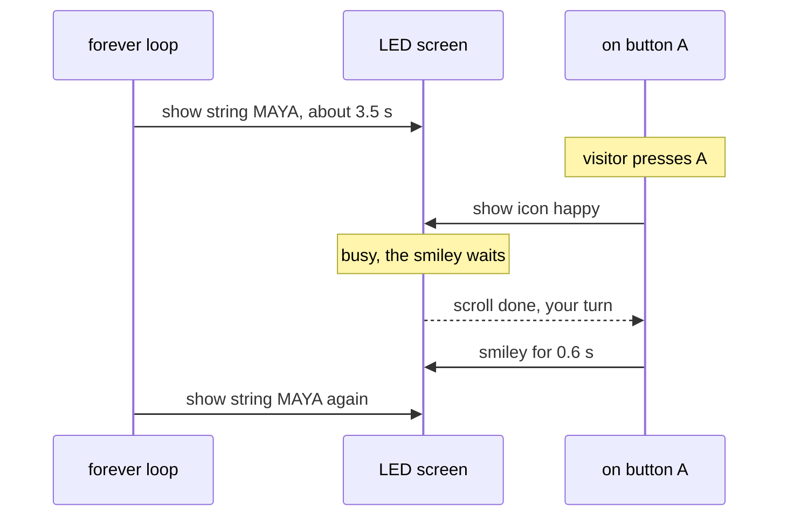

:::objectives
- Describe any micro:bit invention as an input, a decision, and an output.
- Explain when **on start**, **forever**, and an event handler each run.
- Choose between an event (**on button pressed**) and a check (**button is pressed**) for a task.
- Predict when a picture appears if two parts of a program both want the screen.
- Use the speaker as a second output, in the background or until done.
:::

Maya's badge scrolls her name in a **forever** loop. She adds **on button A pressed → show icon (happy)** so visitors can tap it to say hi. A visitor presses A. Nothing happens. About three seconds later, after the visitor has walked off, the smiley appears for a moment and the name starts scrolling again.

Nothing in Maya's code is a typo; the program did exactly what it was told. Seeing why the smiley was late takes a clear picture of how the parts of a program take turns.

## Every invention is input, decision, output

An **input** is anything the micro:bit can notice. An **output** is anything it can do. Your code is the decision in between.

| Invention | Input | Decision | Output |
| --- | --- | --- | --- |
| Doorbell | button A pressed | always ring | play a chime |
| Night light | light level | is it darker than 40? | turn the LEDs on |
| Step counter | accelerometer | did that jolt look like a step? | add 1 and show the count |

Inputs come in two kinds: things that **happen** (a press, a shake, a clap) and things you **measure** (how bright, how tilted, how warm). The kind of input decides which kind of block you reach for.

## on start runs once, forever runs again and again

```makecode
basic.showString("READY")
basic.forever(function () {
    basic.showIcon(IconNames.Heart)
    basic.pause(500)
    basic.clearScreen()
    basic.pause(500)
})
```

When the board powers up, **on start** runs from top to bottom, exactly once. Here that's the `showString` line, because code outside any block belongs to on start. Only when it finishes does **forever** begin. Forever runs its blocks, rests for 20 milliseconds, and runs them again, until the power goes off.

That short rest is when the board gives other parts of your program a turn, which is why a loop that never ends doesn't freeze the micro:bit. You can have several forever blocks; each takes its turns alongside the others.

:::try
Predict how long one full heartbeat takes, then count it on the simulator. (**show icon** holds its picture for 600 ms by itself, so the answer is more than one second.)
:::

## Events: code that waits for something to happen

```makecode
input.onButtonPressed(Button.A, function () {
    basic.showArrow(ArrowNames.West)
})
input.onButtonPressed(Button.B, function () {
    basic.showArrow(ArrowNames.East)
})
input.onButtonPressed(Button.AB, function () {
    basic.clearScreen()
})
```

An **event handler** sits idle until something happens, then runs. These three come from **Input › on button pressed**, with the dropdown set to A, B, and A+B. Press A in the simulator and an arrow points left, toward the A button. Because the program uses A+B, the simulator adds an **A+B** button.

Two details explain a lot of confusing behavior later:

- **"Pressed" means pushed down *and* released.** The handler runs when you let go, not when you touch the button. For A+B, both buttons must be down, and the handler runs when you release one of them.
- **Handlers run alongside forever, not instead of it.** A forever loop doesn't stop when you press a button. And if you press A again while the A handler is still running, the second press waits in line and runs when the first one finishes.

## Waiting for an event vs checking a button

**Input › button A is pressed** is a different kind of block. It doesn't wait for anything; it answers a yes-or-no question about this exact instant. That makes it right for "while you hold it" behavior:

```makecode
basic.forever(function () {
    if (input.buttonIsPressed(Button.A)) {
        led.plot(2, 2)
    } else {
        led.unplot(2, 2)
    }
})
```

Hold A and the center LED lights; let go and it goes dark. (`led.plot` lights one LED by its position; the next module uses it constantly.) This works because the loop asks about 50 times a second.

Now give that same loop something slow to do, like scrolling a word, and it only gets to ask the question between scrolls. A quick tap that starts and ends during a scroll is never seen. Step through a model of that loop below. Each entry in the list is one tenth of a second, and the button is tapped twice.

:::trace Watch a busy loop miss two button taps
```python
# One entry per tenth of a second: is button A down at that moment?
button_down = [False, False, True, False, False, False, False, True, False, False, False, False]
busy_until = 0
noticed = []
for moment in range(len(button_down)):
    if moment < busy_until:
        continue  # still scrolling text, not looking at the button
    if button_down[moment]:
        noticed.append(moment)
    busy_until = moment + 5  # showing text keeps the loop busy for 5 moments
print("taps noticed by checking:", noticed)
taps = [m for m in range(len(button_down)) if button_down[m]]
print("taps an event would catch:", taps)
```
:::

Both taps land while the loop is busy, so checking catches neither. An event catches both, because the board records each press and runs the handler as soon as it can. The rule of thumb:

| You care about... | Use | Example |
| --- | --- | --- |
| something that **happened** | an event: **on button pressed** | count presses, start a game |
| what's true **right now** | a check: **button is pressed** inside forever | a torch that's lit while held |

## The screen does one thing at a time

Every **show** block (**show string**, **show number**, **show icon**, **show leds**, **show arrow**) takes over the whole screen and keeps it until it's done. **show icon** holds for 600 ms and **show leds** for 400 ms. Scrolling text moves one column every 150 ms, and each letter is about six columns wide, so "MAYA" keeps the screen busy for over three seconds.

If another part of the program asks for the screen while it's busy, that request **waits its turn**. That's the whole story of Maya's late smiley:



There are two ways to make a button feel instant. Keep the screen's jobs short, or cancel the current job before showing something urgent, using **stop animation** from **LED › more**:

```makecode
basic.forever(function () {
    basic.showString("MAYA")
})
input.onButtonPressed(Button.A, function () {
    led.stopAnimation()
    basic.showIcon(IconNames.Happy)
})
```

`led.stopAnimation()` ends the scroll in progress, so the smiley appears the moment A is released. The forever loop then waits its turn and scrolls the name again after the smiley's 0.6 seconds. In the build-along you'll take this further, so a button press switches the badge to a new screen that stays.

## Sound is an output too

```makecode
input.onButtonPressed(Button.B, function () {
    music.play(music.builtInPlayableMelody(Melodies.BaDing), music.PlaybackMode.InBackground)
    basic.showIcon(IconNames.Yes)
})
```

The **play** block in **Music** ends with a mode. **until done** makes the next block wait for the sound to finish; **in background** starts it and moves on, so here the tick appears while the melody plays. A V2 board plays it from the speaker on the back; the simulator uses your computer's speakers.

:::warning
**Timing adds up in ways you don't expect.** A program that does `basic.showIcon(IconNames.Heart)` then `basic.pause(1000)` changes every 1.6 seconds, not every 1 second, because show icon already held for 0.6 seconds. When timing matters, count the hidden holds too.
:::

:::video t_Qujjd_38o
Shawn Hymel explains what's inside the micro:bit's buttons and how MakeCode reads them. Watch for the difference between a button being *down right now* and a full *press*, which maps onto checking versus events.
:::

:::quiz
Q: What does this program show? `basic.showString("GO")` at the top, then `basic.forever(function () { basic.showIcon(IconNames.Heart) })`.
- [ ] A heart, then "GO", repeating
  On start always finishes before forever begins.
- [x] "GO" once, then a heart that stays
  On start runs once; forever redraws the same heart each pass, so it looks steady.
- [ ] "GO" and the heart alternating forever
  "GO" is in on start, so it never runs again.

Q: You want a torch: the center LED is lit only while A is held down. Which approach fits?
- [ ] **on button A pressed** → plot the LED
  That runs when A is released, and nothing turns the LED off again.
- [x] A forever loop that checks **button A is pressed** and plots or unplots the LED
  "While held" is about what's true right now, which is what a check answers.
- [ ] **on button A pressed** → plot, pause 1000, unplot
  This lights the LED for a fixed second after release, whatever you do with the button.

Q: Forever scrolls `"SCORE"`. You press A, whose handler does `basic.showIcon(IconNames.Yes)`, just as "SCORE" starts. When does the tick appear?
- [ ] Immediately, cutting the scroll short
  Only **stop animation** cuts a scroll short; this handler doesn't call it.
- [x] When the scroll finishes, for about 0.6 seconds
  The show request waits for the busy screen, then forever takes the screen back.
- [ ] Never, because forever owns the screen
  The handler does get its turn; it just has to wait for the scroll.

Q: A forever loop checks **button A is pressed**, adds 1 to a counter, and then scrolls the counter. Fast taps are often lost. What's the best fix?
- [ ] Add a pause so the loop runs more slowly
  A slower loop checks less often and misses even more taps.
- [ ] Make the scroll speed faster
  That shrinks the busy window but taps can still fall inside it.
- [x] Count in an **on button A pressed** event instead
  The board remembers each press for you, so none fall between checks.
:::

:::takeaways
- On start runs once; forever repeats, resting 20 ms between passes so other code gets a turn.
- Event handlers wait for something to happen and run alongside forever; "pressed" means pressed and released.
- Use an event for things that happen and a check inside forever for things that are true right now.
- Show blocks own the screen until they finish, and other show requests wait; **stop animation** cancels the current one.
- **play ... in background** lets the program keep going while the sound plays.
:::

## Further reading

- [forever reference](https://makecode.microbit.org/reference/basic/forever): includes an example of two parts of a program fighting over the screen.
- [on button pressed reference](https://makecode.microbit.org/reference/input/on-button-pressed): exactly what counts as a press for A, B, and A+B.
- [LEDs and buttons on the micro:bit](https://microbit.org/get-started/features/leds-and-buttons/): the official feature guide, with project ideas for each.
