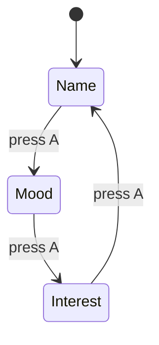

:::objectives
- Use a `mode` variable so a single forever loop owns the screen.
- Make a button press take effect immediately with **stop animation**.
- Change the LED brightness with **set brightness**.
- Test a program against a written checklist in the simulator.
- Wear the finished badge safely on battery power.
:::

A badge has one job: tell a stranger something about you in the two seconds they spend looking at it. That means the screen has to change the moment you press a button, not when the current scroll happens to finish. In the notes you saw why the obvious version reacts late. Here you'll build one that doesn't.

## What we're building

The badge has three screens. Button A moves to the next one, and button B switches between bright and dim on any screen.



```text
Name screen:      MAYA scrolls, over and over
Mood screen:      a happy face
Interest screen:  I LIKE ROBOTS scrolls, over and over
Button A:         next screen, immediately
Button B:         bright or dim
Logo (V2 only):   says hello with a sound
```

Use your own first name or a nickname in place of MAYA, and your own interest. Keep it to a first name: if you share the project link, everything in the code is public.

## Step 1: Scroll your name

Start a new project called `c4t-m2-badge`.

```makecode
basic.forever(function () {
    basic.showString("MAYA")
})
```

From **Basic**, drag **show string** into **forever** and type your name. The simulator scrolls it without stopping, because forever starts the scroll again as soon as the last one ends.

## Step 2: Add a mood button, the obvious way

```makecode
basic.forever(function () {
    basic.showString("MAYA")
})
input.onButtonPressed(Button.A, function () {
    basic.showIcon(IconNames.Happy)
})
```

Add **on button A pressed** from **Input**, with a **show icon** inside. Now test it like a visitor would: press A just as the first letter appears.

```text
The name keeps scrolling to the end.
Then the happy face shows for about half a second.
Then the name starts again.
```

Two problems. The face is late, because the handler's show request waits for the scroll to finish. And it doesn't stay, because forever takes the screen straight back. Fixing the second problem first makes the first one easy.

## Step 3: Give the badge modes

The fix for "forever takes the screen back" is to stop having two parts of the program draw. Let forever be the *only* code that touches the screen, and have it draw whichever screen a variable says is current. The button just changes the variable.

```makecode
let mode = 0
basic.forever(function () {
    if (mode == 0) {
        basic.showString("MAYA")
    } else if (mode == 1) {
        basic.showIcon(IconNames.Happy)
    } else {
        basic.showString("I LIKE ROBOTS")
    }
})
input.onButtonPressed(Button.A, function () {
    mode += 1
    if (mode > 2) {
        mode = 0
    }
})
```

To build it in blocks:

1. In **Variables**, click **Make a Variable...** and name it `mode`. Put **set mode to 0** in **on start**.
2. From **Logic**, drag an **if then else** into forever. Click its **+** to add an **else if**.
3. Use the **=** comparison from **Logic** for `mode = 0` and `mode = 1`.
4. In the A handler, use **change mode by 1** from **Variables**, then an **if** that sets `mode` back to 0 when it's bigger than 2.

The numbers stand for screens: 0 is the name, 1 is the mood, 2 is the interest. The `if (mode > 2)` check makes the count wrap around from 2 back to 0 instead of climbing forever. Press A in the simulator and the screen changes, and this time it stays changed. But it's still late: the new screen only appears once the current scroll finishes.

## Step 4: React the instant A is pressed

```makecode
input.onButtonPressed(Button.A, function () {
    mode += 1
    if (mode > 2) {
        mode = 0
    }
    led.stopAnimation()
})
```

Add **stop animation** from **LED › more** as the last block in the A handler. It cancels whatever the screen is in the middle of. The forever loop's current show block ends early, the loop finishes that pass, and about 20 ms later it starts a new pass, reads the new `mode`, and draws the right screen.

Notice that each branch of the forever loop has exactly one show block. That's deliberate. **stop animation** ends only the show block that's running right now, and the loop carries on with the rest of its pass. If the name branch showed a heart after the name, cancelling the name would let the heart play out for 0.6 seconds before the new screen appeared.

## Step 5: Dim and bright with button B

```makecode
input.onButtonPressed(Button.B, function () {
    if (led.brightness() > 100) {
        led.setBrightness(40)
    } else {
        led.setBrightness(255)
    }
})
```

Both blocks live in **LED › more**. Brightness runs from 0 (off) to 255 (full). This handler doesn't need its own variable: it asks the screen how bright it is right now and flips to the other setting. A dimmer badge is easier on people's eyes indoors and lighter on the batteries.

## Step 6: Say hello with the logo (V2 only)

```makecode
input.onLogoEvent(TouchButtonEvent.Pressed, function () {
    music.play(music.builtinPlayableSoundEffect(soundExpression.hello), music.PlaybackMode.InBackground)
})
```

**on logo pressed** is in **Input**; the **play sound** block and the **hello** sound are in **Music**. As soon as you add it, the simulator switches to a V2 board with a gold logo you can click. The handler makes a sound but never touches the screen, so it can't interfere with the modes. If your board is a V1, skip this step: logo blocks show error 927 there.

## Step 7: Test against a checklist

Testing means deciding what *should* happen before you look. Run each row in the simulator and tick it off only if the result matches.

| Test | Expected result |
| --- | --- |
| Let it run for 10 seconds | Your name scrolls again and again |
| Press A halfway through the name | The happy face appears at once and stays |
| Press A again, then again | The interest scrolls, then the name returns |
| From the name screen, press A five times fast | The badge ends on the interest screen |
| Press B, then B again | The screen dims, then goes back to full brightness |
| Click the logo | A hello sound plays and the screen doesn't change |

Why five presses land on the interest screen: 0 → 1 → 2 → 0 → 1 → 2. If it lands anywhere else, a press was lost or the wrap-around check is wrong.

## The finished program

```makecode title="c4t-m2-badge"
let mode = 0
basic.forever(function () {
    if (mode == 0) {
        basic.showString("MAYA")
    } else if (mode == 1) {
        basic.showIcon(IconNames.Happy)
    } else {
        basic.showString("I LIKE ROBOTS")
    }
})
input.onButtonPressed(Button.A, function () {
    mode += 1
    if (mode > 2) {
        mode = 0
    }
    led.stopAnimation()
})
input.onButtonPressed(Button.B, function () {
    if (led.brightness() > 100) {
        led.setBrightness(40)
    } else {
        led.setBrightness(255)
    }
})
input.onLogoEvent(TouchButtonEvent.Pressed, function () {
    music.play(music.builtinPlayableSoundEffect(soundExpression.hello), music.PlaybackMode.InBackground)
})
```

## Step 8: Wear it safely

Download the program to your board, unplug the USB cable, and connect the battery pack. Then make it wearable:

- Fasten the battery pack behind the board, with a case, a cardboard holder, or tape on the pack (not on the board's parts), so the wires never take the weight.
- Make sure nothing metal touches the back of the board or the gold strip along the bottom: no lanyard clips, zips, keys, or coins. Metal across the pins can short-circuit the board.
- If it feels warm, unplug the battery and check for anything touching the back.
- When you're done for the day, unplug the pack by pinching the plug, not by pulling the wires.

:::video tOgVbOG5QAo
MakeCode's own two-minute name tag tutorial. Watch which blocks it uses for scrolling the name: this build starts from the same idea and adds modes and instant buttons on top.
:::

:::quiz
Q: Why does only the forever loop draw on the screen, while the buttons just change `mode`?
- [ ] Event handlers aren't allowed to use show blocks
  They are allowed; Step 2 did exactly that.
- [x] With one part of the program drawing, the screen can't be taken back by another part
  In Step 2, forever overwrote the handler's face. With one owner, the screen always matches `mode`.
- [ ] It makes the program run faster
  Speed isn't the issue; the problem was two parts fighting over the screen.

Q: Suppose the name branch were `basic.showString("MAYA")` followed by `basic.showIcon(IconNames.Heart)`. You press A halfway through the name. What do you see?
- [ ] The mood face, immediately
  Stop animation only cancels the scroll; the heart block after it still runs.
- [x] The heart for about 0.6 seconds, then the mood face
  The cancelled scroll returns early, the rest of the pass runs, and only the next pass reads the new `mode`.
- [ ] The rest of the name, then the mood face
  The scroll really is cancelled; it's the block after it that gets in the way.

Q: From the name screen, how many presses of A bring you back to the name screen?
- [ ] 2
  Two presses take you to the interest screen (mode 2).
- [x] 3
  0 → 1 → 2 → 0: the third press wraps back to the name.
- [ ] 4
  The wrap happens on the third press, when `mode` would become 3.
:::

:::takeaways
- Let one forever loop own the screen and use a variable to choose what it draws.
- Event handlers change the variable; **stop animation** makes the change show up immediately.
- Keep one show block per branch, so cancelling it switches screens at once.
- Write the test checklist before you run it, with the expected result for each action.
- A wearable needs secured wires, no metal touching the back, and the battery unplugged when it's done.
:::

## Ideas to extend it

- Add a fourth screen, and make the wrap-around check use the new number.
- Shake to show a random mood: an **on shake** event that sets `mode` to 1 and picks one of three icons.
- Count visitors: each logo press adds 1 to a counter, and holding A and B together shows the total.
- Return to the name screen automatically after 10 seconds on any other screen, using **running time (ms)** from **Input**.

## Further reading

- [Name tag project](https://makecode.microbit.org/projects/name-tag): MakeCode's step-by-step version, with variations on scrolling speed.
- [stop animation reference](https://makecode.microbit.org/reference/led/stop-animation): what it cancels and a short example.
- [on logo event reference](https://makecode.microbit.org/reference/input/on-logo-event): the difference between pressed, touched, released, and long pressed.
