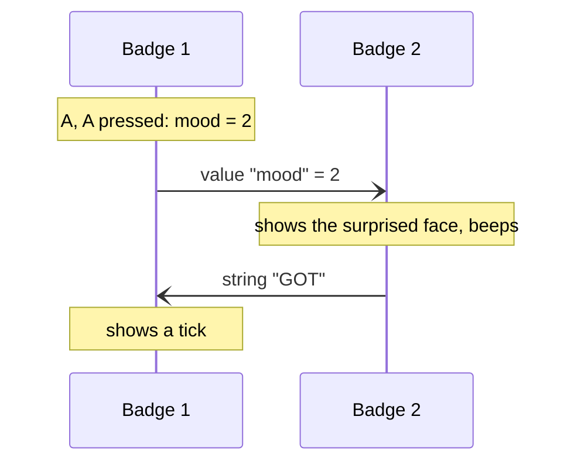

:::objectives
- Build a two-board messenger in MakeCode that sends a labelled value by radio.
- Add a receipt so the sender knows the message arrived, and a timeout for when it didn't.
- Test both badges at once in the MakeCode simulator.
- Port the program to MicroPython and explain each change you had to make.
:::

Here's the finished messenger in action. Each badge holds a mood. Button A flips through four faces on your own badge, and button B sends the current face to your partner. Your partner's badge shows the face and beeps, then quietly sends back a receipt. If a receipt arrives within a second, you see a tick. If it doesn't, you see a cross, so you know to try again.



Open makecode.microbit.org, start a **New Project**, and switch to **JavaScript** with the switch at the top. You can flip back to Blocks at any step to see the same code as blocks.

## Step 1: Pick a group and show it

Agree on a group number with your partner first. This build uses 7. Showing the number at start-up is a cheap way to catch the most common radio bug: two badges quietly set to different groups.

```makecode
radio.setGroup(7)
basic.showNumber(7)
```

The simulator now shows two micro:bits, and both scroll `7`. That's your first proof that the second board is running the same program.

## Step 2: Choose a mood with button A

The mood is a number from 0 to 3, and a function turns that number into a face. Keeping the drawing in one function means every part of the program shows moods the same way.

```makecode
let mood = 0
function showMood(m: number) {
    if (m == 0) {
        basic.showIcon(IconNames.Happy)
    } else if (m == 1) {
        basic.showIcon(IconNames.Sad)
    } else if (m == 2) {
        basic.showIcon(IconNames.Surprised)
    } else {
        basic.showIcon(IconNames.Asleep)
    }
}
input.onButtonPressed(Button.A, function () {
    mood = (mood + 1) % 4
    showMood(mood)
})
```

Press A on the top board four times. You should see sad, surprised, asleep, then happy again. The `% 4` wraps 3 back round to 0, so `mood` can never reach a number `showMood` doesn't know.

## Step 3: Send the mood with button B

`sendValue` sends a label and a number together. The label `"mood"` lets the receiver tell this message apart from anything else you add later.

```makecode
input.onButtonPressed(Button.B, function () {
    radio.sendValue("mood", mood)
    basic.showArrow(ArrowNames.North)
})
```

The arrow is the sender's "it left my badge" signal. It does **not** mean anyone heard it; remember the radio never tells you that.

## Step 4: Receive the mood and show it

Add the matching receive block. It checks the label before trusting the number.

```makecode
radio.onReceivedValue(function (name, value) {
    if (name == "mood") {
        showMood(value)
        music.playTone(880, 100)
    }
})
```

Test it: press A twice on the top board, then B. The top board shows an arrow and the bottom board shows the surprised face and beeps (if your browser plays simulator sound). Now try it the other way round. Both boards can send and receive, because both run every block.

```text
Top board:    surprised face -> arrow
Bottom board: surprised face (plus a short beep)
```

## Step 5: Send a receipt back

To know the message arrived, the receiver has to say so. Add one line to the receive block so it answers with the string `"GOT"`, and a string receiver that shows a tick when that answer comes back.

```makecode
radio.onReceivedValue(function (name, value) {
    if (name == "mood") {
        showMood(value)
        music.playTone(880, 100)
        radio.sendString("GOT")
    }
})
radio.onReceivedString(function (receivedString) {
    if (receivedString == "GOT") {
        basic.showIcon(IconNames.Yes)
    }
})
```

Press B on the top board again. The arrow should flick to a tick almost at once. Notice that the receipt is just another broadcast: in a room full of badges on group 7, everyone would see it. That's fine for a pair, and it's a problem you'll solve properly in the capstone.

## Step 6: Say so when no receipt arrives

A tick when things work is only half the job. If your partner is out of range, the sender should show a cross instead of an arrow that stays up forever. Two new variables remember whether we're waiting and when we sent. A `forever` loop checks the clock.

```makecode
let waiting = false
let sentAt = 0
input.onButtonPressed(Button.B, function () {
    radio.sendValue("mood", mood)
    basic.showArrow(ArrowNames.North)
    waiting = true
    sentAt = control.millis()
})
radio.onReceivedString(function (receivedString) {
    if (receivedString == "GOT") {
        waiting = false
        basic.showIcon(IconNames.Yes)
    }
})
basic.forever(function () {
    if (waiting && control.millis() - sentAt > 1000) {
        waiting = false
        basic.showIcon(IconNames.No)
    }
})
```

`control.millis()` is the number of milliseconds since the board started. Subtracting `sentAt` gives how long we've been waiting. Why not `basic.pause(1000)` after sending? Because a pause tells you nothing: you'd still have to find out whether `"GOT"` arrived during it. The waiting flag records exactly that.

To test the failure path in the simulator, you need the other board to stay silent. The easy way is to cheat for a moment: comment out `radio.sendString("GOT")` with `//`, press B, and watch the cross appear after a second. Put the line back when you're done.

## The finished program

```makecode title="mood-messenger"
let mood = 0
let waiting = false
let sentAt = 0
function showMood(m: number) {
    if (m == 0) {
        basic.showIcon(IconNames.Happy)
    } else if (m == 1) {
        basic.showIcon(IconNames.Sad)
    } else if (m == 2) {
        basic.showIcon(IconNames.Surprised)
    } else {
        basic.showIcon(IconNames.Asleep)
    }
}
input.onButtonPressed(Button.A, function () {
    mood = (mood + 1) % 4
    showMood(mood)
})
input.onButtonPressed(Button.B, function () {
    radio.sendValue("mood", mood)
    basic.showArrow(ArrowNames.North)
    waiting = true
    sentAt = control.millis()
})
radio.onReceivedValue(function (name, value) {
    if (name == "mood") {
        showMood(value)
        music.playTone(880, 100)
        radio.sendString("GOT")
    }
})
radio.onReceivedString(function (receivedString) {
    if (receivedString == "GOT") {
        waiting = false
        basic.showIcon(IconNames.Yes)
    }
})
basic.forever(function () {
    if (waiting && control.millis() - sentAt > 1000) {
        waiting = false
        basic.showIcon(IconNames.No)
    }
})
radio.setGroup(7)
basic.showNumber(7)
```

If you have two real micro:bits, click **Download** and copy the same program to both. Hand one to a friend and walk apart until the ticks turn into crosses: that's your real range.

## Port it to MicroPython

Now open python.microbit.org in a new tab and rebuild the same badge in MicroPython. Paste this in, then run it in the editor's simulator. MicroPython code can't run as ordinary Python on your laptop; it stops with an error at `from microbit import *` because that module lives on the micro:bit.

```python title="mood_messenger.py"
from microbit import *
import radio
import music

MOODS = [Image.HAPPY, Image.SAD, Image.SURPRISED, Image.ASLEEP]
mood = 0
waiting = False
sent_at = 0

radio.config(group=7)
radio.on()
display.scroll("7")

while True:
    if button_a.was_pressed():
        mood = (mood + 1) % 4
        display.show(MOODS[mood])
    if button_b.was_pressed():
        radio.send("mood:" + str(mood))
        display.show(Image.ARROW_N)
        waiting = True
        sent_at = running_time()
    message = radio.receive()
    if message:
        if message.startswith("mood:"):
            display.show(MOODS[int(message[5:])])
            music.pitch(880, 100)
            radio.send("GOT")
        elif message == "GOT":
            waiting = False
            display.show(Image.YES)
    if waiting and running_time() - sent_at > 1000:
        waiting = False
        display.show(Image.NO)
    sleep(20)
```

The Python editor's simulator shows only one micro:bit, so you play the partner yourself. Open the **Radio** panel under the simulator and type `mood:2` into the message box: the face should change. Press B on the simulated board and type `GOT` within a second to get a tick; wait longer and you'll get the cross.

Here's what changed, and why:

| MakeCode | MicroPython | Why it changed |
| --- | --- | --- |
| Five event blocks | One `while True` loop | MicroPython has no radio event, so the loop checks buttons and messages on every pass |
| `radio.sendValue("mood", 2)` | `radio.send("mood:2")` | MicroPython sends text only, so the label and number share one string |
| `value` arrives as a number | `int(message[5:])` | Slice off the five characters `mood:`, then turn the rest into a number |
| `showMood` with an `if` chain | `MOODS[mood]` | Python lists can hold images, so one lookup replaces the chain |
| `control.millis()` | `running_time()` | Same idea, different name |
| `radio.setGroup(7)` | `radio.config(group=7)` | MicroPython sets every radio option through `config` |

`button_a.was_pressed()` deserves a note. It answers "has A been pressed since I last asked?", so a quick tap during `display.scroll` still counts on the next pass. That's how a loop-based program avoids missing presses.

Remember that these two versions can't talk to each other. A MakeCode badge doesn't understand MicroPython's packets, and the other way round, so both badges in a pair need the same version.

:::video rvegdyumjrA
What to watch for: the same two-board radio program shown in the MakeCode block editor and in a Python editor, then run on real micro:bits. The editors look older than today's, but the code lines up with the table above.
:::

:::quiz
Q: Why does the receiver send `"GOT"` back instead of the sender just assuming the mood arrived?
- [ ] `sendValue` only works if the receiver replies
  A `sendValue` packet is broadcast whether or not anyone answers.
- [x] The radio gives the sender no delivery confirmation, so only a reply can prove the message arrived
  Broadcasts have no receipt built in. The `"GOT"` string is a receipt you designed yourself.
- [ ] It keeps the two boards on the same group
  The group is set once by `radio.setGroup`; replies don't change it.

Q: The timeout check lives in a `forever` loop instead of `basic.pause(1000)` after sending. What does that buy you?
- [x] The program keeps running and can notice the moment `waiting` becomes false
  The flag records whether `"GOT"` arrived; the loop just compares the clock against `sentAt`.
- [ ] Faster radio messages
  The radio's speed doesn't change; only how the sender keeps track of time.
- [ ] It stops button A from working while waiting
  Nothing here blocks button A, and freezing buttons is the opposite of the goal.

Q: In the MicroPython version, why is the message `"mood:2"` and not just `"2"`?
- [ ] MicroPython can't send digits
  It can send any text, digits included.
- [x] The label tells the receiver what the number means, so other messages like `"GOT"` can share the same radio
  With only one `radio.receive()`, every kind of message arrives in the same place, so the text must say what it is.
- [ ] Strings must be at least six characters
  There's no minimum length.
:::

:::takeaways
- Show the radio group on start-up; it turns the most common silent bug into something you can see.
- Label your messages (`sendValue` in MakeCode, a prefix like `mood:` in MicroPython) so one board can handle several kinds.
- A receipt plus a timeout turns "I sent it" into "they got it" or "they didn't", which is the difference between a toy and a tool.
- Porting to MicroPython means replacing events with a loop that checks, packing numbers into text, and using Python's own names.
:::

## Ideas to extend it

- Add more moods (there are dozens of `IconNames`), and keep the `% 4` in step with the count.
- Show how far away your partner is: in the receive block, plot `radio.receivedPacket(RadioPacketProperty.SignalStrength) + 128` as a bar graph out of 100.
- Resend automatically up to three times before showing the cross.
- Shake to send a "wave" string that plays a short tune on the other badge.

## Further reading

- [MakeCode Micro Chat project](https://makecode.microbit.org/projects/micro-chat): a short official tutorial for a two-board radio chat, good for comparing with your messenger.
- [micro:bit Python Editor guide](https://microbit.org/get-started/user-guide/python-editor/): a tour of the Reference, Ideas, and simulator panels you used for the port.
- [MicroPython radio module](https://microbit-micropython.readthedocs.io/en/v2-docs/radio.html): the full list of `radio.config` options, including queue length and transmit power.
