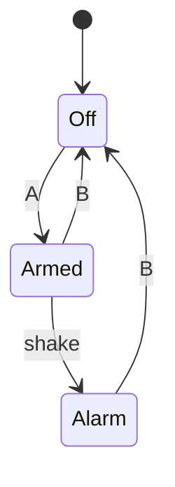

:::objectives
- Tell polling code from event-driven code at a glance.
- Model devices and games as states, then code them with a `state` variable.
- Use `control.millis()` for stopwatches, delays, and random timings.
- Find bugs caused by pausing inside a handler.
:::

Each exercise is a fresh MakeCode project. For the state exercises, sketch the states and arrows on paper before you write code; it takes two minutes and saves twenty.

## Warm-up: polling or events?

Which of these will count every quick press of A, and which will miss some?

```makecode title="snippet 1"
basic.forever(function () {
    if (input.buttonIsPressed(Button.A)) {
        score += 1
        basic.showNumber(score)
    }
})
```

```makecode title="snippet 2"
input.onButtonPressed(Button.A, function () {
    score += 1
})
```

```makecode title="snippet 3"
loops.everyInterval(2000, function () {
    if (input.buttonIsPressed(Button.A)) {
        score += 1
    }
})
```

:::solution
Only snippet 2 counts every press, because it's an event handler. Snippets 1 and 3 poll. Snippet 3 checks just once every two seconds, so it misses almost everything. Snippet 1 checks often, but it stops checking whenever a two-digit score is scrolling, and a long hold counts several times because the loop sees the button still down on the next pass.
:::

### Exercise 1: A people counter that doesn't lie

This counter for a club door misses people and sometimes counts one person twice. Rewrite it so every press of A counts exactly once, and pressing B resets the count to zero.

```makecode
let people = 0
basic.forever(function () {
    if (input.buttonIsPressed(Button.A)) {
        people += 1
    }
    basic.showNumber(people)
    basic.pause(500)
})
```

:::hint
Move the counting into `input.onButtonPressed`. The `forever` loop should only draw.
:::

:::solution
```makecode
let people = 0
input.onButtonPressed(Button.A, function () {
    people += 1
})
input.onButtonPressed(Button.B, function () {
    people = 0
})
basic.forever(function () {
    basic.showNumber(people)
})
```

`onButtonPressed` fires once per press-and-release, so a long hold counts as one person, and the scheduler catches taps even while a number scrolls.
:::

### Exercise 2: A three-way lamp

Button A cycles the lamp through off, dim, and bright, then back to off. When on, every LED lights up.

```text
A -> dim (all LEDs, faint)
A -> bright (all LEDs, full)
A -> off
```

:::hint
Use numbers for the states: 0 off, 1 dim, 2 bright. `(lamp + 1) % 3` moves to the next one. `led.setBrightness` takes 0 to 255.
:::

:::solution
```makecode
let lamp = 0
input.onButtonPressed(Button.A, function () {
    lamp = (lamp + 1) % 3
})
basic.forever(function () {
    if (lamp == 0) {
        basic.clearScreen()
    } else {
        if (lamp == 1) {
            led.setBrightness(30)
        } else {
            led.setBrightness(255)
        }
        basic.showLeds(`
            # # # # #
            # # # # #
            # # # # #
            # # # # #
            # # # # #
            `)
    }
})
```

The handler only changes the state; the loop turns the state into light. Adding a fourth mode means changing `% 3` to `% 4` and adding one branch.
:::

### Exercise 3: Stopwatch

Press A to start; press A again to stop and show the time in seconds with one decimal place. Press B to reset, but only when the stopwatch is stopped.

```text
A ... (about 3.4 s) ... A  ->  scrolls 3.4
B                          ->  shows 0
```

:::hint
Three states: `READY`, `RUNNING`, `STOPPED`. Save `control.millis()` when you start, and work out `elapsed` when you stop. `Math.round(elapsed / 100) / 10` gives one decimal place.
:::

:::solution
```makecode
let state = "READY"
let startTime = 0
let elapsed = 0
input.onButtonPressed(Button.A, function () {
    if (state == "READY") {
        startTime = control.millis()
        state = "RUNNING"
        basic.showIcon(IconNames.Heart)
    } else if (state == "RUNNING") {
        elapsed = control.millis() - startTime
        state = "STOPPED"
        basic.showNumber(Math.round(elapsed / 100) / 10)
    }
})
input.onButtonPressed(Button.B, function () {
    if (state == "STOPPED") {
        state = "READY"
        basic.showNumber(0)
    }
})
basic.showNumber(0)
```

B does nothing while running because there's no `RUNNING` branch in its handler. Deciding what *not* to respond to is half of state design.
:::

### Exercise 4: Read a program, draw its states

Draw the state diagram for this bike alarm. List every state and label every arrow with its event.

```makecode
let state = "OFF"
input.onButtonPressed(Button.A, function () {
    if (state == "OFF") {
        state = "ARMED"
    }
})
input.onButtonPressed(Button.B, function () {
    state = "OFF"
})
input.onGesture(Gesture.Shake, function () {
    if (state == "ARMED") {
        state = "ALARM"
    }
})
```

:::hint
B has no `if`, so it works from every state. Shake only does something in one state.
:::

:::solution


There's no arrow from `Off` on shake, so bumping a disarmed bike does nothing, and no arrow from `Alarm` on A, so a thief pressing A can't silence it.
:::

### Exercise 5: The alarm that arms itself after you cancel it

The owner wants a ten-second delay after pressing A so they can walk away. A student added a pause. Now if you press A and then B within ten seconds, the alarm shows "off" and arms anyway a few seconds later. Explain the bug and fix it.

```makecode
let state = "OFF"
input.onButtonPressed(Button.A, function () {
    if (state == "OFF") {
        basic.showIcon(IconNames.Asleep)
        basic.pause(10000)
        state = "ARMED"
        basic.showIcon(IconNames.Target)
    }
})
input.onButtonPressed(Button.B, function () {
    state = "OFF"
    basic.clearScreen()
})
```

:::hint
While A's handler sleeps, B's handler runs and sets `OFF`. Then A's handler wakes up and carries on with the next line. Give the delay its own state and let a loop finish it.
:::

:::solution
The paused handler doesn't know the world changed while it slept; it blindly runs `state = "ARMED"`. The fix is an `ARMING` state with a saved time, checked by the `forever` loop:

```makecode
let state = "OFF"
let armAt = 0
input.onButtonPressed(Button.A, function () {
    if (state == "OFF") {
        state = "ARMING"
        armAt = control.millis() + 10000
        basic.showIcon(IconNames.Asleep)
    }
})
input.onButtonPressed(Button.B, function () {
    state = "OFF"
    basic.clearScreen()
})
basic.forever(function () {
    if (state == "ARMING" && control.millis() >= armAt) {
        state = "ARMED"
        basic.showIcon(IconNames.Target)
    }
})
```

Now B during the delay moves the state to `OFF`, and the loop's check for `ARMING` is simply false from then on.
:::

### Exercise 6: Red light, green light

Build the playground game for one player. Press B to start. While the light is green (show a bar graph of your progress), each press of A is a step. The light flips between green and red at random times, one to three seconds apart; red shows a cross. Pressing A on red puts you out (skull). Reach 20 steps to win (happy face). B starts a new game after a win or a loss.

:::hint
States: `READY`, `GREEN`, `RED`, `OUT`, `WIN`. Store `switchAt = control.millis() + randint(1000, 3000)`. In the `forever` loop, if the state is `GREEN` or `RED` and the time has passed, flip the colour and pick a new `switchAt`.
:::

:::solution
```makecode
let state = "READY"
let steps = 0
let switchAt = 0
input.onButtonPressed(Button.B, function () {
    if (state == "READY" || state == "OUT" || state == "WIN") {
        steps = 0
        state = "GREEN"
        switchAt = control.millis() + randint(1000, 3000)
    }
})
input.onButtonPressed(Button.A, function () {
    if (state == "GREEN") {
        steps += 1
        if (steps >= 20) {
            state = "WIN"
        }
    } else if (state == "RED") {
        state = "OUT"
    }
})
basic.forever(function () {
    if ((state == "GREEN" || state == "RED") && control.millis() >= switchAt) {
        if (state == "GREEN") {
            state = "RED"
        } else {
            state = "GREEN"
        }
        switchAt = control.millis() + randint(1000, 3000)
    }
    if (state == "GREEN") {
        led.plotBarGraph(steps, 20)
    } else if (state == "RED") {
        basic.showIcon(IconNames.No)
    } else if (state == "OUT") {
        basic.showIcon(IconNames.Skull)
    } else if (state == "WIN") {
        basic.showIcon(IconNames.Happy)
    } else {
        basic.showString("B")
    }
})
```

Try making it fairer: ignore a press on red if it arrives within 200 ms of the switch, since nobody reacts that fast. That's one more condition using the time you saved in `switchAt`.
:::

### Challenge: Hot potato over radio

Two boards on the same group. Pressing B on one board starts a game: it picks a secret fuse of 5 to 15 seconds and becomes the holder. The holder shows a diamond and must shake to throw the potato to the other board, which becomes the holder for the rest of the fuse. Whoever is holding when the fuse runs out shows a skull and tells the other board, which shows a happy face.

:::hint
Each board's `control.millis()` counts from when *that* board started, so you can't send an end time from one board to the other. Send the time remaining instead, `radio.sendValue("potato", explodeAt - control.millis())`, and let the catcher add it to its own clock.
:::

:::solution
```makecode
let state = "WAITING"
let explodeAt = 0
radio.setGroup(5)
input.onButtonPressed(Button.B, function () {
    if (state != "HOLDING") {
        explodeAt = control.millis() + randint(5000, 15000)
        state = "HOLDING"
    }
})
input.onGesture(Gesture.Shake, function () {
    if (state == "HOLDING") {
        radio.sendValue("potato", explodeAt - control.millis())
        state = "WAITING"
        basic.clearScreen()
    }
})
radio.onReceivedValue(function (name, value) {
    if (name == "potato") {
        explodeAt = control.millis() + value
        state = "HOLDING"
    }
})
radio.onReceivedString(function (receivedString) {
    if (receivedString == "BOOM") {
        state = "SAFE"
        basic.showIcon(IconNames.Happy)
    }
})
basic.forever(function () {
    if (state == "HOLDING") {
        if (control.millis() >= explodeAt) {
            state = "BOOM"
            radio.sendString("BOOM")
            basic.showIcon(IconNames.Skull)
        } else {
            basic.showIcon(IconNames.Diamond)
        }
    }
})
```

The game would be unplayable if each board kept its own fuse; sending the remaining time is what makes one fuse burn across two devices.
:::

The video below shows the same move you made in Exercises 5 and 6: replacing a tangle of true/false flags with one clear state variable.

:::video -ZP2Xm-mY4E start=0:54
What to watch for: from 0:54 to about 6:00, how flag-based game code goes wrong and how listing states with explicit transitions fixes it. The later "state pattern" section goes further than you need here.
:::
