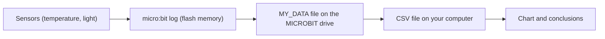

:::objectives
- Plan a log: the question, the columns, how often to sample, and for how long.
- Record rows with the data logger extension on a micro:bit V2 (or in the simulator).
- Get the log off the board as a CSV file.
- Read a CSV in Python, summarise it, and chart it to spot a pattern.
:::

At 10:00 the micro:bit on the windowsill says 21 °C. Is that warm? Is the room heating up or cooling down? Is the window warmer than the door? One number can't answer any of those. Twenty-one readings taken thirty seconds apart can, and by the end of this lesson you'll read a log like that and find something in it you couldn't have seen live.

## Plan the log before you press start

Data logging means recording measurements over time, so you can study them later. The micro:bit V2 can store a table of readings in its own memory, and it keeps them even when the battery is unplugged. Before you write any code, answer four questions:

1.  **What's the question?** "Does sunlight on the windowsill warm the board, and how fast?" is a question. "Collect temperature" isn't.
2.  **What columns do you need?** Here: temperature and light level. The logger adds a time column for you.
3.  **How often?** Fast enough to catch the change you care about. Sunlight warming a room changes over minutes, so every 30 seconds is plenty. A falling object changes in milliseconds and would need much faster logging.
4.  **For how long?** Long enough to see the whole change, plus a little before and after.

Multiply it out before you start: logging every 30 seconds for 10 minutes gives 600 ÷ 30 = 20 readings, plus the first one at time zero, so 21 rows. Every 10 seconds for a whole school day would give thousands. The log's space is limited, so a sensible interval is part of the plan.



## Record rows with the data logger

Logging lives in an extension. In MakeCode, click **Extensions** in the block list, search for `datalogger`, and add it. It needs a micro:bit V2; on a V1 board the program stops with error code 927. This program logs temperature and light every 30 seconds, and button A starts and stops it:

```makecode title="window-logger"
let logging = false
datalogger.includeTimestamp(FlashLogTimeStampFormat.Seconds)
datalogger.setColumnTitles("temperature", "light")
input.onButtonPressed(Button.A, function () {
    logging = !logging
    if (logging) {
        basic.showIcon(IconNames.Heart)
    } else {
        basic.clearScreen()
    }
})
loops.everyInterval(30000, function () {
    if (logging) {
        datalogger.log(
            datalogger.createCV("temperature", input.temperature()),
            datalogger.createCV("light", input.lightLevel())
        )
    }
})
datalogger.onLogFull(function () {
    logging = false
    basic.showIcon(IconNames.No)
})
```

Line by line:

- `includeTimestamp(...Seconds)` adds a `Time (seconds)` column to every row automatically.
- `setColumnTitles` fixes the column names and their order before the first row is written. Do it once, at the start.
- `createCV("temperature", ...)` pairs a column name with a value ("CV" means column-value), and `datalogger.log` writes one row made of those pairs.
- `loops.everyInterval(30000, ...)` runs every 30 seconds, and the `logging` flag decides whether a row is written. The heart tells you, from across the room, that logging is on.
- `onLogFull` runs when there's no space left. Stopping and showing a cross is much better than silently losing data.

In the simulator, press A, drag the thermometer and the light control around, and click **Show data** under the simulator to watch the rows appear. Shorten the interval to 1000 while testing so you aren't waiting half a minute per row.

## Get the log off the board

:::tabs
@tab Real micro:bit V2
1.  Plug the micro:bit into a computer with a USB cable. It appears as a drive called **MICROBIT**.
2.  Open the **MY_DATA** file on that drive. It opens in your web browser as a table of your rows.
3.  Click **Download** to save the table as a CSV file. **Copy** puts it on the clipboard for a spreadsheet, and the visual preview draws a quick chart in the page.
@tab Simulator
1.  Run the program and log a few rows.
2.  Click **Show data** under the simulator to open the data view.
3.  Use the download button above the chart to save the data as a file on your computer.
:::

CSV means **comma-separated values**: a plain text file with one row per line and commas between the columns. Every spreadsheet can open it, and so can Python. A log from the windowsill experiment starts like this:

```text
Time (seconds),temperature,light
0,21,40
30,21,41
60,21,39
```

## Read the CSV in Python

The next cell writes that file to disk, standing in for the CSV you'd download. It holds ten minutes of readings, and partway through, a patch of sunlight reached the windowsill.

```python run title="make_my_data.py"
log = """Time (seconds),temperature,light
0,21,40
30,21,41
60,21,39
90,21,42
120,22,40
150,21,41
180,21,40
210,21,43
240,21,41
270,21,42
300,21,182
330,21,185
360,22,183
390,22,186
420,22,184
450,23,187
480,23,185
510,23,186
540,24,184
570,24,188
600,24,186
"""
with open("my_data.csv", "w") as f:
    f.write(log)
print("saved my_data.csv")
```

Now read it the way you'd read any downloaded log. `csv.DictReader` turns each line into a dictionary keyed by the header, so `row["light"]` is that row's light reading, as text. That's why each value goes through `float` or `int` before any maths.

```python run title="summarise.py"
import csv

with open("my_data.csv") as f:
    rows = list(csv.DictReader(f))

times = [float(row["Time (seconds)"]) for row in rows]
temps = [int(row["temperature"]) for row in rows]
lights = [int(row["light"]) for row in rows]

print("rows:", len(rows))
print("temperature: min", min(temps), "max", max(temps),
      "mean", round(sum(temps) / len(temps), 1))
print("light: min", min(lights), "max", max(lights))
```

The summary says the temperature went from 21 to 24 and the light from about 40 to almost 190. It doesn't say *when*, or which changed first. A chart does:

```python run alt="Two line charts sharing a time axis: light jumps from about 40 to 185 at 300 seconds, while temperature stays at 21 and only climbs to 24 over the following five minutes" caption="Light jumps at 300 s; temperature follows slowly"
import matplotlib.pyplot as plt

fig, (top, bottom) = plt.subplots(2, 1, sharex=True, figsize=(7, 5))
top.plot(times, lights, marker="o", color="#e0a030")
top.set_ylabel("light (0-255)")
top.set_title("Windowsill log")
bottom.plot(times, temps, marker="o", color="#c0504d")
bottom.set_ylabel("temperature (°C)")
bottom.set_xlabel("time (seconds)")
```

The light changes in one step, between 270 and 300 seconds. The temperature doesn't move at that moment; it creeps up over the next five minutes. You'd never notice that lag standing next to the board, but it's obvious once the readings sit on one time axis.

## Noise, lag, and what a log can't tell you

Look at 120 seconds: the temperature reads 22, then drops back to 21. Nothing in the room changed. Sensors jitter by a step or so, and a single bump isn't a trend. Two habits help: look for changes that last several rows, and compare averages of a few readings rather than single values. The next cell finds the moment the light changed most, then the first time the temperature reached 23:

```python run title="lag.py"
jumps = [lights[i] - lights[i - 1] for i in range(1, len(lights))]
biggest = jumps.index(max(jumps)) + 1
print("light jumped by", max(jumps), "at", times[biggest], "s")

for i in range(len(temps)):
    if temps[i] >= 23:
        print("temperature first reached 23 at", times[i], "s")
        print("lag:", times[i] - times[biggest], "s")
        break
```

About two and a half minutes passed between the light arriving and the temperature reaching 23. One more thing to keep in mind: the micro:bit measures temperature with a sensor inside its processor, so direct sun on the board warms the chip itself. That makes it a fine detector of "the sun is on me" and a rougher measure of the air in the room. Knowing what your sensor actually measures is part of reading the data honestly.

:::video TFGeefF82o8
What to watch for: adding the data logging extension and setting columns, then from 4:00 opening the data on a computer, and from 8:50 why a log can split into several "data sections".
:::

## Mistakes that cost you your data

:::warning
**Flashing new code before copying your data.** Downloading a new program to the micro:bit clears the log so it can start fresh. Fix: open MY_DATA and download the CSV *first*, then change the program.
:::

:::warning
**Changing column names halfway.** A row logged with `createCV("temp", ...)` after the header says `temperature` creates a new column, and the MY_DATA page splits into separate sections. Fix: set all the column titles once at the start and copy the names exactly.
:::

:::warning
**Reading the time column as a clock.** `Time (seconds)` counts from when the board last reset, not the time of day. Pressing reset or swapping batteries starts it at zero again. Fix: write down the real start time in your notes.
:::

:::quiz
Q: You log every 15 seconds for 2 hours. About how many rows will the log have?
- [ ] 120
  That's one row per minute; every 15 seconds is four rows per minute.
- [x] About 480
  2 hours is 7,200 seconds, and 7,200 ÷ 15 = 480 (plus the first row at time zero).
- [ ] 7,200
  That would be one row every second.

Q: You fix a small bug and click Download to flash the new program, then open MY_DATA to grab yesterday's readings. What do you find?
- [ ] Yesterday's rows, followed by any new ones
  Flashing a new program marks the old log as erased.
- [x] An empty log, because flashing a new program clears it
  Always copy the CSV before you change the program on the board.
- [ ] Yesterday's rows, but with the times reset to zero
  The rows themselves are gone from the MY_DATA view, not just renumbered.

Q: In the windowsill log, light jumped at 300 s and the temperature climbed from about 360 s. Which conclusion does the data support?
- [x] Something made the windowsill much brighter, and the board warmed up gradually afterwards
  The data shows the order and the delay. It's one run, so you'd repeat it before claiming a general rule.
- [ ] Temperature and light rose at the same time
  The chart shows the light changing in one step and the temperature lagging by minutes.
- [ ] The room's air warmed by exactly 3 °C
  The sensor sits in the processor, so sunlight on the board can warm the chip more than the air.
:::

:::takeaways
- Plan before logging: question, columns, interval, duration. Work out the row count up front.
- The data logger writes rows of column-value pairs with `datalogger.log(datalogger.createCV(...))`; set column titles and the timestamp once, at the start.
- On a V2, MY_DATA on the MICROBIT drive downloads the log as a CSV. In the simulator, use **Show data**.
- A chart on a shared time axis shows order and lag that a summary can't.
- Single bumps are noise; trends last several rows. Know what your sensor really measures.
:::

## Further reading

- [micro:bit data logging guide](https://microbit.org/get-started/user-guide/data-logging/): the official guide to planning a log, reading MY_DATA, timestamps, and erasing.
- [MakeCode datalogger reference](https://makecode.microbit.org/reference/datalogger): every data logger block, with examples of column titles and timestamps.
- [Python's csv module](https://docs.python.org/3/library/csv.html): the reference for `DictReader` and friends, for when your logs get bigger.
