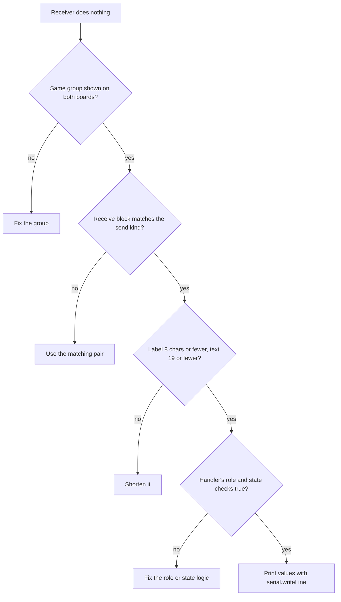

:::objectives
- Write a test plan that covers normal use, edge cases, failures, and scale.
- Measure how reliable your radio link is and chart the result.
- Track down a silent board with a step-by-step checklist.
- Document the invention so someone else could build it, including safety notes.
- Present a short demo and assess your work against the rubric.
:::

Your network works on your desk. Then you carry the teacher board to the front of a real classroom, twenty-five people press buttons in the same second, and three of them see crosses. That isn't failure; that's what testing is for. A project that has been tested shows you exactly where it breaks, which is far more useful than one that's never been pushed.

## Write the test plan before you test

A test plan is a table of things to try, each with the result you expect *before* you try it. Writing the expected result first stops you from deciding afterwards that whatever happened was fine. Cover four kinds of test:

- **Normal use:** the main job, done the way you intended.
- **Edge cases:** legal but unusual actions, like pressing buttons twice or at the wrong moment.
- **Failures:** something goes wrong on purpose, like a lost message or a board out of range.
- **Scale:** more devices, more messages, or a longer run than your desk test.

Here's a plan for the voting network. Make yours the same shape, and fill in the last column as you go.

| # | Kind | Do this | Expect | Result |
| --- | --- | --- | --- | --- |
| 1 | normal | Open poll, vote A, close | Teacher shows `A`; log row 1, 0, 1 | |
| 2 | edge | Vote before the poll opens | Voter stays asleep; nothing counted | |
| 3 | edge | Press A three times while voting | Counted once | |
| 4 | edge | Close the poll while a vote is retrying | Voter returns to sleep, no cross | |
| 5 | failure | Disable the `ack` line, then vote | Arrow, retries, then a cross | |
| 6 | failure | Teacher out of range (real boards) | Cross after about 3 to 5 seconds | |
| 7 | scale | 10+ real voters vote at once | Every voter gets a tick within 5 s | |
| 8 | scale | Two classes on groups 31 and 32 | Neither poll counts the other's votes | |

Tests 6 to 8 need real boards. If you're simulator-only, say so in your documentation and explain what you'd expect; a clear "not tested, and here's why" is better than silence.

## Measure reliability, don't guess it

"It works from across the room" is an opinion. "19 of 20 messages arrived at 20 metres" is a measurement. To test range, put a sender at one end of a corridor and a receiver that counts messages at the other. Send 20 numbered messages at each distance and record how many arrived. Here's the sort of log one test might produce, charted:

```python run alt="Bar chart of percentage of messages received at distances of 1, 5, 10, 20, 30 and 40 metres: 100, 100, 100, 95, 75 and 30 percent" caption="Messages received out of 20 at each distance (example test)"
import matplotlib.pyplot as plt

distance_m = [1, 5, 10, 20, 30, 40]
received = [20, 20, 20, 19, 15, 6]
percent = [100 * r / 20 for r in received]

plt.bar([str(d) + " m" for d in distance_m], percent, color="#5b8def")
plt.axhline(90, color="#888888", linestyle="--")
plt.ylabel("messages received (%)")
plt.xlabel("distance between boards")
plt.ylim(0, 105)
for d, p in zip(distance_m, percent):
    print(d, "m:", round(p), "%")
```

The dashed line marks a 90% target. In this example the link is solid up to 20 metres and falls apart past 30, so a voting network in one classroom is safe, and one spread across a building isn't. Your numbers will differ with walls, bodies, and transmit power, which is exactly why you measure your own. Record where you tested (corridor, open field, through a door) next to the numbers.

## When a board stays silent

Radio bugs rarely crash; the receiver just does nothing. Work through the checks in order, because each one is quicker than the next:



The last step is your general-purpose tool. `serial.writeLine("got " + name + " " + value)` at the top of a receive handler shows every message in the **Show data** console, so you can see whether it arrived and what it really contained. Delete the debug lines once the bug is fixed.

## Document it so someone else could build it

Your documentation is a README: one page that lets a classmate rebuild and use your network without asking you anything. Use this outline:

```text
# Project name
One paragraph: what it does, who it's for, what problem it solves.

## How to use it
Step by step, from "flash this program to every board" to the result.
What each screen means (a small table of icons and states).

## How it works
Roles. Protocol table (message | kind | from -> to | meaning).
State diagram for each role. Radio group used.

## Data
What is logged, column names, how to download it, one chart and
what it shows.

## Testing
Your test plan table with results. Known problems and limits
(for example, "untested beyond 10 voters").

## Safety
Power, batteries, wiring, water, and privacy notes that apply.

## What I'd do next
Two or three concrete improvements.
```

The "known problems" line matters. Every real project has limits, and stating them shows you understand your design.

## Safety notes worth copying

Pick the ones that apply and put them in your README's Safety section:

- Power each board only from its USB cable or its own battery pack; hold boards by the edges.
- Don't mix old and new batteries, and keep loose wires and clips from touching both battery terminals.
- Keep electronics clear of water. If a board gets wet, unplug it and let it dry fully before use.
- Never connect anything in the project to mains power.
- Radio is readable by anyone on your group: don't send names, passwords, or private information.
- For anything worn or carried while moving, secure cables and boards so nothing snags or trips.

## Present it in three minutes

A good demo is short and shows the hard part working. This shape fits in three minutes:

1.  **The problem** (20 seconds): who has it and why it matters. "Hand-count votes get miscounted and nobody can check."
2.  **The normal case** (60 seconds): run it live in the simulator or on real boards.
3.  **The failure case** (40 seconds): break something on purpose and show the feedback. This is the part audiences remember.
4.  **The data** (30 seconds): one chart and what it tells you.
5.  **What's next** (30 seconds): your top improvement and the limit it would fix.

Practise once with a timer. Have a recorded backup (a screen recording of the simulator) in case the live demo misbehaves.

## Rubric

| Criterion | Getting there | Solid | Excellent |
| --- | --- | --- | --- |
| Works as specified | Main job works sometimes | Main job works reliably in tests | Works reliably, including edge cases in the plan |
| Radio protocol | Messages work but aren't documented | Protocol table matches the code | Table matches code; every important message has a reply |
| Events and states | Some polling; states unclear | Events for inputs; one state machine with a diagram | Every role has a diagram that matches its code exactly |
| Failure feedback | None | Lost messages or silent devices are shown | Shown and recoverable (retry, re-join) |
| Data and analysis | Data recorded but not used | CSV exported and charted | Chart answers the planned question, with a stated conclusion |
| Testing | A few informal tries | Test plan with expected and actual results | Plan covers all four kinds; reliability measured |
| Documentation and safety | Partial README | Complete README with safety notes | Someone else rebuilt it from the README alone |
| Presentation | Over time or no demo | Clear demo of the normal case | Normal case, failure case, and data in three minutes |

## Reflect

Write a short answer to each question at the end of your README:

- Which bug took longest to find, and which step of the silent-board checklist would have found it faster?
- Where did your state diagram and your code disagree, and which one was right?
- What did your data show that you didn't expect?

## Where to go next

You've built a network of devices that sense, decide, talk, and record. Some directions from here:

- **Go deeper in MicroPython** at python.microbit.org. Rebuild your network in Python, with the `log` module for data logging and `radio.receive_full()` for signal strength and timing.
- **Train a model on movement** with micro:bit CreateAI, then use its output as an event in a MakeCode program.
- **Browse real projects** in the micro:bit "Make it: code it" collection for sensors, radio, and data logging ideas you can extend.

:::video kqNy5N3WLtM
What to watch for: how CreateAI turns movement data recorded from a micro:bit into a trained model, and how the result runs on the board as a new kind of input. It's the same pipeline you used for data logging, with a model at the end instead of a chart.
:::

## Further reading

- [micro:bit CreateAI](https://createai.microbit.org/): the free browser tool for training movement models and using them in MakeCode.
- [Make it: code it projects](https://microbit.org/projects/make-it-code-it/): the Micro:bit Educational Foundation's project library, filterable by feature and difficulty.
- [micro:bit Python Editor](https://python.microbit.org/): the editor and simulator for taking your network into MicroPython.
